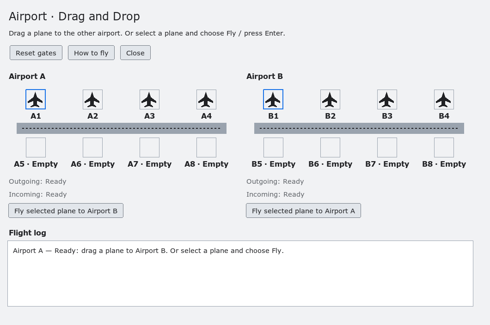
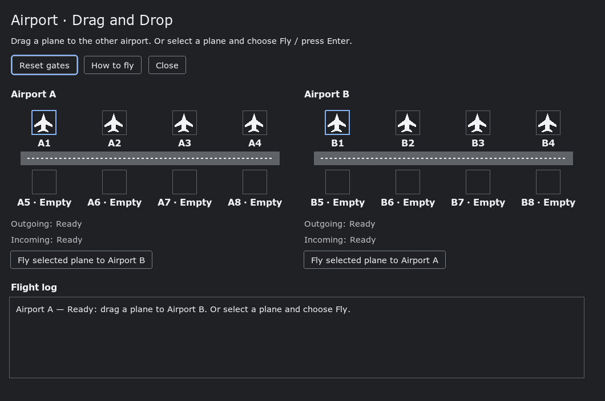

# Airport drag-and-drop demo

Airport demonstrates real Motif drag-and-drop transfers. Both airports appear in
one window, with four starting planes and eight gates each. Gate counts stay
bounded, and resizing preserves plane ownership and flight numbers. Empty gates
are labeled; outgoing/incoming text is status feedback rather than inert controls.

Drag a plane with the left mouse button to the other airport and release over
its gates or runway. Middle-button dragging is also supported. Escape or an
invalid drop returns the plane to its original gate. The destination runway
highlights on approach, and the flight log records what happened.

For click or keyboard use, select an occupied gate and choose **Fly selected
plane**, or press Enter. Arrow keys move the selection. **Reset gates** restores
the initial planes; **How to fly** opens instructions in the application.

A full airport rejects arrivals without removing the source plane. The native
transfer still uses the FLIGHT selection (format 32, one flight number), including
between separate processes. Reservations belong to individual transfers and are
released on transfer destruction. Copy/drop-help operations are rejected safely.
Source ownership changes only after successful completion. The app does not
change global X-server keyboard/bell settings.

Modern profiles use current toolkit colors, fonts and scale. Aircraft are drawn
as transparent scaled silhouettes. The content scrolls when the screen or window
cannot fit it, preserving usable controls and readable labels. Explicit Xt
geometry is respected. Classic painting and alternate Motif drag protocols remain
available. See [Demo launch appearance](demo-launch-appearance.md).





Run the native behavioral fixture against an installed build:

```sh
python3 tests/automated/run-airport-behavior.py \
  --prefix /Volumes/S8T/tmp/your-build/install \
  --gallery /Volumes/S8T/tmp/your-build/install/bin/ckmotif-gallery \
  --out /Volumes/S8T/tmp/your-build/airport-acceptance
```

The output must be fresh. The fixture starts an isolated Xvfb server and sends
real pointer/keyboard input there, never to the user's desktop. It covers light,
dark and classic profiles, multiple scales, compact density, gallery inheritance,
selection, successful/cancelled/invalid/full drops, cross-process transfer,
resize preservation, Help and Close. Optional `--state-report FILE` or
`XM_AIRPORT_STATE_REPORT` emits diagnostic JSON for the fixture; normal launches
emit no report.
