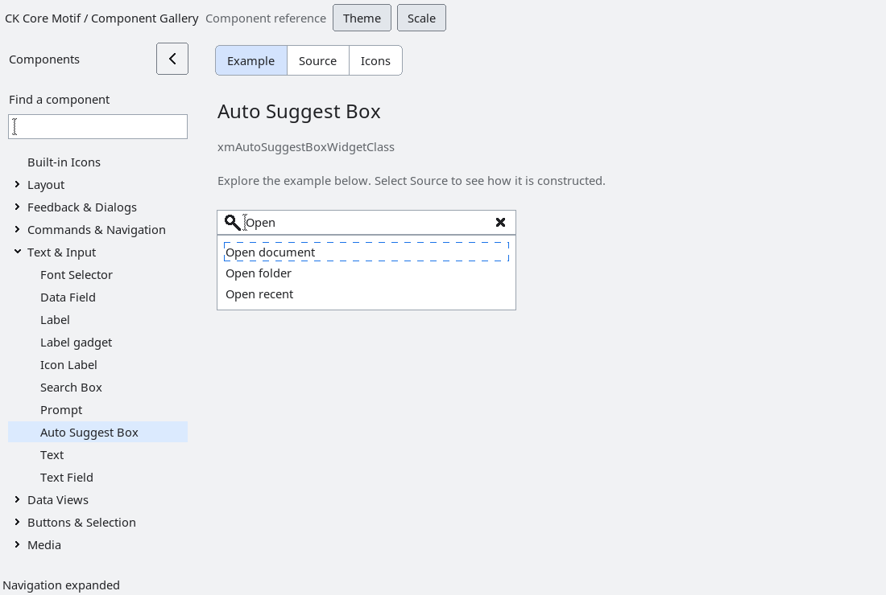

# AutoSuggestBox

`XmAutoSuggestBox` is an opt-in composite containing an ordinary
`XmSearchBox` and an anchored native scrolled `XmList` popup.  The application owns the
provider, filtering, I/O and UI-thread scheduling.  The toolkit never calls a
provider from drawing or popup layout code.

Every query change increments a monotonically increasing generation and sends
that generation with `XmNautoSuggestQueryChangedCallback`.  The application
must pass the same generation to `XmAutoSuggestBoxSetSuggestions`; older or
future generations are rejected, so a delayed result cannot replace a newer
query.  The widget copies suggestion IDs and labels and retains `user_data`
without taking ownership. The complete replacement is prepared before discarding
previous results; invalid counts or allocation failure leave the previous model
intact. Compound-string label renditions are preserved. Committing a suggestion
invalidates outstanding queries through the generation counter without issuing
another provider query for the committed text.

Down-arrow moves focus from the search field to the popup list. Escape dismisses
it and returns focus to the field. Tab and Shift+Tab dismiss without committing
and move to the next or previous tab group relative to the field in its owning
window. They do not cycle inside the popup shell. The list's normal
keyboard/pointer activation commits the selected item through
`XmNautoSuggestCommittedCallback` and returns focus to the field. Dismissal is
reported separately; focus moving elsewhere is preserved. An empty accepted
result is shown as the configurable no-results label and is never actionable.
The popup is per-widget and is destroyed with its owner; no global suggestion
state or blocking work is introduced.

The composite takes its preferred dimensions from the native search field.
Explicit width and height constrain their axes independently; setting an axis
to zero restores natural sizing. The popup aligns with the painted field frame, excluding its focus gutter, shows at
most eight result rows and uses native scrollbars for overflow. It opens below
the field when space permits, otherwise above when that side offers more room,
and remains within screen bounds. Ancestor configure events reposition it;
unmapping the anchor dismisses it. Results supplied before realization wait
until the field is viewable before opening the popup.

Callbacks may destroy the owner. Notification snapshots stop at destruction;
query and selected-ID strings remain valid throughout each dispatch. A text
verification veto suppresses commit. The widget owns a copy of the no-results
label, and tracks child/popup destruction to avoid stale teardown pointers.
The gallery demonstrates an actual case-insensitive provider, including empty
results, using the callback's current generation and native sizing.

Disabling the control or an ancestor cancels the popup and any pending list
gesture. Re-enabling before the event loop runs does not revive that gesture or
permit a pending commit. Dismissal notification runs after the resource update
returns; destruction removes the pending notification. Provider results may
still update the model while disabled but cannot reactivate the list. The underlying [List cancellation behavior](list-sensitivity-cancellation.md)
keeps releases from reviving a cancelled selection. Showing
the popup again is an explicit action after cancellation has completed.

`run-autosuggest-native.py` covers natural geometry, screen-edge placement,
bounded scrolling, stale/oversized result rejection, Escape, native pointer
commit, verification vetoes, no-results ownership, unmapping and destruction
from query, commit, dismissal, inherited text and native list notifications.

<!-- gallery-demo-tabs: begin -->
## Component demo

Captured gallery example and its corresponding source excerpt.

::: tabs
== Demo

== Source

Actual gallery excerpt: class = xmAutoSuggestBoxWidgetClass.
The host supplies parent, name, callback and client_data.
Shared factory locals: Widget example; XmString label = NULL.
The shared factory frees label, attaches callbacks and sizes the preview.
Helpers and the complete factory are in gallery_examples.c.

<<< @/demos/programs/ckmotif-gallery/gallery_examples.c#L279-L307

<<< @/demos/programs/ckmotif-gallery/gallery_examples.c#L523-L525

[Complete demo source](../demos/programs/ckmotif-gallery/gallery_examples.c) · [Public header](../lib/Xm/AutoSuggestBox.h)

:::
<!-- gallery-demo-tabs: end -->

Focus leaving the field and suggestion popup dismisses the popup after native
traversal settles. Movement between the field and popup keeps it open. The
popup uses a traversal-capable transient shell with override-redirect placement;
it remains nonmodal. A deferred check resolves actual X input focus before
consulting the owning shell's logical focus, avoiding stale focus in another
window. The owner cancels that check during destruction. While open, the popup observes button presses on the application's native
widgets on the same display, including widgets and shells created later. An
outside press dismisses without consuming or replaying the event, even when
keyboard focus stays on the search field. Presses within the field or popup
remain part of their native interaction. Observers are removed on dismissal,
widget destruction, and owner teardown. This uses no global pointer grab:
input sent to a different X client is handled through focus loss, not by
intercepting that client's events.
