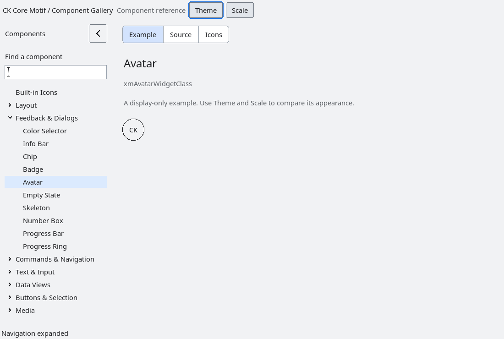

# Avatar

`XmAvatar` is a non-interactive, additive presentation control for a person
or entity marker. It does not attach to another widget, create a global image
cache, load files or URLs, or change host geometry. Applications own its
placement, visibility, click behavior and lifetime.

The control accepts an optional borrowed `XmNavatarPixmap` and a copied
`XmNavatarInitials` fallback. A pixmap is used only while `XGetGeometry`
confirms its dimensions and compatible depth. Depth-one bitmaps use the current
foreground/background colours; colour pixmaps must match the widget depth.
Unspecified or incompatible-depth pixmaps fall back to the copied initials.
Applications must keep borrowed pixmaps alive while assigned; a destroyed X
resource cannot be safely validated by querying it. With neither value, the
accessible name is `Avatar` and the control renders an empty marker.
The supplied pixmap is never freed by the widget.

Images are centered and cropped, without resampling, into the circular marker.
Smaller images retain their native size. Initials and images share the same
circular clip; long initials cannot paint into the outside corners. Classic
retains its symmetric one-pixel outline. Modern profiles use a filled, tinted
circle with antialiased coverage when XRender is available, a solid circular
fallback otherwise, and section-size initials. Toolkit-owned backgrounds blend
the outside corners into the parent surface, including tiled backgrounds. An
explicit application background continues to fill the complete widget rectangle.
Explicit fonts and foreground/background colors remain authoritative. Rendering follows live foreground/background and
sensitivity changes. The native `run-avatar-rendering.py` fixture checks these
contracts independently of the gallery. `run-avatar-modern.py --build BUILD
--results RESULTS` additionally checks smooth edge pixels, parent-background
updates, light/dark profiles, density, scale, readable initials and repeated
creation/destruction on an isolated display.

`XmNavatarSize` supplies the default width and height when the application
does not provide explicit dimensions. Explicit `XmNwidth`/`XmNheight` values
remain authoritative independently. Changing `avatarSize` updates each automatic
axis; setting width or height to zero returns that axis to automatic sizing.
Modern profiles default to 48 logical pixels in comfortable density and 40 in
compact density, scaled with the display. An explicitly supplied `avatarSize`
remains application-owned across profile, density and scale changes. Classic
restores the original 32-pixel default. The gallery supplies no size override.
The control is non-interactive and exposes a label role
through the generic accessibility bridge using the initials or the `Avatar`
fallback name.

The installed consumer fixture is `tests/automated/run-avatar.py`.

<!-- gallery-demo-tabs: begin -->
## Component demo

Captured gallery example and its corresponding source excerpt.

::: tabs
== Demo

== Source

Actual gallery excerpt: class = xmAvatarWidgetClass.
The host supplies parent, name, callback and client_data.
Shared factory locals: Widget example; XmString label = NULL.
The shared factory frees label, attaches callbacks and sizes the preview.
Helpers and the complete factory are in gallery_examples.c.

<<< @/demos/programs/ckmotif-gallery/gallery_examples.c#L361-L363

[Complete demo source](../demos/programs/ckmotif-gallery/gallery_examples.c) · [Public header](../lib/Xm/Avatar.h)

:::
<!-- gallery-demo-tabs: end -->
