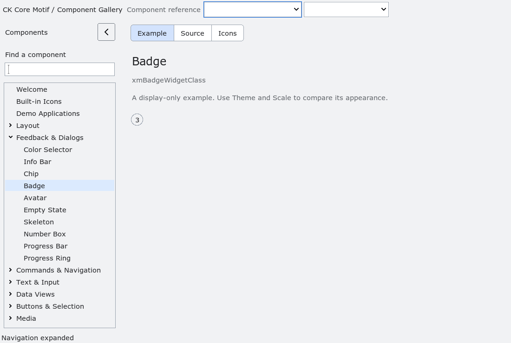

# Badge

`XmBadge` is a non-interactive compact status presentation.  Set
`XmNbadgeCount` to a non-negative value for a bounded count, or leave it at
`-1` and provide the copied `XmNbadgeLabel` text.  Counts above
`XmNbadgeMaximum` render as `maximum+`; `XmBadgeGetDisplayedCount` returns the
clamped value, or `-1` for label mode.  `XmNbadgeSeverity` is one of
`XmBADGE_INFO`, `XmBADGE_SUCCESS`, `XmBADGE_WARNING` and `XmBADGE_ERROR`.

Severity is a semantic state, not a colour-only convention.  The badge never
attaches to a host widget, changes host geometry, receives keyboard focus, or
emits callbacks.  Accessibility exposes label-mode text or the bounded count
as a read-only value.

The default size follows the measured displayed count or complete compound
label, including multiple lines and rendition tags. Padding scales with DPI.
Live label, count and render-table changes update automatically sized axes;
an explicit width or height remains application-owned. Set an axis to zero
to restore its natural sizing. Modern profiles use a symmetric rounded outline
with centered text; classic retains its rectangular outline. Text is clipped
inside the badge when the parent or application provides a smaller allocation.

The native label-geometry regression includes badges at 1x, 1.5x, 2x and 3x,
both modern profiles and layout directions, automatic and explicit dimensions,
count/label transitions, live colours and border reflection symmetry. Badge's
private automatic-size fields belong to the pending ABI-9 cohort; rebuild
subclasses with the matching private header and library.

<!-- gallery-demo-tabs: begin -->
## Component demo

Captured gallery example and its corresponding source excerpt.

::: tabs
== Demo

== Source

Actual gallery excerpt: class = xmBadgeWidgetClass.
The host supplies parent, name, callback and client_data.
Shared factory locals: Widget example; XmString label = NULL.
The shared factory frees label, attaches callbacks and sizes the preview.
Helpers and the complete factory are in gallery_examples.c.

<<< @/demos/programs/ckmotif-gallery/gallery_examples.c#L357-L360

[Complete demo source](../demos/programs/ckmotif-gallery/gallery_examples.c) · [Public header](../lib/Xm/Badge.h)

:::
<!-- gallery-demo-tabs: end -->
