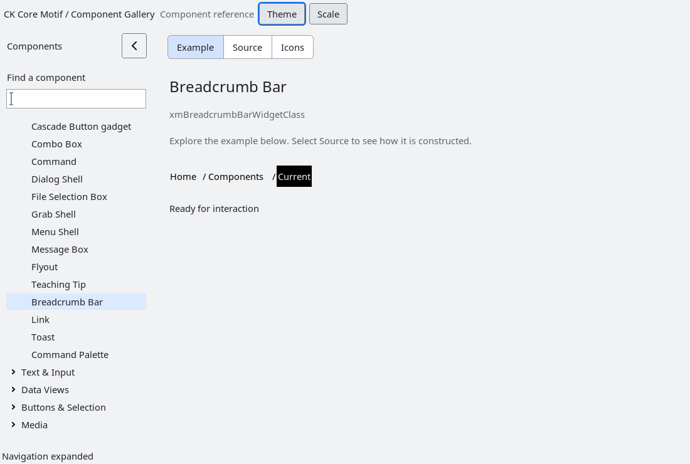

# BreadcrumbBar

`XmBreadcrumbBar` is an additive, resource-driven path presentation.  The
application owns each segment's label and opaque `id`; `XmBreadcrumbBarSetSegments`
copies labels while retaining IDs for callback delivery.  The widget never
parses paths or navigates on its own.

`XmNbreadcrumbMaxVisible` enables bounded leading-ellipsis collapse, and
`XmNbreadcrumbRtl` changes the visual and keyboard direction without changing
the logical segment order.  Left/right keys move the current segment and
Return activates it.  Pointer selection and activation use the same callbacks.
These user-input paths are inactive while the BreadcrumbBar or an ancestor is
insensitive; applications may still set the current segment explicitly.

`XmNbreadcrumbCurrentChangedCallback` reports selection changes and
`XmNbreadcrumbActivateCallback` reports an explicit activation.  Callback data
is an `XmBreadcrumbBarCallbackStruct`; the `id` is the application-owned
payload and must remain valid until the callback returns.  No callback runs
from drawing or geometry negotiation.

The control has no global popup, path model, or external URL behavior.  Empty
segments are allowed and are rendered as empty labels.  Existing Button,
Label, Menu and List contracts are unchanged.

<!-- gallery-demo-tabs: begin -->
## Component demo

Captured gallery example and its corresponding source excerpt.

::: tabs
== Demo

== Source

Actual gallery excerpt: class = xmBreadcrumbBarWidgetClass.
The host supplies parent, name, callback and client_data.
Shared factory locals: Widget example; XmString label = NULL.
The shared factory frees label, attaches callbacks and sizes the preview.
Helpers and the complete factory are in gallery_examples.c.

<<< @/demos/programs/ckmotif-gallery/gallery_examples.c#L534-L542

[Complete demo source](../demos/programs/ckmotif-gallery/gallery_examples.c) · [Public header](../lib/Xm/BreadcrumbBar.h)

:::
<!-- gallery-demo-tabs: end -->

## Modern presentation

An unset (`NULL`) `XmNbreadcrumbSeparator` selects the profile's automatic
separator: a directional chevron in Modern Light/Dark and `/` in Classic.
An explicit string, including `/` or an empty string, remains authoritative.
Setting the resource back to `NULL` restores automatic separators. Chevron
size and spacing follow display scale; RTL mirrors the direction.

Modern mode reports the complete measured natural width and a font-aware height,
with room for its indicator. Explicit widget dimensions remain authoritative.
Modern mode keeps the current label on the normal bar background with a subtle
accent underline. Classic retains its inverted current-item treatment.
Rendering refreshes GC colors from the active resources on every frame, and
modern item widths and hit tests share the visual-leading segment rule so RTL
labels and separators use consistent space. No callback, ID or selection
semantics or public widget-record layout changes.

`tests/automated/run-breadcrumb-modern.py --build ABS_BUILD --results ABS_NEW_DIR`
runs a native Xvfb rendering and input regression across repeated Classic,
Modern Light/Dark, 100/150/200% scale and LTR/RTL transitions. It checks the plain
current-item surface, accent pixels, custom separators, quiet theme changes,
keyboard traversal and pointer activation. The existing BreadcrumbBar contract
and source guards remain part of acceptance.
