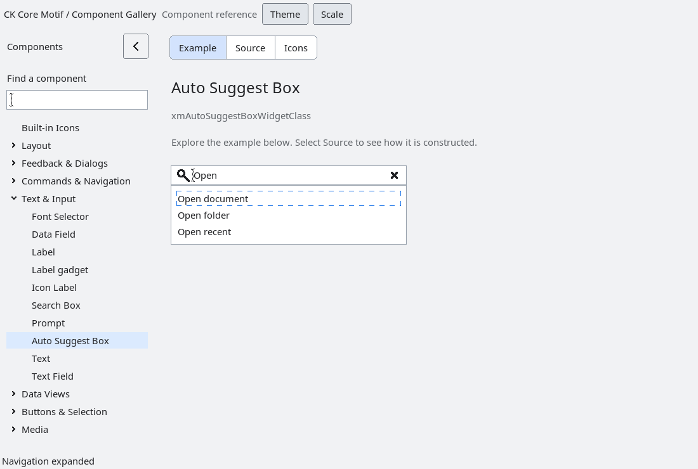
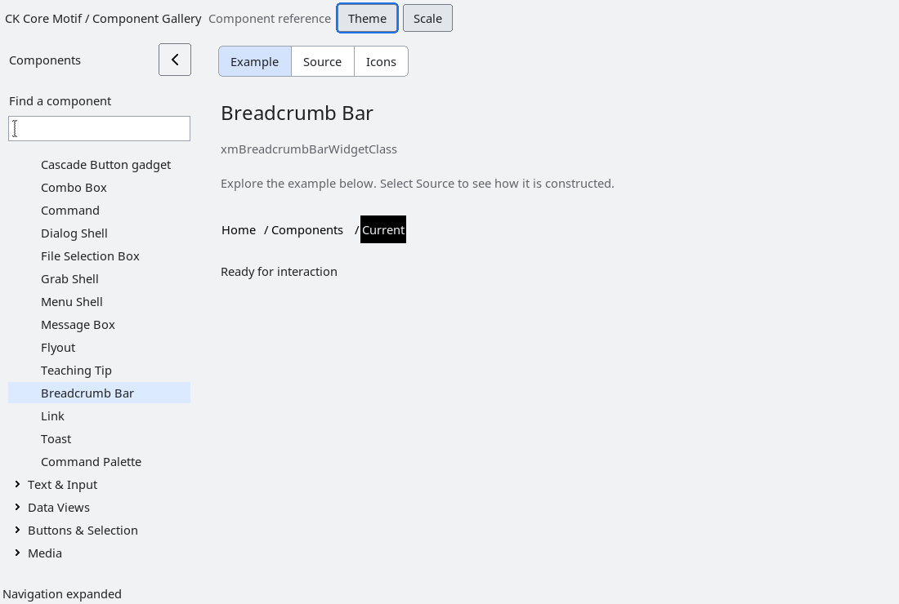
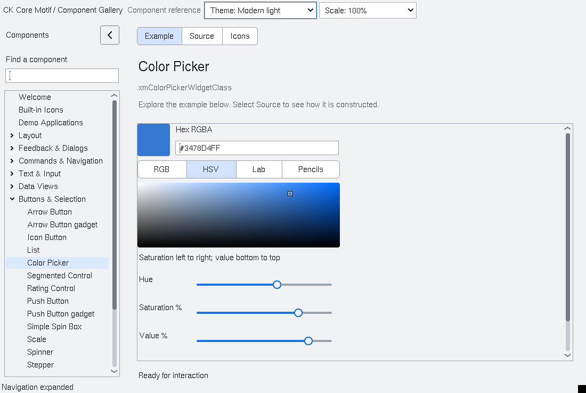
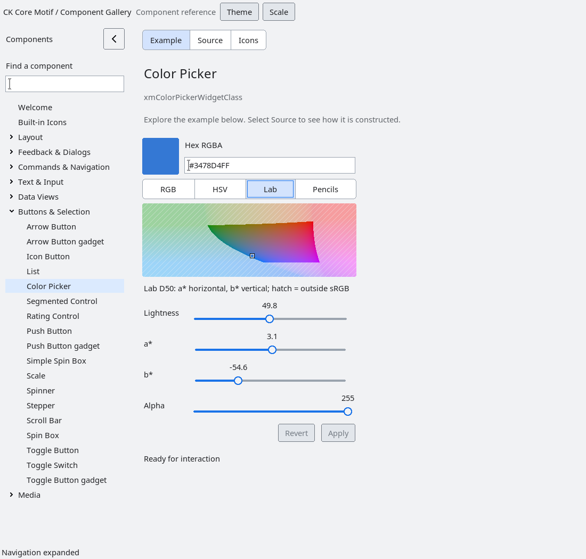
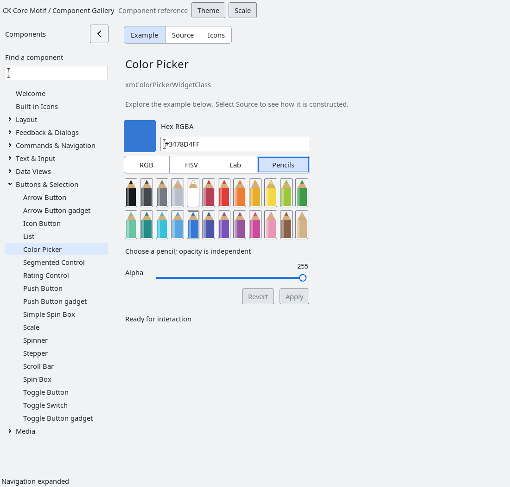
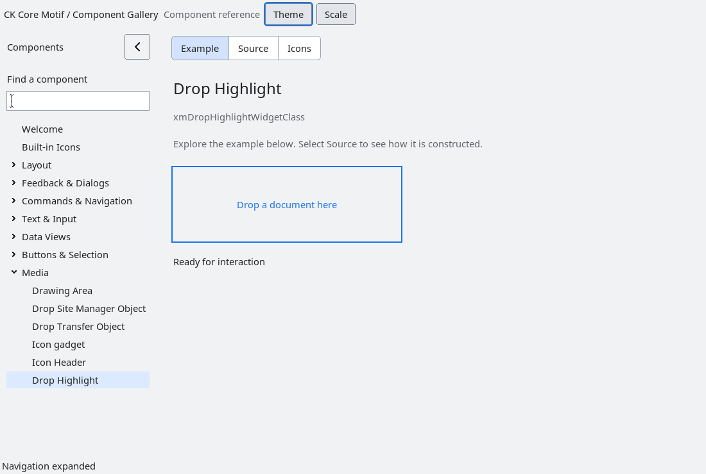
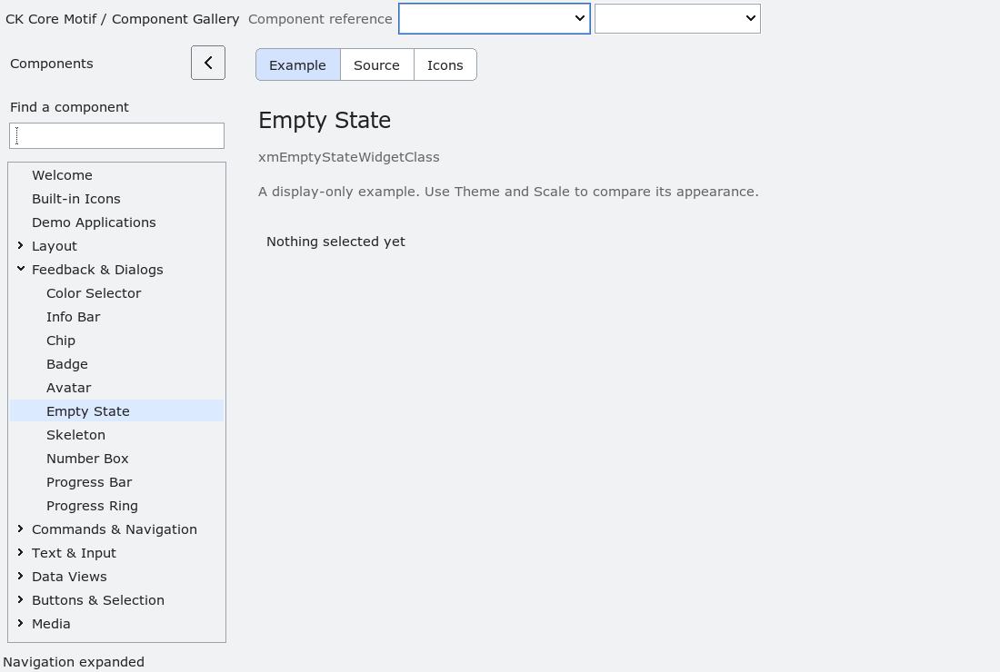

# Bugfix Notes Archive 09

## `accessibility-action-count-bounds.md`

# Accessibility action-count bounds

The AT-SPI `NActions` property is a signed 32-bit D-Bus integer, while Motif
stores the action count as an unsigned value.  The D-Bus adapter now saturates
counts above `INT32_MAX` before publishing them, instead of allowing a large
count to wrap into a negative property value.

Normal action counts are unchanged and the public Motif accessibility ABI is
unchanged.

## `accessibility-child-index-bounds.md`

# Accessibility child-index bounds

Accessibility stores child indices as `size_t` but exposes signed `int`
positions to callers and transport notifications.  Both index lookup and
removed-node notifications now use a saturating conversion, preventing large
trees from wrapping into negative or unrelated positions.

The focused source-contract regression is:

```sh
PYTHONDONTWRITEBYTECODE=1 python3 tests/automated/check-accessible-child-index-bounds.py
```

## `accessibility-dbus-child-count.md`

# Accessibility D-Bus child counts

The D-Bus accessibility bridge exposes child counts through an integer
protocol field.  Native child storage uses `size_t`, so the bridge now clamps
counts above `INT_MAX` before conversion.  Ordinary counts are unchanged and
large trees no longer wrap into negative or unrelated values.

## `accessibility-keysym-bits.md`

# Accessibility key-symbol wire values

AT-SPI device-event notifications carry the key identity in a signed 32-bit
field, while X11 `KeySym` values are unsigned.  The accessibility D-Bus
adapter now copies the 32-bit key-symbol representation into that field
explicitly, preserving high-valued and Unicode keysyms without relying on an
implementation-defined signed cast.

The wire value for ordinary keysyms is unchanged.

## `accessibility-memo-capacity-bounds.md`

# Accessibility memo-table capacity bounds

`memo_resize` now validates its requested bucket capacity at the allocation
boundary, including the `XtCalloc` element-size conversion and the power-of-two
invariant required by the bucket bitmask. Invalid or overflowing capacities
fail before allocation, so future callers cannot rely on caller-side checks to
keep the memo table structurally valid.

The source-contract regression is
`tests/automated/check-accessibility-memo-capacity-bounds.py`.

## `accessibility-metadata-bounds.md`

# Accessibility metadata bounds

The public accessibility snapshot stores table dimensions and text positions
as signed `int` values because that is the width used by the AT-SPI protocol
methods.  Motif's DataGrid counts and text APIs can use wider unsigned
quantities.  The snapshot query therefore saturates values above `INT_MAX`
instead of narrowing them directly and turning them negative.

This keeps large or malformed widgets from publishing negative row counts,
columns, text lengths, or caret offsets.  Normal-sized widgets retain their
exact values and the change does not alter the public ABI.

## `accessibility-name-allocation.md`

# Accessibility name allocation rollback

`XmAccessibilityCreate` now destroys its partially initialized state and
returns NULL when copying the application name fails.  Valid names and the
public ABI are unchanged.

The static regression check is
`tests/automated/check-accessibility-name-allocation.py`.

## `accessibility-position-casts.md`

# Accessibility position casts

Accessibility selection ranges and visual-line offsets now use the shared
two-sided `XmTextPosition` clamp before filling their signed `int` outputs.
This keeps large or malformed provider positions from bypassing the boundary
guard and wrapping in the public accessibility API.

The focused source-contract regression is:

```sh
PYTHONDONTWRITEBYTECODE=1 python3 tests/automated/check-accessible-position-casts.py
```

## `accessibility-selection-count.md`

# Accessibility selection counts

List selection counts are stored as `size_t` internally but exposed through an
integer accessibility API.  `XmAccessibilitySelectionCount` now uses the
shared saturating conversion helper, preventing implementation-defined
wraparound for an unusually large native selection set.

## `accessibility-text-navigation-bounds.md`

# Accessibility text-navigation bounds

Character navigation in the D-Bus accessibility adapter now computes
`offset + direction` in `long long` before clamping to the valid text range.
Offsets at `INT_MAX` or below zero therefore clamp correctly instead of
wrapping through signed `int` arithmetic.

The focused source-contract regression is:

```sh
PYTHONDONTWRITEBYTECODE=1 python3 tests/automated/check-accessible-text-navigation-bounds.py
```

## `accessibility-text-position-bounds.md`

# Accessibility text-position bounds

Accessibility exposes text positions through signed `int` fields.  The
conversion helper now clamps both below `INT_MIN` and above `INT_MAX`, avoiding
implementation-defined narrowing for malformed or unusually large provider
positions.

The focused source-contract regression is:

```sh
PYTHONDONTWRITEBYTECODE=1 python3 tests/automated/check-accessible-text-position-bounds.py
```

## `accessibility-utf8-bounds.md`

# Accessibility UTF-8 conversion bounds

The locale-to-UTF-8 accessibility conversion checks both the wide-character
scratch allocation and the four-byte UTF-8 result bound before allocating.
The checks cover both `size_t` arithmetic and Xt's `Cardinal` allocation
interface, and both accepted sizes are passed explicitly at the allocator
boundary, so a representable host size cannot be truncated. Malformed or
unrepresentable input sizes therefore fail cleanly without
wrapping `(count + 1) * sizeof(wchar_t)`. Allocation failures for either
scratch buffer also return cleanly without dereferencing a null pointer.
The converter rejects a NULL source before entering the multibyte state
machine.

The source-level regression is
`tests/automated/check-accessible-utf8-bounds.py`.

## `accessibility-value-initialization.md`

# Accessibility value initialization

Accessibility metadata is collected through public widget getters. Calendar,
DatePicker, and TimePicker getters can reject a dead or invalid widget without
initializing their caller-provided output structure. The accessibility bridge
now publishes a value range only after that getter succeeds, so it never reads
or exposes indeterminate date or time fields.

BreadcrumbBar and SegmentedControl likewise expose index ranges rather than
raw unsigned counts. Empty controls retain their established neutral ranges,
and large counts saturate before conversion to the accessibility int domain.

The focused source-contract regression is:

```sh
python3 tests/automated/check-accessible-value-initialization.py
```

## `additive-widget-contract.md`

# Additive widget contract

New controls are ordinary opt-in Motif widget classes. They use the existing
Xt object, resource, geometry, traversal, callback, UIL/WML and display
ownership rules; they do not introduce a parallel runtime or alter the
meaning of an existing resource or callback record.

## Public-class rules

- Each class gets a distinct public header, class symbol, constructor naming
  convention and resource/callback namespace.
- Resources describe persistent widget state. Per-view or transient state is
  not encoded in global variables or application-wide singletons.
- A widget owns its Xt children and cancels timers, work procedures and
  registered callbacks before destruction. Borrowed widgets are validated at
  the point of use and never retained past their owner’s lifetime.
- Geometry uses normal Xt negotiation. Explicit application dimensions win
  over fallback resources; scaled metrics are opt-in and must not reinterpret
  legacy pixel resources silently.
- Activation, value changes, cancellation and sensitivity have documented
  keyboard and pointer behavior. Typed callback records are added only when a
  generic callback cannot express the event without ambiguity.
- Callback-driven destruction is a required test case. No callback may require
  its widget or parent to remain alive after the callback returns.

## Accessibility and UI-thread rules

Every class documents its accessible role, name/value/state exposure,
actions, focus behavior and change notifications. Native accessibility
providers consume those semantics; a provider’s absence does not change the
widget’s state contract. All widget, display, resource and callback operations
remain on the owning Xt thread. A new widget must not create worker threads or
an animation loop; bounded Xt timers are permitted for visible indeterminate
feedback and are canceled before unmap or destruction.

## Delivery harness

`tests/automated/run-additive-widget-contract.py` compiles
`check-additive-widget-contract.c` against one absolute installed prefix,
checks that `libXm` and `libXt` resolve from that prefix, and runs the fixture
under an isolated Xvfb. The fixture deliberately uses existing public
PushButton/List classes as contract probes until WP-16 supplies the first new
class. It checks explicit-over-fallback resource precedence, keyboard focus
traversal, the public list accessibility-change callback, activation callback
teardown, and clean application-context shutdown.

The fixture is a contract gate, not a claim that every existing widget or an
external assistive client is complete. A new class must add its own focused
normal, invalid-input, resize, keyboard, accessibility and destruction cases.

## `aicon-c23-directory-safety.md`

# aicon directory-population safety

The historical `aicon` Container demonstration now uses typed C23 callback and
helper declarations.  Its directory scanner no longer alters the caller's
file-selection text, bounds the assembled icon path and icon-list allocation,
closes the directory stream, and releases the temporary text returned by the
file-selection widget.  Empty container selections are ignored safely before
trying to use their pixmap; failed pixmap geometry queries and empty directory
results no longer feed invalid values into the display or child-management
paths.

The focused source-contract check is:

```sh
python3 tests/automated/check-aicon-c23-directory-safety.py
```

## `animate-c23-callbacks.md`

# Animate demo C23 callbacks

The Animate demonstration keeps its existing Mrm callback registration and
animation behavior, but its application entry point, work procedure, and UI
callbacks use exact typed C declarations rather than legacy K&R definitions or
unspecified forward declarations.  This makes the demo build with the current
C23 configuration without changing its UID interface.

The focused source-contract check is:

```sh
python3 tests/automated/check-animate-c23-callbacks.py
```

## `appearance-draw-gc.md`

# Shared appearance drawing GC failures

The modern button focus, button face, and cascade-indicator helpers allocate
short-lived X graphics contexts. Each helper now treats that allocation as
fallible. Button helpers release their temporary clipping region before
returning; cascade indicators simply skip that paint pass. No public resource,
widget state, or rendering contract changes, and a later expose retries the
draw normally.

The focused source-contract regression is
`tests/automated/check-appearance-draw-gc.py`.

## `appearance-profile-number-overflow.md`

# Appearance-profile numeric overflow

Appearance-profile dimension and metric values now reject `strtoul()`
conversion overflow before the result is narrowed to `Dimension`.  This keeps
out-of-range resource values from becoming a platform-dependent maximum size.

The focused source-contract check is:

```sh
python3 tests/automated/check-appearance-profile-number-overflow.py
```

## `appearance-snapshot-bounds.md`

# Appearance transaction snapshot bounds

Appearance-profile changes snapshot all live widget states before preparing a
transaction.  The snapshot count is tracked in native `size_t`, rather than
wrapping through the public `Cardinal` type, and the snapshot plus its
per-widget change plans reject a count that cannot fit both the `XtMalloc`
`Cardinal` argument and native allocation arithmetic. The transaction returns
failure before taking any state references; valid transactions are unchanged.
After that validation, the allocation is explicitly narrowed to Xt's accepted
byte-count type.

The modern arrow inset helper also clamps its position updates to the X11
`Position` range, so large allocated cells cannot wrap the arrow origin.
The helper also treats a missing widget or geometry pointer as a no-op before
consulting display/profile state.

The focused source-contract check is:

```sh
python3 tests/automated/check-appearance-snapshot-bounds.py
```

## `arrow-button-gadget-redisplay-guards.md`

# ArrowButtonGadget redisplay guards

`XmArrowButtonGadget` can be exposed while its manager resources are being
replaced or while highlight and shadow margins leave no drawable area.  Its
background, shadow, and arrow helpers previously accepted missing GCs and
zero-sized geometry.

The redisplay and shared arrow helper now skip only invalid intermediate
requests.  Input-driven arm and activate redraws use the same safe helper,
while valid gadget rendering and callback behavior remain unchanged.

## `arrow-button-redisplay-guards.md`

# ArrowButton redisplay guards

`XmArrowButton` can receive an expose event while its resources are being
replaced or after a resource allocation has failed.  Redisplay now checks the
shadow and arrow GCs before passing them to the X drawing helpers.  The arrow
geometry helper also returns for zero-sized bounds, which avoids issuing
invalid drawing requests when highlight and shadow margins consume the whole
widget.

Classic rendering remains unchanged when the required resources and
geometry are available.  The superclass expose handler is still invoked so
standard Xt event processing continues for partially initialized widgets.

## Modern arrow bounds

Modern light and dark profiles center the arrow within the content rectangle,
after excluding the control's focus and shadow margins. The glyph is at most
18 logical pixels in comfortable density or 16 in compact density, with at
least four logical pixels of surrounding padding. Small allocations shrink
the glyph; allocations with no remaining content draw no arrow. Display scaling
is applied once. Widget and gadget variants use the same geometry rule.

Modern light and dark profiles use a shared renderer for ArrowButton and
ArrowButtonGadget: a flat rounded frame and an open chevron centered within the
content rectangle. The chevron spans at most 14 logical pixels, with at least
four logical pixels of padding inside the frame. Small allocations shrink the
glyph; allocations without sufficient content draw no arrow. Round line caps
are included in the glyph bounds. Display scaling is applied once.

The frame defaults to one logical pixel. Its color comes from
`XmNbottomShadowColor`; explicit application colors and thicknesses remain
authoritative. Modern palette defaults provide a visible border on both light
and dark surfaces. Pressed controls invert their foreground/background colors;
disabled controls use the subdued border color for the glyph. Each state
transition repaints the full face, while the existing focus rendering remains
outside it. Classic and high-contrast use their existing arrow/bevel renderer.

Modern Forms and BulletinBoards default to no shadow: layout containers should
not introduce a bevel around their children. Explicit shadow resources still
take precedence. Classic and high-contrast profiles retain their own defaults.

`tests/automated/run-arrow-bounds.py` runs an installed-library regression that
reads the actual X pixels for all four directions, both widget types, light and
dark profiles, both densities, and 1×, 1.5×, 2× and 3× scales. It checks enabled
and disabled controls, tiny allocations, and default/explicit container shadows.


`tests/automated/run-modern-arrows.py` checks native frame/glyph pixels and
arm, leave, re-enter and activate behavior in 96 cases per font configuration.
It also verifies live classic/modern transitions and explicit frame thickness.
Pointer-inside state is retained separately from the armed state, so an expose
after dragging outside does not redraw the control as pressed. The regression
forces that repaint for widget and gadget controls and checks the same behavior
in classic and high-contrast profiles.

## Preferred target size

The widget and gadget report the same preferred square target. Modern defaults
are 36 logical pixels in comfortable density and 28 in compact density, enlarged
when explicit focus/frame widths need more room around the chevron. Classic and
high-contrast retain their 15-pixel content extent plus focus and shadow margins.

Unspecified axes follow toolkit metrics during profile, density and scale
changes. Explicit nonzero dimensions remain application-owned; if a parent
subsequently changes that allocation, appearance changes retain the parent's
current size. Setting an axis to zero returns it to natural sizing. Resource-file
dimensions follow the same rules. QueryGeometry reports the natural target even
when a parent or application has constrained the actual allocation.

`tests/automated/run-arrow-sizing.py` exercises these ownership rules across
profiles, densities, scales and both control types. The gallery relies on this
toolkit geometry and supplies only the arrow direction.

## Disabling during a pointer gesture

An arrow press is canceled when either the control or an ancestor becomes
insensitive. Re-enabling does not restore the pending press. A fresh press is
required before a release can activate the arrow, including repeated clicks.
The widget and gadget share this rule in all appearance profiles.

The native modern-arrow fixture checks local and ancestor cancellation for both
control types, including unchanged normal activation after cancellation. The
NumberBox editing fixture dispatches actual pointer translations and covers
release outside, disabled input, cancellation during a press, range boundaries,
wrapping and destruction of the composite from the step callback.

## `arrow-geometry-allocation.md`

# Legacy arrow geometry allocation

The legacy arrow geometry builder now allocates its top, center, and bottom
rectangle arrays transactionally. If any allocation fails, all partial arrays
are released and the output pointers remain cleared after the existing cache
reset; successful geometry is unchanged.
Null count or output pointers are rejected before the existing rectangle cache
is touched.

The focused regression check is
`tests/automated/check-arrow-geometry-allocation.py`.

## `atom-list-conversion.md`

# Atom-list resource conversion

`XmRAtomList` conversion now checks temporary name-array growth and the final
atom-array size before multiplying allocation counts. If a malformed resource
would exceed representable storage, all token strings and temporary arrays are
released and conversion fails cleanly. Accepted name-array and atom-array byte
counts are passed explicitly as Xt `Cardinal` values.

The source-level capacity regression is
`tests/automated/check-atom-list-bounds.py`.

## `auto-suggest-box.md`

# AutoSuggestBox

`XmAutoSuggestBox` is an opt-in composite containing an ordinary
`XmSearchBox` and an anchored native scrolled `XmList` popup.  The application owns the
provider, filtering, I/O and UI-thread scheduling.  The toolkit never calls a
provider from drawing or popup layout code.

Every query change increments a monotonically increasing generation and sends
that generation with `XmNautoSuggestQueryChangedCallback`.  The application
must pass the same generation to `XmAutoSuggestBoxSetSuggestions`; older or
future generations are rejected, so a delayed result cannot replace a newer
query.  The widget copies suggestion IDs and labels and retains `user_data`
without taking ownership. The complete replacement is prepared before discarding
previous results; invalid counts or allocation failure leave the previous model
intact. Compound-string label renditions are preserved. Committing a suggestion
invalidates outstanding queries through the generation counter without issuing
another provider query for the committed text.

Down-arrow moves focus from the search field to the popup list. Escape dismisses
it and returns focus to the field. Tab and Shift+Tab dismiss without committing
and move to the next or previous tab group relative to the field in its owning
window. They do not cycle inside the popup shell. The list's normal
keyboard/pointer activation commits the selected item through
`XmNautoSuggestCommittedCallback` and returns focus to the field. Dismissal is
reported separately; focus moving elsewhere is preserved. An empty accepted
result is shown as the configurable no-results label and is never actionable.
The popup is per-widget and is destroyed with its owner; no global suggestion
state or blocking work is introduced.

The composite takes its preferred dimensions from the native search field.
Explicit width and height constrain their axes independently; setting an axis
to zero restores natural sizing. The popup aligns with the painted field frame, excluding its focus gutter, shows at
most eight result rows and uses native scrollbars for overflow. It opens below
the field when space permits, otherwise above when that side offers more room,
and remains within screen bounds. Ancestor configure events reposition it;
unmapping the anchor dismisses it. Results supplied before realization wait
until the field is viewable before opening the popup.

Callbacks may destroy the owner. Notification snapshots stop at destruction;
query and selected-ID strings remain valid throughout each dispatch. A text
verification veto suppresses commit. The widget owns a copy of the no-results
label, and tracks child/popup destruction to avoid stale teardown pointers.
The gallery demonstrates an actual case-insensitive provider, including empty
results, using the callback's current generation and native sizing.

Disabling the control or an ancestor cancels the popup and any pending list
gesture. Re-enabling before the event loop runs does not revive that gesture or
permit a pending commit. Dismissal notification runs after the resource update
returns; destruction removes the pending notification. Provider results may
still update the model while disabled but cannot reactivate the list. The underlying [List cancellation behavior](bugfix-notes-archive-10.md#list-sensitivity-cancellationmd)
keeps releases from reviving a cancelled selection. Showing
the popup again is an explicit action after cancellation has completed.

`run-autosuggest-native.py` covers natural geometry, screen-edge placement,
bounded scrolling, stale/oversized result rejection, Escape, native pointer
commit, verification vetoes, no-results ownership, unmapping and destruction
from query, commit, dismissal, inherited text and native list notifications.

<!-- gallery-demo-tabs: begin -->
## Component demo

Captured gallery example and its corresponding source excerpt.

::: tabs
== Demo



== Source

Actual gallery excerpt: class = xmAutoSuggestBoxWidgetClass.
The host supplies parent, name, callback and client_data.
Shared factory locals: Widget example; XmString label = NULL.
The shared factory frees label, attaches callbacks and sizes the preview.
Helpers and the complete factory are in gallery_examples.c.

<<< @/demos/programs/ckmotif-gallery/gallery_examples.c#L298-L326

<<< @/demos/programs/ckmotif-gallery/gallery_examples.c#L548-L550

[Complete demo source](../demos/programs/ckmotif-gallery/gallery_examples.c) · [Public header](../lib/Xm/AutoSuggestBox.h)

:::
<!-- gallery-demo-tabs: end -->

Focus leaving the field and suggestion popup dismisses the popup after native
traversal settles. Movement between the field and popup keeps it open. The
popup uses a traversal-capable transient shell with override-redirect placement;
it remains nonmodal. A deferred check resolves actual X input focus before
consulting the owning shell's logical focus, avoiding stale focus in another
window. The owner cancels that check during destruction. While open, the popup observes button presses on the application's native
widgets on the same display, including widgets and shells created later. An
outside press dismisses without consuming or replaying the event, even when
keyboard focus stays on the search field. Presses within the field or popup
remain part of their native interaction. Observers are removed on dismissal,
widget destruction, and owner teardown. This uses no global pointer grab:
input sent to a different X client is handled through focus loss, not by
intercepting that client's events.

## `avatar-xrender-mask-allocation.md`

# Avatar XRender mask allocation bounds

Modern Avatar rendering constructs an A8 XRender coverage mask only for a
positive, bounded diameter.  After Xlib creates the temporary `XImage`, Avatar
also verifies that its row stride is positive and that the requested rows fit
the allocation domain before assigning image data.

An unsupported image layout now falls back to the existing non-XRender drawing
path rather than allocating through a signed or overflowing stride.  The
normal circular image and initials rendering path is unchanged.

Regression: `tests/automated/check-avatar-pixmap-allocation.py`.

## `baseclass-resource-copy-allocation.md`

# BaseClass resource-copy allocation guards

When a composite widget class has an uncompiled resource list,
`BaseClass.c` copies the list into Xt-owned storage. The copy now checks both
native `size_t` multiplication and the Xt `Cardinal` limit before allocating,
so a representable host size cannot silently truncate on Xt’s allocation API.

The focused source-contract check is
`tests/automated/check-baseclass-resource-copy-allocation.py`.

## `breadcrumb-bar-redisplay-guards.md`

# BreadcrumbBar redisplay guards

`XmBreadcrumbBar` now handles a missing drawing GC, null separator or segment
labels, and narrow focus geometry without invalid Xlib calls or unsigned
underflow. Item drawing also skips `XmStringDraw` when the render table could
not be initialized, matching the existing safe sizing fallback. Normal
segment sizing and navigation remain unchanged.

The focused source contract is checked by
`tests/automated/check-breadcrumb-bar-redisplay-guards.py`.

## `breadcrumb-bar.md`

# BreadcrumbBar

`XmBreadcrumbBar` is an additive, resource-driven path presentation.  The
application owns each segment's label and opaque `id`; `XmBreadcrumbBarSetSegments`
copies labels while retaining IDs for callback delivery.  The widget never
parses paths or navigates on its own.

`XmNbreadcrumbMaxVisible` enables bounded leading-ellipsis collapse, and
`XmNbreadcrumbRtl` changes the visual and keyboard direction without changing
the logical segment order.  Left/right keys move the current segment and
Return activates it.  Pointer selection and activation use the same callbacks.
These user-input paths are inactive while the BreadcrumbBar or an ancestor is
insensitive; applications may still set the current segment explicitly.

`XmNbreadcrumbCurrentChangedCallback` reports selection changes and
`XmNbreadcrumbActivateCallback` reports an explicit activation.  Callback data
is an `XmBreadcrumbBarCallbackStruct`; the `id` is the application-owned
payload and must remain valid until the callback returns.  No callback runs
from drawing or geometry negotiation.

The control has no global popup, path model, or external URL behavior.  Empty
segments are allowed and are rendered as empty labels.  Existing Button,
Label, Menu and List contracts are unchanged.

<!-- gallery-demo-tabs: begin -->
## Component demo

Captured gallery example and its corresponding source excerpt.

::: tabs
== Demo



== Source

Actual gallery excerpt: class = xmBreadcrumbBarWidgetClass.
The host supplies parent, name, callback and client_data.
Shared factory locals: Widget example; XmString label = NULL.
The shared factory frees label, attaches callbacks and sizes the preview.
Helpers and the complete factory are in gallery_examples.c.

<<< @/demos/programs/ckmotif-gallery/gallery_examples.c#L537-L544

[Complete demo source](../demos/programs/ckmotif-gallery/gallery_examples.c) · [Public header](../lib/Xm/BreadcrumbBar.h)

:::
<!-- gallery-demo-tabs: end -->

## Modern presentation

An unset (`NULL`) `XmNbreadcrumbSeparator` selects the profile's automatic
separator: a directional chevron in Modern Light/Dark and `/` in Classic.
An explicit string, including `/` or an empty string, remains authoritative.
Setting the resource back to `NULL` restores automatic separators. Chevron
size and spacing follow display scale; RTL mirrors the direction.

Modern mode reports the complete measured natural width and a font-aware height,
with room for its indicator. Explicit widget dimensions remain authoritative.
Modern mode keeps the current label on the normal bar background with a subtle
accent underline. Classic retains its inverted current-item treatment.
Rendering refreshes GC colors from the active resources on every frame, and
modern item widths and hit tests share the visual-leading segment rule so RTL
labels and separators use consistent space. No callback, ID or selection
semantics or public widget-record layout changes.

`tests/automated/run-breadcrumb-modern.py --build ABS_BUILD --results ABS_NEW_DIR`
runs a native Xvfb rendering and input regression across repeated Classic,
Modern Light/Dark, 100/150/200% scale and LTR/RTL transitions. It checks the plain
current-item surface, accent pixels, custom separators, quiet theme changes,
keyboard traversal and pointer activation. The existing BreadcrumbBar contract
and source guards remain part of acceptance.

## `breadcrumb-count-range.md`

# BreadcrumbBar segment-count range

`XmBreadcrumbBarSetSegments` accepts a `Cardinal` count, while the current
segment is stored and exposed through a signed `int`.  Counts above `INT_MAX`
would make the `count - 1` current-index conversion unrepresentable.  The
setter now rejects those counts before freeing or replacing existing items;
all representable counts retain their existing behavior.

The regression contract is checked by
`tests/automated/check-breadcrumb-count-range.py`.

## `bulletin-board-shadow-redisplay-guards.md`

# BulletinBoard shadow redisplay guards

`XmBulletinBoard` redraws its manager shadow after redisplaying child gadgets.
The expose path previously assumed a realized window, valid shadow GCs, and
non-zero dimensions whenever shadow thickness was configured.

The shadow request now waits for those prerequisites.  Gadget redisplay and
cached geometry updates still run, and valid realized boards retain their
existing shadow type and dimensions.

## `cache-geometry-status.md`

# Pixmap-cache geometry status

When dimensions were omitted, `_XmCachePixmap` ignored the status returned by
`XGetGeometry`.  Invalid server-side pixmap handles could therefore leave
uninitialized width, height, and depth values in the cache.

The query is now required to succeed before cache allocation.  Failed geometry
lookup returns `False` without creating an entry.

`tests/automated/check-cache-geometry-status.py` protects this contract.

## `cache-pixmap-input.md`

# Pixmap-cache input validation

`_XmCachePixmap` queries geometry immediately when dimensions are omitted.
Passing a null screen or the unspecified pixmap handle therefore reached Xlib
with invalid arguments.

The API now rejects either invalid handle before initializing cache state or
issuing X requests.  Existing valid pixmap caching and geometry behavior are
unchanged.

`tests/automated/check-cache-pixmap-input.py` protects this boundary.

## `calendar-geometry-guards.md`

# Calendar geometry and callback guards

`XmCalendar` now handles missing drawing GCs, clamps selected-day geometry, and
avoids zero-width cell division in pointer handling. Callback routing compares
resource names by content, so activation and date-change callbacks remain
separate even when callers provide equivalent strings.

Calendar metric sampling now only frees an `XmString` after successful
creation.  A missing render table still uses the existing fallback dimensions,
while a successfully created sample is always released.

The focused source contract is checked by
`tests/automated/check-calendar-geometry-guards.py`.

## `callback-allocation-failure.md`

# Callback-list allocation failure

Internal Motif callback lists can be copied or resized while callbacks are
being called. Allocation failure is now handled transactionally: adding a
callback leaves the active list intact, and removing a callback preserves the
current list when a replacement cannot be allocated. Deferred-free state is
also cleared when a copy cannot be made, preventing a dangling callback-list
pointer after callback dispatch completes.

The focused regression check is
`tests/automated/check-callback-allocation-failure.py`.

## `callback-capacity.md`

# Callback-list capacity bounds

Motif's internal callback list stores its entry count in an unsigned short.
`_XmAddCallback` now refuses to grow a list at that representational limit,
and checks the header-plus-entry byte count before either allocation path.
This prevents count wraparound and keeps the callback array within Xt's
allocation-width contract while preserving normal callback behavior.

## `cardinal-item-bounds.md`

# Cardinal item-list allocation bounds

The public breadcrumb and segmented-control setters accept Xt `Cardinal`
item counts. Their item arrays now check both `size_t` multiplication and the
Xt `Cardinal` byte-width limit before allocation, preventing truncation on
32-bit Xt builds while retaining the existing `False`/empty-state failure
behavior.

## `cascade-button-appearance.md`

# Cascade button appearance

Modern light and dark profiles give `XmCascadeButton` and
`XmCascadeButtonGadget` flat surfaces, theme selection colors, modern render
tables and density-aware padding. Default padding is 12 by 6 logical pixels
in comfortable density and 8 by 3 in compact density. The default shadow is
zero; application-supplied thicknesses and colors remain authoritative.
The internal resource-ownership query includes live gadgets, using their
Object destruction callbacks to retire state before addresses can be reused.
Arming, disarming and exposure repaint the complete surface so selection does
not leave a legacy bevel or stale gray rectangle.

Generated submenu arrows use clean directional chevrons. Right-to-left menus
reverse their disclosure direction; option-menu gadget arrows point down.
Application-supplied cascade pixmaps retain their existing drawing behavior.
Compound strings, label pixmaps, accelerators and mnemonics continue through the
ordinary Label renderer. Classic and high-contrast profiles retain their
existing drawing paths, and returning to Classic restores toolkit defaults.
No public resources or native instance records change.

Cascade controls belong in a menu RowColumn, such as a menu bar, pulldown or
popup. Use `XmCreateMenuBar`, create the pulldown from that bar, then create the
cascade as a child of the bar with `XmNsubMenuId` referencing the pulldown.
Modern menu bars default to zero outer shadow; explicit application shadows
remain authoritative. The gallery reuses its supplied menu bar; the shared
example factory creates one only when given a generic host. Both host paths
are covered by native tests.

Native qualification uses the actual gallery factory:

```sh
python3 tests/automated/run-cascade-appearance.py \
  --build /absolute/build --results /absolute/fresh-results
```

The test runs on an isolated display and exercises both classes, live palettes,
scale and density changes, selected/unselected pixels, explicit application
resources, action callbacks and repeated destruction/recreation. It sends no
input to the user's desktop.

## `cascade-button-gadget-shadow-redisplay-guards.md`

# CascadeButtonGadget shadow redisplay guards

`XmCascadeButtonGadget` draws its shadow into the realized manager window.
During manager realization, resource replacement, or narrow gadget geometry,
its parent window, shadow GCs, and rectangle can be incomplete.

The armed and option-menu shadow path now requires a realized parent, both
shadow GCs, non-zero shadow thickness, and geometry larger than the highlight
margins.  Valid gadget rendering and menu behavior remain unchanged.

## `cascade-button-shadow-redisplay-guards.md`

# CascadeButton shadow redisplay guards

An armed `XmCascadeButton` draws a 3D shadow around its label.  The old path
only checked realization, so an intermediate resource replacement or narrow
geometry could pass missing GCs or underflowed dimensions to
`XmeDrawShadows`.

The armed path now requires both shadow GCs, non-zero shadow thickness, and a
rectangle larger than its highlight margins.  Menu etched-in selection and all
other cascade behavior are unchanged when the widget is valid.

## `cascade-resource-bounds.md`

# CascadeButton resource-table bounds

CascadeButton class initialization checks the combined superclass and subclass
resource counts before allocating the merged `XtResource` table, and checks the
allocation before populating it. An unrepresentable or unavailable table
leaves initialization without wrapping its count or dereferencing null state;
normal resource merging is unchanged.

The source-level regression is
`tests/automated/check-cascade-resource-bounds.py`.

## `cascadebg-resource-merge.md`

# CascadeButton resource-list merge guards

CascadeButton class initialization merges the LabelG and CascadeButton
resource arrays into one Xt resource list. The existing native `size_t` check
now also enforces Xt's `Cardinal` limit before the merged list is allocated,
keeping the class initialization safe on platforms where those widths differ.

The focused source-contract check is
`tests/automated/check-cascadebg-resource-merge.py`.

## `charset-canonicalization-bounds.md`

# Charset canonicalization bounds

The private charset canonicalizer accepts application-derived strings.  Its
legacy ISO detection path assumed a non-null pointer and used an unbounded
format write into a fixed-size canonical name buffer.

Null input now returns `NULL` safely, and the fixed ISO form uses bounded
formatting.  Existing ASCII, ISO, and pass-through canonical names are
unchanged.

`tests/automated/check-charset-canonicalize-bounds.py` protects these paths.

## `charset-canonicalize-allocation.md`

# Legacy charset canonicalization allocation

The compatibility charset canonicalization helper now checks allocation for
ASCII, ISO, and pass-through charset results before writing the output string.
On allocation failure it returns `NULL`, matching the helper's existing
failure contract without changing successful canonicalization.

The focused regression check is
`tests/automated/check-charset-canonicalize-allocation.py`.

## `charset-conversion-state-inputs.md`

# Charset conversion state inputs

The compound-text charset helpers now reject a missing charset tag or output
state before comparing tags or appending converted data. This protects both
the narrow and UTF-8 conversion paths from malformed XmString component
streams while preserving valid conversion behavior.

Regression coverage: `tests/automated/check-charset-conversion-state.py`.

## `chip-label-destroy.md`

# Chip label destruction

`XmChip` copies its label `XmString` during initialization and replacement.
The widget now releases that owned copy in `Destroy`, preventing label storage
from accumulating across repeated chip creation and destruction.

## `clip-window-translation-inputs.md`

# ClipWindow translation inputs

The private ClipWindow translation builder now rejects a missing display,
missing key-binding array, or non-positive key count before indexing the
array or asking X11 to resolve keysyms.  This also prevents a negative signed
count from being compared against the unsigned traversal index and becoming a
large out-of-bounds walk.

Invalid input returns the existing reusable empty translation buffer, so the
normal widget initialization contract remains fail-closed and ABI-compatible.
The focused source regression is
`tests/automated/check-clip-window-translation-inputs.py`.

## `clip-window-translations.md`

# ClipWindow translation-buffer growth

Virtual-key translation assembly now handles an empty initial capacity, checks
`XtRealloc` before publishing the replacement, and aborts cleanly when the
initial buffer or a growth allocation fails.  The previous zero-capacity path
could loop forever, while a failed growth could lose the live buffer before a
write.

`tests/automated/check-clip-window-translation-allocation.py` protects these
contracts.

## `clipboard-callback-snapshot-guard.md`

# Guard deferred clipboard snapshot callbacks

Deferred clipboard callbacks can arrive after their snapshot association has
already been removed during cancellation or widget teardown.  The callback
now checks its data identifier, dictionary, and snapshot record before
decrementing or dereferencing the record, returning cleanly when the
association is gone.

The focused source regression is
`tests/automated/check-clipboard-callback-snapshot-guard.py`.

## `clipboard-callback-table-growth.md`

# Clipboard callback table growth

Cut-by-name callbacks use paired callback and item-id tables. `XmClipboardStartCopy`
now grows those tables with checked allocate-copy-swap logic. A failed
allocation leaves the existing pair untouched, releases the temporary item and
clipboard lock, restores the previous header state, and returns
`ClipboardFail`; successful callback registration remains unchanged.

## `clipboard-cancel-copy-validation.md`

# Clipboard cancel-copy validation

`XmClipboardCancelCopy` now validates the next-id property before restoring it
and checks the clipboard header before changing its copy state. Missing,
failed, or undersized properties release the clipboard lock and return
`ClipboardFail` without dereferencing invalid storage.

## `clipboard-close-size-guard.md`

# Clipboard header close size guard

`ClipboardClose` now ignores null headers and rejects `currItems` values whose
serialized header size would overflow `unsigned long`. This prevents malformed
clipboard state from wrapping the property length or dereferencing a null
header during cleanup.

## `clipboard-convert-allocation.md`

# Clipboard conversion allocation handling

The clipboard selection conversion path now checks the data buffer length
against Xt's `Cardinal` allocation width before allocating storage for
non-built-in targets. Allocation failure or an oversized length returns a
failed conversion with no output buffer. If retrieval fails after allocation,
the temporary buffer is released and the output pointer and size are cleared,
preventing a leak and avoiding exposure of an invalid result.

## `clipboard-copy-allocation.md`

# Clipboard copy allocation failure handling

`XmClipboardCopy` now checks allocations for newly created format records and
their data buffers before publishing the item update. It also checks the
status and returned buffer from existing-format retrievals before appending.
Failures release temporary storage and clipboard locks and return
`ClipboardFail` (or the underlying retrieval status), avoiding null-pointer
dereferences and partially published records. Successful copies, including
zero-length and pass-by-name copies, retain their existing behavior.

## `clipboard-copy-by-name-validation.md`

# Clipboard copy-by-name validation

`XmClipboardCopyByName` now validates the clipboard header, format record, and
format-data retrieval before dereferencing or appending data. Invalid results
release temporary records and any acquired lock and return `ClipboardFail`.
Zero-length copy-by-name operations remain valid without pointer arithmetic on
a null data buffer.

## `clipboard-copy-id-validation.md`

# Clipboard copy ID validation

`XmClipboardCopy` now checks the clipboard header and both newly allocated
format IDs before linking or publishing a format record. A failed ID
allocation releases the temporary format/item records and clipboard lock
without publishing partial state.

## `clipboard-copy-input-validation.md`

# Clipboard copy input validation

`XmClipboardCopy` now rejects missing format names and null non-empty data
buffers.  `XmClipboardCopyByName` rejects null non-empty data buffers as well.
Both return `ClipboardBadFormat` before clipboard state changes; valid and
zero-length copy operations remain compatible.

## `clipboard-data-ready-validation.md`

# Clipboard data-ready event validation

`ClipboardDataIsReady` now rejects missing event/private state and validates
the retrieved format record before reading its cut-by-name flag. Invalid
records are released and reported as not ready instead of invoking fatal
corruption handling or dereferencing malformed storage.

## `clipboard-data-wait-cleanup.md`

# Clipboard cut-by-name wait cleanup

`ClipboardRequestDataAndWait` now restores the root-window event mask on every
early failure path. It also refuses to create an Xt timeout when the request
window cannot map to a widget/application context, avoiding a null-context
event-loop call.

## `clipboard-delete-formats-validation.md`

# Clipboard delete-formats validation

`ClipboardDeleteFormats` now validates the data-item record, format-list
offset/count bounds, and every retrieved format record before iterating or
reading fields. Malformed records are released and ignored without fatal
corruption handling or out-of-bounds list traversal.

## `clipboard-delete-label-validation.md`

# Clipboard delete-label validation

`ClipboardDeleteItemLabel` now validates the data-item lookup status and
minimum record length before reading the label ID. Missing or malformed items
are released and ignored instead of entering fatal corruption handling.

## `clipboard-delete-state-validation.md`

# Clipboard delete-state validation

`ClipboardIsMarkedForDelete` now validates the item ID, lookup status, and
data-item record length before reading `deletePendingFlag`. Invalid items are
released and treated as unmarked, allowing deletion scans to fail closed
without fatal corruption handling.

## `clipboard-end-copy-header-guard.md`

# Clipboard end-copy header guard

`XmClipboardEndCopy` now checks the header returned by `ClipboardOpen` before
reading its copy state. If header retrieval fails, the operation releases the
clipboard lock and application mutex and returns `ClipboardFail`; successful
copy finalization is unchanged.

## `clipboard-end-copy-record-validation.md`

# Clipboard end-copy record validation

`XmClipboardEndCopy` now validates the finalized data-item retrieval status,
pointer, and record length before reading cut-by-name fields. Invalid records
are released and follow the existing corrupt-clipboard handling instead of
being dereferenced as a shorter or missing structure.

## `clipboard-event-record-validation.md`

# Clipboard event record validation

Clipboard client-message handling now validates retrieved format records and
header records before dereferencing them, including minimum record lengths and
callback-index bounds. It also releases records when callback state is absent.
Malformed or incomplete properties are ignored without invoking an invalid
callback or corrupting clipboard state.

## `clipboard-format-atom-allocation.md`

# Clipboard format-atom allocation handling

`ClipboardGetAtomFromFormat` now rejects a null format name, checks the
synthetic atom-name size for overflow, and checks its allocation before
formatting. Any failure returns `None`, allowing callers to fail closed rather
than dereferencing an invalid temporary string.

## `clipboard-format-buffer-validation.md`

# Clipboard format buffer validation

`XmClipboardInquireFormat` now rejects a null output buffer when a nonzero
buffer length is requested, returning `ClipboardBadFormat` before clipboard
locking or copying.  Zero-length inquiries and valid buffers retain their
existing behavior.

## `clipboard-format-length-validation.md`

# Clipboard format-length validation

`ClipboardGetLenFromFormat` now rejects failed or malformed format properties
before reading their payload. The synthetic format atom must exist, and the
property must be a non-empty X11 format-32 result; otherwise the helper
returns `ClipboardFail` with the existing default length of 8 bits.

## `clipboard-header-validation.md`

# Clipboard header validation

`ClipboardOpen` now rejects short or null clipboard-header properties before
callers access header fields. A malformed header property is removed and a
fresh default header is retrieved, preserving normal clipboard recovery while
avoiding out-of-bounds header reads.

## `clipboard-inquire-count-header-guard.md`

# Clipboard inquire-count header guard

`XmClipboardInquireCount` now checks the header returned by `ClipboardOpen`
before reading retrieval timestamps or querying item lists. Header failure
releases the clipboard lock and application mutex and returns `ClipboardFail`.

## `clipboard-inquire-format-guards.md`

# Clipboard format inquiry guards

`XmClipboardInquireFormat` now rejects a null `outlength` pointer before
locking and checks the clipboard header before using its retrieval state.
Invalid calls return `ClipboardBadFormat`; header retrieval failure releases
locks and returns `ClipboardFail`.

## `clipboard-inquire-format-zero-length.md`

# Clipboard format inquiry zero-length results

`XmClipboardInquireFormat` now skips the destination copy when the effective
buffer length is zero. This keeps the supported `buffer == NULL,
bufferlength == 0` query form safe while preserving truncation and normal
non-empty copies.

## `clipboard-inquire-length-guards.md`

# Clipboard length inquiry guards

`XmClipboardInquireLength` now rejects a null format name before calling X11
atom APIs and checks the clipboard header before accessing retrieval state.
Header failure releases the clipboard lock and application mutex; the optional
`length` output remains optional as before.

## `clipboard-inquiry-lock-cleanup.md`

# Clipboard inquiry lock cleanup

Clipboard inquiries now close their temporary header and release the clipboard
lock when an external selection cannot provide data.  This applies to format
count, format-name, and format-length inquiries, allowing subsequent clipboard
operations to retry instead of remaining locked after `ClipboardNoData`.

## `clipboard-inquiry-result-validation.md`

# Clipboard inquiry result validation

Clipboard inquiries now reject inconsistent external-selection results where a
nonzero byte count is paired with a null allocation pointer.  Count, format,
and length inquiries release their header and lock before returning
`ClipboardNoData`, preventing malformed selection data from becoming an atom
array or format string.

## `clipboard-item-id-allocation.md`

# Clipboard item-ID allocation validation

`ClipboardGetNewItemId` now validates the next-ID property before incrementing
or replacing it. `XmClipboardStartCopy` also aborts cleanly if either the item
or label ID cannot be allocated, restoring the previous header state and
releasing resources.

## `clipboard-lock-allocation.md`

# Clipboard lock allocation

The Motif clipboard lock path allocates a small lock record when no lock
property exists. Allocation failure is now reported as `ClipboardFail` after
releasing the application lock, before the record is initialized. Existing
clipboard ownership and lock-level behavior is unchanged for successful
allocations.

The focused regression check is
`tests/automated/check-clipboard-lock-allocation.py`.

## `clipboard-mark-item-validation.md`

# Clipboard mark-item validation

`ClipboardMarkItem` now validates data-item lookup status and record length
before setting `deletePendingFlag`. Missing, failed, or undersized records are
released and ignored instead of entering fatal corruption handling or being
dereferenced as a full structure.

## `clipboard-next-id-validation.md`

# Clipboard next-id validation

`ClipboardOpen` now validates the `_MOTIF_CLIP_NEXT_ID` property returned from
the root window. A null or undersized value is discarded and replaced with the
standard first-free item ID, keeping subsequent clipboard allocations
consistent after malformed external state.

## `clipboard-next-item-guard.md`

# Clipboard next-item update guard

`ClipboardSetNextItemId` now checks the result of retrieving the next-item
property before writing through it. Missing, failed, or undersized properties
are released and ignored, avoiding a null or short-buffer dereference while
leaving the clipboard property unchanged.

## `clipboard-pending-header-guard.md`

# Clipboard pending-items header guard

`XmClipboardInquirePendingItems` now checks the clipboard header before deriving
the item-list pointer. Header retrieval failure releases the clipboard lock and
application mutex and returns `ClipboardFail`; the existing null-list shortcut
remains unchanged.

## `clipboard-pending-list-allocation.md`

# Clipboard pending-list allocation handling

`XmClipboardInquirePendingItems` now treats an empty clipboard as a valid
zero-length result without requiring an allocation. For non-empty clipboards it
checks the pending-list size calculation and allocation before iterating, then
closes the header, releases the lock, and returns `ClipboardFail` if the list
cannot be created.

## `clipboard-receive-callback-validation.md`

# Clipboard receive-callback validation

`ClipboardReceiveData` now validates its callback context, X11 output
pointers, conversion format (8/16/32), and non-empty payload pointer before
computing byte counts. Invalid or failed conversions are marked unsuccessful
and their rejected payloads are released.

## `clipboard-request-count-lock.md`

# Deferred clipboard request count locking

Deferred clipboard targets publish a data-id-to-snapshot association and then
track the number of outstanding callbacks. These operations now occur under
one `_XmProcessLock` critical section. Previously a callback could run after
the hash insertion but before `outstanding` was incremented, reject the
request as inactive, and lose the deferred conversion. Valid single- and
multi-target transfers retain their existing behavior.

Regression coverage: `tests/automated/check-clipboard-request-count-lock.py`.

## `clipboard-request-lifetime.md`

# Deferred clipboard request lifetime

Deferred clipboard callbacks now copy the snapshot distinguisher while holding
the process lock and use a local final-callback flag after releasing it. This
keeps callbacks independent of the shared request record while other target
callbacks run and prevents the setup path from freeing a request that has
already been published. Requests with no successfully registered data-id are
still released immediately.

Regression coverage: `tests/automated/check-clipboard-request-lifetime.py`.

## `clipboard-retrieve-allocation.md`

# Clipboard retrieval allocation failure handling

The internal `ClipboardRetrieveItem` helper now checks its output allocation
before copying data. If a non-empty result cannot be allocated, it releases the
property buffer, clears the output pointer and length, and returns
`ClipboardFail`. Empty results remain valid and do not require an allocation.
This protects all clipboard operations that retrieve item records or data.

## `clipboard-retrieve-buffer-validation.md`

# Clipboard retrieve buffer validation

`XmClipboardRetrieve` now rejects a missing format name and a null output
buffer when a nonzero length is requested, returning `ClipboardBadFormat`
before clipboard access.  Valid retrieval and zero-length queries retain their
existing behavior.

## `clipboard-retrieve-data-bounds.md`

# Clipboard retrieve data bounds

`ClipboardRetrieve` now validates format-data retrieval status and pointers,
rejects copied offsets beyond the available data instead of allowing unsigned
underflow, and handles empty foreign data without invalid pointer arithmetic.
Zero-length results skip `memcpy`; valid retrieval and incremental-copy behavior
remain unchanged.

## `clipboard-retrieve-header-guards.md`

# Clipboard retrieval header guards

Clipboard retrieve transaction entry points now check the header returned by
`ClipboardOpen` before reading or updating retrieval state. Start and internal
retrieve failures release their clipboard lock and application mutex; end
retrieve returns `ClipboardFail` without dereferencing a missing header.

## `clipboard-selection-output-guards.md`

# Clipboard external-selection output guards

`ClipboardGetSelection` now validates all output pointers before starting an
Xt selection request or event loop. Calls with missing value, type, size, or
format outputs fail immediately and leave the caller state untouched.

## `clipboard-send-message-guards.md`

# Clipboard send-message guards

`ClipboardSendMessage` now rejects a missing format record and validates the
clipboard header before writing `recopyId` for a data-request message. Invalid
records are released and the message is not sent; valid cut-by-name requests
remain unchanged.

## `clipboard-snapshot-allocation.md`

# Check deferred clipboard snapshot allocations

Deferred clipboard snapshots now verify creation of their data-ID dictionary
and per-snapshot request record.  If either allocation fails, the temporary
clipboard copy is ended, buffers are released, and the source reports failure
without publishing callback IDs that cannot be resolved later.

The focused source regression is
`tests/automated/check-clipboard-snapshot-allocation.py`.

## `clipboard-start-copy-allocation.md`

# Clipboard start-copy allocation failure handling

`XmClipboardStartCopy` now checks the data-item allocation before updating the
clipboard header or dereferencing the new item. If allocation fails, it closes
the header, releases the clipboard lock, and returns `ClipboardFail` without
publishing a partial copy transaction.

## `clipboard-undo-copy-validation.md`

# Clipboard undo-copy validation

`XmClipboardUndoCopy` now checks the clipboard header and the last-copy data
record before reading or mutating them. Missing, failed, or undersized records
release temporary storage and clipboard locks and return `ClipboardFail`, while
valid undo operations retain their existing behavior.

## `clipwindow-translation-growth.md`

# Clip-window translation-buffer growth

The scrolled-window translation builder grows a shared buffer while composing
virtual-key bindings.  The required string length is checked against
`UINT_MAX`; growth now also stops doubling before a capacity would exceed that
Xt allocator limit.  It falls back to the exact required size and leaves the
old buffer intact when `XtRealloc` fails.

This avoids a 64-bit size being narrowed by an Xt implementation that accepts
`Cardinal` allocation sizes, without changing generated translations.

## `color-cache-property-inputs.md`

# ColorObj cache-property input validation

`ColorCachePropertyExists` now rejects missing displays or widgets, absent
selection owners, and out-of-range screen indices before calling Xlib or
forwarding property data to the pixel parser.

`tests/automated/check-color-cache-property-inputs.py` protects this contract.

## `color-object-name-array.md`

# Color-object atom-name allocation

Color-object initialization now checks the screen-count multiplication before
allocating the temporary atom-name pointer array. An unrepresentable product
skips atom interning safely; normal display sizes retain their existing
behavior.

`tests/automated/check-color-object-name-array.py` protects this contract.

## `color-object-property-format.md`

# ColorObj property format validation

The desktop color cache stores its serialized pixel data as an 8-bit X11
property.  `ColorCachePropertyExists` now rejects properties returned with a
different format before treating `length` as a byte count and parsing the
payload.  This keeps malformed 16- or 32-bit properties from being truncated
or misinterpreted by the color parser.

## `color-object-screen-index.md`

# Color-object pixel-data screen validation

`FetchPixelData` now rejects a missing widget, missing per-screen storage, and
screen indices outside the ColorObj’s range before parsing property data or
writing the result. Valid screen updates remain unchanged.

`tests/automated/check-color-object-screen-index.py` protects this contract.

## `color-picker-redisplay-guard.md`

# ColorPicker rendering ownership

ColorPicker now delegates text, focus and buttons to native controls. Its only
custom painting is the passive alpha-aware swatch, clipped to its allocated
bounds. Its cached XImage validates the row stride and checked strip allocation
before writing pixel data. The obsolete Primitive focus rectangle and text GC
have been removed.
Native geometry and rendering are checked by `run-colorpicker-native.py`; see
[ColorPicker](#color-pickermd) for the current interaction contract.

## `color-picker.md`

# ColorPicker

`XmColorPicker` provides four mutually exclusive, tab-like modes using the native
SegmentedControl. HSV is the default. The library owns all styling and measured
geometry; the gallery only creates the control and sets its initial color.

| Mode | Visual selection | Numeric controls |
| --- | --- | --- |
| RGB | Shared color/alpha preview | Red, green, blue, alpha (0–255) and hex |
| HSV | Saturation/value field; hue sets the field's color | Hue (degrees), saturation/value (%) and alpha |
| Lab | a*/b* field at the selected lightness | CIE Lab D50 lightness, a*, b* and alpha |
| Pencils | 24 colored pencils, each a named native button | Shared alpha and hex |

The swatch, hex editor, Apply and Revert remain available in every mode. Switching
modes does not convert, commit or change the current color; it preserves pending
hex text. A common measured width prevents the editor and mode strip shifting
horizontally. Natural height follows the selected content. Constrained hosts may
scroll the composite. Explicit width/height independently own their axes; setting
an axis to zero restores its natural size. Layout and pencil ordering mirror for
right-to-left applications, while color-field axes retain their documented meaning.

## Visual selection modes

The following gallery captures show the library-owned modern light appearance.
Use the mode strip inside the component to change the editing model.

::: tabs
== HSV



== Lab



== Pencils



:::

## Color and gamut contract

Committed and preview values are 32-bit **sRGB** `0xRRGGBBAA`, with eight bits per
channel. The unsigned-long API normalizes values to the low 32 bits. Hex accepts
six or eight digits, optionally prefixed by `#`; six digits imply opaque alpha.
Canonical text is `#RRGGBBAA`.

HSV operates on encoded sRGB. Achromatic edits preserve the chosen hue; editing
black also retains the chosen saturation until another color source replaces it.
Lab uses the D50 white point, sRGB transfer functions, and Bradford chromatic
adaptation between D65 and D50. The conversion follows the
[CSS Color 4 color-conversion model](https://www.w3.org/TR/css-color-4/#color-conversion-code).
This is an sRGB picker, not an ICC-managed monitor or wide-gamut editor.

Muted hatching marks Lab coordinates outside sRGB. Selecting those coordinates
retains the requested Lab cursor and slider values, clips the resulting RGB
channels to the output range, and shows an explicit gamut notice. The swatch and
hex editor show that actual clipped output. Applying commits the displayed sRGB
value. Alpha is independent of every color mode and composites over a checkerboard.

## Editing and API

Valid text, slider, color-field and pencil edits update the preview. A changed
packed value emits `XmNcolorPickerPreviewCallback`; selecting a different mode
alone does not. Apply or Return commits and emits
`XmNcolorPickerValueChangedCallback` only when the committed color changes.
Invalid text leaves both values intact; attempting to commit shows validation.
Revert or Escape restores the committed preview and text. Native buttons support
release-outside cancellation. The field supports mouse dragging, arrow keys,
Shift+arrow for larger steps, Home/End for horizontal endpoints, and Return.

- `XmColorPickerGetValue` / `XmColorPickerGetPreviewValue`: committed/preview RGBA.
- `XmColorPickerSetValue`: replace both values, optionally notify commit.
- `XmColorPickerPreviewValue`: replace preview only.
- `XmColorPickerSetMode` / `XmColorPickerGetMode`: `XmCOLOR_PICKER_RGB`,
  `XmCOLOR_PICKER_HSV`, `XmCOLOR_PICKER_LAB` or `XmCOLOR_PICKER_PENCILS`.
- `XmColorPickerPreviewHSV`: hue 0–360, saturation/value 0–1; preserves alpha.
- `XmColorPickerPreviewLab`: L* 0–100 and a*/b* −128–127; preserves alpha.
- `XmColorPickerCommit(widget, notify)`: False for invalid text.
- `XmColorPickerRevert`: restore committed color.
- `XmColorPickerGetTextField`: borrowed editor owned by the picker.

Invalid/non-finite model arguments are rejected without changing the preview.
Callbacks may destroy the picker. Native fonts and foregrounds inherit application
settings while retaining explicit child overrides. The color field caches its
raster by model parameter, allocation, sensitivity, background and colormap.
TrueColor uses visual masks; indexed displays use a bounded, owned palette with
nearest existing-color fallback. Cached pixmaps and allocated colors are released.

The field skips a transient zero-sized allocation and abandons a failed server
pixmap allocation before issuing any drawing request.  Its shared swatch GC is
created only after its one-pixel setup drawable exists; plane and pencil redraws
skip safely if that GC is unavailable. The next valid expose retries the cache
creation; no stale or invalid drawable is retained.
`tests/automated/check-colorpicker-plane-allocation.py` keeps that drawable
allocation contract explicit.

## Accessibility and validation

The parent exposes a color-chooser role with packed committed value, hex text and
Apply/Revert actions. Visible RGBA and model channels expose named sliders with
their actual bounds and units. Pencil buttons expose their color names and native
activation; the two-dimensional field also has a descriptive focusable identity.
Numeric sliders provide an alternative to every visual field edit. Semantic
writes respect sensitivity, visibility and modal admission.

`run-colorpicker-native.py` checks editing, alpha pixels, geometry, live metrics,
semantic actions and callback destruction. `run-colorpicker-modes.py` checks the
four modes, native pointer/keyboard input, RTL, tiny allocations, gamut handling,
alpha preservation and accessibility. It also checks 4,096 sRGB/HSV/Lab round trips
and known D50 reference values. Run both in Xft/SVG and core-font/non-SVG builds.
The pending epoch-9 private layout changes require consumer/subclass rebuilds.
The separate legacy `XmColorSelector` remains available.

<!-- gallery-demo-tabs: begin -->
## Component demo

Captured gallery example and its corresponding source excerpt.

::: tabs
== Demo


== Source

Actual gallery excerpt: class = xmColorPickerWidgetClass.
The host supplies parent, name, callback and client_data.
Shared factory locals: Widget example; XmString label = NULL.
The shared factory frees label, attaches callbacks and sizes the preview.
Helpers and the complete factory are in gallery_examples.c.

<<< @/demos/programs/ckmotif-gallery/gallery_examples.c#L532-L533

[Complete demo source](../demos/programs/ckmotif-gallery/gallery_examples.c) · [Public header](../lib/Xm/ColorPicker.h)

:::
<!-- gallery-demo-tabs: end -->

## `color-read-storage.md`

# ColorObj read-side storage validation

`_XmGetColor` now requires the per-screen color-use and color-set arrays to
exist before reading them. A partially initialized ColorObj therefore returns
failure instead of indexing missing storage; valid running ColorObj reads are
unchanged.

`tests/automated/check-color-read-storage.py` protects this contract.

## `color-selection-inputs.md`

# ColorObj selection callback input validation

`GetSelection` now rejects missing callback widgets, selection atoms, atom
storage, or screen metadata before scanning or writing state. It also avoids
dereferencing a missing transfer length when no property value is supplied.

`tests/automated/check-color-selection-inputs.py` protects this contract.

## `color-selector-channel-bounds.md`

# ColorSelector channel bounds

`XmColorSelector` keeps RGB slider state in `int` fields but exposes it as
8-bit RGB text and 16-bit X11 color channels. Incoming slider callback values
are now normalized to 0–255, and the same normalization is applied before
formatting a hex name or constructing `XColor`. This keeps malformed or custom
scale callbacks from producing an invalid color string or wrapping a channel.

Filename-change detection also now converts `strcmp` to an explicit Boolean,
so every non-equal string is reliably treated as changed.

The focused source contract is covered by
`tests/automated/check-color-selector-channel-bounds.py`.

## `color-selector-format-bounds.md`

# ColorSelector RGB formatting bounds

ColorSelector derives hexadecimal RGB names into its fixed color-name buffer.
The value is normally short, but its writes should still honor the buffer
contract.

Both slider and parsed-color paths now use `snprintf` with the destination
size.  The generated `#rrggbb` names and label behavior are unchanged.

`tests/automated/check-colors-selector-format-bounds.py` protects both paths.

## `color-selector-layout-geometry.md`

# ColorSelector layout geometry

`XmColorSelector` derives child widths and heights by subtracting margins,
radio-box geometry, and borders from the selector's current size. Those
members are X toolkit unsigned dimensions, so doing the subtraction directly
could wrap a tiny selector into a nearly 64K-wide child. The layout now uses
signed intermediates, clamps negative available space to zero, and avoids
subtracting borders from a color area that is too small to contain them. The
radio-box centering calculation also performs its subtraction in signed
arithmetic.

This preserves the normal layout for usable sizes while making very small or
temporarily collapsed selectors deterministic during resize and realization.

The final widths, heights, and accumulated positions are also converted through
explicit range guards. This prevents a large margin or stacked child geometry
from narrowing into a wrapped `Dimension` or signed `Position`, which could
place children on the opposite edge of the selector.

## `color-selector-name-scope.md`

# Color selector replacement-name scope

`XmColorSelector` can replace a hexadecimal color name with the matching
named color after parsing the slider value. The replacement pointer now has
function scope, so both selector update paths compile while preserving the
existing allocation, failure, and ownership behavior.

## `color-selector-preferred-size.md`

# ColorSelector preferred size

`XmColorSelector` derives its preferred size by combining all internal child
geometries, borders, and margins. The accumulation now uses a wide type and
saturates at the `Dimension` maximum. A large child or many children can no
longer wrap the preferred size into a smaller value that destabilizes geometry
negotiation.

The focused source contract is covered by
`tests/automated/check-color-selector-preferred-size.py`.

## `colorobj-init-cleanup.md`

# ColorObj initialization cleanup

ColorObj initialization publishes the per-display object before allocating
its per-screen arrays. If one of those allocations fails, the object is now
removed from both the X context and the global ColorObj chain before the
initializer returns. This prevents later lookups from reusing an unusable
partially initialized object.

## `colorobj-name-table-allocation.md`

# ColorObj screen-name table allocation

Color initialization builds a temporary table of screen-name pointers through
`XmStackAlloc`.  That macro narrows heap allocations to an unsigned size, so
the table check now bounds both `size_t` and `UINT_MAX` before multiplication.
Normal screen-name construction is unchanged; an unrepresentable table falls
back to the existing failure path.

## `colorobj-pixel-data-rollback.md`

# Color-object pixel-data rollback

`FetchPixelData` parses a server-provided pixel-set property before updating
the display color object.  Malformed input must not leave the selector
(`colorUse`) changed while the associated pixel fields are still old or
partially parsed.  The parser now publishes `colorUse` only after every color
field has validated and `UpdateXrm` has completed.

The focused source-contract check is:

```text
python3 tests/automated/check-colorobj-pixel-data-rollback.py
```

## `colorobj-property-trailing-data.md`

# Color-object property trailing data

The ColorObj server property has a fixed sequence of underscore-terminated
hexadecimal fields. After parsing the selector and every pixel-set field,
`FetchPixelData` now requires the cursor to be at the terminating NUL. Trailing
bytes are rejected before any color state is published.

The focused source-contract check is:

```text
python3 tests/automated/check-colorobj-property-trailing-data.py
```

## `colorobj-type-boundaries.md`

# Color object type boundaries

`XmColorObj` obtains its screen count from Xlib as a signed `int`, while Xt's
allocation API accepts a `Cardinal`.  Initialization allocates its per-screen
arrays only for a positive count and makes that signed-to-unsigned conversion
explicit at the allocation boundary.  An anomalous non-positive count follows
the established allocation-failure path rather than becoming a very large
allocation request.

The selection-timeout sentinel is represented as `(unsigned long)-1`, matching
the type returned by Xt.  It is compared using the same unsigned type before a
saved timeout is restored.

`ColorCachePropertyExists` keeps Xlib's integer request status separate from
its Boolean parse result.  X errors are checked against `Success`; the caller
receives only `True` when the bounded pixel-set payload was parsed successfully.

## `colorpicker-highlight-geometry.md`

# ColorPicker focus and geometry

ColorPicker now delegates text, focus and buttons to native controls. Its only
custom painting is the passive alpha-aware swatch, clipped to its allocated
bounds. The obsolete Primitive focus rectangle and text GC have been removed.
Native geometry and rendering are checked by `run-colorpicker-native.py`; see
[ColorPicker](#color-pickermd) for the current interaction contract.

## `column-label-name-bounds.md`

# Column label names

Column creates an internal label child by appending `_label` to each child
widget name.  The legacy path truncated names longer than 240 bytes before
adding the suffix, which could make distinct long names collide.

The generated name is now measured and allocated to its full length, then
released after widget creation.  Existing short names and the `_label` naming
contract are unchanged.

`tests/automated/check-column-label-name-bounds.py` protects this behavior.

## `combobox-delete-selection-pointer.md`

# ComboBox deletion selected-position pointer

`XmComboBoxDeletePos` reads the child List’s selected position before
repairing selection after a deletion.  A positive selected-position count does
not guarantee that the returned array pointer is available.  The repair path
now treats a missing array as no selected position, avoiding a null
dereference while preserving the existing behavior for valid List results.

The regression contract is checked by
`tests/automated/check-combobox-delete-selection-pointer.py`.

## `combobox-get-selected-pointer.md`

# ComboBox selected-position export

The synthetic `XmNselectedPosition` export obtains both a count and an array
from the child List.  A positive count does not make the array pointer safe to
dereference if the query cannot provide it.  The export now returns the
documented no-selection value (`0`) unless both the count and pointer are
valid; ordinary selected positions and zero-based conversion are unchanged.
The export also returns safely when Xt supplies no widget or output pointer.

The regression contract is checked by
`tests/automated/check-combobox-get-selected-pointer.py`.

## `combobox-selected-import-input.md`

# ComboBox selected-position import input

The synthetic selected-position import procedure receives an `XtArgVal`
pointer from resource conversion.  A malformed or private caller can provide
no widget or no value pointer; dereferencing either before the child-creation
check would crash the process.  The import now returns the existing
`XmSYNTHETIC_NONE` result for null inputs and keeps valid resource conversion
unchanged.
Zero-based imports also reject `XmINVALID_POSITION` and other negative values
before applying the compatibility `+1` conversion, preventing `-1` from
becoming List position zero (which means the last item).

The regression contract is checked by
`tests/automated/check-combobox-selected-import-input.py`.

## `combobox-selection-pointer.md`

# ComboBox selected-position pointer

The ComboBox list action obtains both a selected-position count and the
selected-position array through `XtGetValues`.  A nonzero count is not enough
to make the pointer safe to dereference if the list cannot provide its array.
Navigation now requires both a positive count and a non-null position pointer;
otherwise it leaves the current selection unchanged and avoids a null
dereference.

The regression contract is checked by
`tests/automated/check-combobox-selection-pointer.py`.

## `combobox-selection-sync.md`

# ComboBox selection-to-text synchronization

When a child List selection changes, ComboBox mirrors the selected item into
its edit field.  The old path assumed that positive counts implied non-null
arrays and that the first position was within the item count.  Synchronization
now requires both arrays and a one-based position in range before indexing the
item table; malformed or failed List queries leave the edit field unchanged.

The regression contract is checked by
`tests/automated/check-combobox-selection-sync.py`.

## `combobox-up-boundary.md`

# ComboBox Up-navigation boundary

ComboBox list positions are one-based.  The Up action previously accepted the
first position (`1`) and subtracted one before calling `XmListSelectPos`,
passing the invalid position `0`.  Up now moves only when the selected
position is greater than one; at the first item it remains selected, matching
normal keyboard navigation and preserving the public one-based List contract.

The regression contract is checked by
`tests/automated/check-combobox-up-boundary.py`.

## `command-api-inputs.md`

# Command convenience API inputs

The public Command helpers now reject non-Command widget handles before
obtaining an application context or reading Command-private children.  This
covers `XmCommandGetChild`, `XmCommandSetValue`, `XmCommandAppendValue`, and
`XmCommandError`; null and optional-value behavior remains unchanged.

The focused source regression is
`tests/automated/check-command-api-inputs.py`.

## `command-palette-allocation-bounds.md`

# CommandPalette item-array bounds

`XmCommandPaletteSetItems` now validates the requested item count before
allocating stored command records.  The multiplication must fit both native
`size_t` arithmetic and Xt's `Cardinal` allocation width; oversized requests
return with a warning before any item records are accessed.

The focused source-contract check is:

```sh
python3 tests/automated/check-command-palette-allocation-bounds.py
```

## `command-palette-geometry-bounds.md`

# Command Palette geometry bounds

XmCommandPalette now saturates its preferred height before writing an X11
Dimension. Its list child also uses a representable signed Position, and the
remaining list height is clipped to the X11 signed-coordinate range.

Ordinary palette layouts are unchanged. At pathological geometry sizes, the
control retains a visible one-pixel list extent instead of wrapping a preferred
height or passing a negative child y-coordinate to Xt.

The focused source-contract check is:

    python3 tests/automated/check-command-palette-geometry-bounds.py

## `command-palette-rebuild.md`

# CommandPalette rebuild allocation

CommandPalette filtering now allocates only the text needed to evaluate the
filter and the final compound string inserted into the list. A previously
constructed plain C string was never displayed; its allocation could therefore
make a valid command disappear on transient memory pressure. Shortcut labels
continue to be rendered through the existing `XmString` path.

## `command-palette-selection-pointer.md`

# CommandPalette selected-position result

CommandPalette invocation maps the selected List position into its filtered
visible-item array.  A positive selection count does not guarantee that the
position array is available after an allocation failure.  Invocation now
rejects a null array before reading `positions[0]`; valid selections and
callback delivery remain unchanged.

The regression contract is checked by
`tests/automated/check-command-palette-selection-pointer.py`.

## `compact-controls-contract.md`

# WP-35 compact content and adornment contract

WP-35 is split into independently releasable controls.  Each control owns
only its content and callbacks; placement remains the application's job.  No
control changes the resources or geometry of an existing `XmLabel`,
`XmSeparator`, button, list, or pixmap.

## Chip / Tag / Token

The first implementation target is `XmChip`, a bounded label with optional
leading pixmap and an optional remove action.  The public model is one copied
`XmString` label, one optional pixmap, a Boolean enabled state, and a Boolean
removable state.  The remove callback reports the widget and input event but
does not destroy the widget implicitly.  Applications own the surrounding
collection and call a setter or destroy the chip after the callback.

Chip activation is keyboard-accessible when removable: Space/Return invokes
the normal activation callback and Delete/Backspace invokes removal.  Removal
has a visible non-colour affordance and remains available in high contrast.
There is no implicit list model, drag behavior, truncation menu, or global
overlay.  Tag and Token remain aliases/configurations of this same bounded
contract unless a consumer demonstrates a distinct semantic requirement.

## Badge

`XmBadge` is a non-interactive status presentation with either a copied text
label or a bounded non-negative count.  Counts above the configured maximum
render as `maximum+` and remain available as an accessible value.  Severity
is an enum with informational, success, warning, and error values; severity
never relies on colour alone.  Badges do not attach themselves to a host
widget and never resize or overlay one implicitly.

The additive implementation is documented in `docs/badge.md`; its installed
fixture covers count clamping, label ownership, severity resources and the
read-only accessibility value.

## Icon-and-text label and Divider

An icon-and-text label is an additive configuration of a label-like control:
the icon and text are copied/owned by the control and its direction-aware
layout is measured as one row.  A text Divider is non-interactive, exposes a
copied optional label, and has an explicit orientation and thickness.  Neither
control introduces a new text value or callback contract.

## Avatar

`XmAvatar` accepts an optional pixmap and a copied fallback initials string.
When the pixmap is unavailable or invalid, initials are rendered; fallback is
deterministic and does not load files or URLs.  The control is non-interactive
unless an application composes it with a separate button.  It does not create
a global image cache or modify host geometry.

The additive implementation is documented in `docs/avatar.md`; its installed
fixture covers explicit sizing, unspecified-pixmap fallback, initials
ownership and the read-only accessibility label.

## Work packages and acceptance

1. Implement and test `XmChip` with label/pixmap ownership, remove and
   activation callbacks, keyboard operation, sensitivity, narrow geometry,
   high-contrast rendering, accessibility, and destruction from callbacks.
2. Implement and test `XmBadge` with bounded counts, severity states,
   localization, non-colour semantics, and no implicit host placement.
3. Implement the icon-label and Divider configurations, preserving ordinary
   label/separator behavior and measuring RTL/narrow layouts.
4. Implement `XmAvatar` with pixmap failure and initials fallback tests.
5. Run the unchanged legacy Label, Separator, pixmap and ToggleButton fixtures
   plus every new installed-prefix fixture before releasing the package.

The package is complete only when every accepted control has a documented
public contract, an installed consumer fixture, and teardown/reentrancy
coverage.  Any control without a consumer-ready contract remains deferred.

## `compound-segment-bounds.md`

# Compound-string segment size bounds

When a compound-string segment is returned with indentation or a separator,
the converter allocates a new buffer and prepends tabs or appends a newline.
The old code stored the resulting length in an `int`, even though the source
length is `size_t`.  A large segment could therefore wrap the length and cause
an undersized allocation before the copy.

The conversion now keeps the length in `size_t` and rejects an unrepresentable
prefix-plus-segment size as an invalid segment before allocating.  Ordinary
compound strings retain the same bytes and separator behavior.  The source
regression in `tests/automated/check-compound-segment-bounds.py` protects the
checked arithmetic and the non-overflowing type.

## `compound-text-converter-display.md`

# Compound-text converter display input

The public compound-text converter wrappers now reject a null `Display *`
before attempting conversion diagnostics. A failed conversion previously
passed that pointer to `XtDisplayToApplicationContext`, which could crash for
direct malformed calls. Valid Xt converter calls retain their normal warnings
and conversion behavior.

Regression coverage: `tests/automated/check-compound-text-converter-display.py`.

## `compound-text-converter-inputs.md`

# Compound-text converter inputs

`XmCvtTextToXmString` now returns `False` when its Xt converter input or output
record is absent. The previous implementation dereferenced those records
before checking the contained text pointer. Valid converter calls retain their
existing conversion and warning behavior.

Regression coverage: `tests/automated/check-compound-text-converter-inputs.py`.

## `container-cell-info-allocation.md`

# Container cell-layout allocation

`XmContainer` uses temporary per-child metadata while calculating an ideal
size for `XmCELLS` layouts.  The allocation is now checked for size overflow
and failure before the child list is traversed.  If the metadata cannot be
created, sizing returns safely instead of dereferencing a null array; normal
layouts and their compatibility behavior are unchanged.

`tests/automated/check-container-cell-info-allocation.py` protects this
contract.

## `container-cell-reset-cleanup.md`

# Container cell-grid reset cleanup

`XmContainer` subclasses may omit the optional `remove_item` class hook.  A
spatial reset still owns its prior occupancy grid in that case.  Reset now
invokes the hook only when supplied, then always releases and clears the old
grid before rebuilding or returning for a non-spatial layout.  This prevents a
leak and stale grid state without changing hook behavior for existing classes.

## `container-cells-allocation.md`

# Container CELLS allocation bounds

The CELLS ideal-size path now checks both `size_t` and Xt `Cardinal` product
limits before allocating one geometry record per child. An unrepresentable
array is rejected before `XtCalloc`, avoiding truncation in the allocator.

The focused source contract is checked by
`tests/automated/check-container-cells-allocation.py`.

## `container-child-count-bounds.md`

# Container child-list count bounds

`XmContainerGetItemChildren` now checks the public `int` count before each
linked-list increment. An unrepresentably large or corrupted child list is
rejected instead of wrapping the count and allocating an undersized result
array.

The focused source contract is checked by
`tests/automated/check-container-child-count-bounds.py`.

## `container-clipboard-inputs.md`

# Container clipboard command input contract

`XmContainerCut`, `XmContainerCopy`, and `XmContainerCopyLink` now return
`False` for a null widget before container casting, application-context setup,
or clipboard dispatch.  Valid container clipboard behavior is unchanged.

## `container-compare-int.md`

# Container integer comparison

Container reorder sorting now compares position indices relationally instead
of subtracting them. This preserves the same ordering while avoiding signed
integer overflow when malformed or extreme indices reach the comparator.

## `container-destination-prehook-guard.md`

# Container destination prehook validation

`ContainerDestPrehookProc` now rejects callbacks without a transfer handle
before allocating location data or invoking transfer completion APIs. This
keeps malformed or stale destination callbacks from reaching the transfer
machinery with a null identifier.

## `container-disclosure-sensitivity.md`

# Container disclosure sensitivity

Container disclosure buttons are synthetic siblings of the real outline row.
`OutlineButtonAction` now checks the row handle and its effective sensitivity
before reading constraints, changing `outline_state`, or delivering the
outline callback.  A disabled row therefore cannot be expanded or collapsed by
an activated proxy gadget or a keyboard action.

The guard is deliberately before parent/constraint access and leaves enabled
rows and all callback ordering unchanged.  The focused source regression is
`tests/automated/check-container-disclosure-sensitivity.py`.

## `container-disclosure-state.md`

# Container disclosure state

Container outline mode creates a small synthetic push-button gadget beside
each expandable row.  The gadget's constraint record stores the link back to
the row; the row's constraint record owns `outline_state`.

`ChangeOutlineButtons` now follows that link before selecting the expanded or
collapsed pixmap.  Refreshes therefore preserve the visible disclosure state
instead of silently repainting every button as collapsed.  The refresh path
also skips detached or incomplete synthetic gadgets safely.

`tests/automated/check-container-disclosure-state.py` protects the association
lookup and both constraint guards.

## `container-header-position-bounds.md`

# Container header position bounds

When a Container changes between outline and detail modes, header height is
now applied through the existing saturating signed-position helper. This
prevents large header dimensions from wrapping `core.y` during subtraction or
assignment.

The focused source contract is checked by
`tests/automated/check-container-header-position-bounds.py`.

## `container-move-destination-guard.md`

# Container drag destination validation

The internal drag-move callback now stops when the transfer has no destination
callback record. Transfer lookup can fail for a stale or malformed transfer;
continuing in that case would dereference missing state after moving an item.

Valid drag-and-drop transfers continue through the existing placement path.

## `container-relayout-inputs.md`

# Container relayout input contract

`XmContainerRelayout` now returns immediately for a null widget before
application-context lookup, realization checks, or container casting.  Valid
container relayout behavior is unchanged.

## `container-reorder-inputs.md`

# Container reorder input contract

`XmContainerReorder` now returns before context lookup when its widget or child
list is absent, when fewer than two children are supplied, or when any listed
child is null. Valid reorder operations are unchanged, while malformed caller
input no longer reaches constraint lookup or sorting.

## `container-tab-pool-bounds.md`

# Container dynamic tab-pool bounds

Dynamic detail tabs are built from a per-call temporary pool. Its checked
`size_t` byte count is now converted explicitly to Xt's `Cardinal` allocator
size after the existing overflow guards, keeping the allocation contract
visible on both 32-bit and 64-bit builds.

The focused source contract is checked by
`tests/automated/check-container-tab-pool-allocation.py`.

## `container-transfer-allocation.md`

# Container transfer allocation

Container primary-transfer actions keep a temporary event context, and
copy/link/move and drop callbacks keep temporary pointer coordinates.  All of
these allocations are now checked.  An allocation failure abandons only the
current transfer setup or callback, leaving the widget and existing transfer
state valid instead of dereferencing a null pointer.

`tests/automated/check-container-transfer-allocation.py` protects this
contract.

## `context-menu-decision.md`

# Context-menu entry decision

## Scope

WP-39 asks whether Motif needs a new context-menu entry abstraction for
icon-and-shortcut actions.  This package covers entry presentation and
dispatch only; it does not change drag-and-drop ownership, menu admission or
application command routing.

## Evidence

The existing public contract already provides the required pieces:

- `XmCreatePopupMenu` creates a normal popup menu using the existing
  `XmRowColumn` menu behavior;
- `XmPushButton` entries accept `XmNlabelPixmap` for an icon and
  `XmNlabelString` for the visible label;
- `XmNaccelerator` installs the keyboard binding and `XmNacceleratorText`
  displays its human-readable form; and
- `XmNactivateCallback` dispatches the selected entry to application-owned
  code.

The installed consumer fixture `check-context-menu-contract.c` creates these
public widgets, verifies the label, icon, accelerator and displayed shortcut,
and invokes the callback.  It passes 9 checks repeatedly on the qualified
AArch64 `uconsole` prefix under Xvfb.

## Decision

No new context-menu widget or parallel entry API is justified.  A new wrapper
would duplicate existing RowColumn/PushButton semantics, create another
shortcut ownership contract and risk diverging from Motif menu behavior.
Applications that need a higher-level command model can continue to use the
documented `XmCommandPalette` or `XmToolbar` contracts while constructing
ordinary context menus from the public Motif menu and button APIs.

This is a completed no-go decision for the WP-39 context-menu sub-item.  It
does not restrict future additive APIs if an installed consumer demonstrates a
requirement that the existing menu contract cannot express.

## `convert-drop-context.md`

# Motif-drop conversion context

The shared conversion handler hides the real selection atom for drag and drop
and obtains it from the active drag context.  It now rejects a Motif-drop
external conversion when that context has already been cleared, returning an empty
failure result before any `XtGetValues` or selection-request lookup.  This
keeps cancelled or failed drags from dereferencing a null context.

The regression check is `tests/automated/check-convert-drop-context.py`.

Local export-target negotiation is an intentional exception: XmeDragSource must
query targets before XmDragStart creates the context. The one-shot local flag is
consumed before early failures. The native [DNDDemo regression](dnd-demo.md)
checks this exception, retained rejection of external requests, and real drags.

## `copied-label-destructors.md`

# Copied-label destructors

Avatar initials, Divider labels, and IconLabel labels are copied into widget
state during initialization and replacement. Their destructors now release
those owned `XmString` copies, matching the ownership behavior of the other
custom label widgets.

## `cpp-support-library-proposal.md`

# Optional C++ support-library proposal (WP-08)

This is a design boundary, not a replacement object model and not a required
`libXm` dependency. Existing C callers and the Xt/Motif ABI remain authoritative.
The proposal addresses the most repetitive C++ consumer work while keeping raw
widgets and resource names visible at the boundary.

## Proposed small surface

```cpp
namespace motif {
class string;                 // owned XmString; copy duplicates, move transfers
class args;                   // ordered XtArgVal storage; names remain Xm resource names
class widget_ref;             // non-owning Widget view; never destroys the widget
class callback_connection;    // RAII XtAddCallback/XtRemoveCallback registration
}
```

`motif::string` owns exactly one `XmString` and frees it with `XmStringFree`.
It has explicit UTF-8/localized construction, copy and move operations; no
implicit conversion to a mutable `char *` is provided. `motif::args` owns its
argument storage until the Xt call returns and forbids mutation after passing
the array to Xt. `widget_ref` is intentionally non-owning and can be empty.

`callback_connection` stores the callback identity and borrowed closure exactly
as Xt does. Destruction unregisters on the owning display thread. A callback
trampoline catches every C++ exception, records it in an application-owned
error sink and returns across the C ABI; exceptions never cross Xt. The
connection does not keep an arbitrary Widget alive, and widget destruction
invalidates a connection before its owner releases the wrapper.

## Interoperation and ownership rules

- Raw `Widget` values can be constructed into `widget_ref` and extracted for
  existing C calls; no private Xm records or global wrapper registry are used.
- Wrappers are movable, but only `string` owns toolkit memory. Copying a
  `widget_ref` or `args` view does not create widget ownership.
- All widget, display, Xt callback and wrapper destruction operations run on
  the owning Xt application thread.
- The support layer is an exception barrier and value-ownership aid, not a
  thread-safe widget facade or an asynchronous dispatch mechanism.
- The released support layer remains header-only at the implementation level,
  but is installed as a versioned public header with pkg-config metadata after
  the installed-prefix lifecycle test proves the callback/destruction contract.

## Consumer examples to validate

1. Build a localized `motif::string`, pass it to a normal Label resource and
   verify copy/move/destruction with an installed prefix.
2. Build ordered `motif::args` for a C-created widget, then reuse the same raw
   widget through `widget_ref` without private-record access.
3. Register a callback with a borrowed closure, destroy the widget first and
   release the `callback_connection` afterward; verify no callback or use-after-
   free occurs.
4. Throw from a callback and verify the exception sink receives it while Xt
   continues unwinding normally.

## Decision

WP-08 design is complete and WP-09 is **GO**: the lifecycle and
exception-barrier fixture passes against a fresh installed prefix with GCC,
Clang and sanitizer variants, so the optional header and pkg-config package
are released without changing the stable C ABI. The native AArch64 evidence
does not close the toolkit-wide x86_64 qualification gate.

## `cpp-support-library-prototype.md`

# C++ support-library prototype (WP-08)

This document records the consumer-side fixture that drove the optional C++
support layer. The public header is now installed as
`ckmotif++/motif_support.hpp`; this fixture remains the lifecycle proof against
a real installed prefix and does not change `libXm`, Xt resources, UIL,
callbacks or widget ownership.

## Supported prototype contract

- `motif::string` owns one `XmString`; copies duplicate the toolkit value and
  moves transfer it. Destruction calls `XmStringFree` exactly once.
- `motif::args` owns copied resource names and `XtArgVal` values. `apply()`
  builds a temporary native `Arg` array for one Xt call and seals the list so
  its storage cannot be mutated after hand-off.
- `motif::widget_ref` is a non-owning view. It never destroys or registers a
  global wrapper for the `Widget`.
- `motif::callback_connection` owns one Xt callback registration and a
  destroy callback that invalidates the connection when the widget is
  destroyed first. Its C callback trampoline catches the callback and error
  sink exceptions before returning through Xt.

All operations remain on the owning Xt application thread. The support layer
does not provide asynchronous dispatch, thread safety, private-record access
or an implicit event loop. See the [installed support-library reference](#cpp-support-librarymd)
for the release contract and package metadata.

## Installed-prefix check

Run it against a fresh ABI-matching install:

```sh
python3 tests/automated/run-cpp-support-prototype.py \
  --prefix /absolute/installed/prefix \
  --out /absolute/fresh/cpp-support-results
```

The runner records source/header hashes, compiler/linker commands, loaded
`libXm.so.8` identity and the Xvfb result in `receipt.json`. The fixture
covers copied/moved `XmString` values, one-shot argument storage, raw-widget
interoperation, move-only connection ownership, callback exception capture,
callback continuation after the exception, and destruction-before-connection-
release. Pass `--sanitize` for AddressSanitizer/UBSan with leak detection.

## `cpp-support-library-release-decision.md`

# WP-09 optional C++ support-library release decision

WP-08's consumer-side header and lifecycle fixture now qualify the installed
`ckmotif++` package. Its `motif::string`, `motif::args`, `motif::widget_ref`
and `motif::callback_connection` types pass a fresh AArch64 installed prefix
with GCC and Clang, including callback exception barriers,
widget-destruction ordering, mixed C/C++ ownership and sanitizer runs with
leak detection enabled.

## Decision

**Go for WP-09 release.** Install the header-only, separately versioned
`ckmotif++-9` package and its pkg-config metadata. Keep `libXm`'s C ABI
unchanged; do not hide a global widget registry or claim thread-safe widgets.

The accepted release evidence is a fresh installed prefix and proves, at
minimum:

- copied and moved `XmString` ownership with no leaks or double frees;
- ordered argument storage whose lifetime ends at the Xt call boundary;
- callback unregister/destruction ordering when the widget is destroyed first;
- an exception barrier that catches every exception before returning through
  the C callback ABI; and
- mixed C-created/C++-wrapped widget use without private-record access.

The package remains optional, separately versioned and independent of a clean C
`libXm` build. The native AArch64 result does not close the toolkit-wide
x86_64 qualification gate.

## Installation contract

Configure with `--enable-cxx-support` to install the header and
`ckmotif++-9.pc`. The default C build does not install or compile this optional
package, and `libXm` retains its unchanged C ABI. The installed-prefix
consumer fixture remains the release gate for callback, ownership and
destruction behavior.

The clean qualification build also covers the core C library: the scroll-frame
navigator capacity guard includes the standard integer-limit definitions it
uses, so the optional package does not depend on an incidental transitive
include from a particular compiler or system header set.

## `cpp-support-library.md`

# Optional C++17 support library

CK Core Motif can install an optional, header-only C++17 support layer as
`ckmotif++`.  It is an ownership and exception-boundary aid for the existing
Xt/Motif ABI, not a second widget toolkit.

## Installation and use

The support layer is opt-in at build/install time through the normal headers
and pkg-config metadata.  A consumer can use:

```sh
c++ -std=c++17 widget.cpp $(pkg-config --cflags --libs ckmotif++-9)
```

The installed header is `ckmotif++/motif_support.hpp`; the package metadata is
`ckmotif++-9.pc`.  The C++ layer adds no required dependency to a C-only
`libXm` build and leaves the Motif ABI unchanged.

## Contract

- `motif::string` owns one `XmString`; copies duplicate it and moves transfer
  ownership.  Destruction calls `XmStringFree` once.
- `motif::args` copies resource names and stores `XtArgVal` values in order.
  `apply()` constructs a temporary native `Arg` array, seals the list only
  after construction succeeds, and requires the callback not to retain that
  array after it returns.
- `motif::widget_ref` is a non-owning view.  It never destroys or registers a
  global wrapper for a `Widget`.
- `motif::callback_connection` owns one Xt callback registration and installs
  a destroy callback.  Widget-first destruction invalidates the connection;
  reset from inside a callback defers state deletion until the active
  trampoline returns.
- The callback trampoline catches both the user callback and error-sink
  exceptions before returning through Xt's C ABI.

All widget, display, callback-registration and wrapper-destruction operations
must run on the owning Xt application thread.  The layer does not provide
thread-safe widgets, asynchronous dispatch, private-record access or an
implicit event loop.

## Qualification

`tests/automated/run-cpp-support-prototype.py` compiles the installed header,
checks that the executable resolves `libXm.so.8` from the selected prefix and
runs the lifecycle fixture under Xvfb.  The accepted release matrix covers a
fresh installed prefix with GCC and Clang, plus AddressSanitizer/Undefined
BehaviorSanitizer runs with leak detection enabled.  The fixture exercises
copy/move ownership, ordered argument storage, mixed C/C++ widget use,
callback exception capture, callback continuation, widget-first destruction
and explicit connection reset.

The matrix is native AArch64 Linux on `uconsole`; x86_64 remains a separate
toolkit-wide qualification gate.  No claim is made that the wrappers make
Xt thread-safe or that a system Xt leak outside this support layer is owned by
the C++ package.

## `cutpaste-atom-name-guards.md`

# CutPaste atom-name guards

Clipboard conversion now handles failed `XGetAtomName` calls in both target
format lookup and returned-type inspection.  A failed target lookup reports a
conversion failure; a failed returned-type lookup preserves the atom as the
type without indexing a null string.  Successful clipboard behavior is
unchanged.

## `cutpaste-callback-table-bounds.md`

# Clipboard callback-table growth bounds

When a clipboard callback table is full, Motif grows both callback tables by
20 entries.  The growth path now rejects integer overflow and checks both the
host `size_t` and Xt `Cardinal` allocation limits before replacing either
table.  Existing rollback cleanup remains unchanged.

The focused source-contract check is:

```sh
python3 tests/automated/check-cutpaste-callback-table-bounds.py
```

## `cutpaste-format-enumeration.md`

# Clipboard format enumeration

`XmClipboardInquireFormat` now skips a target whose `XGetAtomName` lookup
fails instead of passing a null name to `strlen`.  Other target formats remain
enumerated normally, and successful name lookups retain their existing length
calculation.

## `data-grid-prototype.md`

# WP-27 DataGrid/TableView prototype

This document records the prototype contract before a public `XmDataGrid`
widget is considered.  The prototype is an installed-prefix consumer fixture;
it uses only public Xt/Motif APIs and does not inspect `XmContainer`, `XmList`,
or any other private widget record.

## Model contract

Rows and columns have stable, application-owned 64-bit IDs.  A model owns its
labels and cell values for the duration of a view snapshot; the view copies
visible text into its bounded viewport and never retains a borrowed pointer
after a model mutation.  The prototype deliberately excludes formulas,
charts, arbitrary data binding, and background model callbacks.

The model reports column headers, row/column counts, cell text, editability,
and errors.  Sorting is a request (`column_id`, ascending/descending), not a
view-side reorder.  Selection is one row and one optional cell.  Edits have an
explicit begin/set/commit/cancel sequence; a failed commit leaves the prior
value intact and returns an application error string.

## Bounded viewport

The prototype uses a fixed 24-pixel header, 22-pixel rows, a maximum of 4096
realized rows, and a maximum of 256 columns.  `top_row` is clamped to the
model's last possible viewport origin.  Geometry is computed from the public
drawing-area width and height; only rows intersecting the viewport are drawn.
The scroll bar is an ordinary public `XmScrollBar` whose value is the bounded
top-row index.

Keyboard focus is owned by the drawing area.  Up/Down move the selected row,
Left/Right move the selected column, Home/End move to the first/last bounded
row, and Return begins or commits an edit.  The prototype records these
transitions but does not yet promise a final resource or translation surface.

## Accessibility

The fixture registers a provider through `XmAccessibilityAdd`.  The table
provider exposes stable row/column counts and cell IDs; each cell provider
reports `XmACCESSIBLE_TABLE_CELL` and its current text.  No row-number or
column-number is used as a semantic identity.  This verifies the table
semantic contract without coupling a future widget release to provider
implementation details.

## Prototype limits and decision gate

The prototype is intentionally single-threaded and bounded.  It does not
attempt lazy providers, arbitrary variable-height rows, frozen panes, merged
cells, formulas, or general data binding.  WP-27 is complete only after the
fixture and benchmark corpus establish memory, redraw, geometry, and callback
behavior for small, typical, and maximum bounded tables, followed by an
explicit go/no-go decision in this document.  A go decision authorizes WP-28;
it does not itself add a public DataGrid class.

## Benchmark evidence

The companion benchmark performs 10,000 selection/layout/edit iterations and
scans every cell in the bounded visible viewport.  It was compiled with
`-std=c99 -O2 -Wall -Wextra -Werror` and run on the AArch64 `uconsole` on
2026-10-25:

```text
case,rows,columns,model_bytes,init_us,operations_us,visible_rows,maxrss_kib
small,64,8,16896,64,5275,28,12080
typical,512,16,266240,957,10536,28,12080
maximum,4096,32,4227072,15284,20917,28,12080
```

The microsecond timings are one clean-run sample and may vary with host load;
the bounded model-size and viewport-row columns are the contract evidence.

The model storage scales linearly with the bounded row/column product.  The
maximum case remains a 4 MiB model snapshot and a 28-row viewport; operation
time rises with visible-column work rather than with unrealized rows.  The
fixture separately verifies geometry, edit lifecycle, sorting requests,
public scroll-bar ownership, and table/cell accessibility IDs.

## WP-27 decision

**Go for WP-28, with restrictions.**  Release work may proceed for a bounded
single-threaded table model using stable application-owned row/column IDs,
fixed or explicitly measured row heights, bounded viewport realization,
request-only sorting, explicit edit commit/cancel/error paths, and provider
backed table/cell accessibility.  Lazy providers, variable-height rows,
frozen panes, merged cells, formulas, charts, and general data binding remain
out of scope and must not be implied by the public API.

## `data-grid-redisplay-guards.md`

# DataGrid redisplay guards

`XmDataGrid` now skips drawing safely when its GC is unavailable, treats null
cell text as an empty string, and clamps selected-cell rectangle dimensions for
narrow columns or short rows. This avoids null-handle Xlib calls, null-string
length faults, and unsigned geometry underflow while preserving normal grids.

The focused source contract is checked by
`tests/automated/check-data-grid-redisplay-guards.py`.

## `dataf-clipboard-atom-name.md`

# Clipboard atom-name failure

The text-field clipboard path now handles a failed `XGetAtomName` lookup
before calling `XmClipboardCopy`.  It cancels the pending copy and releases
the selected text, converted property data, and label.  Successful clipboard
copies retain the existing atom-name and transfer behavior.

## `datafield-action-snapshot.md`

# DataField action event snapshots

The DataField `df_Stuff` action now checks both its action-record and copied
event allocations before use. A missing event or allocation failure exits
cleanly without dereferencing or leaking a partial snapshot.

The regression check is:

```sh
python3 tests/automated/check-datafield-action-snapshot.py
```

## `datafield-allocation.md`

# DataField allocation safety

The legacy `XmDataField` implementation shares the TextField validation and
modify-verify patterns used by older applications. Its narrow and wide value
paths now check allocations before copying, and veto restoration keeps the
`XtRealloc` result in a temporary pointer before copying. Allocation failure
therefore cannot turn into a null write or corrupt the previous value.

The regression check is:

```sh
python3 tests/automated/check-datafield-allocation.py
```

## `datafield-baseline-input.md`

# DataField baseline getter guard

`XmDataFieldGetBaseline` now returns zero for a NULL widget before Xt
application-context lookup. Valid baseline calculation and layout metrics are
unchanged.

The focused source contract is checked by
`tests/automated/check-datafield-baseline-input.py`.

## `datafield-empty-wide-callback.md`

# DataField empty wide callback results

`XmDataField` accepts a wide-character modify-verify callback result with a
zero length and no allocated buffer.  The callback bridge now treats that as
an empty value and avoids writing a terminator through the null pointer before
the conversion step.  Non-empty results still require a valid buffer and keep
the existing conversion and allocation behavior.

## `datafield-getsubstring-conversion-failure.md`

# DataField substring conversion failures

`XmDataFieldGetSubstring` now returns `XmCOPY_FAILED` when converting a wide
substring to the active multibyte encoding fails.  It still clears the output
at the safe terminator position, but callers are no longer told that an empty
copy succeeded when the source contains an unrepresentable character.

## `datafield-getter-allocation.md`

# DataField getter allocation safety

Legacy DataField diagnostics and getters now check every temporary allocation
before using it. This covers warning formatting, highlight initialization,
wide-string retrieval, selection retrieval, and baseline queries. On allocation
failure these paths return safely and leave the caller with a null or empty
result rather than dereferencing an uninitialized pointer.

The regression check is:

```sh
python3 tests/automated/check-datafield-getter-allocation.py
```

## `datafield-highlight-allocation.md`

# DataField highlight-list allocation

`XmDataField` now grows its internal highlight list transactionally. If the
replacement allocation fails or the requested record count cannot fit the Xt
allocator width, the existing list, count, and capacity remain valid. This
prevents selection or highlight updates from corrupting the field after a
memory-allocation failure.

Normal highlighting behavior, ordering, and public APIs are unchanged.

`tests/automated/check-datafield-highlight-allocation.py` protects this
failure-atomic growth contract.

## `datafield-mblen-progress.md`

# DataField multibyte counting progress

DataField counts characters by repeatedly calling `mblen`.  A zero return
means that no multibyte character was consumed (for example, an embedded NUL
or an incomplete sequence).  The old loop only stopped on negative errors, so
the zero result left both the pointer and byte count unchanged and could hang
the event thread.

The loop now stops for every non-positive result.  Valid multibyte sequences
continue through the same path, while malformed input is rejected promptly.
The source regression in `tests/automated/check-datafield-mblen-progress.py`
protects the termination condition.

## `datafield-multibyte-scratch.md`

# DataField multibyte conversion scratch space

DataField validates and converts wide characters with `wctomb`.  That
function writes up to the locale's `MB_LEN_MAX` bytes, but three conversion
paths used fixed eight-byte scratch arrays.  Locales with a larger maximum
could therefore overwrite the stack during input validation or warning
generation.

Those arrays now use `MB_LEN_MAX` from `<limits.h>`.  Normal locale behavior
is unchanged, while conversion remains safe for every supported locale.  The
source regression in `tests/automated/check-datafield-multibyte-scratch.py`
keeps all three paths correctly sized.

## `datafield-mutator-inputs.md`

# DataField mutator input guards

The public DataField string, replacement, and insertion helpers now return
before Xt application-context lookup when passed a NULL widget. The last
position getter follows the same rule and returns zero. Valid DataField text
conversion, editing, callbacks, and selection behavior are unchanged.

The focused source contract is checked by
`tests/automated/check-datafield-mutator-inputs.py`.

## `datafield-paste-buffer.md`

# DataField paste buffer safety

`XmDataFieldPaste` now rejects clipboard lengths that cannot be represented by
Xt's `Cardinal` allocation size and checks the temporary buffer before asking
the clipboard subsystem to fill it. Failed or oversized pastes return `False`
without dereferencing a null buffer.

The regression check is:

```sh
python3 tests/automated/check-datafield-paste-buffer.py
```

## `datafield-picture-callback-length.md`

# DataField picture callback length

Picture verification can generate a replacement string before it updates the
`XmTextVerifyCallbackStruct`.  The generated byte length is now checked
against the callback field's `int` range; an unrepresentable result is
rejected instead of being narrowed and published as a corrupt length.

## `datafield-picture-null-result.md`

# DataField picture null results

Picture autofill and current-string generation can fail when their result
cannot be allocated.  The DataField verifier now rejects that result and
cleans up its temporary picture state before inspecting its length, avoiding a
null dereference while preserving the existing callback failure behavior.

## `datafield-render-table-lifetime.md`

# DataField render-table lifetime

DataField copies the render table supplied through `XmNfontList` during
initialization, just as it does for the default table. The copy is therefore
owned by the widget and must be released by `df_Destroy` regardless of where
the source table came from.

The destroy path previously consulted `fontlist_created`, which only recorded
whether the source was the default table. Application-supplied tables were
copied but their private copies were not freed. The destroy path now checks the
owned table itself and releases it, covering both source cases without changing
the public resource or ABI contract.

The strict Unicode/Xft fixture exercises application-supplied tables on
TextField, Text and DataField widgets. Its current remaining sanitizer report
is a separate 104-byte allocation rooted in the system Xt selection-owner
implementation; that dependency report is retained rather than suppressed.

## `datafield-replace-conversion.md`

# DataField replacement conversion

`XmDataFieldReplace` now rejects input that cannot be represented by its
legacy signed character-count API or that fails `mbstowcs`. It releases the
temporary wide buffer and leaves replacement unsuccessful instead of silently
publishing an empty replacement. The reverse wide-to-multibyte API also checks
the `wcstombs` result before assigning its signed length.

Regression coverage:

```text
python3 tests/automated/check-datafield-replace-conversion.py
```

## `datafield-selection-actions.md`

# DataField selection-action guards

The public DataField remove, copy, cut, and paste actions now reject a NULL
widget before Xt context, display, or window lookup. They retain their existing
`False` failure result without touching clipboard state; valid selection,
clipboard, conversion, and callback behavior is unchanged.

The focused source contract is checked by
`tests/automated/check-datafield-selection-actions.py`.

## `datafield-selection-assembly.md`

# DataField selection assembly guards

When a compound or multi-value selection is converted before insertion, the
DataField code builds a temporary byte string and, for wide-character fields,
a temporary `wchar_t` buffer. Both allocations are now checked, and the wide
buffer size is bounded by Xt's `Cardinal` limit as well as native arithmetic
limits. Conversion failure releases the incoming selection and temporary data
before reporting an unsuccessful insertion. Direct TEXT input is also limited
to the signed length accepted by the replacement API.

The focused source-contract check is
`tests/automated/check-datafield-selection-assembly.py`.

## `datafield-selection-bounds.md`

# DataField selection bounds

`XmDataFieldGetSelection` now checks selection length and character-width
arithmetic before converting the result to Xt's `Cardinal` allocation size.
Oversized or malformed ranges return `NULL` without wrapping the allocation
size, while normal narrow and multibyte selections retain their existing
behavior.

The regression check is:

```sh
python3 tests/automated/check-datafield-selection-bounds.py
```

## `datafield-selection-byte-count.md`

# DataField selection byte counting

The wide-character selection path counts the multibyte bytes needed before it
allocates a transfer buffer.  The counter now treats a failed `wctomb`
conversion as an empty result and checks each addition for `int` overflow.
This prevents invalid or wrapped lengths from reaching selection allocation
and conversion callbacks while preserving the existing successful path.

## `datafield-selection-geometry.md`

# DataField selection and geometry guards

DataField selection, coordinate conversion, scrolling, and highlight entry
points now reject NULL widgets before Xt application-context lookup.
`XmDataFieldPosToXY` also rejects NULL output coordinates before writing them.
Valid selection ranges, coordinate conversion, scrolling, and rendering remain
unchanged.

The focused source contract is checked by
`tests/automated/check-datafield-selection-geometry.py`.

## `datafield-splice-allocation-bounds.md`

# DataField splice allocation bounds

When a DataField modify-verify callback builds a replacement string, the
splice size is passed to Xt's `Cardinal`-sized allocator.  The splice path now
rejects sizes above `UINT_MAX` as well as ordinary `size_t` addition overflow,
so a 64-bit size cannot silently truncate before allocation.

Normal edits are unchanged; an unrepresentable edit is rejected through the
existing `doit = False` path.

## `datafield-state-accessors.md`

# DataField state accessor guards

DataField state, cursor, insertion, and selection APIs now reject NULL widgets
before Xt application-context lookup, preserving their established empty or
no-op results. `XmDataFieldGetSelectionPosition` also rejects NULL output
pointers before writing the selected range. Valid DataField editing,
conversion, selection, and callback behavior is unchanged.

The focused source contract is checked by
`tests/automated/check-datafield-state-accessors.py`.

## `datafield-string-conversion.md`

# DataField string conversion safety

`XmDataFieldGetString` and `XmDataFieldSetStringWcs` now validate character
width and length arithmetic before allocating conversion buffers. They return
an empty/failure result safely when a buffer cannot be represented or
allocated, and a null wide input is treated as an empty string.

The regression check is:

```sh
python3 tests/automated/check-datafield-string-conversion.py
```

## `datafield-string-inputs.md`

# DataField string input guards

DataField byte-string, wide-string, and substring getters now reject a NULL
widget before Xt application-context lookup. They return the established
failure values (`NULL` for allocated strings and `XmCOPY_FAILED` for bounded
copies) without touching caller storage; valid conversion and truncation
behavior is unchanged.

The focused source contract is checked by
`tests/automated/check-datafield-string-inputs.py`.

## `datafield-substring-byte-range.md`

# DataField byte-substring range validation

`XmDataFieldGetSubstring` now validates the output buffer, start, and length
before forming a source pointer. It also truncates an overlong valid request
before calculating the byte count and rejects byte-count/buffer-size overflow.
The narrow and wide substring APIs therefore share the same malformed-range
behavior.

The regression check is:

```sh
python3 tests/automated/check-datafield-substring-byte-range.py
```

## `datafield-substring-range.md`

# DataField substring range validation

`XmDataFieldGetSubstringWcs` now rejects negative starts and lengths and checks
the start against the current string before subtracting or forming a pointer.
Valid requests that extend past the end retain the existing truncated-copy
behavior; malformed ranges return `XmCOPY_FAILED`.

The regression check is:

```sh
python3 tests/automated/check-datafield-substring-range.py
```

## `datafield-substring-wcs-buffer.md`

# DataField wide-substring output validation

`XmDataFieldGetSubstringWcs` now rejects a null output buffer and non-positive
buffer size before copying. Its capacity check also avoids `num_chars + 1`
signed overflow by comparing the requested character count directly.

The regression check is:

```sh
python3 tests/automated/check-datafield-substring-wcs-buffer.py
```

## `datafield-verify-buffer.md`

# DataField modify-verify buffer

When a wide `XmDataField` value is passed to a narrow modify-verify callback,
the implementation creates a temporary multibyte buffer. That allocation is
now checked before conversion or callback dispatch. An allocation failure
rejects the proposed edit safely and leaves the existing value available for
the normal restoration path.

The regression check is:

```sh
python3 tests/automated/check-datafield-verify-buffer.py
```

## `datafield-wcs-bridge-bounds.md`

# DataField wide callback bridge bounds

When a character modify-verify callback is followed by a wide callback,
DataField copies callback-owned text into a temporary wide buffer.  Both the
callback-provided length and the original insertion length are now validated
before adding the terminator or multiplying by `sizeof(wchar_t)`.

Invalid or unrepresentable callback lengths fail the edit without issuing an
undersized allocation.

## `datafield-wcs-callback-bounds.md`

# DataField wide callback bounds

Wide modify-verify callbacks control the character count copied back into a
DataField.  The callback result is now checked before computing the terminating
element and allocation size, preventing `INT_MAX + 1` signed overflow and
rejecting buffers wider than Xt's `Cardinal` allocator can represent.

Normal callback results and their conversion behavior are unchanged.

## `datafield-wcvalue-init.md`

# DataField wide-value initialization

When a resource update supplies no wide value, the legacy DataField setter
creates an empty wide-character value before validation. The allocation is
now checked before writing the terminator or entering validation. An
allocation failure cancels that value change without dereferencing `NULL`.

The regression check is:

```sh
python3 tests/automated/check-datafield-wcvalue-init.py
```

## `datafield-wide-insertion-allocation.md`

# DataField wide insertion allocation

The DataField keyboard insertion path converts multibyte input to wide text
before replacement.  Its temporary wide buffer now checks signed length,
wide-character multiplication, Xt's allocation width, and the allocation
result before conversion.  Failure restores the insertion point and returns
without dereferencing null storage.

The focused source contract is checked by
`tests/automated/check-datafield-wide-insertion-allocation.py`.

## `datafield-wide-length-before-sentinel.md`

# DataField wide-string length before sentinel reads

`df_FindPixelLength` temporarily terminates a wide string at the requested
length before converting it for measurement.  The sentinel read must happen
only after the length is known to be nonnegative and representable; otherwise
a malformed negative or oversized length can index outside the caller’s
buffer.  Both font-set paths now validate first, then save and replace the
sentinel as before.

The regression contract is checked by
`tests/automated/check-datafield-wide-length-before-sentinel.py`.

## `datafield-wide-selection-allocation.md`

# DataField wide-selection allocation

`XmDataFieldGetSelectionWcs` now checks both the wide-character allocation
width and the returned pointer before conversion and terminator writes.  An
unavailable selection buffer returns `NULL` through the existing locked API
path without dereferencing null storage.

The focused source contract is checked by
`tests/automated/check-datafield-wide-selection-allocation.py`.

## `datagrid-model-edit-cleanup.md`

# DataGrid model replacement and edit cleanup

Replacing a DataGrid model is transactional: a malformed model or allocation
failure leaves the previous model and its active edit untouched. After a new
model has been copied successfully, any pending edit text and error string are
released and the edit state is reset. Repeated model replacement therefore does
not retain abandoned edit buffers until widget destruction.

## `date-picker-redisplay-guard.md`

# DatePicker redisplay guard

`XmDatePicker` now skips redisplay safely when its drawing GC could not be
allocated. The widget remains usable for date state and callbacks, while Xlib
is never called with a null GC. Callback routing compares resource names by
content, so open-change notifications are not dependent on string interning.

The focused source contract is checked by
`tests/automated/check-date-picker-redisplay-guard.py`.

## `datepicker-range-redraw.md`

# DatePicker range redraw

`XmDatePickerSetRange` now invalidates a realized picker after successfully
changing its minimum and maximum dates.  Range-dependent labels and controls
therefore repaint immediately, matching the calendar range API, without
changing the existing validation or notification contract.

The focused source-contract check is:

```sh
python3 tests/automated/check-datepicker-range-redraw.py
```

## `default-colors-allocation.md`

# Legacy default-color cache allocation

`_XmGetDefaultColors` now grows its static default-color pointer array
transactionally. Integer overflow and allocation failure return `NULL` while
preserving the existing cache; successful color lookup and reuse are unchanged.

The focused regression check is
`tests/automated/check-default-colors-allocation.py`.

## `default-font-cache-bounds.md`

# Default font-list cache bounds

The per-display default render-table cache checks its eight-entry capacity
increment and resulting byte count before converting the allocation size to
Xt's `Cardinal` type. An unrepresentable cache growth returns failure without
changing the existing cache capacity.

The source-level regression is
`tests/automated/check-default-font-cache-bounds.py`.

## `default-hash-portability.md`

# Default hash portability

The default Motif hash function now mixes a widget or pointer key through
`uintptr_t` and bounds it before converting to the signed `XmHashValue` type.
Hash tables without a custom hasher therefore avoid implementation-defined
pointer narrowing on 64-bit systems.

## `desktop-size-limit-header.md`

# Include the header for Desktop allocation limits

The Desktop child-array growth guard compares the requested allocation
against `UINT_MAX`.  `<stdint.h>` supplies the fixed-width size types used by
the surrounding arithmetic, but `UINT_MAX` is defined by `<limits.h>`.

Including the owning standard header keeps the guard portable across libc
implementations and restores clean compilation on platforms where the
transitive include did not expose `UINT_MAX`.

## `dialog-name-bounds.md`

# Dialog shell name bounds

Motif convenience dialogs create a companion shell by appending
`"_popup"` to the caller's widget name.  The old implementation added the
string lengths directly and then copied the pieces, allowing length arithmetic
to wrap before allocation for unusually long names.

`XmeCreateClassDialog` now measures the complete name with `snprintf`, allocates
the exact result plus its terminator, and performs a bounded second pass.  The
generated shell name and all public dialog behavior remain unchanged.

`tests/automated/check-dialog-name-bounds.py` protects this contract.

## `dir-cache-reset-bounds.md`

# Directory-cache reset bounds

Directory-cache reset now checks the qualified-directory length against both
native `size_t` and Xt `Cardinal` limits before narrowing it to the legacy
unsigned cache field and adding the username suffix budget.  Oversized paths
fail cleanly instead of wrapping the allocation size.

`tests/automated/check-dir-cache-reset-bounds.py` protects this contract.

## `dir-cache-state.md`

# Directory-cache backing state

The file-selector directory cache now rejects insertions when its backing
directory string is unavailable, such as after a failed cache reset.  This
prevents a null write while preserving normal cache population and lookup.

`tests/automated/check-dir-cache-state.py` protects this contract.

## `dir-entries-initial-allocation.md`

# Directory-entry list initialization

`_XmOSGetDirEntries` now checks its initial entry-list allocation. If the
allocation fails, it resets the allocation count, releases the Motif process
lock, and returns before any directory result can be written through a null
list.

`tests/automated/check-dir-entries-initial-allocation.py` protects this
contract.

## `direction-stack-bounds.md`

# Compound-text direction-stack bounds

Compound-text decoding grows a direction stack when nested direction controls
are encountered. `_PushDir` now checks both native multiplication and Xt’s
`Cardinal` allocation width before `XtRealloc`; an unrepresentable growth
request retains the existing conversion-failure result.

## `directory-cache-path-capacity.md`

# Directory-cache full-path capacity

The file-selection directory cache constructs a temporary full path to classify
each directory entry with `stat`. Its buffer now tracks its allocation and grows
with a checked Xt allocation when an entry name exceeds the former fixed
user-name-sized slack. Long valid directory-entry names are classified without
writing beyond the cache path buffer; ordinary cached-path behavior is
unchanged.

The focused regression check is
`tests/automated/check-directory-cache-path-capacity.py`.

## `directory-entry-list-growth.md`

# Directory-entry list growth bounds

The file-selection directory scanner grows its returned entry-pointer list in
fixed increments. Before reallocating, it now validates both native `size_t`
bytes and Xt's legacy `Cardinal` allocation range. An unrepresentably large
entry list stops scanning cleanly instead of truncating the reallocation size.

The focused regression check is
`tests/automated/check-directory-entry-list-growth.py`.

## `display-info-allocation.md`

# XmDisplay private-state allocation

`XmDisplay` initialization now checks its private `XmDisplayInfo` allocation
before initializing the state fields.  Allocation failure exits the
initializer safely, matching the existing screen-state guard; successful
display initialization is unchanged.

`tests/automated/check-display-info-allocation.py` protects this contract.

## `display-scale-global-helper.md`

# Keep the display-scale helper interface consistent

The display-scale implementation has two roles: reading the global Xft DPI
resource and exposing the established `_XmGetDpiScale` helper.  The resource
reader is now named `_XmGetGlobalDpiScale`, matching its callers in the Xlibre
backend and scale transaction code.  `_XmGetDpiScale` remains as the existing
wrapper, preserving the internal compatibility entry point.

The shared private header declares both helpers so each translation unit sees
the same return type and parameter contract.  This removes the duplicate
definition and implicit-declaration errors that otherwise prevent a clean
build on modern compilers.

## `dnd-drop-site-stream-bounds.md`

# Validate ICC drop-site stream bounds

The ICC drag receiver now rejects a truncated or malformed drop-site stream
before it writes region boxes.  The stream header and animation payload must
be fully present, the declared region count must fit in the remaining data
bytes, and region allocation failure is handled without dereferencing a null
region.  Rejected
streams release their temporary property buffer and receiver state and return
failure to the drop-site manager.

Valid Motif-produced streams retain their existing decoding and geometry
behavior.  The focused source regression is
`tests/automated/check-drag-ds-stream-bounds.py`.

## `dnd-receiver-site-count.md`

# Preserve the drag receiver site-count wire contract

The Motif drag receiver property stores `num_drop_sites` as a 16-bit protocol
field.  The publisher now refuses to emit receiver metadata when the local
drop-site count exceeds `UINT16_MAX`, instead of silently truncating the count
and producing a property whose stream cannot be consumed consistently.

Normal receivers are unchanged.  The focused source regression is
`tests/automated/check-drag-receiver-site-count.py`.

## `dnd-stream-region-input.md`

# Validate ICC stream region inputs

The ICC drop-site stream writer now validates its region before writing the
header.  Null regions, non-empty regions without rectangle storage, negative
rectangle counts, and counts that cannot be represented by the protocol's
32-bit field are refused without dereferencing invalid memory or emitting a
truncated stream.

Valid regions retain the existing wire format.  The focused source regression
is `tests/automated/check-drag-stream-region-input.py`.

## `dogs-c23-widget-safety.md`

# dogs custom-widget safety

The unsupported `dogs` demonstration and its `Dog` and `Square` custom
widgets now use typed C23-compatible Xt, Mrm, action, timer, and constraint
method declarations. The demo reports a failed UID load instead of managing a
null widget, and its UIL callback data is checked before use.

The `Dog` widget bounds its drawable inner rectangle for very small allocated
sizes and records each repeating tail-wag timeout, allowing a stop or destroy
operation to cancel the active timer. The `Square` constraint widget now
honours only the width and height reply bits returned by its geometry manager.

Run the focused source-contract check with:

```sh
python3 tests/automated/check-dogs-c23-widget-safety.py
```

## `dpi-defaults.md`

# Global DPI defaults

ck-core-motif reads the optional `Xft.dpi` X resource when a widget needs a
scaled default. The value is accepted only when it is finite, positive and
fully consumed after surrounding whitespace. The scale is `Xft.dpi / 96`. One logical pixel therefore maps to one device
pixel at 96 DPI, consistently with the widget-scale override and XLibre scale.
The ABI 9 development cohort replaces the former 75-DPI conversion; applications
which used that conversion when constructing overrides should now pass their
intended logical scale directly.

Only toolkit-owned defaults are scaled. Explicit application resources remain
authoritative: an explicit `XmNarrowSize` or `XmNindicatorSize` is returned
unchanged at every DPI. Invalid values fall back to the existing unscaled
default, and an oversized finite result saturates at the maximum `Dimension`
instead of wrapping during conversion.

Native test tools may use `XmSetDisplayScaleOverride` from `<Xm/Display.h>` to
exercise the same default conversion deterministically.  The override is
per-display and process-local, does not mutate `Xft.dpi` or the X resource
database, and is cleared with `XmClearDisplayScaleOverride`.  Changing the
value runs the shared UI-thread scale transaction: registered scale-aware
widgets update toolkit-owned defaults, then the normal same-size resize pass
reflows realized geometry.  Widget identity, callbacks, toggle state, and
explicit pixel resources are preserved.

The current qualified scope is deliberately global-per-display. It covers
unlabelled ToggleButton and ToggleButtonGadget indicators and SpinBox arrow
defaults for creation-time conversion, and the live transaction now reflows
SpinBox arrow and ProgressRing preferred-size defaults as well. Explicit
SpinBox arrow sizes and ProgressRing width/height resources are tracked as
application-owned even when they match the old default. It does not
claim complete historical-widget reflow, per-monitor output selection,
automatic pixmap scaling, compositor scaling or physical-monitor-DPI
inference. Those require the separate XLibre-specific contract in WP-04A.

The deterministic live fixture also exercises the gallery's logical DPI
matrix: 96, 144, 192 and 288 DPI map to scales 1, 1.5, 2 and 3. It verifies rounded ToggleButton,
SpinBox and ProgressRing defaults at every step and reverses the transitions.

The installed fixture is `tests/automated/check-dpi.c`, run by
`tests/automated/run-widget-regressions.py`. It exercises 96, 192 and 384
DPI, malformed and non-finite values, saturation, and explicit-size
preservation under Xvfb.

In modern profiles, the scale transaction first stages toolkit-owned render
tables and appearance metrics for the affected subtree. If preparation fails,
no legacy scale callbacks run and the display override is rolled back. Logical
profile dimensions are converted once; explicit dimensions and captured classic
baselines remain device-pixel values. The role fixture compares live scaling
with fresh controls at 1x, 1.5x, 2x and 3x and checks preserved explicit fonts.

Applications can query `XmGetWidgetScale(widget, &scale)` from `<Xm/Display.h>`
for layout outside toolkit-owned dimensions, such as initial shell sizing.
It resolves the display override, then the widget's XLibre monitor scale, then
`Xft.dpi`, with a 1.0 fallback. Its minimum is 1.0, matching default dimension
scaling. Null arguments return False without writing an output value. The query
does not change resources or trigger a layout transaction.

## `drag-cancel-inputs.md`

# Drag-cancel input contract

`XmDragCancel` terminates an active drag context and sends its completion
state through the normal finish path.  A null or non-drag widget has no
context to cancel; the function now returns before application-context lookup
or casting.  Valid drag-context subclasses and cancellation are unchanged.

## `drag-context-create-failure.md`

# Drag-context construction failure handling

The drag-start path creates a private `XmDragContext` before registering the
source-destroy callback and starting the transfer. If Xt cannot create that
context, the path now releases its merged argument list, unlocks the display
state, and returns `NULL` without invoking callbacks or dereferencing an
invalid context.

The focused source-contract regression is
`tests/automated/check-drag-context-create-failure.py`.

## `drag-copy-helper.md`

# Harden the shared drag copy helper

The internal `_XmAllocAndCopy` helper is used by drag contexts and drop
transfers to duplicate caller-provided arrays.  It now checks that the byte
count fits Xt's `Cardinal` allocator, rejects a null source for non-empty
copies, and checks `XtMalloc` before copying.  Zero-length copies remain
valid and return a null pointer.

This prevents allocation-failure crashes while preserving the existing helper
interface and successful-copy behavior.  The focused source regression is
`tests/automated/check-drag-copy-helper.py`.

## `drag-receiver-failure-guard.md`

# Guard drag motion after receiver allocation failure

If receiver-info allocation fails while the pointer crosses into a new
window, the drag motion protocol now stops that update before accessing the
missing receiver record.  This keeps allocation pressure from turning a
recoverable discovery failure into a null dereference; later motion events can
retry discovery normally.

The focused source regression is
`tests/automated/check-drag-receiver-failure-guard.py`.

## `drag-receiver-info-allocation.md`

# Bound drag receiver-info growth

Drag contexts grow their receiver-info array as windows are visited.  Growth
now checks the doubling arithmetic and the `Cardinal` allocation limit, and
handles `XtRealloc` failure without replacing the existing array.  Callers
abort the current receiver discovery cleanly when no new entry can be
allocated.

This preserves normal receiver discovery while preventing overflow or null
dereferences under allocation pressure.  The focused source regression is
`tests/automated/check-drag-receiver-info-allocation.py`.

## `drag-selection-request-guard.md`

# Guard drag selection request lookups

Drag conversion callbacks can run while a selection request is being torn
down.  The incremental and normal drag callbacks now check the
`XtGetSelectionRequest` result before reading its timestamp, returning a
conversion failure when the request no longer exists.

The focused source regression is
`tests/automated/check-drag-selection-request-guard.py`.

## `drag-source-inputs.md`

# Drag-source input guard

`XmeDragSource` now rejects a null initiating `XEvent` before it allocates a
conversion context or invokes the export-target converter.  `XmDragStart`
already requires a real button, key, or motion event; validating the same
precondition at the Motif transfer entry point avoids running user conversion
callbacks for a drag that cannot start.

Regression coverage: `tests/automated/check-drag-source-event-input.py`.

## `drag-start-inputs.md`

# Drag-start input contract

`XmDragStart` needs both a source widget and the initiating X event before it
can resolve the display and create a drag context.  It now returns `NULL` for
either missing input, or for a nonzero argument count with no argument list,
before application-context, display, or event-field access.  Valid drag-start
behavior is unchanged.
The maximum representable argument count is also rejected because the drag
context creation path appends one internal argument.

## `drag-target-allocation-bounds.md`

# Bound drag target-table allocations

The binary-swap drag reader checks target-list and target-entry allocation
products against the `Cardinal` limit used by Xt allocation APIs.  A protocol
count that is representable in its 16-bit wire field but not in the local
allocator is rejected cleanly instead of wrapping the allocation size.  The
same validation is applied to each serialized atom list before its temporary
array is allocated; partial table growth is rolled back on failure.

Valid target tables are unchanged.  The focused source regression is
`tests/automated/check-drag-target-allocation-bounds.py`.

## `drag-target-heap-bound.md`

# Bound drag target-list parsing to the serialized heap

Motif's byte-stream drag protocol stores target-list records before the
`heap_offset` declared in the property header.  The reader now validates each
record against that declared boundary, rather than using the complete X11
property length.  A malformed or extended property can no longer make the
parser consume bytes from the following heap or unrelated trailing data.

This is a wire-format hardening change: valid properties produced by Motif
retain the same layout and behavior.  The focused source regression is
`tests/automated/check-drag-target-heap-bound.py`.

## `drag-target-inputs.md`

# Drag-target compatibility input contract

`XmTargetsAreCompatible` compares two X11 target lists for a display.  It now
returns `False` when the display is null or when a non-empty target count has
no corresponding array, before application-context setup or array access.
Empty lists remain valid, and comparisons with valid inputs are unchanged.

## `drag-targets-conversion-bounds.md`

# Bound automatic drag `TARGETS` conversion

When a drag source does not provide its own `TARGETS` conversion, Motif builds
the atom list automatically.  Both normal and incremental conversion paths
now check the atom-count multiplication against the `int`/Xt allocation
contract, reject missing source arrays, and handle allocation failure without
calling `memmove` on a null pointer.

Zero-target sources continue to return an empty successful conversion.  The
focused source regression is
`tests/automated/check-drag-targets-conversion-bounds.py`.

## `dragbs-atom-entry-growth.md`

# DragBS atom-entry growth

When a Motif atom table is exhausted, DragBS appends a new entry and rewrites
the property.  The append now checks the Xt byte range, uses a temporary
reallocation pointer, and increments the entry count only after success.  A
failed resize releases the server grab and leaves the table consistent.
The growth check uses Xt's `Cardinal` allocation width directly, avoiding a
redundant host-size comparison.

## `dragbs-target-allocation.md`

# Drag-and-drop target-table allocation guards

`_XmTargetsToIndex` sorts a target list and may grow the display's target
table. It now bounds both array sizes, checks the initial target allocation,
and uses a temporary pointer for table growth so a failed `XtRealloc` leaves the
old table intact. Every failure path frees the new target list and releases the
server/process lock before returning.

The focused source-contract check is
`tests/automated/check-dragbs-target-allocation.py`.

## `draw-shadow-allocation.md`

# Legacy shadow-buffer allocation

`_XmDrawShadow` and `XmDrawEtchedShadow` now grow their cached rectangle
buffers transactionally. Initial allocation failure leaves drawing state
unchanged and returns; reallocation failure preserves the existing buffer for
later calls. Successful drawing and rectangle geometry are unchanged.

The focused regression check is
`tests/automated/check-draw-shadow-allocation.py`.

## `draw-utils-size-limit-header.md`

# DrawUtils size-limit header

`XmDrawBevel` checks rectangle allocation arithmetic against `UINT_MAX`, but
the source previously relied on a transitive declaration of that limit.  The
file now includes `<limits.h>` directly, keeping the overflow guard portable
across toolchains and include-order changes.

## `drawn-button-shadow-redisplay-guards.md`

# DrawnButton shadow redisplay guards

`XmDrawnButton` has two shadow-rendering paths: the ordinary drawn-button path
and the optional push-button emulation path.  Both previously passed cached
GCs and dimensions directly to `XmeDrawShadows`, including during realization
or small-geometry transitions.

Both paths now share a guard that requires a realized widget, both manager
shadow GCs, non-zero shadow thickness, and a drawable rectangle after
highlight margins.  Label exposure and application expose callbacks continue
to run even when an intermediate shadow draw is skipped.

## `drop-highlight.md`

# DropHighlight

`XmDropHighlight` is an opt-in presentation overlay for an existing drop
target.  The application keeps its current `XmDropSiteRegister` contract and
calls `XmDropHighlightSetState` from its existing enter, leave and acceptance
paths.  The widget never registers a drop site, accepts a transfer, changes
the drop operation or invokes a drop callback.

The `XmDROP_HIGHLIGHT_VALID` state draws a solid outline and
`XmDROP_HIGHLIGHT_INVALID` draws a dashed outline.  `XmDROP_HIGHLIGHT_NONE`
clears the outline.  This deliberately uses line style as well as color so a
high-contrast theme can distinguish accepted and rejected targets without
depending on a particular palette.  The presentation is static and has no
timer, animation or pointer-grab side effects.

The application owns geometry and placement.  An optional copied
`XmNdropHighlightLabel` is exposed as the accessible panel name; no
accessibility action is advertised because acceptance and transfer remain
application-owned.

<!-- gallery-demo-tabs: begin -->
## Component demo

Captured gallery example and its corresponding source excerpt.

::: tabs
== Demo



== Source

Actual gallery excerpt: class = xmDropHighlightWidgetClass.
The host supplies parent, name, callback and client_data.
Shared factory locals: Widget example; XmString label = NULL.
The shared factory frees label, attaches callbacks and sizes the preview.
Helpers and the complete factory are in gallery_examples.c.

<<< @/demos/programs/ckmotif-gallery/gallery_examples.c#L880-L883

[Complete demo source](../demos/programs/ckmotif-gallery/gallery_examples.c) · [Public header](../lib/Xm/DropHighlight.h)

:::
<!-- gallery-demo-tabs: end -->

## `drop-site-warning-bounds.md`

# Drop-site warning formatting

`_XmDSIGetChildPosition` reports inconsistent drop-site parentage using the
two widget resource names.  Resource names are caller-controlled strings, so
the diagnostic must not assume that the names fit in a fixed stack buffer.

The warning now uses `snprintf` with the existing 256-byte buffer.  Normal
Motif names are unchanged; unusually long names are safely truncated rather
than corrupting the stack or the drop-site manager's state.

The source regression in
`tests/automated/check-drop-site-warning-bounds.py` keeps both diagnostic
paths bounded and prevents an unbounded `sprintf` from being reintroduced.

## `drop-transfer-add-bounds.md`

# Bound drop-transfer list additions

`XmDropTransferAdd` now builds the copied transfer entries and resized list in
a transactional order.  Count products are checked against Xt's `Cardinal`
limit, source-copy failure leaves the existing lists unchanged, and a failed
list reallocation no longer loses the old pointer or publishes a null entry.

Successful additions retain the existing public behavior.  The focused source
regression is `tests/automated/check-drop-transfer-add-bounds.py`.

## `drop-transfer-callback-destruction.md`

# Drop-transfer callback destruction

The drop-transfer selection dispatcher now stops immediately when an
application transfer callback destroys its `XmDropTransferObject`. Xt marks a
destroyed widget before deferring its final teardown; continuing to advance the
transfer lists after that callback could otherwise access state that is being
retired. Normal callbacks that keep the transfer object alive retain the
existing transfer ordering and incremental-transfer behavior.

Regression coverage: `tests/automated/check-drop-transfer-callback-destruction.py`.

## `drop-transfer-callback-guards.md`

# Drop-transfer callback guards

`DropTransferSelectionCB` now releases the Xt-owned result buffer when a
callback arrives without client data, then validates its callback pointers,
selection result pointers, transfer-list bounds, and current transfer entry
before dereferencing them.  It also discards a queued result if Xt has already
started destroying the transfer object. Invalid or late callback state fails
through the normal drop-transfer teardown path instead of crashing or leaving
the request pending.

Regression coverage: `tests/automated/check-drop-transfer-callback-guards.py`.

## `drop-transfer-callback-input.md`

# Drop-transfer callback input

Drop-transfer processing now requires a transfer callback before issuing a
selection request.  A missing `XmNtransferProc` fails the transfer through the
normal cleanup path instead of later dereferencing a null callback pointer.

Regression coverage: `tests/automated/check-drop-transfer-callback-input.py`.

## `drop-transfer-callback-selection.md`

# Drop-transfer callback selection validation

The drop-transfer selection callback now rejects a null selection atom before
dispatching to application transfer code. Xt supplies a real selection atom
for a valid request; `None` indicates malformed or stale callback data and
cannot complete a transfer. Valid callbacks retain their existing incremental
and multi-target behavior.

Regression coverage: `tests/automated/check-drop-transfer-callback-selection.py`.

## `drop-transfer-drag-destroy.md`

# Drop-transfer drag destruction

Drop-transfer timers and processing can outlive the drag context's destruction
callback.  They now check the cleared drag handle and receiver information
before reading ICC properties or dereferencing the drag context.  Invalidated
state is finalized as a failed transfer, releasing temporary arrays and
destroying the drop-transfer object safely.

Regression coverage: `tests/automated/check-drop-transfer-drag-destroy.py`.

## `drop-transfer-entry-allocation.md`

# Bound drop-transfer entry work arrays

Before dispatching a drop-transfer list, Motif allocates arrays for target
atoms and callback data.  The process now checks both allocation products,
handles zero-entry lists without allocating, and releases the first array if
the second allocation fails.  Truncated sizes and null-array writes are
therefore avoided.

The focused source regression is
`tests/automated/check-drop-transfer-entry-allocation.py`.

## `drop-transfer-initialization.md`

# DropTransfer initialization

`XmDropTransfer` initialization now treats its transfer-list allocation and
entry-copy allocation as one transaction. Overflow or allocation failure
leaves the object with an empty transfer list instead of dereferencing a null
list or entering later transfer processing with partial state. Successful
initialization retains the existing transfer ownership and behavior.

The focused regression check is
`tests/automated/check-drop-transfer-initialization.py`.

## `drop-transfer-inputs.md`

# Drop-transfer input contract

`XmDropTransferStart` now returns `NULL` when its reference widget is absent,
before display or application-context lookup.  `XmDropTransferAdd` now
returns without dispatch when its widget is absent, when the transfer count is
zero, or when the transfer array is missing.  Valid drop-transfer construction
and additions are unchanged.

## `drop-transfer-processing-failure.md`

# Drop-transfer processing failures

Drop-transfer processing now fails closed when a transfer list is empty or
when temporary target/client-data arrays cannot be allocated.  The temporary
arrays are released, the transfer status is set to `XmTRANSFER_FAILURE`, and
the source is notified through the normal termination path.  This prevents a
drop object from waiting forever without a callback.

Regression coverage: `tests/automated/check-drop-transfer-processing-failure.py`.

## `drop-transfer-processing-selection.md`

# Drop-transfer processing selection validation

Drop-transfer processing now rejects a missing ICC selection atom before it
registers an Xt selection request. `None` is not a valid selection owner for
the `XtGetSelectionValue*` APIs; attempting to use it could leave a transfer
marked pending without a request that can complete. The existing failure path
cleans up temporary target arrays and terminates or destroys the transfer as
appropriate. Valid external-owner transfers are unchanged.

Regression coverage: `tests/automated/check-drop-transfer-processing-selection.py`.

## `drop-transfer-selection-atom.md`

# Drop-transfer selection atom

Drop-transfer termination now rejects a null selection pointer or `None` ICC
selection atom before calling Xt selection APIs.  The failure helper also
destroys the transfer object when ICC lookup cannot provide a usable atom.

Regression coverage: `tests/automated/check-drop-transfer-selection-atom.py`.

## `drop-transfer-start-allocation.md`

# Drop-transfer construction allocation

`StartDropTransfer` now checks the result of `XtCreateWidget` before storing
drag state or scheduling its timer.  A failed object allocation returns `NULL`
through the existing `XmDropTransferStart` failure contract instead of
dereferencing an unavailable transfer object.

Regression coverage: `tests/automated/check-drop-transfer-start-allocation.py`.

## `drop-transfer-start-inputs.md`

# Drop-transfer start inputs

`XmDropTransferStart` now requires an `XmDragContext`, rejects a nonzero
argument count with a null argument list, and checks both the display object
and its drop-transfer class before dispatching the start operation. Invalid
construction state returns `NULL` without touching Xt state or dereferencing a
missing class method.

Regression coverage: `tests/automated/check-drop-transfer-start-inputs.py`.

## `drop-transfer-widget-input.md`

# Drop-transfer widget input

`XmDropTransferAdd` now rejects widgets that are not instances of
`xmDropTransferObjectClass` before casting or entering the application lock.
The public API remains unchanged for valid drop-transfer objects while
invalid callers fail safely.

Regression coverage: `tests/automated/check-drop-transfer-widget-input.py`.

## `dropdown-argument-merge.md`

# DropDown argument-list merging

`XmDropDown` merges application resources with the internal resources used for
its text child, arrow, popup shell, and popup list.  The merged count is now
checked before addition, so a caller cannot wrap the legacy `Cardinal` count.
If allocation of a non-empty merged list fails, construction stops before an
Xt constructor receives a null argument list with a non-zero count.  A popup
whose list merge fails tears down its partial shell through the existing
destroy callback.

The focused source contract is covered by
`tests/automated/check-dropdown-argument-merge.py`.

## `dropdown-layout-state.md`

# DropDown layout state

`XmDropDown` now starts a no-resize layout pass from its current core geometry
and initializes optional label metrics to zero. This makes unrealized and
partially constructed control layout deterministic, rather than depending on
uninitialized local dimensions. Normal requested-size negotiation and visible
label layout are unchanged.

The focused regression is
`tests/automated/check-dropdown-negotiation-contract.py`.

## `dropdown-match-positions.md`

# DropDown match-position results

`SetListFromText` centers the first selected item by querying its List match
positions.  A positive match count does not guarantee that the returned array
is available after an allocation failure.  The positioning path now requires
both a positive count and a non-null array before reading `pos_list[0]`; when
the result is unavailable it retains the existing safe default position.

The regression contract is checked by
`tests/automated/check-dropdown-match-positions.py`.

## `dropdown-multibyte-failure-cleanup.md`

# DropDown multibyte-conversion cleanup

DropDown converts each selected `XmString` to multibyte text before inserting
it into the text field.  If `mbstowcs` rejects invalid locale input, the
conversion skips that item; the unparse buffer must still be released on this
error path.  The failure branch now frees the buffer before continuing,
preventing a leak while preserving the existing warning and skip behavior.

The regression contract is checked by
`tests/automated/check-dropdown-multibyte-failure-cleanup.py`.

## `dropdown-selection-allocation.md`

# DropDown selected-text allocation bounds

When a multi-select `XmDropDown` copies selected list entries into its text
field, it allocates both a temporary entry array and a comma-separated result.
Those allocations are passed through Xt's `Cardinal`-sized interface. The
selection conversion now rejects counts and joined byte sizes that cannot be
represented by that interface before allocating or changing the text field.

Normal selection conversion, separator formatting, and all-or-nothing text
replacement are unchanged. The focused regression is
`tests/automated/check-dropdown-selection-inputs.py`.

## `dropdown-selection-inputs.md`

# DropDown selected-item conversion inputs

`SetTextFromList` converts selected List items into the DropDown text field.
The List can report a positive selected-item count without returning an item
array, and `XmStringUnparse` can fail for an individual item.  The conversion
now returns safely for a missing array and skips an item whose unparse failed,
without passing a null pointer to `mbstowcs` or changing successful item
serialization.

DataField drop-transfer callbacks likewise assign and validate their target
widget before reading widget state, avoiding an uninitialized-pointer query
during external text drops.

The public `XmDropDownGetValue` helper also rejects non-DropDown widget
handles before accessing the private text child.  Valid DropDown and
CombinationBox2 alias behavior is unchanged.

The regression contract is checked by
`tests/automated/check-dropdown-selection-inputs.py`.

## `dropsite-allocation-failure.md`

# Handle drop-site manager allocation failure

Drop-site updates and visible-child queries now check their Xt allocations.
Queued update creation returns cleanly when memory is unavailable, while
visible-child results reject size overflow and return an empty result instead
of dereferencing a null array.

The focused source regression is
`tests/automated/check-dropsite-allocation-failure.py`.

## `dropsite-end-update-inputs.md`

# Drop-site update completion input contract

`XmDropSiteEndUpdate` completes a grouped update for a reference widget and
its display's drop-site manager.  A null reference cannot identify those
resources, so the function now returns before application-context or display
lookup.  Valid-widget update completion is unchanged.

## `dropsite-hash-portability.md`

# DropSite Manager hash portability

DropSite Manager widget keys now hash through bounded `uintptr_t` arithmetic
before conversion to signed `XmHashValue`. This avoids implementation-defined
pointer narrowing on 64-bit systems while preserving widget identity matching.

## `dropsite-query-inputs.md`

# Drop-site query input contract

`XmDropSiteRegistered` reports whether a widget has a registered drop site.
The widget is required to identify the display and drop-site manager.  The
query now returns `False` immediately for a null widget, before application
context or display lookup, so optional drag-and-drop cleanup can query safely.

The result for valid widgets is unchanged.

## `dropsite-register-inputs.md`

# Drop-site registration input contract

`XmDropSiteRegister` requires a widget to identify the display and drop-site
manager.  It now returns without changing state when passed `NULL`, before
application-context or display lookup.  This makes optional registration
paths safe when widget construction has failed or teardown has already begun.

Registration behavior for valid widgets is unchanged.

## `dropsite-retrieve-inputs.md`

# Drop-site retrieval input contract

`XmDropSiteRetrieve` synchronizes and returns drop-site information for an
enclosing widget.  A null enclosing widget cannot identify a display manager;
the function now returns immediately before application-context or display
lookup.  Retrieval for valid widgets is unchanged.

## `dropsite-start-update-inputs.md`

# Drop-site update startup input contract

`XmDropSiteStartUpdate` begins a grouped update for a reference widget and
its display's drop-site manager.  A null reference has no display or manager;
the function now returns immediately before application-context and display
lookup.  Existing behavior for valid reference widgets is unchanged.

## `dropsite-unregister-inputs.md`

# Drop-site unregistration input contract

`XmDropSiteUnregister` removes a widget's drop-site registration and updates
the display's drop-site manager.  A null widget cannot identify either
resource, so the function now returns immediately before application-context
or display lookup.  This makes teardown and conditional cleanup safe without
changing valid-widget behavior.

## `dropsite-update-inputs.md`

# Drop-site update input contract

`XmDropSiteUpdate` applies drop-site arguments to an enclosing widget and its
display manager.  A null enclosing widget cannot identify those resources;
the function now returns immediately before application-context or display
lookup.  Valid-widget update behavior is unchanged.

## `dropsmgr-child-growth.md`

# Drop-site child-list growth

Composite drop-site metadata stores child records in a growable list.  The
growth path now validates the 16-bit child-count addition and byte size before
resizing, uses a temporary pointer, and publishes the new capacity only after
`XtRealloc` succeeds.  A failed resize leaves the existing drop-site tree
unchanged.

## `earth-c23-timer.md`

# Earth demo C23 callbacks and timer lifecycle

The Earth demonstration now uses typed C23 declarations for its application
entry point, timeout procedure, and Xt callbacks.  Its rotation timer is also
explicitly inactive at zero speed: startup does not divide by zero to create a
timeout, and changing the scale from zero to a nonzero value records the newly
created timeout ID.  Existing resource and callback behavior is otherwise
unchanged.

The focused source-contract check is:

```sh
python3 tests/automated/check-earth-c23-timer.py
```

## `editres-c23-prototypes.md`

# Editres C23 prototype compatibility

The Editres demonstration protocol implementation in `demos/lib/Xmd/RegEdit.c`
uses exact typed declarations for its event handlers, selection callbacks,
protocol encoders and decoders, widget-tree traversal, and resource converter.
This replaces legacy K&R definitions and empty forward declarations without
changing the wire format or the public `XmdRegisterEditres` entry point.

The implementation is therefore accepted by the project's C23 configuration.
The focused source-contract check is:

```sh
python3 tests/automated/check-regedit-c23-prototypes.py
```

The relevant demonstration object can be compiled incrementally with the
configured build using the `RegEdit.o` target.

## `editres-child-bounds.md`

# Edit-resources child enumeration bounds

The edit-resources protocol enumerates normal and popup children together.
The enumeration no longer builds a child array: `ChildCount` saturates the sum
of the two counts and `ChildAt` returns one child by index, normal children
first, then popup children, so there is no allocation to fail and no byte
count to overflow. The widget lookup and the tree dump use the same two
helpers. See [Editres protocol handler](editres-wire-protocol.md).

## `editres-error-bounds.md`

# EditRes diagnostic bounds

EditRes reports conversion and protocol errors to the resource editor as
text. Every diagnostic is now built in storage sized from the rendered text.
Toolkit messages that carry `%s` parameters (`noColormap`) are expanded by a
function that only understands `%s` and `%%` and takes its parameters from the
parameter list the toolkit passed, so a message cannot ask for more arguments
than exist or for another conversion. Normal text and the EditRes protocol
remain unchanged.

`tests/automated/check-editres-error-bounds.py` protects this contract, and
`tests/automated/check-editres-wire-protocol.c` exercises the messages.

## `editres-event-allocation.md`

# Editres event allocation

Editres protocol parsing checks the event record and the SetValues value
allocations before using them. Resource failure or malformed requests take
the common cleanup path, which now releases every part of the request,
including the value and the names of requests that were not SetValues.

`tests/automated/check-editres-event-allocation.py` protects this contract.

## `editres-payload-allocation.md`

# Editres payload allocation

Strings, widget paths and SetValues values are allocated only after the number
of bytes they announce has been checked against the bytes left in the request.
A rejected size or a failed allocation reports a protocol parse failure to
the common cleanup path. The 32-bit decoder widens each half before shifting.
Outgoing Editres strings are bounded to the protocol's 16-bit length field;
the writer never emits more bytes than it advertises.

The focused regression checks are
`tests/automated/check-editres-payload-allocation.py`,
`tests/automated/check-editres-string-output.py` and
`tests/automated/check-editres-error-message-bounds.py`.
See [Editres protocol handler](editres-wire-protocol.md).

## `editres-stream-growth.md`

# Editres protocol-stream growth

Editres serializes widget inspection data into a growable reply stream. The
stream doubles its capacity up to a fixed limit (32 MiB), checks the addition
that decides whether it still fits, and keeps the old block when a
reallocation fails. Once a write does not fit the stream is marked failed,
later writes are dropped, and the reply is replaced by a short failure message.
A large buffer is released when the next command starts. See
[Editres protocol handler](editres-wire-protocol.md).

## `editres-widget-array-allocation.md`

# Editres widget-array allocation

Editres protocol parsing allocates one widget path per entry of SetValues,
geometry and resource queries. The announced entry count is compared with the
bytes left in the request (every path takes at least six) before the array is
allocated, and each path is checked in turn; a request that fails half way
releases the paths it already read. FindChild and GetValues read a single path.
Zero-entry GetValues requests are rejected because the command consumes a
first widget; other zero-entry arrays remain valid.

The focused regression check is
`tests/automated/check-editres-widget-array-allocation.py`.

## `embedded-mask-ownership.md`

# Embedded XPM mask ownership

The XPM loader generated embedded mask names in a fixed 255-byte buffer and
ignored whether `_XmInstallImage` accepted the mask.  Long image names could
overflow the stack, while duplicate names or disabled mask use leaked the
loaded mask image.

The mask name is now dynamically sized and its size is checked against Xt's
`Cardinal` allocation interface. Failed installation, allocation failure, and
intentionally unused masks all destroy the temporary `XImage`; successful
installation transfers ownership to the image cache.

`tests/automated/check-embedded-mask-ownership.py` protects these rules.

## `empty-state.md`

# EmptyState

`XmEmptyState` is an additive presentation manager for an empty view.  It
owns an optional icon label, a message label and an optional action button;
applications own the model that decides whether the empty view is shown and
the callback that performs the action.  The widget never replaces, hides or
mutates the application-owned data view.

`XmNemptyStateMessage` and `XmNemptyStateActionLabel` are copied `XmString`
resources.  `XmNemptyStateIcon` borrows the application `Pixmap`, which must
remain valid while the widget uses it.  Margins and spacing are explicit
dimension resources.  An empty action label leaves the button unmapped.

`XmEmptyStateInvokeAction` dispatches the application callback without
launching a command or changing view state.  Accessibility exposes the
composite as a panel named from the message and reports one action only when
the action button is present.  The installed fixture covers action dispatch,
dynamic action visibility, accessibility, constrained geometry and teardown.

The action button does not invoke its callback while the EmptyState or an
ancestor is insensitive. `XmEmptyStateInvokeAction` remains available as the
explicit programmatic dispatch API.

<!-- gallery-demo-tabs: begin -->
## Component demo

Captured gallery example and its corresponding source excerpt.

::: tabs
== Demo



== Source

Actual gallery excerpt: class = xmEmptyStateWidgetClass.
The host supplies parent, name, callback and client_data.
Shared factory locals: Widget example; XmString label = NULL.
The shared factory frees label, attaches callbacks and sizes the preview.
Helpers and the complete factory are in gallery_examples.c.

<<< @/demos/programs/ckmotif-gallery/gallery_examples.c#L399-L401

[Complete demo source](../demos/programs/ckmotif-gallery/gallery_examples.c) · [Public header](../lib/Xm/EmptyState.h)

:::
<!-- gallery-demo-tabs: end -->

## `encoding-registry-length-output.md`

# Encoding-registry length output

`_XmGetEncodingRegistryTarget` now returns `NULL` when its output-length
pointer is absent instead of dereferencing it. Existing callers that provide a
length pointer retain the same registry serialization and allocation behavior.

Regression coverage: `tests/automated/check-encoding-registry-length-output.py`.

## `exm-container-c23-api.md`

# Exm Container constructor declaration

The historical unsupported Exm Container sample now declares
`ExmCreateContainer` with the same `Widget`, name, argument-list, and argument
count parameters as its implementation.  This lets current C compilers check
sample callers instead of treating the constructor as an unprototyped function.

The focused source-contract check is:

```sh
python3 tests/automated/check-exm-container-c23-api.py
```

## `exm-container-header-copy.md`

# Exm Container detail-header copying

The educational Exm Container sample copies its `detailHeader` resource before
creating the associated IconHeader. That copy is now bounded by Xt's allocation
size, initialized before use, and transactional: a failed table or string copy
cleans up partial state and leaves the sample without an optional header rather
than dereferencing a failed allocation.

Run the focused source-contract check with:

```sh
python3 tests/automated/check-exm-container-header-copy.py
```

## `exm-container-tablist-ownership.md`

# Exm Container default-tab ownership

The educational Exm Container sample now owns its generated default tab list
per widget instance. Previously, a process-global tab pool and tab list meant
that asking one Exm Container for its default detail tabs could free or replace
the list returned by another instance.

The generator now builds a temporary bounded array, transfers the resulting
`XmTabList` to the owning widget only after successful construction, and frees
that list at widget destruction. Callers retain the historical contract: a
generated default list is widget-owned and must not be freed by the caller.

Run the focused source-contract check with:

```sh
python3 tests/automated/check-exm-container-tablist-ownership.py
```

## `ext18list-demo-c23.md`

# Extended List demo callback contracts

The Extended List demo now gives its remaining generated callbacks typed Xt
signatures and converts the small player identifier through `intptr_t` when it
is stored in or read from the `XtPointer` row-data field.  This keeps the
example valid on pointer-width-aware C toolchains.

The **Toggle Finder** control now listens for the toggle's value-change
notification rather than its arm notification.  The finder visibility
therefore follows the newly selected state, instead of lagging one click
behind.

The focused source-contract check is:

```sh
python3 tests/automated/check-ext18list-demo-c23.py
```

## `external-selection-lifecycle.md`

# External selection-owner lifecycle

Motif transfer helpers can replace a selection owned by an unrelated X11
window.  The replacement must become the Motif widget's owner, and destroying
that widget must release the selection instead of leaving a stale owner behind.

The focused regression creates a foreign owner through an independent X11
client connection, then claims its named selection through `XmeNamedSource`.
The foreign client takes ownership back and the fixture processes the pending
Xt events. Destroying the former Motif owner must leave the foreign owner
intact. Destroying the foreign window must then clear ownership. A fresh Motif
widget reacquires the selection and releases it on destruction:

```sh
python3 tests/automated/run-external-selection-regressions.py \
  /absolute/prefix /absolute/results
```

The two clients use separate X connections in one process. This is not a
cross-process data-transfer or INCR test. The fixture also retains null-widget
and invalid-selection checks. The runner supplies a fresh Xvfb server and
verifies the actual loaded toolkit with `dladdr`; source, header, library and
executable hashes, commands, timings and results are recorded in `receipt.json`.

On 2026-11-01 all 16 checks passed against the isolated ARM64 ABI9 snapshot
with SHA-256 `cb73f5a93257004b4509b09184782f17a99bdf583bf299cd5765b1540a4faa7a`.
This verifies ownership lifecycle only; external payload formats, cancellation,
INCR transfers and broad application interoperability remain separate gates.

## `filemanager-unreadable-entry-fallback.md`

# File Manager unreadable-entry fallback

The File Manager keeps an entry visible when its metadata lookup fails.  That
fallback now avoids indexing the file-info array with the `-1` default-icon
sentinel or reading uninitialized `stat` fields.  It displays placeholder
owner information, uses non-directory defaults, and builds the metadata path
and icon-mask names with bounded storage.

The focused source-contract check is:

```sh
python3 tests/automated/check-filemanager-unreadable-entry.py
```

## `filesb-directory-length-bounds.md`

# FileSelectionBox directory length bounds

The FileSelectionBox file and directory search paths now retain directory
prefix lengths from `strlen` as `size_t` while filtering and slicing returned
names. This avoids narrowing a long directory prefix to `unsigned` before
path indexing and compound-string generation.

The focused source regression is
`tests/automated/check-filesb-directory-lengths.py`.

## `filesb-filter-allocation.md`

# FileSelectionBox filter allocation

The legacy FileSelectionBox filter field uses an empty string when no pattern
text is available.  If that fallback allocation fails, it now uses a
non-owned static empty string and avoids freeing it, preserving the empty
filter behavior without dereferencing or freeing invalid memory.

`tests/automated/check-filesb-filter-allocation.py` protects this contract.

## `filesb-qualified-path-failure.md`

# File selection qualified-path failure handling

The File Selection Box callback now checks the results of qualified path
construction before measuring or copying them.  Allocation or input-size
failure leaves the callback result fields in their initialized null state and
returns cleanly instead of dereferencing a null path.

The focused source-contract check is:

    python3 tests/automated/check-filesb-qualified-path-failure.py

## `filter-resources-bounds.md`

# Legacy resource filtering bounds

`_XmFilterResources` now counts matching resources before allocation and fills
the result in a second pass. This removes the former fixed 256-entry temporary
index limit, checks the result-size arithmetic for both `size_t` and Xt's
`Cardinal`, and reports allocation failure
with an empty result instead of writing through `NULL`.
Null resource, class, or output pointers now return an empty result before
the filter is inspected.

The focused regression check is
`tests/automated/check-filter-resources-bounds.py`.

## `fixed-match-allocation.md`

# File-selector fixed-match allocation

File-selector filter construction now checks both temporary pattern buffers.
If the second buffer cannot be allocated, the first is released before the
helper returns `NULL`; successful filter normalization is unchanged.

`tests/automated/check-fixed-match-allocation.py` protects this contract.

## `fixed-pattern-bounds.md`

# Fixed-pattern allocation bounds

The Motif pattern helper expands a slash-delimited pattern before matching.
Its size calculation now checks both native `size_t` arithmetic and the Xt
`Cardinal` size parameter, then passes the checked width explicitly. Patterns
that cannot be represented by Xt allocation APIs are rejected cleanly.

## `float-units-outputs.md`

# Float-unit conversion output validation

`_XmConvertFloatUnitsToIntUnits` now rejects a conversion when either output
pointer is missing, before selecting a unit scale or writing a result. This
keeps the internal conversion helper safe for callers that cannot provide an
optional result and preserves the existing `False` failure contract.

`tests/automated/check-float-units-outputs.py` protects this input-validation
behavior.

## `flyout-destroy-state.md`

# Flyout destroy-state callbacks

Flyout owner and popup destroy callbacks now stop when the Flyout itself is
already being destroyed. This prevents late teardown notifications from
mutating popup, label, or visibility fields after widget destruction has begun.

## `font-encoding-callback-types.md`

# Font selector encoding callback indexes

Font selector encoding menu callbacks carry a small integer index through
Xt's `XtPointer` callback data slot.  The old implementation cast directly
between pointers and `int`, which emits 64-bit diagnostics and relies on a
non-portable conversion.

The callback producer and consumer now convert through `uintptr_t`.  The
index values and callback behavior remain unchanged, while the code is
well-defined on 32-bit and 64-bit builds.  The source regression in
`tests/automated/check-font-encoding-callback-types.py` protects both sides
of the conversion.

## `font-family-bounds.md`

# Font selector family fallback bounds

When an XLFD family is wildcarded, `XmFontSelector` obtains a replacement
family string from an `XmString`. That value can be longer than the local
`BUFSIZ` scratch buffer, so the fallback now copies at most `BUFSIZ - 1` bytes
and explicitly terminates the result before quark lookup.

The focused source check is
`tests/automated/check-font-family-bounds.py`.

## `font-pattern-bounds.md`

# Font Selector pattern formatting bounds

The Font Selector builds a default XLFD pattern in a fixed `BUFSIZ` buffer.
The encoding resource is inserted into that pattern and may be longer than the
historical built-in values. `SetDisplayedFont` now uses bounded `snprintf`,
preventing an oversized resource from overwriting adjacent state while keeping
the existing pattern for values that fit.

`tests/automated/check-font-pattern-bounds.py` guards the formatting contract.

## `font-selector-buffer-allocation.md`

# FontSelector reusable buffer allocation

FontSelector initialization now stops safely when its reusable font-formatting
buffer cannot be allocated. This prevents later font-string construction from
writing through a null buffer while preserving normal initialization.

`tests/automated/check-font-selector-buffer-allocation.py` protects this
contract.

## `font-selector-current-font-allocation.md`

# FontSelector current-font allocation

FontSelector initialization now stops before display setup when its current
`FontData` record cannot be allocated. This avoids dereferencing an incomplete
font record while preserving normal font selection behavior.

`tests/automated/check-font-selector-current-font-allocation.py` protects this
contract.

## `font-selector-encoding-count.md`

# Font Selector encoding-list count

Font Selector initialization duplicates the configured encoding list. Its
counting loop now advances once per encoding instead of incrementing twice,
which avoids needless over-allocation and signed counter growth. The resulting
array size is checked against both native and Xt allocation limits before it is
created.

The focused source-contract check is
`tests/automated/check-font-selector-encoding-count.py`.

## `font-selector-encoding-list-allocation.md`

# FontSelector encoding-list allocation

FontSelector now duplicates its encoding list atomically. A failed list or
entry allocation releases any partial copy and leaves the original resource
list in place for cleanup, avoiding a partially initialized widget list.

`tests/automated/check-font-selector-encoding-list-allocation.py` protects this
contract.

## `font-selector-encoding-string-allocation.md`

# FontSelector encoding-label allocation

FontSelector initialization now stops safely if the duplicated encoding-label
string cannot be allocated. This prevents later selector updates from using
missing resource storage while preserving normal label behavior.

`tests/automated/check-font-selector-encoding-string-allocation.py` protects
this contract.

## `font-selector-encoding-update.md`

# FontSelector encoding update allocation

FontSelector now builds a replacement encoding label before freeing the old
one. If the replacement allocation fails, the existing label remains valid,
so later selector matching cannot dereference missing state.

`tests/automated/check-font-selector-encoding-update.py` protects this
contract.

## `font-size-label-bounds.md`

# Font selector size-label formatting

The font selector builds the list of available size labels from the global
size table.  Those values are numeric and were formatted with `sprintf` into
a 10-byte buffer, leaving no margin for a larger signed value or a future
table entry.

The label buffer now has 32 bytes and uses `snprintf`.  Existing size labels
remain identical, while a larger value cannot overwrite adjacent stack data.
The source regression in `tests/automated/check-font-size-name-bounds.py`
protects this bounded path.

## `fontsel-demo-c23.md`

# Font Selector demo C23 callback contracts

The generated Font Selector demo now gives each Xt callback its complete
`Widget`, client-data, and callback-data signature, and gives its form factory
and program entry point typed parameter lists.  Callback registrations can
therefore be checked by a current C compiler instead of relying on legacy
unprototyped function declarations.  The explanation selector also converts
the Xt client-data token through `intptr_t` before narrowing it to its small
enumerated value.

The focused source-contract check is:

```sh
python3 tests/automated/check-fontsel-demo-c23.py
```

## `fontselector-argument-merge.md`

# FontSelector argument-list merging

`XmFontSelector` builds its compound interface through 23 internal child and
menu argument-list merges. Each merge now goes through one checked helper that
rejects a `Cardinal` count that would wrap. Existing call sites already return
or roll back when merging fails, so the original cleanup behavior remains in
effect and the subsequent Xt creation count is safe.

The focused source contract is covered by
`tests/automated/check-fontselector-argument-merge.py`.

## `fontselector-encoding-list.md`

# FontSelector encoding-list ownership

`XmFontSelector` now allocates room for both every copied encoding pointer and
the required null terminator. The previous allocation omitted that terminator
slot, so an otherwise ordinary non-empty `XmNencodingList` wrote one pointer
beyond its allocation during initialization.

An empty or null encoding list is now supported as an explicit, useful state:
the encoding menu retains its `Any` choice, menu rebuilding does not dereference
a null list, and selecting `Any` remains possible. Encoding lists are also
bounded by the allocation and signed menu-index ranges before copying.

A null `XmNdefaultEncodingString` is likewise normalized to `Any` during
construction and runtime updates. Allocation failure preserves the previous
valid selection rather than introducing a null value.

The focused source contract is covered by
`tests/automated/check-fontselector-encoding-list.py`.
