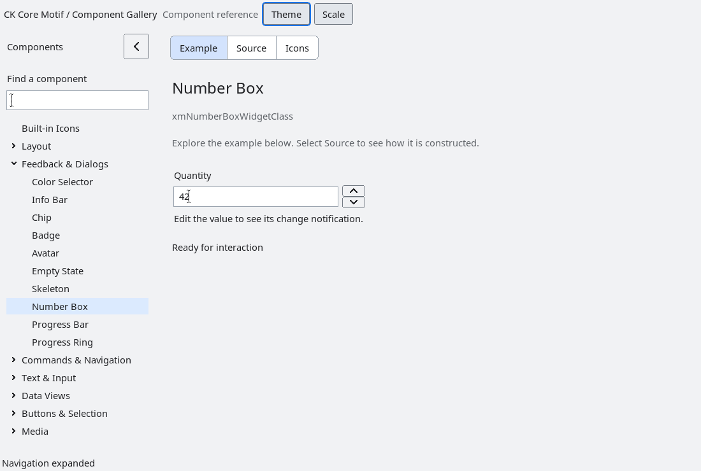
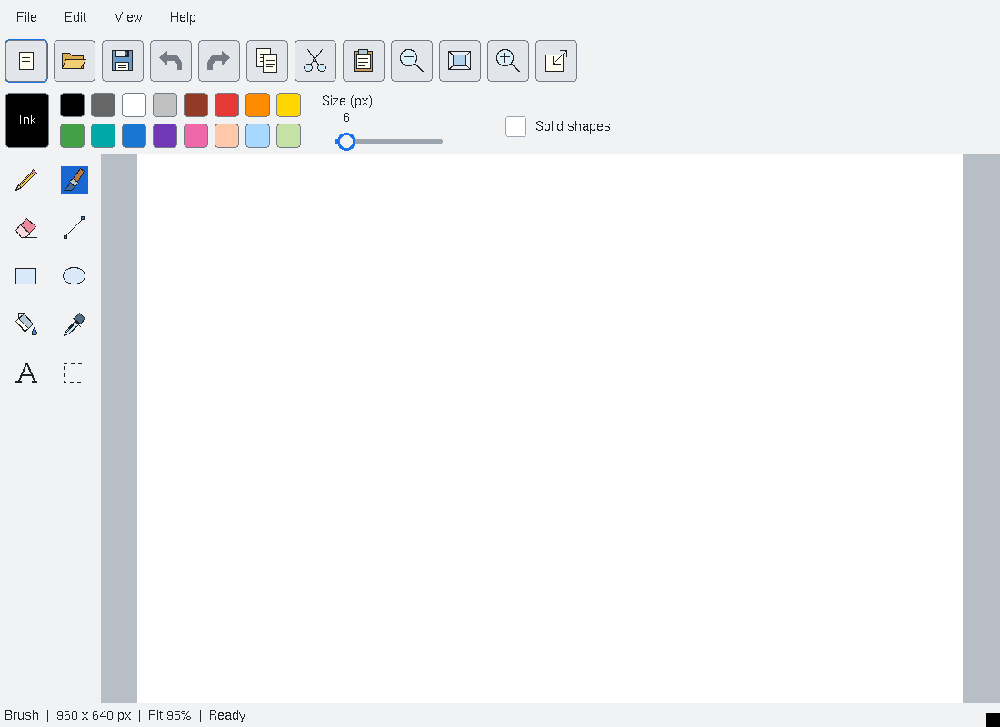
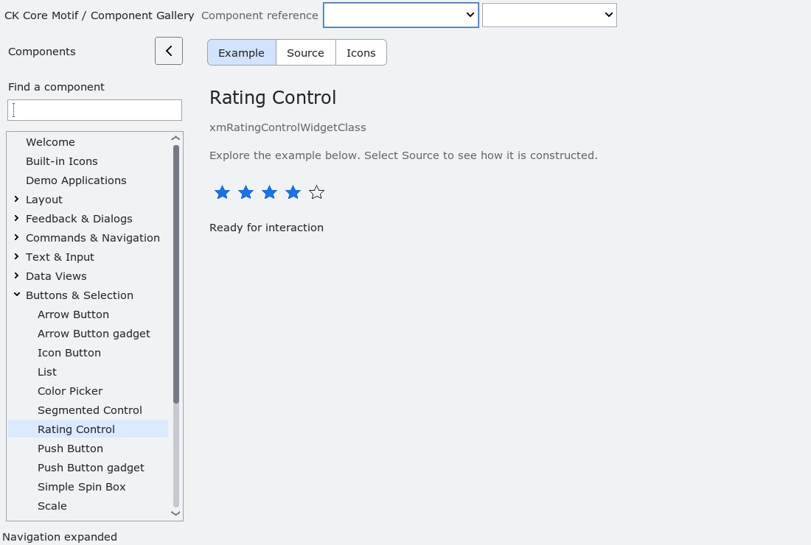
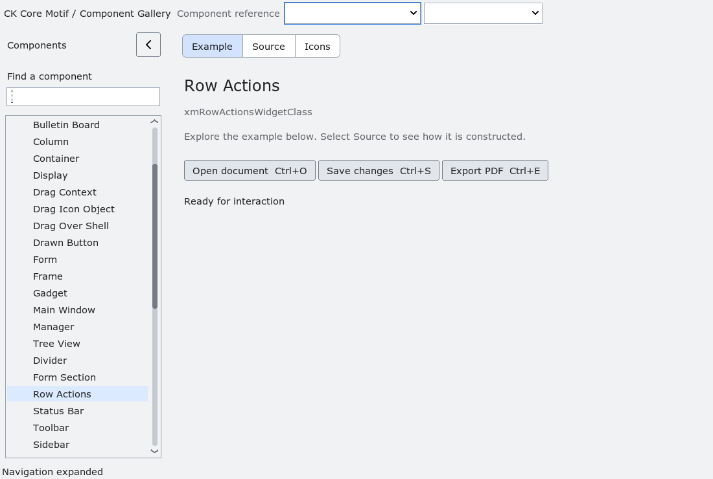
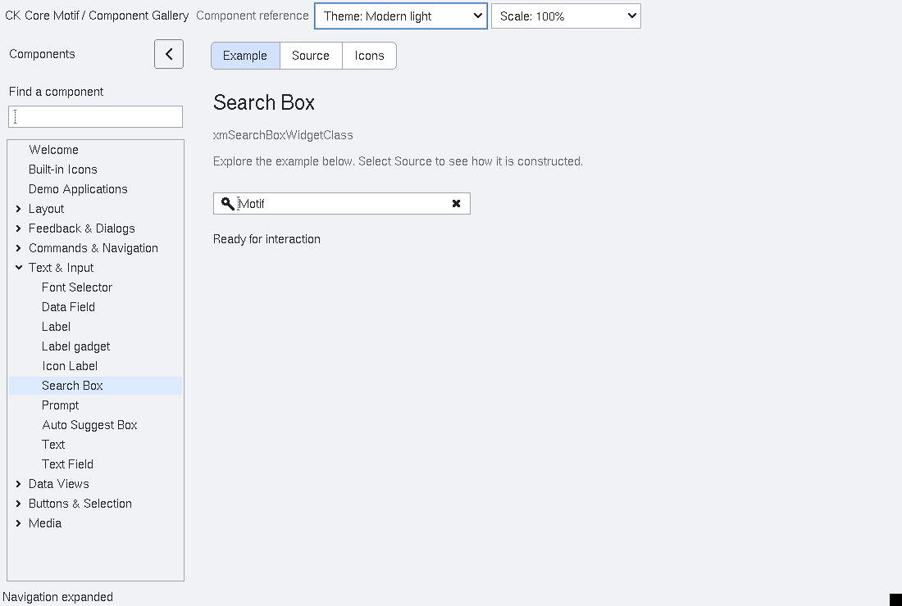
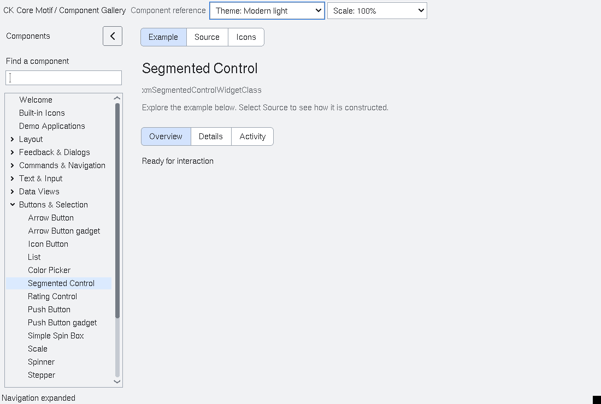

# Bugfix Notes Archive 12

## `mwm-icon-resource-failure.md`

# MWM icon X resource failure

`MakeIconPixmap()` now checks `XCreatePixmap()` and `XCreateGC()` before using
the resources.  If pixmap creation fails it returns `None`; if GC creation
fails it frees the pixmap and returns `None`.  Successful icon scaling,
masking, and beveling remain unchanged.

Run the source-contract regression check with:

```sh
python3 tests/automated/check-mwm-icon-resource-failure.py
```

## `mwm-icon-screen-fallback.md`

# MWM icon screen fallback

`MakeIconPixmap()` selects the client screen when available and otherwise uses
the active MWM screen.  It now returns `None` if both records are unavailable,
before reading icon-size limits or creating X resources.  Valid client and
active-screen records keep the existing icon scaling, masking, and beveling
behavior.

Run the source-contract regression check with:

```sh
python3 tests/automated/check-mwm-icon-screen-fallback.py
```

## `mwm-icon-shadow-gcs.md`

# MWM icon shadow graphics contexts

Icon pixmap construction allocates highlight GCs for the top and bottom
bevels. The constructor now validates both results and releases the temporary
pixmap on failure, preventing null-GC drawing requests and preserving the
existing null-pixmap failure contract.

## `mwm-icon-source-validation.md`

# MWM icon source validation

`MakeClientIconPixmap()` and `MakeIconPixmap()` now reject missing source
pixmaps before geometry queries, and reject zero width/height inputs before
checking size limits, creating resources, or calling
`XCopyArea()`/`XCopyPlane()`. Valid icon scaling, masking, and beveling are
unchanged. A failed built-in bitmap allocation can no longer reach drawing
with an invalid source.

Run the source-contract regression check with:

```sh
python3 tests/automated/check-mwm-icon-source-validation.py
```

## `mwm-icon-teardown.md`

# MWM icon teardown

Icon cleanup can run after partial workspace setup. `FreeIcon` now validates
the WSM workspace list before reading its first icon frame and checks icon
window IDs in both WSM and non-WSM builds. Destroyed IDs are cleared so a
second cleanup remains harmless.

## `mwm-icon-title-geometry.md`

# MWM icon-title geometry helper

`GetIconTitleBox` computes the rectangle used by icon-title painting. It now
returns immediately for a null client, missing screen state, or null output
rectangle, keeping geometry calculation safe when callbacks race with teardown.

## `mwm-icon-title-painting.md`

# MWM icon-title painting

Icon title exposure and redisplay callbacks may run after a client has started
teardown. Both title-drawing entry points now require valid client/screen state
and a realized icon frame before reading appearance data or painting text.
Normal title repainting is unchanged.

## `mwm-iconbox-event-types.md`

# MWM IconBox event-type validation

The MWM IconBox focus and key handlers now verify the event type before reading
the corresponding XEvent union member. Focus feedback accepts only FocusIn and
FocusOut, while the key dispatcher accepts only KeyPress.

This keeps an unexpected event delivery from being interpreted as unrelated
focus or key-event fields. Normal IconBox focus feedback and keyboard commands
are unchanged.

Focused regression check:

    python3 tests/automated/check-keypress-callback-guards.py

## `mwm-iconbox-gc.md`

# MWM icon-box GC source validation

The icon-box highlight and fade graphics contexts are cloned from the
screen's inactive icon appearance GC. If appearance-resource initialization
fails, that source GC can be unavailable even though the icon-box screen
record exists. `MakeShrinkWrapIconsGC` and `MakeFadeIconGC` now return before
calling `XCopyGC` in that state, avoiding a `BadGC` request while leaving the
icon-box usable without the optional decoration.

## `mwm-iconbox-hierarchy-creation.md`

# MWM icon-box hierarchy creation

The icon box is built as a shell, frame, scrolled window, and bulletin board.
Each Xt creation call can fail, for example when a display-side allocation
fails.  The construction helpers now report success, and `MakeIconBox` stops
before realizing or linking a partial hierarchy.  Any created shell and
associated icon-box allocations are released on that path.

`RealizeIconBox` also validates the required widgets and the scrolled-window
clip window before using them.  Existing successful creation and widget names
are unchanged, so applications using MWM retain the same hierarchy and
resources while failure handling is deterministic.

## `mwm-image-path-allocation.md`

# MWM bitmap path allocation

The window manager combines the configured bitmap directory with a relative
icon name before asking Motif to load the image. The measured path length is
checked against Xt's `Cardinal` allocation width, and the allocator can also
fail. In either case the lookup now returns the existing unspecified-pixmap
result before formatting into the buffer. Successful lookup order and path
names are unchanged.

`tests/automated/check-mwm-image-path-allocation.py` protects this contract.

## `mwm-image-path-bounds.md`

# Mwm bitmap path bounds

The window manager combines the configured bitmap directory with a relative
icon name before asking Motif to load the image.  Both strings are resource or
application input, so adding their lengths directly and then using `sprintf`
could wrap the allocation arithmetic or overrun the result.

`GetNamedPixmap` now measures the combined path with `snprintf`, allocates the
exact result plus its terminator, and performs a bounded second formatting
pass.  Bitmap lookup order and names are unchanged.

`tests/automated/check-mwm-image-path-bounds.py` protects this contract.

## `mwm-initial-property-inputs.md`

# MWM initial-property helper inputs

The WSM initial-property helpers in `clients/mwm/WmProperty.c` now handle a
missing `ClientData` record safely:

- `GetInitialPropertyList(NULL)` returns without querying X or modifying state.
- `DiscardInitialPropertyList(NULL)` returns without attempting a free.
- `HasProperty(NULL, atom)` returns `False`.

With a valid client record, the existing property-list capture, release, and
membership behavior is unchanged. The null cases are defensive contracts for
callers that are cleaning up or handling partially initialized client state.

## `mwm-insert-tree-allocation.md`

# MWM command-tree path allocation

Client-command insertion builds a bracketed command path while walking the
MWM command tree.  The measured length is already bounded; the path buffer is
now also checked before formatting.  Allocation failure stops that insertion
without writing through a null pointer, while successful command matching and
path formatting remain unchanged.

`tests/automated/check-mwm-insert-tree-allocation.py` protects this contract.

## `mwm-invoke-command-parsing.md`

# MWM invoke-command parsing

`F_InvokeCommand` receives two 32-bit protocol values and an X atom from a
textual function argument.  It now scans them into matching unsigned
intermediate types before conversion, rather than writing through incompatible
`int *` casts or using a potentially mismatched `%ld` conversion.

The existing client-context dispatch behavior is unchanged.

## `mwm-invoke-message-allocation.md`

# MWM invoke-message allocation

The workspace-management `SendInvokeMessage` path now checks its fixed-size
message allocation before packing the command and client window identifiers.
Under allocation pressure it returns without sending a malformed message,
while successful invocations retain the existing wire format and callback
behavior.

The source-level regression is
`tests/automated/check-mwm-invoke-message-allocation.py`.

## `mwm-invoke-message-guard.md`

# MWM invoke-message guard

Command invocation messages use the per-screen UTM drawing area.  If that
optional widget was unavailable, `SendInvokeMessage` now frees its prepared
payload and returns without calling the UTM transport.  This keeps command
handling safe while preserving normal message delivery when UTM is present.

## `mwm-invoke-window-bounds.md`

# MWM invoke-command window bounds

The invoke-command protocol carries the invoking window as a 32-bit X11
identifier, while the local `Window` typedef can be wider.  `F_InvokeCommand`
now checks that the client window fits in `CARD32` before converting it and
rejects an unrepresentable value instead of silently truncating it.

## `mwm-key-substitution-allocation.md`

# MWM key-substitution allocation

The optional WSM key-substitution table is built from configuration text.
`InitKeySubs` now checks its table, source-string, and replacement-string
allocations. Reallocation uses a temporary pointer, and allocation failure
publishes only the already-complete entries with their correct count. A failed
replacement allocation releases its paired source string before returning.

The behavior is covered by
`tests/automated/check-wm-resparse-keysubs-allocation.py`.

## `mwm-label-parse-allocation.md`

# MWM label-parse allocation

MWM resource parsing copies menu labels and quoted client-command names before
checking for bitmap syntax. It now rejects null inputs and checks both `size_t`
and Xt `Cardinal` limits before allocating either string, avoiding a narrow wrap
while preserving normal label and bitmap handling.

`tests/automated/check-mwm-label-parse-allocation.py` protects this contract.

## `mwm-line-continuation-bounds.md`

# MWM configuration line-continuation bounds

The non-multibyte configuration reader recognizes a continued line by looking
for a backslash before the line ending.  It now checks that the line contains
at least two characters before subtracting two from its length.  Empty and
one-character lines therefore remain ordinary input instead of turning a
`size_t` underflow into an out-of-bounds buffer access.

## `mwm-lower-argument-length.md`

# MWM lower-argument traversal

`F_Lower` scans optional family-stacking arguments using the same command
grammar as `F_Raise`.  Its traversal now uses `size_t` directly instead of
subtracting two from `strlen(args)` into an unsigned counter, and stops on an
empty token.  Short and very long argument strings therefore cannot produce an
underflowed or truncated loop bound.

## `mwm-match-insertion-allocation.md`

# MWM match-list insertion allocation

Client-command matches can insert new menu items.  The insertion path now
passes source strings to the constructor, which owns the copies, avoiding the
previous temporary-string leaks.  It also skips an insertion cleanly when
item construction fails instead of dereferencing a null result.  Successful
insertions retain their labels, arguments, ordering, and command IDs.

`tests/automated/check-mwm-match-insertion-allocation.py` protects this
contract.

## `mwm-matte-gc-initialization.md`

# MWM matte shadow GC initialization

Matte shadow GCs are supplied later by client-resource processing and are
optional for frames without a matte. `GetClientInfo` now initializes both
handles to `NULL`, so early construction or failure cleanup cannot consume
indeterminate GC values.

## `mwm-maximize-geometry.md`

# MWM maximize-button compact geometry

`BevelMaximizeButton()` now returns for heights below five pixels.  Those
values are too small for the legacy maximize glyph, and the previous default
branch subtracted eight from an unsigned height before drawing, producing a
wrapped rectangle.  Normal title-bar heights retain the existing bevel
geometry.

Run the source-contract regression check with:

```sh
python3 tests/automated/check-mwm-maximize-geometry.py
```

## `mwm-menu-accelerator-bounds.md`

# MWM menu accelerator button bounds

MWM associates menu accelerator specifications with menu-button entries while
deciding whether the matched action should be sent to the toolkit.  A partially
constructed or rebuilt menu can have an empty button table, or an accelerator
list that no longer has a matching slot.

The association walk now consumes an explicit remaining-slot count.  It does
not form `menuButtons - 1`, and it cannot decrement beyond the first table
element.  Ordinary accelerator dispatch remains unchanged; the sensitivity
lookup is simply skipped when no corresponding button exists.

`tests/automated/check-mwm-menu-accelerator-bounds.py` checks this source-level
memory-safety contract.  The change preserves MWM's public menu and accelerator
resource syntax.

## `mwm-menu-button-array-bounds.md`

# MWM menu-button array bounds

`MakeMenu` builds a temporary button array from menu items that need greyed
or management-state handling.  It now checks the item count before multiplying
by the element size, rejecting an unrepresentable array without wrapping the
allocation byte count.  Normal menus retain the same button ordering and
resource behavior.

`tests/automated/check-mwm-menu-button-array-bounds.py` protects this contract.

## `mwm-menu-child-creation.md`

# MWM menu child creation

Menu separators are widgets too and can fail to be created when the toolkit
cannot allocate a child.  `CreateMenuWidget` now checks every separator it
adds before counting it or passing the child array to `XtManageChildren`.
Successful menus retain the same separator types, names, and ordering.

## `mwm-menu-conversion-results.md`

# MWM menu conversion results

The `_MWM_MENU` property is converted through Xmb before parsing.  MWM now
rejects an empty XTextProperty, then requires both a non-empty converted item count and a non-null first entry
before handing the result to the menu parser, while preserving the existing
cleanup path for empty or failed conversions.  Any returned text list is freed
even when validation rejects it.
An Xlib property payload is also released when the property has zero items, so
an empty-but-allocated reply cannot leak through the early validation path.
The conversion output variables are initialized before the call so unusual
converter results remain safe to clean up.
Conversion failures also release any partial text list returned by Xmb.

## `mwm-menu-counts.md`

# MWM menu-button count safety

MWM stores the allocated and active menu-button counts as `unsigned int`.
Client-command updates now use the same unsigned type for their loop,
compaction, and snapshot counters. This avoids narrowing a valid count into a
signed temporary before indexing the menu-button array.

The focused source-contract regression is:

```sh
python3 tests/automated/check-mwm-menu-counts.py
```

## `mwm-menu-item-copy-allocation.md`

# MWM menu-item copy allocation

Custom menus duplicate their source menu items, including labels, accelerator
text, function arguments, and client-command names.  The copy now checks each
node and owned-string allocation, links only complete nodes, and releases the
current and previously copied items on failure.  Valid menu copies retain
their original ordering and ownership rules.

`tests/automated/check-mwm-menu-item-copy-allocation.py` protects this
contract.

## `mwm-menu-label-termination.md`

# Mwm menu-label termination

Client-command menu labels are parsed from quoted resource text.  The legacy
parser copied the bytes with `strncpy` without terminating them, then called
`strlen` on the unterminated allocation and wrote the terminator one byte past
the intended label.  An empty quoted label also left the multibyte scan length
uninitialized.

The parser now initializes the scan state and copies the exact label length
with an explicit terminator.  Empty, ASCII, and multibyte labels all have a
deterministic owned string.

`tests/automated/check-mwm-menu-label-termination.py` protects this contract.

## `mwm-menu-name-allocation.md`

# MWM quoted menu-name allocation

MWM resource parsing accepts a quoted label for client-command menu entries.
The parser requires the matching closing quote before it measures or stores the
label, then checks the measured name length and allocation result before
copying the label or writing its terminator. An unterminated, unrepresentable,
or unallocatable label is ignored safely; valid labels and command matching are
unchanged.

`tests/automated/check-mwm-menu-name-allocation.py` protects this contract.
`tests/automated/run-mwm-menu-name-termination.py` compiles the real parser
into a small harness covering complete and unterminated labels.

## `mwm-menu-retry-state.md`

# MWM menu retry state

`CreateMenuWidget` marks a menu specification while recursively constructing
its children.  Allocation failures now clear that marker before returning, so
a later attempt can retry the menu instead of being falsely rejected as menu
recursion.  Successful construction and recursion detection remain unchanged.

## `mwm-menu-root-creation.md`

# MWM menu root creation

`CreateMenuWidget` now treats failure to create either the menu shell or its
row-column pane as a failed menu construction.  The recursion marker is
cleared, and a shell created before a pane failure is destroyed.  This avoids
callback registration and menu-item construction against a null widget while
preserving the existing widget classes, names, and resource arguments on the
successful path.

## `mwm-menu-spec-allocation.md`

# MWM menu-spec name allocation

MWM creates a menu specification before parsing its items.  The specification
name is copied from resource input, so allocation failure must abort creation
before the partially initialized record enters the menu list.  `MakeMenuSpec`
now rejects a null name and frees the record if copying the name fails; valid
menu specifications retain the same fields and behavior.

`tests/automated/check-mwm-menu-spec-allocation.py` protects this contract.

## `mwm-menu-spec-copy-allocation.md`

# MWM menu-spec copy allocation

Custom menus duplicate an existing menu specification before adding client
items.  The duplicate now handles a null source record and checks the copied
name before continuing.  If the name cannot be copied, the new record is
released and duplication fails cleanly; valid specifications retain the same
name and menu behavior.

`tests/automated/check-mwm-menu-spec-copy-allocation.py` protects this
contract.

## `mwm-menutree-bounds.md`

# Mwm command-tree bounds

Nested menu command names are assembled from resource-controlled fragments.
The construction now uses `size_t` arithmetic with overflow checks and bounded
`snprintf` calls. A missing tree name is treated as an empty component, and an
unrepresentable command is skipped safely instead of overflowing an integer or
heap buffer.

`tests/automated/check-mwm-menutree-bounds.py` guards this construction.

## `mwm-message-initialization.md`

# MWM message initialization

`initMesg()` now returns after its first completed initialization.  The
localized confirmation strings are process-global, so reinitializing them for
each screen or dialog only leaked the previous catalog allocations.  The
existing fallback strings and localized message selection remain unchanged.

Run the source-contract regression check with:

```sh
python3 tests/automated/check-mwm-message-initialization.py
```

## `mwm-modal-input-window.md`

# MWM modal input-window failure handling

System-modal dialogs use a per-screen input-only window to block background
input. That helper is optional when X resource allocation fails. Modal setup,
sibling placement, and teardown now configure, map, or unmap it only when its
window ID is valid,
so dialogs do not issue requests against `None` after helper creation failure.

## `mwm-modal-window-mapping.md`

# MWM modal-window mapping failure

`SetupSystemModalState()` now checks `inputScreenWindow` before mapping it on
non-active screens.  If X window creation failed, the modal setup keeps the
invalid window unmapped instead of issuing `XMapRaised()` on `None`.

Run the source-contract regression check with:

```sh
python3 tests/automated/check-mwm-modal-window-mapping.py
```

## `mwm-multiscreen-selection.md`

# Mwm multi-screen selection naming

Mwm owns one `WM_S<number>` selection for each managed screen. The selection
name is now formatted from `wmGD.Screens[scr].screen` inside the per-screen
loop, so multiple screens no longer reuse the display's default screen atom.
The buffer is sized and formatted with `snprintf`; single-screen behavior is
unchanged.

`tests/automated/check-mwm-multiscreen-selection.py` guards this mapping.

## `mwm-named-icon-fallback.md`

# MWM named-icon fallback inputs

`MakeNamedIconPixmap()` now returns `None` for a missing client record or when
neither the client nor active MWM screen exists.  It skips named-file lookup
when the client has no screen record, then uses the selected active-screen
record for the built-in fallback.  Valid clients with screen data retain their
named pixmap, scaling, and default fallback behavior.

The local named-pixmap result begins as `XmUNSPECIFIED_PIXMAP`. Therefore a
client with a valid screen but no icon name takes the built-in icon fallback
instead of testing an uninitialized X resource ID.

Run the source-contract regression check with:

```sh
python3 tests/automated/check-mwm-named-icon-fallback.py
```

## `mwm-named-icon-metadata.md`

# MWM named-icon metadata

Named icon pixmaps require dimensions and depth from `XmeGetPixmapData` before
they can be converted. If that query fails, `MakeNamedIconPixmap` marks the
named pixmap unavailable and follows the existing built-in-icon fallback path.

## `mwm-normal-hints-range.md`

# MWM `WM_NORMAL_HINTS` range validation

The property reader stores X11 `long` property fields in Motif's signed
`int`-sized `SizeHints` structure.  It now rejects a malformed property when
any field cannot be represented, before narrowing conversions occur.  The
reader returns the same unknown/default-hints state used for an unavailable or
invalid property, preserving normal ICCCM behavior while preventing wrapped
geometry and resize constraints. Legacy ICCCM R2 records are checked only
across their 15-field payload; newer base-size and gravity fields are checked
only when the full current-format record is present.

The bounded X11 read must also be complete (`bytes_after` is zero) and return a
non-null payload.  An oversized property is not a valid third layout: its
15- or 18-field prefix is ignored rather than being mistaken for a complete
set of geometry constraints.  This applies to both WSM and standalone MWM
builds.

## `mwm-null-client-icon-colors.md`

# WSM null-client icon colors

`MakeIconPixmap` supports constructing an icon from screen defaults without a
client. Its masked-image color path now selects `iconAppearance` from the
screen when no client exists, preserving valid foreground/background values
for built-in icons.

## `mwm-number-argument-bounds.md`

# MWM numeric argument bounds

MWM numeric resource arguments now use explicit Boolean conversion helpers
with an output value. Decimal, hexadecimal, and octal accumulation checks for
overflow before multiplying, and a missing argument is rejected without
dereferencing a null pointer. The accepted bases and unsigned output remain
compatible with the existing parser.

The source contract is covered by
`tests/automated/check-wm-resparse-number-bounds.py`.


The numeric keysym fallback also uses the checked Boolean conversion contract:
`StrToNum` fills an unsigned output value, and `ParseKeySym` assigns that value
only after success. Its former one-argument sentinel call prevented a fresh
MWM build. `tests/automated/run-mwm-numeric-keysym.py` compiles the production
caller together with the decimal, octal and hexadecimal helpers and exercises
named symbols, valid numeric keysyms, overflow and malformed input.

## `mwm-outline-gc.md`

# MWM outline drawing and failed GC creation

`FlashOutline` and `DrawOutline` draw the temporary move/resize outline with
the screen's XOR graphics context. X resource allocation can fail, leaving
that context unavailable. Both entry points now return before issuing an X
drawing request when the active screen record or its XOR GC is missing. This
keeps a resource failure from becoming a `BadGC` request while preserving the
normal outline behavior when initialization succeeds.

## `mwm-outline-window-transaction.md`

# MWM outline-window allocation

The WSM outline renderer uses four temporary windows for the north, south,
east, and west edges. Creation is now transactional: if any edge window
cannot be allocated, already-created siblings are destroyed and all IDs are
reset. `WindowOutline` draws only when all four resources are valid, avoiding
partial outlines and invalid X requests.

## `mwm-parser-token-bounds.md`

# MWM parser token boundaries

MWM now copies parsed configuration tokens through one bounded helper instead
of narrowing pointer differences to `int`.  Context, modifier, event, and key
symbol tokens remain terminated within their destination arrays.  Parsed menu
function indices are validated before table lookup, and a `KeySym` that cannot
fit the public unsigned-detail value is rejected rather than truncated.

The lowercase helper also passes bytes to the C character-classification APIs
as `unsigned char`, which avoids undefined behavior for non-ASCII locale
bytes.

Icon-box subcontext masks are also complemented in the unsigned `Context`
domain, so removing a subcontext does not pass a signed complement through the
unsigned mask.

The focused source contract is covered by
`tests/automated/check-mwm-parser-token-bounds.py`.

## `mwm-parser-warning-bounds.md`

# Mwm parser-warning bounds

WSM resource parsing reports localized messages together with the current
configuration filename and line number.  The legacy `PWarning` path formatted
those values into a fixed `MAXWMPATH+1` buffer, so long parse messages or paths
could overwrite stack storage.

`PWarning` now measures and allocates the complete rendered message before
calling `_DtSimpleError`, checking the formatter width before converting to an
Xt `Cardinal`, with a direct message fallback if allocation fails.
The warning context and parser behavior are unchanged.

`tests/automated/check-mwm-parser-warning-bounds.py` protects this contract.

## `mwm-preprocessor-tempfile.md`

# MWM preprocessor temporary output

When its optional configuration preprocessor is enabled, MWM creates the
output pathname with `mkstemp()` rather than asking `tmpnam()` for an
unreserved name.  The file is created atomically in `TMPDIR` (or the platform
temporary directory when `TMPDIR` is unset), then the existing preprocessor
command writes its output to that owned pathname.

The command shape and its normal cleanup are unchanged: MWM still opens the
preprocessed result by pathname and removes it through
`DeleteTempConfigFileIfAny()` and configuration-stack cleanup.  Failure to
reserve or close the temporary file cleanly disables preprocessing for that
config read instead of leaving an unowned name behind.

Regression: `tests/automated/check-mwm-preprocessor-tempfile.py`.

## `mwm-property-payload-pointers.md`

# MWM X11 property payload validation

Several MWM property readers receive an allocated payload pointer from Xlib.
The readers now require that pointer to be non-null alongside the expected
type, format, and item count before copying, parsing, or returning data.  This
keeps malformed or failed property replies from becoming null-pointer
accesses, including the WM_STATE and _MWM_HINTS getters.

`WM_NORMAL_HINTS` also releases a returned Xlib payload when later validation
rejects its type, format, item count, or trailing data.  Xlib can allocate that
payload before reporting metadata that MWM does not accept, so rejecting the
metadata must not leave the temporary allocation behind.
The same contract now covers the WM_PROTOCOLS, _MWM_MESSAGES, and
WM_COLORMAP_WINDOWS arrays before their elements are consumed.

`WM_PROTOCOLS` additionally treats a zero-item property as absent.  It no
longer asks Xt for a zero-byte protocol array or emits a misleading allocation
warning for an empty client property.

All three variable-length readers use bounded `XGetWindowProperty` requests.
They now require `bytes_after` to be zero before inspecting the returned
array.  A client property that exceeds MWM's historical 40-item limit is not
partly applied, so a suffix cannot silently change the intended protocol,
message, or colormap-window list.  Once the complete bounded count is
accepted, conversions to MWM's `int` count fields are explicit.

## `mwm-property-processors-inputs.md`

# MWM property-processor inputs

The WM protocol, Motif-message, and colormap-window property processors now
return immediately when no `ClientData` record is supplied. This prevents
null dereferences before state cleanup or Xlib property access; normal client
processing is unchanged.

The focused source contract is covered by
`tests/automated/check-mwm-property-processors-inputs.py`.

## `mwm-property-reader-inputs.md`

# MWM property-reader inputs

`GetNormalHints` now returns its existing default-hints structure when called
without a client record, and `GetMwmHints` returns `NULL` before accessing the
client. This makes both property readers safe for defensive callers while
preserving their normal X-property behavior.

The focused source contract is covered by
`tests/automated/check-mwm-property-reader-inputs.py`.

## `mwm-property-warning-bounds.md`

# Mwm property-warning bounds

When a client title or icon title cannot be converted, `mwm` reports the X11
property atom or current locale.  The old diagnostic path formatted those
values into a fixed 200-byte array, so long localized messages or atom names
could overwrite stack storage and the `%.100s` limit could truncate useful
context.

Warnings are now measured with `snprintf`, validated as `size_t` values before
the Xt `Cardinal` conversion, allocated to their rendered length, and released
after dispatch.  Normal warning text and conversion fallback behavior remain
unchanged; atom names are also released after use.

`tests/automated/check-mwm-property-warning-bounds.py` protects this contract.

## `mwm-protocol-atom-bounds.md`

# MWM protocol atom-array bounds

Per-screen protocol atom arrays now validate the signed screen count and the
`sizeof(Atom)` multiplication against both `size_t` and Xt's `Cardinal` byte
limit before allocation. This applies to WM-selection ownership and optional
WM-query atoms without changing normal screen initialization.

The source contract is covered by
`tests/automated/check-mwm-protocol-atom-bounds.py`.

## `mwm-query-atom-format-bounds.md`

# MWM query-atom formatting

For each managed screen, MWM creates a `_MOTIF_WM_QUERY_<screen>` atom name.
The name is now formatted with `snprintf` into the existing compatibility
buffer and checked for failure or truncation before interning the atom. This
keeps malformed or unexpectedly large screen identifiers from reaching Xlib as
an unterminated name.

The focused source contract is checked with:

```sh
python3 tests/automated/check-mwm-query-atom-format-bounds.py
```

## `mwm-query-client-guards.md`

# MWM all-client query guards

The WM-query conversion path now validates its screen index and all output
pointers before traversing the client list. Detached entries without client
data are skipped, and the accumulated XID count is explicitly widened to the
selection API's `unsigned long` length type.

The source contract is covered by
`tests/automated/check-mwm-query-client-guards.py`.

## `mwm-raise-argument-length.md`

# MWM raise-argument traversal

`F_Raise` scans optional family-stacking arguments.  The old loop subtracted
two from `strlen(args)` into an unsigned counter, so a short argument could
underflow into a very large traversal and a very long argument could truncate
the bound.  The loop now uses `size_t` directly and stops on an empty token.

Normal `within` and `freeFamily` arguments retain their existing behavior.

## `mwm-refresh-geometry-guard.md`

# MWM refresh geometry guard

The temporary window used by `F_Refresh_Win` receives unsigned X11 dimensions,
while client and maximized geometry is stored in signed `int` fields.  The
refresh action now skips the request when either dimension is non-positive,
avoiding a negative-to-unsigned conversion that could request a huge window
during a malformed-hints or teardown transition.

## `mwm-refresh-tree-cleanup.md`

# MWM refresh tree cleanup

`RefreshByClearing` recursively queries child windows with `XQueryTree` and
must release the server-allocated child list after each successful query. The
cleanup now follows the returned pointer rather than the child count, so an
unusual successful response with an allocated empty list is still released.

## `mwm-refresh-window-base-guard.md`

# MWM client refresh base-window guard

`F_Refresh_Win` creates a temporary child of the client's base window.  During
unmanage and frame teardown, callbacks can arrive after `clientBaseWin` has
been cleared.  The refresh action now returns without issuing an X request when
that base window is `None`.

Normal managed clients retain the existing temporary refresh behavior.

## `mwm-refresh-window-create.md`

# MWM refresh-window creation failure

The non-WSM refresh commands use short-lived windows to trigger repainting.
Both `F_Refresh` and `F_Refresh_Win` now check the temporary
`XCreateWindow` result before mapping and destroying it. If allocation fails,
the command returns successfully without issuing requests against `None`.

## `mwm-rename-allocation.md`

# MWM command rename allocation

Runtime command updates can rename an existing menu item.  The new label is
now copied before replacing the old one; if allocation fails, the old label
and visible menu remain intact.  Successful renames retain the existing
tear-off-safe update path and widget behavior.

`tests/automated/check-mwm-rename-allocation.py` protects this contract.

## `mwm-replacement-allocation.md`

# MWM replacement allocation

`WmMalloc` is used when MWM replaces a live dynamic buffer. It now allocates
the replacement before freeing the old block. If allocation fails, the old
pointer remains valid and the caller can preserve or retry its state; the
previous order freed the old block first and left callers with a dangling
pointer.

Successful replacement behavior is unchanged. The focused source contract is
covered by `tests/automated/check-mwm-replacement-allocation.py`.

## `mwm-rlist-growth-ownership.md`

# MWM rectangle-list growth ownership

`ExtendRList` now treats a successful replacement allocation as the new list
buffer even when the old list is empty. The old implementation only assigned
the replacement pointer inside the non-empty copy branch, so growing a zero-
capacity list leaked the new allocation and left `prect` unchanged.

The growth path also rejects an inconsistent nonzero `used` count with no old
buffer, validates the list counters before copying, and keeps the old list
untouched when validation fails. The focused source contract is covered by
`tests/automated/check-mwm-rlist-growth-ownership.py`.

## `mwm-root-menu-fallback.md`

# MWM built-in root-menu fallback

When MWM constructs its built-in key or button bindings, a missing
`rootMenu` resource now falls back to `DefaultRootMenu` before measuring or
formatting the binding text. Configurations that provide a root menu retain
their existing behavior; incomplete resource sets no longer crash in `strlen`.

`tests/automated/check-mwm-root-menu-fallback.py` protects this contract.

## `mwm-running-inputs.md`

# MWM-running query input contract

`XmIsMotifWMRunning` checks the Motif window-manager property for a shell's
screen.  A null shell cannot identify a screen or display; the query now
returns `False` before `XtScreen` or application-context lookup.  Valid shell
queries are unchanged.

## `mwm-screen-client-list-bounds.md`

# MWM screen client-list bounds

`UpdateScreenClientList` now checks the next element count and byte product
before reallocating its window array. It also converts the final count
explicitly to the unsigned type used by `SetMwmClientList`, preserving the
existing property update behavior while avoiding size and conversion hazards.

The source contract is covered by
`tests/automated/check-screen-client-list-guards.py`.

## `mwm-screen-conflict-warning.md`

# Mwm screen-conflict warning bounds

During startup, `mwm` reports when another window manager already owns a
screen.  The localized message was formatted into an 80-byte stack buffer,
which could overflow for a long catalog translation.

The warning is now measured and allocated for its complete rendered length,
after checking that the formatter result fits Xt's `Cardinal` width. A short
fallback is emitted if message allocation fails; screen-management behavior is
unchanged.

`tests/automated/check-mwm-screen-conflict-warning.py` protects this contract.

## `mwm-screen-data-allocation.md`

# MWM screen-record allocation

MWM obtains its managed screen count from Xlib and configuration processing,
then stores one `WmScreenData` record for each screen.  Before using the count
for the Xt `Cardinal` allocator, startup now requires a positive count and
checks the record-array byte size against both host `size_t` and Xt's limit.
Invalid counts stop initialization before backdrop or screen access; valid
single- and multi-screen behavior is unchanged.

## `mwm-screen-display-bounds.md`

# Mwm screen display bounds

Per-screen startup derives the display environment string from Xlib's display
name.  The legacy code copied that name into fixed 256-byte scratch buffers,
which could overflow for long hostnames or transport-specific display names.

`InitWmScreen` now parses a private dynamically sized copy and formats into a
buffer sized from the complete input.  The resulting per-screen
`DISPLAY=...` value and resource initialization behavior are unchanged for
normal displays, while long names no longer overwrite stack storage.

`tests/automated/check-mwm-screen-display-bounds.py` protects this contract.

## `mwm-screen-list-length.md`

# MWM screen-list name lengths

`ProcessScreenListResource` now keeps screen-list name lengths in `size_t` and
checks them against the `unsigned` size accepted by `WmRealloc` before copying
the name. Both explicitly listed names and the repeated-name fallback use the
same bound, preventing truncating allocation sizes for oversized resource
values.

Both allocations are transactional as well: a temporary receives the
replacement before the live screen-name slot changes. A failed replacement
therefore preserves the old valid name even if shutdown is delayed or tested.

The focused source contract is covered by
`tests/automated/check-mwm-screen-list-length.py`.

## `mwm-screen-name-allocation.md`

# MWM command-line screen-name allocation

The `-screens` parser now keeps screen-name lengths in `size_t`, rejects names
that cannot fit Xt's `Cardinal` allocation size, and publishes `XtRealloc`
results only after success. The same bound is applied when copying the first
name to the remaining screens.

The source contract is covered by
`tests/automated/check-wm-resparse-screen-names.py`.

## `mwm-screen-name-initialization.md`

# MWM WSM screen-name initialization

When the WSM build replaces the default `fbk` screen name, it now formats the
screen number into a local, bounded buffer. The previous code wrote through the
general display-string buffer before that pointer was allocated, which could
crash MWM during multiscreen startup. The replacement checks the formatting
result, sizes the Xt allocation from the measured length, and copies only the
initialized bytes.

The initial four-byte slots used for default screen names are also populated
with checked `snprintf` output in both WSM and non-WSM builds.

The focused source contract is checked with:

```sh
python3 tests/automated/check-mwm-screen-name-initialization.py
```

## `mwm-screen-name-table-bounds.md`

# MWM screen-name table bounds

`InitScreenNames` now validates the signed screen count and pointer-table byte
product against both `size_t` and Xt's `Cardinal` allocation width before
allocating the table. Normal screen-name initialization is unchanged, while
invalid geometry cannot wrap into an undersized allocation.

The source contract is covered by
`tests/automated/check-mwm-screen-name-table-bounds.py`.

## `mwm-screen-warning-format.md`

# MWM unmanaged-screen warning formatting

The `F_Screen` unmanaged-screen warning uses a fixed format string.  Both
`snprintf` calls now pass that literal directly, preserving compiler format
checking and the existing warning text while retaining the allocation guard.

## `mwm-screen-warp-warning.md`

# Mwm screen-warp warning bounds

The `f.screen` command reports an attempt to warp to an unmanaged screen.  Its
message was formatted into an 80-byte stack buffer, which was unnecessary and
could overflow if the diagnostic were localized or extended.

The warning now allocates the exact rendered message length and keeps the bell
and command-failure behavior unchanged.  A short fallback is used only when
message allocation fails.

`tests/automated/check-mwm-screen-warp-warning.py` protects this contract.

## `mwm-selection-atom-initialization.md`

# MWM per-screen selection atom initialization

`mwm` maintains one `WM_Sn` selection atom for each physical X11 screen.
Only screens managed by the current window-manager instance acquire a named
selection.  The backing table is now zero-initialized, so every unmanaged
entry is explicitly `None` rather than indeterminate storage.

This preserves the existing public selection names and ownership behavior.
It makes callback-side comparisons deterministic if a screen is unmanaged or
if setup cannot install a selection callback for that screen.

`tests/automated/check-mwm-selection-atom-initialization.py` verifies the
allocation contract without requiring a nested window-manager session.

## `mwm-separator-template-allocation.md`

# MWM separator-template allocation

Legacy CCI menu parsing optionally inserts separator-template items.  Template
and label allocation are now checked, and callers omit only the optional
separator when construction fails rather than linking a null node into the
menu list.  Actual menu items and valid separators retain their ordering and
behavior.

`tests/automated/check-mwm-separator-template-allocation.py` protects this
contract.

## `mwm-session-command-growth.md`

# Mwm session-command growth

WSM session restoration tokenizes a saved command into an array of argument
pointers.  The legacy loop wrote the next pointer before expanding its
100-entry array, so a command with exactly 100 segments wrote past the
allocation; allocation failures were also unchecked.

The parser now grows the array before insertion and aborts cleanly on either
initial or subsequent allocation failure.  Command ordering and restored
argument content remain unchanged.

`tests/automated/check-mwm-session-command-growth.py` protects this contract.

## `mwm-session-db-format-bounds.md`

# MWM session DB path formatting

When MWM derives its session client database path from the home directory, it
allocates room for the path and restart suffixes. The path is now written with
`snprintf` and its return value is checked; a formatting failure or unexpected
truncation releases the allocation and leaves the database name unset rather
than retaining a malformed path.

Proxy-client IDs written into the same session file use the same checked
formatter, so a future change to the ID representation cannot silently
truncate the serialized record.

The focused source contract is checked with:

```sh
python3 tests/automated/check-mwm-session-resource-bounds.py
```

## `mwm-session-db-path.md`

# Mwm session database path bounds

The session-management database is loaded and saved through a fixed
`MAXPATHLEN` stack buffer.  Command-line and resource configuration can supply
an arbitrary database path, so copying that value directly could overwrite the
buffer before the session database was opened.

The non-WSM path now checks the complete source length before copying.  Paths
that fit retain their exact spelling; an overlong path falls back to the
standard `dtwmFileName`, matching the existing fallback used when the WSM
session path cannot fit. The fallback itself is bounded, so a future or
platform-specific default cannot overflow the fixed buffer.

`tests/automated/check-mwm-session-db-path.py` protects the source-level
contract.

## `mwm-session-hints-input.md`

# MWM DT session-hint input

`GetDtSessionHints` now returns immediately when called without a
`WmScreenData` record. This prevents a null dereference before the root-window
property lookup. Calls with valid screen data continue to parse and remove the
session-hints property as before. The item-count boundary is also checked
before allocation: null screen data, zero or negative counts, and counts that
cannot fit in the Xt `Cardinal` allocation size are rejected without touching
the destination. The allocation byte count is computed once in `size_t` and
reused for zero-initialization, so allocation and initialization cannot
disagree.

The bounded X11 property read must be complete before its bytes are copied into
the session parser. A property with bytes remaining is discarded with the same
restart cleanup as any other unusable session hint.

## `mwm-session-resource-bounds.md`

# Mwm session resource-name bounds

Session-management resource names are built from client IDs and, for workspace
sessions, workspace names.  The legacy implementation formatted those names
into a fixed 1024-byte buffer in both resource lookup and proxy-entry removal.
Long IDs or workspace names could therefore overwrite stack storage.

Both paths now measure and allocate the complete resource name, release the
temporary buffer after the Xrm operation, and preserve the existing resource
keys and database update behavior.

The signed formatter result is first widened to `size_t` and checked against
the Xt allocation width before conversion, including the extra delimiter byte
used when removing a proxy-client entry.  This avoids a narrowing cast making
an oversized formatter result appear valid on 64-bit builds.

`tests/automated/check-mwm-session-resource-bounds.py` protects this contract.

## `mwm-slide-cover-window.md`

# MWM slide cover-window creation failure

Slide-up and slide-back transitions use a temporary input-only cover window
while the client frame moves. If that optional window cannot be created, the
transition now clears its pending slide record and returns. The client remains
mapped without issuing configure/map requests against an invalid `None` window.

## `mwm-startup-icon-inputs.md`

# MWM startup and named-icon input boundaries

MWM derives its resource identity from `argv[0]` before creating its Xt
application state. The program entry point now rejects an empty or incomplete
argument vector before that access. `CopyArgv`, which is also used as a helper
by restart support, independently converts a negative count or a missing
non-empty vector to an empty restart state rather than dereferencing it or
retaining a negative secondary-display count.

Named icon lookup now also requires both an icon name and a valid X `Screen`.
This preserves the existing bitmap-directory and `XBMLANGPATH` lookup order
for valid calls while avoiding a null screen reaching Motif's pixmap APIs.

Focused check:

```
python3 tests/automated/check-mwm-startup-icon-inputs.py
```

## `mwm-startup-widget-creation.md`

# MWM startup widget creation

Screen and workspace resource widgets are created during MWM startup.  The
startup path now stops safely when a required screen shell or workspace widget
cannot be allocated, and it skips optional UTM callback setup when its drawing
area cannot be created.  Successful startup retains the same widget classes,
names, resources, and popup behavior.

## `mwm-stretcher-corner-geometry.md`

# MWM stretcher-corner geometry

`StretcherCorner()` now validates its lists and dimensions before generating
resize-handle rectangles.  It requires a two-pixel border, at least a
three-pixel corner in each direction, and a border no wider than either corner
dimension.  Invalid compact geometry is skipped instead of wrapping
expressions such as `cwidth - 3`, `cheight - 3`, or `swidth - 2`.

Run the source-contract regression check with:

```sh
python3 tests/automated/check-mwm-stretcher-corner-geometry.py
```

## `mwm-stretcher-geometry.md`

# MWM stretcher geometry validation

`CreateStretcherWindows()` now checks the `GetFramePartInfo()` result for every
resize handle.  If a frame part is unavailable, that handle is skipped rather
than using uninitialized local coordinates or dimensions in `XCreateWindow()`.
Valid frame records continue to create all available resize handles exactly as
before.

Run the source-contract regression check with:

```sh
python3 tests/automated/check-mwm-stretcher-geometry.py
```

## `mwm-stretcher-window-initialization.md`

# MWM stretcher-window initialization

Client records contain one window ID for each resize-border stretcher.
Creation only fills entries for frame parts that are valid for a particular
decoration. `GetClientInfo` now initializes every entry to `None`, so later
frame regeneration cannot interpret uncreated entries as arbitrary X window
IDs.

## `mwm-stretcher-window-rollback.md`

# MWM stretcher-window creation rollback

Resize handles are separate X input-only windows.  Previously, a failed
`XCreateWindow` left the frame construction running with only a subset of its
resize handles, producing a partially functional decoration.  Stretcher
creation is now transactional: any failure destroys every handle created for
that frame and causes `ConstructFrame` to unwind the frame window.

Normal frames still create the same handles, while low-resource failures no
longer leave a half-working resize border.

## `mwm-system-button-width.md`

# MWM system-button width validation

`BevelSystemButton()` now validates the available width for each height range
before computing the icon rectangle.  Narrow malformed frame-part rectangles
are skipped instead of wrapping unsigned `width - 4`, `width - 6`, or
`width - 8` calculations.  Normal square title-bar gadgets retain their
existing geometry.

Run the source-contract regression check with:

```sh
python3 tests/automated/check-mwm-system-button-width.py
```

## `mwm-system-menu-bounds.md`

# Mwm localized system-menu bounds

The window manager assembles its built-in system menu from localized command
strings.  The legacy implementation concatenated those strings into a fixed
2048-byte buffer, so long translations could overrun the stack.

The menu is now measured with `snprintf`, allocated to its exact rendered
length, and formatted with a bounded second pass.  Menu ordering and fallback
behavior are unchanged, and long translations are preserved instead of
truncated.

`tests/automated/check-mwm-system-menu-bounds.py` protects this contract.

## `mwm-system-modal-cursor.md`

# MWM system-modal cursor resources

`SetupSystemModalState()` now checks both bitmap resources before calling
`XCreatePixmapCursor()`.  Failed resources are freed individually, and the
modal input window falls back to the default cursor while retaining its input
grab behavior.

Run the source-contract regression check with:

```sh
python3 tests/automated/check-mwm-system-modal-cursor.py
```

## `mwm-system-modal-screen-size.md`

# MWM system-modal screen size validation

Before creating the system-modal input window, MWM now validates that the
signed Xlib screen dimensions are positive and then converts them explicitly
to the unsigned X window-size type. Invalid geometry is rejected for that
screen instead of becoming a wrapped, oversized window.

The source contract is covered by
`tests/automated/check-mwm-system-modal-screen-size.py`.

## `mwm-target-list-length.md`

# MWM TARGETS conversion length

The `TARGETS` selection response now reports the number of Atom items in
`outputLen`, as required for an X11 format-32 conversion. It no longer derives
the length from host `sizeof(Atom)`, which incorrectly doubled the count on
64-bit systems and could make consumers read beyond the allocated array.

The source contract is covered by
`tests/automated/check-mwm-target-list-length.py`.

## `mwm-temp-cleanup.md`

# Mwm temporary configuration cleanup

WSM preprocessing creates temporary configuration files.  The legacy cleanup
path assembled `/bin/rm <path>` in a fixed `MAXWMPATH+1` buffer and passed it to
the shell, so long names could overflow and shell metacharacters could change
the cleanup command.

Temporary files are now removed directly with `unlink()`.  Cleanup ordering and
ownership release remain unchanged, while path length and shell parsing no
longer affect the operation.

`tests/automated/check-mwm-temp-cleanup.py` protects this contract.

## `mwm-text-drawables.md`

# MWM text-wrapper drawables

The MWM text helpers already validate displays, graphics contexts, strings,
and active-screen state. They now also validate the target drawable/window ID,
so callers that race with frame teardown cannot pass `None` into XDrawString or
Motif string drawing APIs.

## `mwm-text-drawing-inputs.md`

# MWM text drawing input guards

The legacy text helpers now reject incomplete input records before calling
Xlib:

- `DrawStringInBox()` checks its display, graphics context, font, box, and
  string pointers.
- `WmDrawString()` checks its display, graphics context, string, and active
  screen pointer.

Valid 8-bit title and feedback text keeps the existing centering, clipping,
and clean-text behavior.  Invalid teardown or partially initialized callbacks
now become no-ops instead of dereferencing missing drawing state.

Run the source-contract regression check with:

```sh
python3 tests/automated/check-mwm-text-drawing-inputs.py
```

## `mwm-title-drawing-inputs.md`

# MWM title drawing input guard

`DrawWindowTitle()` now ignores a null client record before reading decoration,
appearance, or title-window state.  Exposure callbacks can therefore safely
run during client teardown while valid title redraws retain their existing
alignment and font behavior.

Run the source-contract regression check with:

```sh
python3 tests/automated/check-mwm-title-drawing-inputs.py
```

## `mwm-title-font-metrics.md`

# MWM title-font metric validation

Title bars store their measured text height as an unsigned value, but X font
ascent and descent are signed integers.  MWM now adds the metrics in `long`
and accepts the result only when it is positive and representable as the title
height.  Invalid metrics use the window manager's existing 16-pixel robustness
fallback and emit a diagnostic, preventing signed arithmetic from wrapping
into an oversized title bar.

## `mwm-title-property-bounds.md`

# MWM title-property bounds

WM_NAME and WM_ICON_NAME arrive as `XTextProperty` records with an explicit
item count.  MWM now uses `nitems` to reject empty values instead of calling
`strlen` on the raw Xlib buffer, which is not required to be NUL-terminated.
Non-empty title and icon-name properties continue through the existing Motif
conversion path unchanged.

## `mwm-transient-list-growth.md`

# MWM transient-window list growth

The transient-window collector grows its `Window` list while walking siblings
and children. Growth now uses a temporary pointer and updates the size only
after `XtRealloc` succeeds. A recursive growth failure therefore leaves the
caller with the original list and consistent size/count state. The top-level
terminator growth frees its owned list on failure instead of losing the pointer.

The behavior is covered by
`tests/automated/check-transient-list-growth.py`.

## `mwm-transient-window-bounds.md`

# MWM transient-window cache bounds

The transient restacking and lowest-window helpers now check their `count + 5`
growth against both `int` and Xt/WM allocation widths before multiplying by
`sizeof(Window)`. They publish the resized cache only after `WmMalloc()`
succeeds, preserving the prior cache on allocation failure.

The source contract is covered by
`tests/automated/check-mwm-transient-window-bounds.py`.

## `mwm-unmanage-frame.md`

# MWM unmanage frame withdrawal

Unmanage can run after a client has been registered but before its decoration
hierarchy is fully realized. The normal/maximized withdrawal path now checks
`clientFrameWin != None` before unmapping, so partial management cleanup is
safe while ordinary clients retain the same behavior.

## `mwm-utm-selection-guard.md`

# MWM UTM selection guard

The UTM drawing area is optional in the startup path, but WM selection setup
also uses it later for conversion callbacks.  `OwnWMSelections` now skips that
selection registration when the drawing area was not created, avoiding a null
callback target while allowing other managed screens to continue.  Normal
UTM-backed selection ownership is unchanged.

## `mwm-virtual-key-atom-allocation.md`

# MWM virtual-key atom allocation

The optional HP/DIN virtual-key remapping path in `mwm` interns two Motif
binding atoms.  The atom array is now checked before it is passed to
`XInternAtoms`; if the allocation cannot be satisfied, the routine releases
its replacement table and returns without changing the bindings.  Normal
startup and remapping behavior are unchanged, while allocation pressure no
longer turns this initialization path into a null-pointer write.

The source-level regression is
`tests/automated/check-mwm-virtual-key-atom-allocation.py`.

## `mwm-virtual-key-counts.md`

# MWM virtual-key count handling

The HP virtual-key replacement scan now rejects negative table counts and
keeps the Xlib keyboard-map request count separate from the bounded unsigned
count used to walk the returned key map. This preserves the existing key
matching behavior without signed/unsigned wraparound at the scan boundary.
The server-reported keycode range is also checked before converting its lower
bound to Xlib's `KeyCode` type.

The source contract is covered by
`tests/automated/check-mwm-virtual-key-counts.py`.

## `mwm-virtual-key-property-count.md`

# MWM virtual-key property count

`VirtKeys4DIN` now validates the property-array count and Xt byte limit before
allocating Atom storage, then converts the count explicitly for Xlib's signed
`XInternAtoms` parameter. The normal two-property virtual-key update remains
unchanged while malformed future tables cannot wrap the count or allocation.

The source contract is covered by
`tests/automated/check-mwm-virtual-key-property-count.py`.

## `mwm-wait-cursor-resources.md`

# MWM wait-cursor bitmap resources

`ShowWaitState()` now checks both bitmap resources before creating the wait
cursor.  If either bitmap creation fails, any partial resource is freed and the
function returns without issuing an invalid `XCreatePixmapCursor()` call.
Successful wait-cursor creation and pointer/keyboard grabs are unchanged.

Run the source-contract regression check with:

```sh
python3 tests/automated/check-mwm-wait-cursor-resources.py
```

## `mwm-warning-format.md`

# MWM catalog warning formatting

MWM diagnostics use catalog-provided templates together with one string value,
usually a menu, bitmap, or binding name. Catalog entries are data and can be
locally supplied, so they must not be interpreted as unrestricted variadic
`printf` formats.

`MWarning` now performs bounded formatting itself: `%s` substitutes its sole
string argument and `%%` emits a percent character. Any other percent sequence
is retained literally. The final diagnostic is always NUL-terminated within the
legacy `MAXWMPATH` buffer.

The focused source-contract regression is:

```sh
python3 tests/automated/check-mwm-warning-format.py
```

## `mwm-window-title-drawing.md`

# MWM window-title drawing

`DrawWindowTitle` may draw into either the client frame or its separate title
child, depending on appearance settings. It now validates the selected XID
after that choice, so title exposure during partial teardown returns cleanly.

## `mwm-wmstate-write-input.md`

# MWM `WM_STATE` write validation

`WM_STATE` is written using an unsigned X11 property field, while MWM's
writer receives its state as an `int`.  ICCCM states used by MWM are
non-negative (`WithdrawnState`, `NormalState`, and `IconicState`).  The writer
now ignores a negative caller value before the explicit conversion to the wire
field, preventing an invalid negative state from becoming an all-bits-set
property value.  Existing valid state transitions are unchanged.

## `mwm-workspace-hints-empty.md`

# Empty MWM workspace hints

An explicit workspace-hints property may contain an empty workspace list.  The
reader now returns that as a successful empty result instead of allocating zero
bytes and depending on allocator-specific `XtMalloc(0)` behavior.

Regression: `tests/automated/check-mwm-workspace-hints-empty.py`.

## `mwm-workspace-hints-inputs.md`

# MWM workspace-hints inputs

`GetWorkspaceHints` now rejects missing output pointers with `BadValue` before
dereferencing them. It also treats a successful workspace-hints provider call
that returns no record as `BadAlloc`, rather than continuing with a null
record. A provider result that advertises workspace atoms but supplies no atom
array is rejected with `BadValue` before the copy. Valid callers and successful
populated hints retain the existing behavior.

The focused source contract is covered by
`tests/automated/check-mwm-workspace-hints-inputs.py`.

## `mwm-workspace-list-failure-cleanup.md`

# MWM workspace-list allocation cleanup

WSM allocates a per-client workspace list during `GetClientInfo`. Invalid
screen workspace metadata or a failed list allocation happens before the
client is registered, so the newly allocated `ClientData` remains the caller's
responsibility. Both error exits now release it before returning `NULL`.

## `mwm-workspace-metadata-inputs.md`

# MWM workspace metadata inputs

The WSM workspace metadata helpers now reject incomplete records safely:

- `SetWorkspaceInfoProperty(NULL)` and a workspace without `pSD` return before
  constructing or publishing a property.
- `DeleteWorkspaceInfoProperty(NULL)` and a workspace without `pSD` return
  before atom lookup or deletion.
- `WorkspacePropertyName(NULL)` and a workspace with no `name` return `NULL`.

Complete workspace records keep the existing property format and X11 behavior.

## `mwm-workspace-restore-allocation.md`

# MWM workspace-restore allocation

Session and proxy-client restoration can return workspace-name metadata to
the window manager.  The copied string is now assigned only after
`XtNewString` succeeds, so an allocation failure preserves the caller’s
existing pointer and still allows the rest of client-state restoration to
complete.

`tests/automated/check-mwm-workspace-restore-allocation.py` protects this
contract.

## `mwm-workspace-window-create.md`

# MWM workspace helper-window creation failure

The hidden per-screen workspace helper window is an implementation detail used
for Motif workspace properties. `SetupWmWorkspaceWindows` now checks the
`XCreateWindow` result before mapping the helper or publishing its ID in
Motif state. A resource-allocation failure therefore leaves that optional
helper unavailable without issuing requests against `None`.

## `mwm-wsm-tree-cleanup.md`

# MWM workspace tree query cleanup

`GetPCD` walks parent windows with `XQueryTree`. The server allocates the
returned child list for every successful query, even though this lookup only
needs the parent and root IDs. The function now releases each child list
immediately, including the initial query, preventing one X11 allocation leak
per parent lookup.

`GetParentWindow` uses the same pointer-based cleanup rule rather than assuming
that a zero child count implies no Xlib allocation.

## `mwm-xa-string-termination.md`

# MWM XA_STRING property termination

X11 properties carry an item count; an XA_STRING value is not a promise of a
C-string terminator.  MWM now copies bindings and DT session-hint payloads into
Xt-owned buffers with one checked extra byte, writes the terminator explicitly,
and only then invokes the existing string parsers.  Empty, oversized, or
allocation-failed properties are rejected safely.

## `mwm-xsmp-client-order.md`

# MWM XSMP client ordering

Session-managed clients are sorted first by screen and, with workspace
support, by their current workspace ID.  The comparator now uses relational
comparisons and returns `-1`, `0`, or `1`; it no longer subtracts identifiers
into a signed result.  Large or otherwise unbalanced IDs therefore cannot
overflow the comparator or make `qsort` observe an inconsistent ordering.

## `mwm-xsmp-proxy-property-bounds.md`

# MWM XSMP proxy-property bounds

MWM reads `WM_COMMAND` through an X text property while constructing proxy
client information.  The reader now rejects a missing or empty value before
accessing its first byte, and normalizes embedded NULs with an `i + 1 < nitems`
condition.  Empty properties therefore cannot turn unsigned count subtraction
into an out-of-bounds read.

## `native-text-ime-matrix.md`

# Native text and external-IME qualification matrix

This matrix records which native text boundaries are evidence-backed. A
provider row is only a pass when the test observes the provider's real XIM
callbacks; a deterministic interposed lookup or local Compose table is a
separate toolkit-contract test.

| Boundary | AArch64 Linux (`uconsole`) | x86_64 Linux | Evidence / remaining gap |
| --- | --- | --- | --- |
| UTF-8 scalar and UAX #29 grapheme movement/deletion | Pass | Bounded pass | Installed scalar/map/preedit/widget fixtures and the 1 MiB large-text stress fixture pass on x86_64 with the recorded fallback corpus. |
| Combining, emoji, RTL, CJK and fallback-font corpus | Pass for recorded corpus | Bounded pass | The recorded x86_64 fontconfig corpus passes layout, line-context, Unicode-widget, font-resize and large-text fixtures, including flags, ZWJ families and color-glyph transport. |
| Non-text Unicode labels, compound strings, List search, mnemonics, ComboBox, Menu, FileSelection and standard dialog values | Focused pass | Focused pass | `run-nontext-unicode-regressions.py` covers combining, non-BMP and Han values, a two-segment compound `XmString` with separator checks, a non-ASCII `XmNmnemonic` round trip, and List existence/position/match search through public Label, List, ComboBox, Menu, FileSelection, MessageBox and SelectionBox APIs; physical-keyboard and application journeys remain open. |
| Local Compose/dead key | Pass with private `@im=none` Xvfb | Pending | XTest fixture proves local XIM/XIC registration and exact commits; it is not a physical-keyboard test. |
| IBus XIM composition, commit and cancellation | Focused pass | Pending | Real IBus/m17n fixture; standalone combining-mark commit and candidate panels remain gaps. |
| Provider restart and transport loss | Focused pass | Pending | Same-process service loss/reconnect fixture; broader engines/providers remain unqualified. |
| Clipboard UTF-8 round trip and interrupted INCR lifetime | Pass for the bounded AArch64 cohort with pinned corrected Xt | Bounded pass with pinned corrected Xt | Multi-megabyte UTF-8 bytes, direct Motif-to-Motif Text/TextField round trips, cancellation, a fresh transfer from the surviving owner, and the installed 8/16/32-bit transfer-storage/owner-replacement cohort pass; x86_64 now has the bounded large round trip, storage modes and cancelled-transfer lifetime with the pinned Xt. Broader DnD remains separate. |
| Motif drag/drop transfer, receiver/source cancellation and initiator cancellation | Focused pass | Independent-client modes pass | Installed XTEST gestures cover same-process and independent-client copy transfer, same-process and independent-client two-target transfers, independent-client 4 MiB incremental assembly, receiver-side delayed/active `XmDropTransfer` destruction, request cancellation and requestor-shell teardown, source-side owner replacement during an active drag and post-drop incremental transfer, drop admission, source conversion, transfer-entry client data, Xt-owned selection values and `XmDragCancel` finish notification; x86_64 evidence is limited to three fresh runs of the independent-client 14/22/116-check modes. Complete application workflows remain open. See `docs/dnd-transfer-lifecycle.md`. |
| Strict ASan/UBSan | Bounded pass with pinned Xt; matrix-wide gate pending | Pending | A fresh helper-built Xt cohort passes ABI, incremental-layout and clipboard-lifetime with leak detection enabled. The strict FontSelector consumer still reports one 160-byte shared Xt/Xlib GC-cache allocation at process exit; Fontconfig and broader ownership paths remain separate gates. See `docs/fontselector-sanitizer-boundary.md`. |

Run the focused installed service fixture with:

```sh
python3 tests/automated/check-native-features.py \
  --prefix /absolute/installed/prefix \
  --out /absolute/fresh/results --only xim-service
```

The default native suite is useful for the non-provider rows. It must be run
against one clean installed cohort with matching headers and libraries. Missing
services or fonts are recorded as unavailable matrix entries; they are not
replaced by synthetic callbacks or treated as successful provider coverage.

The current matrix deliberately does not claim complete x86_64 text/IME or
accessibility qualification, complete desktop input-method interoperability,
physical keyboard layouts, candidate panels, screen-reader usability, or a
matrix-wide clean sanitizer exit. The bounded x86_64 results are recorded in
`docs/status.md`; they do not substitute for the missing journeys. Detailed provider
behavior and the recorded ARM64 versions are in `docs/unicode.md`; aggregate
admission limits are in `docs/status.md`.

The installed `nontext-unicode` fixture is a deliberately bounded public-API
consumer check. It round-trips combining, non-BMP and Han `XmString` values
through Label, List, ComboBox, Menu and FileSelection resources, verifies a
two-segment compound string, List selection/search, and checks the menu label
and file-selection directory-spec paths. It does not substitute for an
application journey or for the remaining physical-keyboard matrix.

On 2026-10-25, the x86_64 WSL2 cohort passed the installed `abi`,
`incremental-map`, `preedit`, `layout`, `line-context`, `unicode-widgets`,
`font-resize` and `large-text` fixtures. The fresh receipt is
`/mnt/v/tmp/ckmotif-x86-20261025/results/text-pass-r5/receipt.json`; it records
the x86_64 ELF checks, installed-header/library fingerprints and the color-
enabled fontconfig file hash
`524b8206b678c48169cf9a7310303934a43618b2bafd7be8adbf231151d2fda3`.
The task-local corpus uses Noto CJK `1:20220127+repack1-1`, Noto core
`20201225-1build1`, Symbola `2.60-1.1` and Noto Color Emoji
`2.047-0ubuntu0.22.04.1`. The layout capture now groups glyph clusters that
belong to one extended grapheme, including regional-indicator flags in both LTR
and RTL context, and drawing batches Xft glyph requests to stay
inside the X11 Render request limit. The large fixture passes with
1,073,152 bytes, 761,856 scalars and 696,320 graphemes per widget. This is
bounded Xvfb evidence; physical displays, external IME services and broader
architecture acceptance remain separate gates. Full receipt and asset
fingerprints are in `docs/x86-text-qualification.md`.

The native runner accepts repeated `--runtime-library-dir` arguments for a
known dependency cohort. The selected Motif library directory remains first in
the runtime and link search path, while the additional directories supply
matching Xt/X11 dependencies. The receipt records every directory so a result
cannot be mistaken for a system-library run. For example, the interrupted
clipboard transfer fixture must be run with the pinned corrected Xt directory;
the system Xt on `uconsole` exits the owner during cancelled-transfer cleanup,
while the pinned dependency cohort keeps the owner alive and completes the
fresh transfer. This is a dependency qualification boundary, not a suppressed
toolkit failure.

On 2026-10-25, the official dependency build helper produced a fresh pinned Xt
prefix, and the consumer `--sanitize` run passed ABI, `incremental-layout` and
`clipboard-lifetime` with leak detection enabled. This closes the bounded Xt
selection-context and interrupted-INCR ownership regressions; it does not close
the matrix-wide leak gate for Fontconfig, the strict FontSelector Xt/Xlib GC
cache boundary, or other unqualified ownership paths. The FontSelector result
is retained as a failure rather than suppressed; see
`docs/fontselector-sanitizer-boundary.md`.

The clipboard observer now additionally runs direct Motif-to-Motif Text and
TextField owner/import workflows for both the mixed-script and large payloads.
The destination re-exports the received value to an independent Xlib
requestor, so the application path is checked without trusting only the paste
return value; large transfers must still use multiple INCR chunks.

The transfer-storage fixture also passes its clipboard, merge, bounds and
lifetime modes against the pinned corrected Xt cohort. It exercises 8-, 16-
and 32-bit format assembly across large split copies, replacement of named,
primary and secondary selection owners, repeated replacement, and destruction
of the active owner. Run the focused cohort with the repeatable mode selector:

```sh
python3 tests/automated/run-storage-regressions.py \
  /absolute/installed/prefix /absolute/fresh/results \
  --runtime-library-dir /absolute/pinned-xt/lib \
  --only clipboard --only merge --only bounds --only lifetime
```

The optional `--runtime-library-dir` is recorded in the receipt and keeps this
focused result distinct from the separate Xt callback-lifetime fixture and
from application-level drag-and-drop workflows.

The same dependency-directory contract reaches the local Compose observer. A
normal installed-prefix run passed the local XIM/XIC and dead-key fixture while
loading the pinned Xt directory; its receipt records both the Motif and
dependency paths. A strict attempt reaches the fixture body but remains
bounded by the external Fontconfig ownership report, so that result is kept as
a dependency-sanitizer boundary rather than suppressed.

On 2026-10-25, the x86_64 installed cohort passed the 11-check large UTF-8
clipboard round trip and the four transfer-storage modes (`clipboard`, `merge`,
`bounds` and `lifetime`) under the ordinary Xvfb profile. The strict storage
rerun initially reported 104 and 416 bytes rooted in system Xt for the
clipboard and lifetime modes. Repeating those modes with the pinned libXt
1.3.1 correction passed all four with ASan/UBSan leak detection enabled. The
native cancelled-transfer observer then passed its ABI and lifetime checks
with the same pinned Xt, using the fingerprinted color-font configuration to
avoid unrelated text-layout warnings. The x86 toolkit fingerprint is
`58bc39a032d63a600942e90554ab67655dd08eed4b3303e878b59e3f135ccf94`; the
pinned Xt library fingerprint is
`da8eeb4148b238d21ef9c4430d37bfeb8dd45fcc628c68b3e326b36465f317d4`.
Receipts are retained under
`/mnt/v/tmp/ckmotif-x86-20261025/results/storage-x86-xt-asan-r1/` and
`/mnt/v/tmp/ckmotif-x86-20261025/results/clipboard-native-x86-xt-r2/`.
The strict native observer rerun also passes with leak detection enabled; its
receipt is `/mnt/v/tmp/ckmotif-x86-20261025/results/clipboard-native-x86-xt-asan-r1/`.
This closes only the bounded x86 clipboard/selection-lifetime cohort; broader
application workflows, other providers and matrix-wide sanitizer ownership
remain open.

## `notebook-appearance.md`

# Notebook page connections and appearance

Notebook tabs represent page flaps. For the standard PushButton and
PushButtonGadget tab implementations, the edge facing the page is open in every
appearance profile. Classic tabs retain their bevel colors; modern tabs use
restrained, flat borders. Custom tabs implementing the JoinSide trait retain
control of their own drawing.

The selected tab and page form one outlined region. This also applies when
`frameShadowThickness` is zero: the historical two-rectangle drawing left a
closed seam. The region includes the complete tab extent, and its surface is
painted before its outline so underlying back-page lines cannot cross the join.
Inactive gadget tabs clear the full page-facing border band before drawing
their three exposed edges.

Modern light and dark defaults use the same surface color for the page frame,
footer and tab faces. Back-page outlines use a subdued border color rather than
black, and the small page stack remains visible. The frame has a one-logical-
pixel outline and comfortable/compact inner padding of eight/four logical
pixels. The decorative binding width defaults to zero in modern profiles.
High contrast uses black page surfaces and white outlines. Explicit application
resources remain authoritative, including frame color and inner margins.

An expose no longer forcibly unhighlights gadget tabs. Their existing redisplay
method preserves the focused state and redraws the focus indicator. Major and
minor tab-scroller visibility is counted independently.

## Tab placement

`backPagePlacement` names the corner showing the stacked page edges, not the
first tab's corner. With horizontal orientation, `XmBOTTOM_RIGHT` places major
tabs on the right, ordered from top to bottom; this is the normal Periodic demo
layout. `XmTOP_RIGHT` reverses that order, starting at the bottom. Both are
supported layouts and must maintain the same page connections. The page-number
navigator is a separate control, not a tab.

## Native validation

Run `tests/automated/run-notebook-appearance.py --prefix INSTALL --out FRESH_DIR`
against a coherent installed toolkit. The fixture checks actual X pixels for
open page-facing edges, outer tab edges and selected-page connections. It covers
major/minor tabs, widget/gadget tabs, all four placements, both orientations,
1×/2× scales, classic/light/dark/high-contrast profiles, zero-depth frames,
selection changes, live profile changes, focus preservation and explicit
resource overrides. The connection probes use inner padding so page-content
windows cannot obscure the Notebook pixels being measured.

The fixture reproduces a closed page-facing bevel in the prior library. Both
Xft/SVG and core-font/non-SVG configurations are included in qualification.
The isolated ABI 8 Xft/SVG patch also passes all 128 configurations, independently
of the development typography changes. The complete modern visual overhaul has
a separate acceptance matrix in
[Modern visual overhaul](modern-visual-overhaul.md).

## `notebook-geometry.md`

# Notebook geometry reply safety

`XmNotebook` recomputes a preferred size when a realized notebook changes its
layout resources. The preferred geometry reply is optional when the application
changes both dimensions at once, so `SetValues` now initializes the local
`XtWidgetGeometry` before applying the independent width and height decisions.
This preserves the existing resource precedence while keeping the code safe under
compiler data-flow analysis and future changes to the negotiation path.

The focused source check is
`tests/automated/check-notebook-geometry-init.py`. A native build should also
compile `lib/Xm/Notebook.c` with warnings enabled; the check is intended to keep
the initialization explicit in future maintenance.

See [Notebook page connections and appearance](#notebook-appearancemd) for
joined tab outlines, theme defaults and native pixel validation.

## `number-box-redisplay-guard.md`

# NumberBox redisplay guards

`XmNumberBox` now returns safely when one of its drawing GCs or its queried X11
font is unavailable. Those resources can fail independently during display
allocation; the previous path dereferenced the font before checking it and
could pass a null GC to Xlib drawing calls.

The redisplay path now reads the font resource from the active drawing GC with
`XGetGCValues(..., GCFont, ...)`. It never passes a GC context ID to
`XQueryFont`, avoiding `BadFont` on servers whose X11 resource namespaces do
not overlap.

The focused source contract is checked by
`tests/automated/check-number-box-redisplay-guard.py`.

## `number-box.md`

# NumberBox

`XmNumberBox` is an additive bounded integer entry and spin control. Its
numeric contract is deliberately explicit: values are signed integers,
`XmNnumberMinimum`/`XmNnumberMaximum` define an inclusive range,
`XmNnumberStep` and `XmNnumberPageStep` define keyboard and pointer increments,
and `XmNnumberWrap` controls boundary wrapping. Existing `XmTextField` and
`XmSpinBox` resources and records are unchanged.

The visible text is a tentative edit in a native `XmTextField`. Caret movement,
selection, clipboard operations and text rendering use the existing text-field
implementation. Return commits, Escape restores the committed value, and
Up/Down and PageUp/PageDown step the numeric value. A complete edit is committed only when it parses and is
inside the configured range. Invalid text remains visible, sets
`XmNumberBoxIsInvalid`, and invokes `XmNnumberInvalidCallback`; it is never
silently converted to another value. Programmatic setters normalize and
format the committed value.

`XmNnumberValueChangedCallback` receives normalized range, value and step
information. Explicit setters and stepping accept a `notify` flag. The
control composes a text field and two native arrow buttons. Focus traversal
enters the editor. `XmNumberBoxGetTextField` returns the borrowed editor for
standard text-field operations; the NumberBox owns its lifetime. An invalid
commit leaves the tentative text visible and displays the permitted range.
The manager's private layout replaces the former Primitive record in the
pending ABI-9 development cohort. Rebuild private-record consumers.

Natural size follows native editor/font metrics and range width. Explicit width
and height remain independent; zero returns an axis to automatic sizing.
The spin column moves to the left in RTL. Modern spacing defaults to 4 logical
pixels in comfortable density and 2 in compact density. The gallery supplies
no size override. Standard editor activation commits just like Return.

An explicit `XmNforeground` on NumberBox is inherited by its editor, arrows and
validation message. A child's own resource-file or explicit foreground takes
precedence, including a setter whose value equals the current inherited colour.
Without an explicit parent colour, each child follows the selected appearance
palette. The text field retains its own background surface. These ownership
rules apply at creation and during live profile, density and scale changes.

Value and invalid-input notifications stop when a callback destroys the
control. Callback registration changes take effect on the next dispatch.
Callbacks on the borrowed editor may destroy the NumberBox during SetValue,
SetRange or Step; formatting then stops without accessing the destroyed owner.

The accessibility provider exposes a spin-button role, committed numeric value,
inclusive bounds and configured increment. Named increment/decrement and page
step actions use the native callback path; numeric writes replace tentative text
and clear validation. See [Native accessibility](accessibility.md#numeric-values-and-native-scroll-bars).
The installed Xvfb fixture covers range normalization, stepping,
wrapping, programmatic clamping, focus, explicit sizing and accessibility.

<!-- gallery-demo-tabs: begin -->
## Component demo

Captured gallery example and its corresponding source excerpt.

::: tabs
== Demo



== Source

Actual gallery excerpt: class = xmNumberBoxWidgetClass.
The host supplies parent, name, callback and client_data.
Shared factory locals: Widget example; XmString label = NULL.
The shared factory frees label, attaches callbacks and sizes the preview.
Helpers and the complete factory are in gallery_examples.c.

<<< @/demos/programs/ckmotif-gallery/gallery_examples.c#L338-L345

<<< @/demos/programs/ckmotif-gallery/gallery_examples.c#L497-L499

<<< @/demos/programs/ckmotif-gallery/gallery_examples.c#L1102-L1105

[Complete demo source](../demos/programs/ckmotif-gallery/gallery_examples.c) · [Public header](../lib/Xm/NumberBox.h)

:::
<!-- gallery-demo-tabs: end -->

## `numberbox-render-table-failure.md`

# NumberBox render-table replacement failures

`XmNumberBox` owns a copy of the render table used for its value text. During
resource updates it copies the requested table before releasing the old one.
If the copy cannot be allocated, the existing valid table remains installed so
the control stays drawable and can recover on a later update.

The focused source contract is checked with:

```sh
python3 tests/automated/check-numberbox-font-fallback.py
```

## `obso1-2-rectangle-allocation.md`

# Legacy rounded-rectangle allocation

The compatibility drawing helpers in `Obso1_2.c` cache rounded-rectangle
segments in a growable `XRectangle` array.  Their size checks now cover both
`size_t` and Xt's `Cardinal` allocation range before the `size * 4`
multiplication.  Failed allocations continue to leave the existing cache
untouched.

## `obso2-colordata-allocation.md`

# Legacy color-data table allocation

The compatibility color-data cache grows a table of `XmColorData` pointers.
Its capacity check now covers both `size_t` and Xt's `Cardinal` allocation
range before multiplying the entry count by the pointer size.  A failed resize
still leaves the existing cache unchanged.

## `obso2-translation-growth.md`

# Legacy translation-buffer growth

The compatibility `_XmGetRealXlations` helper grows a shared translation
buffer.  When doubling would cross Xt's `Cardinal` allocation limit, it now
uses the exact required size instead of rejecting an otherwise representable
translation.  The existing allocation-failure path still preserves the old
buffer and returns failure cleanly.

## `obsolete-rectangle-bounds.md`

# Legacy rectangle helper bounds

The compatibility drawing helpers check rectangle-count arithmetic before
allocating their reusable `XRectangle` arrays. Impossible sizes are ignored
safely instead of wrapping the allocation or the Xlib rectangle count; normal
shadow and highlight rendering is unchanged.

The source-level regression is
`tests/automated/check-obsolete-rectangle-bounds.py`.

## `obsolete-resource-allocation.md`

# Legacy resource-string allocation

The compatibility file-selection restore path and row/column menu-accelerator
resource getter now check their temporary string allocations before copying.
Allocation failure leaves the caller with no replacement string instead of
writing through `NULL`; successful legacy resource behavior is unchanged.

`tests/automated/check-obsolete-resource-allocation.py` protects this
contract.

## `outline-child-list-allocation.md`

# Outline child-operation list allocation

`XmOutline` uses its private child-operation list from constraint destruction,
layout, redraw, and work-procedure callbacks. Initialization and replacement of
that list now stop with an Xt error if allocation fails, rather than leaving a
partially initialized widget whose later callbacks dereference a null list.
Successful layout and list ownership are unchanged.

The focused regression check is
`tests/automated/check-outline-initialize-list.py`.

## `outline-connections.md`

# Outline connector endpoints

With `XmNconnectNodes=True`, Outline branches meet the visible node borders.
Primitive focus margins sit outside the node face, so stopping at the X window
edge leaves a gap. Outline now extends each endpoint through that margin,
as Tree already does. Parent drawing remains clipped by children; only the
endpoint child's margin receives the extension. Active focus rings are preserved.

Incoming endpoints use the actual disclosure button geometry when present.
The outgoing ladder starts at the bottom of the corresponding node/disclosure
face. After child exposure, focus or configuration and parent redisplay, a
coalesced idle repaint restores endpoints after normal widget painting finishes.
Old gutter fragments are erased using the normal unhighlight surface contract.
Turning connections off removes endpoint fragments; destruction cancels pending
repaint work. Scheduling is private and does not change native widget records.

Modern profiles use 30 logical pixels of indentation in comfortable density,
or 24 in compact density, converted once for display scale. This leaves room
for scaled disclosure buttons. Explicit application arguments/X resources remain
authoritative, and Classic keeps its existing indentation policy.

Run `tests/automated/run-outline-connections.py --prefix PREFIX --out OUT` on
Linux or macOS/XQuartz with Xvfb installed. The native test uses a distinct
connector color to distinguish it from bevel pixels, and covers plain and
expandable nodes, both width policies, three profiles and three display scales.
It checks both endpoint gutters, window resizing, partial parent exposure,
child exposure, collapse/expand, focus-ring preservation, connection toggles
and destruction with repaint work pending. Tests run on an isolated display.
The [Mac qualification record](validation/macos-outline-20261101.json) records
source/output fingerprints and actual-window verification.

## `outline-top-node-allocation.md`

# Outline top-node allocation

Outline initialization enlarges the hierarchy top-node record to its outline
constraint type. It now uses a temporary realloc pointer and raises an Xt error
when allocation fails, rather than leaving a widget with a hierarchy node of an
incompatible size. Successful initialization remains unchanged.

## `paint-demo.md`

# Paint drawing demo

The `draw` executable is a raster drawing application with a compact action bar,
color palette and left-hand tool panel. The default 960 × 640 document fits the
available canvas viewport. Resizing the window does not resize or distort the
picture. Explicit zoom enables horizontal or vertical scrolling only when the
scaled picture exceeds the viewport; **Fit** removes the need to scroll.



## Tool layout and icons

The left-hand tools use a compact two-column grid, while the action bar uses
square icon buttons. All 22 tool/action buttons expose hover tooltips; action
tips include keyboard shortcuts. The palette uses two rows of square swatches,
with separate current-ink, size and solid-shape controls.

Original classic-style icon geometry is in `paint-icons.c`. It rasterizes at the
widget's display scale without external assets or an SVG dependency. Each button
owns its normal, active and disabled pixmaps and frees them on destruction.
Both the icon viewport and its visible artwork are centered, with equal margins;
the toolbar explicitly requests centered entry alignment. Native tests measure
pixel bounds, padding and image alignment, and verify actual hover popup text
under classic and 150% modern styling. Tooltips show the full text and a subtle outline in the
first frame, at its final size. See [tooltip popup geometry](bugfix-notes-archive-13.md#tooltip-child-allocationmd).

A tooltip captured from the running application:


## Drawing and editing

- **Pencil**, **Brush**, **Eraser**, **Line**, **Rectangle** and **Ellipse** draw
  directly into the document. Shape drags preview until release. Pencil uses one
  pixel; Size controls the other tools. Solid shapes fills rectangles/ellipses.
- **Fill** changes a connected region; **Eyedropper** picks an existing color.
  The palette provides sixteen colors; **Ink…** accepts a custom `#RRGGBB` value.
  The right button draws white, including for shapes and fill.
- **Text** places an X11 bitmap-font label at the clicked location.
- **Select** marks a rectangle. **Copy** and **Cut** retain its pixels in an
  application-local clipboard; **Paste** places them at the next canvas click.
- **Undo/Redo** retain sixteen edits. A new edit after undo discards the redo
  branch. **Canvas size** crops or extends the raster without scaling its
  content, and is also undoable. Dimensions are bounded to 1–4096 pixels.
- **Escape** cancels a drawing gesture or a pending paste. **Delete** clears the
  selection or, if there is none, the canvas; clearing can be undone.

Keyboard commands are Ctrl+N/O/S, Ctrl+Shift+S, Ctrl+Z/Y, Ctrl+C/X/V, `+`/`-` for
zoom and `0` for fit. The in-application Help menu describes the same workflow.

## Files and resource ownership

Every build reads/writes uncompressed 24-bit BMP. With the existing configured
libpng dependency, PNG is supported too. The save extension selects the format;
unsupported extensions produce an error. PNG alpha is composited onto white.
Failed or truncated input leaves the current document untouched. Saving writes
and closes a sibling temporary file before renaming it over the destination.
New/Open/Quit ask before discarding changes; Save As asks before replacing a file.
Canceling an Open dialog after a discard prompt retains the old dirty document.

The RGB document, history and selection clipboard are independent of X11 pixmaps
and widget geometry. Expose events reconstruct the visible raster; zoom changes
only the view transform. The app requires a TrueColor X11 display. It does not
import the former demo's resource-encoded polylines or embedded button objects.
No toolkit ABI is changed by this demo replacement. Gallery launches retain the
normal appearance/density/scale resources.

## Validation

From the repository root, with an installed toolkit and XQuartz/Xvfb:

```sh
python3 tests/automated/run-paint.py \
  --prefix /path/to/install --out "$TMPDIR/paint-check"
```

Use a fresh, host-policy-compliant output directory. The runner records source
and library fingerprints, exact compiler commands, output path, build/test times
and exit statuses. Address/undefined-behavior sanitizers cover the raster model
and application fixture. Native XTest input exercises strokes, shape previews,
tool selection, selection/paste, erasing, zoomed coordinates, scrolling and fit.
It also verifies document preservation across window resizing, canvas resizing,
bitmap text and undo. Model checks cover flood fill, clipped paste, bounded
history, branch edits, PNG/BMP round trips and malformed-input preservation.

## `paint-render-gc.md`

# Buffered and cascade rendering GC failures

Buffered painting now abandons a paint transaction safely when it cannot obtain
its required GC, and retries acquisition on a later expose. Modern cascade
buttons use their ordinary LabelG expose path if their private face GC cannot
be created, then still restore the frame and cascade arrow. These failure
paths preserve widget state and avoid invalid X requests.

The focused source-contract regression is
`tests/automated/check-paint-render-gc.py`.

## `paned-demo-c23.md`

# Paned demo factories and sash controls

The generated Paned demo now gives both widget factories explicit `Widget`
parameters, allowing the current C compiler to verify their callers.  Its
client-data resource values pass through `uintptr_t`, avoiding assumptions
that a pointer and an unsigned integer have the same width.

The third pane's **Pane Demo** control is now an `XmToggleButton`, consistent
with the first two **Show Sash** controls.  It receives the same value-change
callback, so its state correctly enables or disables the third pane sash.

The focused source-contract check is:

```sh
python3 tests/automated/check-paned-demo-c23.py
```

## `paned-sash-list-allocation.md`

# Paned sash and separator list allocation

Paned's managed-state update now sizes its temporary sash and separator lists
for every child (the old half-size calculation could under-allocate odd child
counts), and handles empty child sets and allocation failure before populating
them. Any partially allocated lists are released and the update returns
without changing valid layout behavior.

`tests/automated/check-paned-sash-list-allocation.py` protects this contract.

## `paned-separator-allocation.md`

# Paned separator allocation guards

When the Paned widget enables separators during a resource update, it builds a
temporary child-pointer array for the managed panes. The allocation now checks
the signed pane count and both native and Xt `Cardinal` multiplication limits,
and rejects the update if the temporary array cannot be allocated. This avoids
writing through a wrapped or NULL array while retaining the existing separator
creation behavior for valid pane counts.

The focused source-contract check is
`tests/automated/check-paned-separator-allocation.py`.

## `panner-error-handler-contract.md`

# Panner Xlib error-handler contract

Panner redraws a live X11 window tree, so windows can disappear between the
tree query and attribute lookup.  The temporary Xlib error handler is now
stored with the exact `XErrorHandler` type, and an attribute record is used
only after `XGetWindowAttributes` reports success.  This preserves the redraw
behavior while avoiding an incompatible callback assignment and stale data.

The focused source-contract check is:

```sh
python3 tests/automated/check-panner-error-handler.py
```

## `part-offset-allocation.md`

# Widget part-offset allocation

`_XiResolveAllPartOffsets` now validates its required inputs and superclass
before reading inherited widget sizes or allocating an offset table. It also
checks the offset-table size before allocation. If either table cannot be
allocated, partial state is released and the Motif process lock is released
before returning; resource offsets are not updated from an incomplete table.
Alignment rounding and widget/constraint-size addition are checked before
class records are changed, so oversized layouts fail without partial size
updates.

The Xi resolver also validates every aligned superclass offset before writing
the table, rejects values that do not fit its public `XmOffset` type, and rolls
back both tables on failure.

`tests/automated/check-part-offset-allocation.py` protects this contract.

## `picture-allocation-guards.md`

# XmPicture allocation guards

`XmParsePicture` builds a regular-expression state machine by growing a node
table. The parser now checks node and transition allocation, rejects table-size
overflow before doubling the table, and marks the parse as failed if a growth
operation cannot be completed. The public constructor returns `NULL` for an
oversized or unrepresentable picture instead of dereferencing a failed node.

The source-contract regression is
`tests/automated/check-picture-allocation-guards.py`; native builds should also
compile `lib/Xm/Picture.c` with the normal Motif warning flags.

## `picture-copy-bounds.md`

# XmPicture repeat node-map bounds

Picture repeat expansion checks the current node count before allocating its
per-copy node map. An empty or unrepresentable map leaves the existing graph
unchanged and returns the current end node; ordinary repeat expansion keeps its
existing behavior.

The source-level regression is
`tests/automated/check-picture-copy-bounds.py`.

## `picture-subgraph-allocation.md`

# Picture subgraph allocation

Repeated `XmPicture` subgraphs use a temporary node table.  The table
allocation is now checked against both `size_t` and Xt `Cardinal` limits
before initialization; if memory is unavailable or unrepresentable on a
narrow target, the current graph end is returned unchanged instead of
dereferencing a null table.  Successful picture parsing and repetition
behavior are unchanged.

`tests/automated/check-picture-subgraph-allocation.py` protects this contract.

## `pixmap-create-failure.md`

# Pixmap creation failure

A failed `XCreatePixmap` returned the unspecified handle but the old path still
inserted that handle into both pixmap caches and attempted to upload into it.
This leaked the temporary cache entry and image/color ownership and exposed a
bad resource to later callers.

The failure path now restores any temporary depth-1 image conversion, releases
all owned allocations, and returns before cache insertion.  Valid pixmap
creation is unchanged.

`tests/automated/check-pixmap-create-failure.py` protects this contract.

## `png-allocation-cleanup.md`

# PNG allocation-failure cleanup

`_XmPngGetImage` owns the decoded PNG buffer until the `XImage` is created.
The destination allocation and `XCreateImage` failure paths now release that
buffer before returning, keeping repeated malformed or resource-exhaustion
loads from accumulating decoded image storage.

`tests/automated/check-png-allocation-cleanup.py` protects both failure paths.

## `png-error-cleanup.md`

# PNG decoder error cleanup

libpng reports malformed input and allocation failures through `longjmp`.
The loader now tracks decoded image and row-pointer allocations across that
boundary, releases both on error, and keeps `png_read_end` ahead of row cleanup
so late parser errors are covered too.

`tests/automated/check-png-error-cleanup.py` protects this ownership contract.

## `png-pixel-layout.md`

# PNG XImage pixel layout

PNG conversion previously wrote four bytes for every 24/32-bit destination
pixel.  That is correct for the common 32-bit XImage layout, but a valid
24-bit XImage has three bytes per pixel and the extra write could corrupt the
following pixel or row.

The converter now derives the byte count from `XImage.bits_per_pixel`, accepts
three- and four-byte layouts, and writes the pixel in the configured
`MSBFirst` order.  Unsupported layouts fail cleanly.  The source contract is
covered by `tests/automated/check-png-pixel-layout.py`.

## `png-signature-validation.md`

# PNG signature validation

The PNG loader now checks that the complete eight-byte signature was read
before calling `png_sig_cmp`.  Truncated or empty inputs therefore return the
existing bad-signature status without parsing uninitialized bytes.

`tests/automated/check-png-signature-read.py` protects this input contract.

## `print-allocation.md`

# Print setup allocation

Print-to-file and print-display-manager setup now check their small callback
context allocations and close both pipe descriptors if `fork()` fails.
Print-to-file closes its parent pipe before reporting allocation failure; PDM
setup returns `XmPDM_NOTIFY_FAIL`.  Successful printing and callback ownership
are unchanged.

`tests/automated/check-print-allocation.py` protects this contract.

## `progress-bar-redisplay-guards.md`

# ProgressBar redisplay guards

`XmProgressBar` now tolerates partial GC allocation. It updates only existing
GCs, skips rendering when the track or fill GC is unavailable, and falls back
to the track GC for text. Focus rectangles are omitted when the widget is too
small for their requested thickness, avoiding unsigned geometry underflow.

The focused source contract is checked by
`tests/automated/check-progress-bar-redisplay-guards.py`.

## `protocol-list-bounds.md`

# Protocol list bounds

`XmAddProtocols` can receive more than the historical 32-protocol fast-path
size. Protocol property updates now use a stack buffer for small lists and an
owned buffer for larger lists. Larger lists are checked against Xt's `Cardinal`
byte limit before the owned allocation, so a representable protocol count
cannot narrow into a truncated heap size. Removal compacts the existing
protocol array without a fixed-size match table, and null protocol arrays are
rejected at the public entry points. Existing callback, property and ordering
behavior is unchanged.

The focused source check is
`tests/automated/check-protocol-list-bounds.py`.

## `provenance-check-invocation.md`

# Provenance check invocation

The documentation and gallery provenance checks now distinguish a generic
no-argument test sweep from their real build-time invocation. Running either
script without required artifacts reports a clear `SKIP` and exits successfully;
the explicit Makefile invocations still perform the complete archive or
manifest/provenance validation.

This keeps repository-wide automated discovery useful without weakening the
checks used by documentation and gallery builds.

## `qualify-file-spec-failure.md`

# Make file-spec qualification failures deterministic

`_XmOSQualifyFileSpec` is a `void` helper that reports its results through two
output pointers.  Its allocation-failure branches incorrectly returned
`NULL`, which is invalid for a `void` function and fails with modern compiler
diagnostics.  The branches now return normally after releasing any partial
allocation.

Both output pointers are also cleared before allocation begins.  A caller
that receives an allocation failure therefore cannot accidentally consume an
uninitialized directory or pattern pointer, while successful qualification
continues to return the same strings as before.

## `rating-control.md`

# RatingControl

`XmRatingControl` is an additive integer rating from zero through
`XmNratingCount`. It draws outlined and filled stars, so selection does not rely on color alone. Arrow keys and pointer selection choose a value;
`XmNratingAllowClear` permits selecting the current value again to clear it,
and `XmNratingReadonly` disables interaction while retaining visible focus and
value semantics. `XmNratingValueChangedCallback` reports the count and
committed value. Existing toggle-button groups are not involved.

Natural width follows the rating count, display scale and modern density. Height
follows the scaled control metrics. Explicit width and height independently own
their axes; setting an axis to zero restores natural sizing. Live appearance and
scale changes renegotiate natural dimensions. Classic retains its normal density.
Star drawing stays inside the content allocation and bounds its work by available
pixels, including extreme rating counts.

`run-rating-layout.py --build BUILD --out FRESH_DIR` checks 30 live profile,
density and scale transitions, count changes, explicit axis ownership and tiny
allocations with extreme counts. The gallery uses the library's natural size.
`run-rating-interaction.py` covers hover preview, press/release, cancellation,
read-only and disabled input, RTL keyboard navigation, focus rendering and
destructive callbacks. SetValue only notifies when its normalized value changes.

<!-- gallery-demo-tabs: begin -->
## Component demo

Captured gallery example and its corresponding source excerpt.

::: tabs
== Demo



== Source

Actual gallery excerpt: class = xmRatingControlWidgetClass.
The host supplies parent, name, callback and client_data.
Shared factory locals: Widget example; XmString label = NULL.
The shared factory frees label, attaches callbacks and sizes the preview.
Helpers and the complete factory are in gallery_examples.c.

<<< @/demos/programs/ckmotif-gallery/gallery_examples.c#L503-L504

[Complete demo source](../demos/programs/ckmotif-gallery/gallery_examples.c) · [Public header](../lib/Xm/RatingControl.h)

:::
<!-- gallery-demo-tabs: end -->

## `rc-layout-geometry-allocation.md`

# RowColumn geometry allocation guards

`_XmRCGetKidGeo` now checks the managed-child count, tear-off addition, and
geometry-record multiplication before allocating its result array. Allocation
failure returns `NULL` before any record is dereferenced, allowing callers to
abort the geometry pass safely instead of crashing or wrapping the requested
size.

The focused source-contract check is
`tests/automated/check-rc-layout-geometry-allocation.py`.

## `rclayout-baseline-count.md`

# RowColumn baseline count

Baseline-aligned RowColumn children use the first or last value returned by
`XmWidgetGetBaselines`.  The query can produce an empty or null result, so
both RowColumn layout paths now require a positive count and a non-null array
before indexing it.  Empty results retain the existing zero-baseline fallback
instead of underflowing `line_count - 1` or dereferencing a null pointer.

The regression contract is checked by
`tests/automated/check-rclayout-baseline-count.py`.

## `rcmenu-bounds.md`

# RCMenu dynamic-array bounds

Menu callback snapshots, exception-pane ancestry, and post-from widget lists
now check their counts before allocation growth. Unrepresentable menu state
returns safely or stops the ancestry walk; ordinary callback and posting
behavior is unchanged.

The regression checks the normalized local growth variable (`new_size`) used
by the exception-pane path, so refactoring the owning field name does not
silently invalidate coverage of the `short` capacity limit.

The source-level regression is `tests/automated/check-rcmenu-bounds.py`.

## `rcpopup-list-allocation.md`

# RowColumn popup-list allocation

`XmAddToPostFromList` keeps a private hash table and per-widget popup list for
automatic popup behavior. The table and list allocations are now checked
before lookup, initialization, or insertion. Post-from-list preparation keeps
the old list until a bounded replacement is available, releases the old list
after copying, and leaves existing popup state unchanged on failure.

Successful popup registration and removal retain the existing API and list
ordering behavior.

## `real-xlations-allocation.md`

# Legacy real-translation allocation

The compatibility helper that expands virtual key bindings now checks its
initial translation buffer before writing the empty terminator.  Allocation
failure returns no translation safely; successful translation construction and
legacy key-binding behavior are unchanged.

`tests/automated/check-real-xlations-allocation.py` protects this contract.

## `region-empty-operation.md`

# Empty region operation results

Region operations overwrite their destination. When both input regions are
empty, `miRegionOp` now clears the destination's rectangle count and extents
instead of returning with stale geometry from an earlier operation. Arithmetic
overflow and allocation failures still preserve the previous destination so a
caller can handle the failure without data loss.

The focused source-contract check is:

```text
python3 tests/automated/check-region-empty-operation.py
```

## `region-export-bounds.md`

# Region rectangle export bounds

The region-to-`XRectangle` export path feeds both an Xt allocation-size
(`Cardinal`) and Xlib's signed `int` rectangle count.  The old code narrowed
both without checking the region count, allowing a sufficiently large region
to wrap the allocation or the Xlib argument.

The exporter now returns no rectangle array for counts that cannot fit either
interface.  Callers already treat a null array with a nonzero count as an
allocation failure, so ordinary exports and clipping behavior remain
unchanged.  The source regression in
`tests/automated/check-region-export-bounds.py` protects both checks.

## `region-from-image-input.md`

# Region-from-image input validation

`_XmRegionFromImage` now returns `NULL` for a NULL `XImage`, missing pixel
data, or non-positive dimensions before calling `XGetPixel`. This keeps
drag-icon and other internal callers from crashing or producing invalid
geometry when image conversion fails upstream.

The focused source-contract check is:

```text
python3 tests/automated/check-region-from-image-input.py
```

## `region-operation-allocation-rollback.md`

# Region operation allocation rollback

`miRegionOp` builds an operation result in replacement storage while retaining
the destination's previous rectangles until the operation succeeds. If the
scratch allocation fails, the destination now restores its original pointer,
rectangle count, and capacity instead of becoming empty and leaking the old
storage. Callers can therefore retry or destroy the region safely after an
out-of-memory failure.

The focused source-contract check is:

```text
python3 tests/automated/check-region-operation-allocation-rollback.py
```

## `region-operation-capacity.md`

# Region operation capacity growth

Region union, intersection, and subtraction operations initially reserve twice
the larger source rectangle count.  The old `MAX(...)*2` expression could
overflow the `long` region-size field or the Xt `Cardinal` allocation size
before the rectangle array was allocated.

The operation now validates the doubled capacity against both limits and
returns without mutating the destination when the request is unrepresentable.
Normal region operations keep their existing capacity and coalescing behavior.
The source regression in
`tests/automated/check-region-operation-capacity.py` protects the checks.

## `region-shadow-counts.md`

# Region shadow segment counts

Region shadow drawing allocates segment arrays proportional to the rectangle
count and requested shadow thickness.  The old calculation performed that
product in the region's `long` value and then narrowed it to `int`; extreme
geometry could wrap the count and under-allocate the arrays used while
drawing.

The code now validates the product against both `INT_MAX` and Xt's
`Cardinal` byte limit before allocating, and passes valid segment-array sizes
explicitly as Xt `Cardinal` values. Ordinary shadows are unchanged, while unrepresentable geometry
emits the existing warning and returns safely. The source regression in
`tests/automated/check-region-shadow-counts.py` protects the check.

## `region-size-bounds.md`

# Region allocation size bounds

`_XmRegionCreateSize` allocates an array of `XmRegionBox` records from a
caller-supplied `long` count.  The old implementation cast that count to the
Xt `Cardinal` allocation size without checking negative values, narrowing, or
multiplication overflow.

The function now rejects non-positive counts and counts that cannot be
represented by the allocation API after multiplying by `sizeof(XmRegionBox)`.
Normal region creation is unchanged, while malformed or extreme geometry
requests fail cleanly.  The source regression in
`tests/automated/check-region-size-bounds.py` protects the validation.

## `render-rendition-font-name-update.md`

# Updating a rendition with a font name

When a rendition has an already-loaded font but no `XmNfontName`, adding a
font name must invalidate the old font so the next validation loads the named
font.  The update path now checks whether a prior font exists directly; it no
longer compares a font pointer with the newly supplied string.

## `render-rendition-merge.md`

# Rendition merge defaults

`XmMERGE_OLD` and related render-table merge modes fill only resources that
are unspecified in the incoming rendition.  Underline and strikethrough are
independent resources; an unspecified strikethrough value must therefore be
tested against `XmAS_IS` separately.  The merge helper now preserves that
contract instead of accidentally using the underline state for both fields.

## `render-rendition-null-font-name.md`

# Rendition cleanup with no font name

Renditions may intentionally omit `XmNfontName`, for example when an
application supplies an already-loaded font object or defers font loading.
Cleanup must preserve that valid state.  The resource normalizer now checks
for a null font name before comparing the `XmAS_IS` marker string, avoiding a
null-pointer dereference while retaining the existing handling of marker
values and copied names.

## `render-rendition-update-renewal.md`

# Shared rendition update renewal

Render-table sharing uses copy-on-write when a rendition is updated.  If the
private rendition allocation fails, the update must leave the shared body and
its reference count unchanged.  `XmRenditionUpdate` now restores the reference
count and exits through its normal lock-release path instead of mutating shared
state after a failed renewal.

## `render-table-add-null-entry.md`

# Adding render tables with null entries

`XmRenderTableAddRenditions` now rejects a rendition array containing a null
entry before reading its display or modifying a table.  Existing tables are
returned unchanged, while valid arrays retain their normal merge and copy
behavior.

## `render-table-cardinal-bounds.md`

# Render-table allocation bounds

Render-table creation, merge, append, and copy paths now check Xt's
`Cardinal` allocation limit in addition to host `size_t` overflow.  Merge
count addition is checked before subtraction from the inline rendition
capacity, preventing truncation or wrapped table sizes on 64-bit hosts.

The focused source-contract check is:

    python3 tests/automated/check-render-table-cardinal-bounds.py

## `render-table-export-entry-guards.md`

# Render-table export entry guards

Property export now rejects a null rendition, null tag, or missing font name
when a font resource must be serialized.  It frees the temporary buffer and
returns zero, with the output pointer reset to null, rather than dereferencing
malformed state or passing a null string to the formatter.

## `render-table-export-inputs.md`

# Render-table export inputs

`XmRenderTableCvtToProp` now rejects a null widget, render table, or output
pointer before entering the application context or serializing entries.  This
matches the defensive behavior of the import converter and keeps malformed
converter calls from dereferencing invalid state.

## `render-table-final-record.md`

# Render-table final-record handling

`XmRenderTableCvtFromProp` accepts property strings supplied by other X11
clients. A valid final rendition no longer needs a trailing newline: once the
last field has been parsed, the importer records that rendition before acting
on end-of-input. This matches the documented property example and preserves
the normal newline-terminated output from `XmRenderTableCvtToProp`.

If rendition-array growth cannot be completed, the newly created rendition is
released before the importer returns its existing partial-result form. Public
syntax and successful conversion results are otherwise unchanged.

The focused regression check is
`tests/automated/check-render-table-final-record.py`.

## `render-table-null-entry-tag.md`

# Null tags in render-table entries

Normal rendition creation supplies a tag, but a failed or externally built
entry can still leave a render-table slot with a null tag.  Lookup and removal
now skip such entries before comparing tags.  Valid tagged entries retain the
same matching and removal behavior, while malformed entries no longer cause a
null-pointer dereference.

## `render-table-property-header.md`

# Rendition converter property header

`XmRenderTableCvtToProp` now writes its property-name header directly into its
checked, dynamically growing conversion result. It no longer concatenates the
names through a fixed process-global buffer, so adding or extending property
names cannot overflow that intermediate state. Converter syntax and public
output remain unchanged.

The focused regression is
`tests/automated/check-render-table-property-header.py`.

## `render-table-remove-inputs.md`

# Render-table removal inputs

`XmRenderTableRemoveRenditions` now rejects a null table, null tag array,
non-positive count, or null tag entry before deriving an application context.
The internal helper repeats the count and tag validation for callers that do
not use the public wrapper.  Valid removal requests retain their existing
copy-on-write and matching behavior.

## `render-table-tag-entry-guards.md`

# Render-table tag extraction guards

`XmRenderTableGetTags` now rejects null rendition slots and null entry tags
before copying them.  Any tags already copied are released and the output is
reset to null, so callers never receive a partial list or encounter a null
pointer dereference.

## `render-token-allocation.md`

# Render-table token allocation

Render-table property parsing reuses a token record while creating temporary
strings. Every token length is checked against Xt's `Cardinal` width before
allocation; on sizing or allocation failure the token is marked EOF and the
existing parser termination/error path is used. Successful render-table
parsing is unchanged.

`tests/automated/check-render-token-allocation.py` protects this contract.

## `rendition-copy-bounds.md`

# Rendition tag-copy allocation bounds

`_XmRenditionCopy` duplicates the optional tag array attached to a rendition.
The copy now checks the tag count against both `size_t` multiplication and
the Xt `Cardinal` allocation width before allocating. An unrepresentable
count follows the existing copy-failure cleanup path and returns `NULL`.

## `reptype-bounds.md`

# Representation-type table bounds

Dynamic representation-type registration and enumeration check record-count
addition and allocation limits before resizing their tables. If the table
cannot be represented, registration returns `XmREP_TYPE_INVALID` or enumeration
returns `NULL`; ordinary representation types retain their existing IDs and
value mappings.

The source-level regression is `tests/automated/check-reptype-bounds.py`.

## `reptype-table-allocation.md`

# Dynamic representation-type table allocation

Dynamic representation types are appended to a shared table.  Before growing
that table, the count-to-byte calculation now checks both `size_t` and Xt's
`Cardinal` allocator range.  A failed `XtRealloc` leaves the old table intact
and returns the invalid representation-type sentinel as before.

## `resconvert-list-bounds.md`

# Resource converters for lists: tab units and token reader

## Unit names of a tab list

`GetNextTab` copies the unit name of a tab (`"1 inches"`) into a caller buffer
of 12 bytes. It accepted names of up to 12 characters, so a 12 character name
wrote its terminating NUL one byte past the buffer. The function now takes the
size of the buffer and rejects a name that does not leave room for the NUL. The
longest unit that the toolkit knows, `millimeters`, has 11 characters, so no
valid tab list is affected; a longer name was never a valid unit.

## Token reader

`GetNextToken` splits a resource string at a delimiter (for example the commas of
an atom list), skipping delimiters and white space that are escaped with a
backslash. It returned a pointer to the last character of the token, which cannot
distinguish an empty token from a token of one character. The consequences were:

- a delimiter at the start of the string made the reader look one byte before the
  string,
- a token of one character was returned as an empty token, and the last token was
  lost when it had one character,
- an empty token between two delimiters was returned without advancing, so a
  caller that reads until `NULL` did not terminate, and
- a backslash at the end of a token made the copy loop continue past the token.

The token is now the range from its first character up to, but excluding, its
end, and the context always advances past the delimiter. A token that consists of
white space only, or is empty, is returned as an empty string unless it is the
rest of the string, which ends the list. The only caller is the atom list
converter.

## Test

```text
python3 tests/automated/run-resconvert-list-bounds.py RESULTS
python3 tests/automated/run-resconvert-list-bounds.py RESULTS2 --source-revision HEAD
```

`check-resconvert-list-bounds.c` includes `ResConvert.c` to reach its static
functions and runs under AddressSanitizer and UndefinedBehaviorSanitizer with the
production `lib/Xm` sources; every string is held in a heap block of exactly its
length. The cases check valid tab lists and tokens (including escapes and
white space) and the strings that the fuzzer found. The crash inputs are kept as
seeds in `tests/fuzz/corpus/xm-converters`.

## `resconvert-token-whitespace.md`

# Resource token trailing whitespace

The resource converter trims ordinary trailing whitespace from a token, but
must preserve whitespace escaped with a backslash. `GetNextToken` now checks
the byte before the trailing whitespace (`*(e - 2)`, where `e` is one past the
end of the token) rather than subtracting one from the current character
value. The latter was a precedence bug: escaped trailing spaces were trimmed as
if they were unescaped. How the token reader delimits tokens and empty tokens
is described in [resconvert-list-bounds.md](#resconvert-list-boundsmd).

The behavior is covered by
`tests/automated/check-resconvert-token-whitespace.py` and the existing token
allocation regression.

## `resencod-concat-failure.md`

# Compound-text concatenation failure handling

Compound-text conversion now uses a checked append API. ctextConcat updates
the output pointer and length only after XtRealloc succeeds; every encoder
caller returns a conversion failure immediately when the append cannot be
completed. This prevents length bookkeeping from advancing past the actual
buffer after an allocation failure.

The focused source-contract check is:

    python3 tests/automated/check-resencod-concat-failure.py

## `resencod-converter-cleanup.md`

# Compound-text converter failure cleanup

Compound-text conversion can build an output buffer incrementally.  If a
later segment cannot be converted, or an append allocation fails, the
converter now releases the partial output buffer, the active encoding copy,
and the string traversal context before returning failure.  This keeps the
public `XmCvtXmStringToCT` and UTF-8 conversion paths leak-free under malformed
input and allocation pressure without changing their failure result.

The focused source-contract check is:

    python3 tests/automated/check-resencod-converter-cleanup.py

## `resencod-direction-stack.md`

# Compound-text direction-stack growth

Resource encoding direction control now grows its stack through a checked
helper.  A failed `XtRealloc` leaves the current stack and depth unchanged and
causes CSI processing to report failure instead of writing through a null or
partially published stack.

`tests/automated/check-resencod-direction-stack.py` protects this path.

Both public and resource-converter context constructors now check their
context and initial direction-stack allocations and release partial state on
failure.

## `resencod-input-failure-cleanup.md`

# Compound-text input failure cleanup

Compound-text input conversion can build an `XmString` before discovering a
malformed escape/control sequence.  The conversion paths now free that
partial string on failure and only publish it to the caller after successful
parsing.  This avoids leaking partially converted strings and prevents a
failed conversion from leaving an ambiguous output object.

The focused source-contract check is:

    python3 tests/automated/check-resencod-input-failure-cleanup.py

## `resencod-output-error.md`

# Compound-text output error propagation

Compound-text decoding builds an `XmString` incrementally.  If one of those
allocations fails, the decoder now records the output-construction failure and
returns conversion failure instead of silently continuing with a partial or
empty result.  Existing fallback charset handling remains unchanged; only a
failed final `XmString` construction changes the result.

The focused source-contract check is:

    python3 tests/automated/check-resencod-output-error.py

## `resencod-segment-bounds.md`

# Extended text-segment separator bounds

The text-property encoder's extended-segment decoder now bounds its STX
separator scan by the segment length.  A malformed segment without a
separator is rejected before the old unbounded loop could read past the
declared buffer.

The focused source contract is checked by
`tests/automated/check-resencod-segment-bounds.py`.

## `resencod-stack-copy-length.md`

# Compound-text stack-copy length

The UTF-8 and locale compound-text converters copy each text component to a
NUL-terminated temporary buffer through `XmStackAlloc`.  Because the component
length is unsigned, `len + 1` wrapped at `UINT_MAX` and could produce a zero
allocation before the copy.  Both conversion paths now reject that impossible
NUL-terminated size before allocation.

## `row-actions-allocation-bounds.md`

# RowActions item-array bounds

`XmRowActionsSetItems` now checks the requested item count before allocating
its stored-item array. The public count must fit Xt's `Cardinal` allocation
width; an oversized request emits the existing warning-style failure and
leaves the widget out of its initialization phase. The check uses this
effective `UINT_MAX` bound directly, avoiding a redundant `SIZE_MAX`
comparison that strict compilers diagnose as unreachable for `Cardinal`.

The focused source-contract check is:

```sh
python3 tests/automated/check-row-actions-allocation-bounds.py
```

## `row-actions.md`

# RowActions

`XmRowActions` is an opt-in action strip that an application may place beside
or over a compatible row.  It owns copied action IDs, labels and shortcuts,
and dispatches the selected ID through `XmNrowActionsInvokeCallback`.
`user_data` is borrowed and returned unchanged.

The strip starts hidden.  `XmRowActionsReveal` and the Space/Return keyboard
equivalent reveal or hide it; `XmRowActionsInvoke` dispatches only while it is
revealed.  The application owns row identity, pointer/swipe admission,
placement and dismissal policy.  The widget never changes `XmList` selection,
scrolling, transfer ownership or drop callbacks, so it can be used as a
sibling or explicitly managed overlay by a new list surface.

Keyboard reveal/hide input is inactive while the action strip or an ancestor is
insensitive.  Explicit `XmRowActionsReveal` calls remain available to the
application for programmatic state management.

`XmRowActionsSetItems` constructs all action buttons unmanaged and manages them
only after the internal item table is complete.  This is intentional: Xt may
synchronously request geometry while a child is managed, and a partially
populated action table must never expose a missing button to that path.

Natural width calculation saturates at the X11 `Dimension` limit, so a large
number of actions cannot wrap the accumulator on 32-bit builds and collapse
the action strip to an incorrect width.

`XmNrowActionsSide` selects the logical edge used when the strip is revealed.
The default `XmROW_ACTIONS_SIDE_END` aligns the complete action group to the
trailing edge; `XmROW_ACTIONS_SIDE_START` aligns it to the leading edge. These
edges follow the widget layout direction, so the positions mirror in RTL.

Accessibility exposes a revealed strip as a panel with one action per visible
action button.  The installed fixture covers copied model ownership,
reveal/hide, explicit dispatch, accessibility and preservation of a sibling
`XmList` selection.

<!-- gallery-demo-tabs: begin -->
## Component demo

Captured gallery example and its corresponding source excerpt.

::: tabs
== Demo



== Source

Actual gallery excerpt: class = xmRowActionsWidgetClass.
The host supplies parent, name, callback and client_data.
Shared factory locals: Widget example; XmString label = NULL.
The shared factory frees label, attaches callbacks and sizes the preview.
Helpers and the complete factory are in gallery_examples.c.

<<< @/demos/programs/ckmotif-gallery/gallery_examples.c#L835-L853

[Complete demo source](../demos/programs/ckmotif-gallery/gallery_examples.c) · [Public header](../lib/Xm/RowActions.h)

:::
<!-- gallery-demo-tabs: end -->

## `rowcolumn-argument-list-bounds.md`

# RowColumn menu argument-list bounds

The shared RowColumn menu constructor accepts caller-supplied `ArgList`
entries. It no longer copies those entries into fixed 256-item stack arrays.
Instead, it validates null and count inputs, checks native and Xt allocation
limits, and builds dynamically sized argument lists for both the RowColumn and
any private popup shell. All temporary lists are released on every creation or
validation failure path.

The focused source contract is covered by
`tests/automated/check-rowcolumn-argument-list-bounds.py`.

## `rowcolumn-key-buffer-allocation.md`

# RowColumn accelerator text allocation

RowColumn converts virtual key bindings into human-readable accelerator text
using a growable buffer. Initial allocation and every resize are now checked,
and the old buffer remains valid when a resize cannot be satisfied. Resizes
are also limited to Xt's `Cardinal` allocation width before calling
`XtRealloc`. A zero capacity is normalized before growth so the helper cannot
loop forever.

The public accelerator conversion behavior is unchanged for successful
allocations; memory pressure now yields the existing partial-result fallback
instead of a null dereference.

## `rowcolumn-menupost.md`

# RowColumn menu-post validation

`XmRowColumn` now limits passive-grab installation, menu-post duplication and
old-string release to the successful `_XmMapBtnEvent` path. An invalid menu-post
value still emits the existing warning without performing success-only cleanup
through a failed mapping.

The focused source regression is
`tests/automated/check-rowcolumn-menupost.py`. It runs directly from a source
checkout with no arguments (or accepts an explicit `RowColumn.c` path); compile
`RowColumn.c` with `-Wmisleading-indentation` enabled to keep the control flow
explicit.

## `rowcolumn-popup-name-allocation.md`

# RowColumn popup-shell name allocation

RowColumn popup and pulldown creation now checks the combined prefix/name size
against host `size_t` and Xt's `Cardinal` limits, and returns `NULL` when the
temporary shell-name buffer cannot be represented or allocated, before
formatting or creating the shell. Successful menu creation remains unchanged.

`tests/automated/check-rowcolumn-popup-name-allocation.py` protects this
contract.

## `rowcolumn-resource-allocation.md`

# RowColumn menu resource allocation

RowColumn’s menu-accelerator and menu-post resource getters now expose a null
result when their returned copy cannot be allocated or its length cannot be
represented by Xt's `Cardinal` allocator, rather than copying into a null
buffer. Successful resource queries remain unchanged.

`set_values` now uses the same checked accelerator copy helper. If a changed
accelerator cannot be copied, the previous value remains active and the old
allocation is not released prematurely; successful replacements retain the
existing menu-tree update behavior.

`tests/automated/check-rowcolumn-resource-allocation.py` protects this
contract.

## `scale-convert-allocation.md`

# XmScale selection conversion allocation

XmScale conversion now refuses a target when its target list, plain-string,
or compound-text result cannot be allocated. It also handles a failed X11
compound-text conversion before copying the result, preserving successful
clipboard and selection conversion behavior.

`tests/automated/check-scale-convert-allocation.py` protects this contract.

## `scale-metric-bounds.md`

# Scale metric bounds

Scale obtains value-trough text metrics from Xft/render tables or the legacy
font API, and derives tick/title padding and scrollbar extents from those
metrics.  The public and internal Motif geometry fields remain `Dimension`,
whose historical representation is an unsigned 16-bit value.

All of these calculations now remain in an integer metric until their final
geometry boundary.  `ScaleBoundedDimension` preserves representable positive
values, maps non-positive results to zero, and saturates an oversized result at
`USHRT_MAX`.  This avoids turning an unusually large font, DPI-derived extent,
or accumulated padding into a small wrapped Scale geometry.

The focused `check-scale-metric-bounds.py` regression check covers the value
trough height/ascent/descent/width paths, major leading/trailing padding, and
scrollbar width/height return boundaries.

## `scale-scrollbar-arithmetic.md`

# Scale scrollbar arithmetic bounds

`XmScale` translates its available scrollbar span into the scrollbar child's
integer slider size.  The span includes highlight and shadow thickness, and
the slider calculation uses the large `SCROLLBAR_MAX` coordinate range.

The span and `SCROLLBAR_MAX / span * slider-size` product are now held in
`int64_t`.  The result is clamped to the established `[1, SCROLLBAR_MAX]`
contract before it is returned through the legacy integer scrollbar API.  This
preserves normal sizes while preventing a large configured Scale from wrapping
before the existing bounds policy can apply.

When the slider occupies the full coordinate range, its input callback now
recognizes that there is no representable movement and leaves the current Scale
value unchanged instead of dividing by a zero scrollbar travel range.

`tests/automated/check-scale-scrollbar-arithmetic.py` guards this conversion
boundary.

## `scale-value-bounds.md`

# XmScale value formatting bounds

`XmScale` formats its displayed value and clipboard text using a resource
controlled decimal precision.  The old formatter used `sprintf` and was
called with both 256-byte and 100-byte buffers, so unusually large precision
could overwrite either caller.

`GetValueString` now receives the destination size, uses `snprintf`, checks
room for the locale decimal separator without narrowing its `size_t` length,
and leaves a safely terminated result when the requested precision cannot fit.
Normal values and locale-specific decimal points retain their existing
representation.  The fixed local display buffer is also converted once to the
`int` length required by the legacy Xlib text calls, after its bounded formatter
has established that conversion is representable.

`tests/automated/check-scale-value-bounds.py` protects both call sites.

## `scale-value-redisplay-guards.md`

# Scale value redisplay guards

`XmScale` renders its optional value label from a derived value region,
foreground GC, font resource, and child scrollbar.  During realization or
resource replacement those objects can be temporarily unavailable, while the
expose path may still call `ShowValue`.

`ShowValue` now returns until the widget is realized, the value region and
foreground GC exist, the scrollbar child is present, and the active font
resource is valid.  Normal value formatting, positioning, clearing, and
rendering remain unchanged once those prerequisites are available.  Its derived
value-label origin and extent are also now clamped at the X11
`Position`/`Dimension` boundary before the redraw rectangle is recorded, so
oversized metrics cannot wrap the region that is cleared or redisplayed.

## `screen-index-scan.md`

# Screen widget index scan

`XmGetXmScreen` first checks the existing child widgets of the Motif display.
That loop leaves its index at the child count.  The implied-creation path then
needs to scan the X display's screens, whose indexes are independent of the
child count.

The function now resets the index to zero before calling `ScreenOfDisplay`.
This preserves the existing screen lookup behavior and avoids skipping screens
or using an out-of-range display index when the display has several Motif
children.  The source regression in
`tests/automated/check-screen-index-scan.py` protects the reset.

## `screen-lookup-bounds.md`

# XmScreen lookup bounds

Motif’s screen-wide cursor and font-unit setters, as well as
`XmGetXmScreen`’s implied-screen search, walk the X11 display’s screen array.
The previous loops called `ScreenOfDisplay` in their increment expressions
before testing the loop bound, causing one lookup at `ScreenCount(display)`.
Each loop now checks the bound first and performs the lookup inside the body,
preserving behavior without an out-of-range read.

`tests/automated/check-screen-lookup-bounds.py` guards this loop contract.

## `scroll-autodrag-lifetime.md`

# Scrolled-window auto-drag lifetime

`XmScrolledWindow` auto-drag uses an Xt timeout to move the active scrollbar
while a drop remains over an edge region.  The timeout payload is owned by the
scrolled window, not by the scrollbar, and is retired on every exit path:

- drop-site leave;
- disabling `XmNautoDragModel`;
- scrollbar removal or destruction;
- scrolled-window destruction; and
- a value-change callback that destroys or mutates either widget.

The timeout callback marks itself active while it calls the scroll-frame
navigator protocol.  It re-checks cancellation after that protocol returns,
because application callbacks can destroy the scrollbar or its parent during
the notification.  Destroy callbacks detach the payload before Xt completes
the child destruction walk; idle payload storage is released by Xt after the
walk has unwound.  No callback path dereferences a scrollbar after its
destruction notification.

The scrollbar navigator dispatcher also snapshots its callback records before
calling application code.  This keeps Xt from iterating a callback list that a
reentrant callback has caused to be freed.  The scroll-frame navigator loop
stops when a callback marks the frame for destruction rather than visiting a
borrowed navigator list after its owner has retired it.

The native lifetime regression exercises destruction, disable, leave,
repeated-timer, and callback-triggered mutation scenarios.  Run it against an
installed build under Xvfb; repeat the process to cover allocator and event
ordering differences.  Sanitizer builds should run the same scenario set.

## Qualification record

On 2026-10-25, the installed AArch64 `uconsole` cohort ran all eight scenarios
three times under separate Xvfb displays.  Each run completed 81 checks.  A
strict consumer ASan/UBSan run (`detect_leaks=1`, `abort_on_error=1`,
`halt_on_error=1`) completed the same 81 checks with no sanitizer diagnostics.
The fixture source hash was
`24a045c0d0a640765e60cd8f4cedcd0aa57af7dd57faadbc171c422fb2ff9ae3`;
the rebuilt installed `libXm.so.8.0.0` hash was
`ff96b78d4548dab3d38f803090dbef643d73f798607e94da6a2411d769d81443` and it
was run with the pinned corrected Xt dependency.

The sanitizer run before the toolkit fix reported 360 bytes in nine allocations
from the synthesized DropSMgr clipper records.  `DestroyInfo` now retires those
internal clipper subtrees before releasing the owning drop-site tree.  The
earlier broader run also exposed a separate Xt selection-context allocation;
the pinned dependency patch now retires that context during widget-destroy and
disown ordering.  A fresh helper-built Xt prefix passes strict `abi`,
`incremental-layout` and `clipboard-lifetime` consumer fixtures.  Application
drag-and-drop ownership, Fontconfig allocations and other architectures remain
separate gates.

## `scroll-frame-size-limit-header.md`

# Include the header for ScrollFrameT size guards

The ScrollFrameT child-array allocation check uses `SIZE_MAX` to reject an
overflow before calculating the requested byte count.  The source now
includes `<stdint.h>` explicitly, so that guard is available regardless of
which platform headers happen to be included transitively.

## `scrollbar-api-inputs.md`

# ScrollBar value API inputs

`XmScrollBarGetValues` and `XmScrollBarSetValues` now reject both `NULL` and
non-ScrollBar widget handles before obtaining an application context or reading
ScrollBar instance fields.  Passing an unrelated widget therefore fails
quietly instead of interpreting its private data as scrollbar state.

The valid-widget behavior, resource model, callbacks, and ABI remain
unchanged.  The focused source regression is
`tests/automated/check-scrollbar-api-inputs.py`.

## `scrollbar-callback-snapshot.md`

# ScrollBar callback-list ownership

ScrollBar obtains the public, null-terminated callback array through
`XtGetValues` and dispatches an owned snapshot with
`_XmCallCallbacksUntilDestroyed`. It never interprets Xt’s private compiled
callback storage as an array. Snapshot allocation is bounded and checked before
copying.

A callback may add or remove callbacks during delivery. The current delivery
uses its original snapshot; the next delivery observes those changes. A destroy
watch stops delivery if a callback destroys the widget. This also covers timer
callbacks, where destruction can happen immediately rather than being deferred
until an X event finishes dispatching. Keeping Xt’s compiled list in flight
across immediate widget destruction can otherwise free that list twice.

Scroll-frame navigation separately watches the owner and every navigator in its
snapshot. It stops after destruction and checks membership before notifying each
navigator, so callbacks can safely destroy the frame or remove another navigator.

`check-scrollbar-callback-snapshot.py` and
`check-callback-dispatch-allocation.py` guard the dispatch contract. Native
`check-modern-scale.c` checks observer closures and callback mutation during
delivery. `check-scroll-lifetime.c` exercises timer teardown, frame destruction,
and auto-drag enable/disable transitions. Both run in the macOS modern audit.

## `scrolled-list-arg-merge.md`

# Scrolled-list argument merge failure

`XmCreateScrolledList` now stops cleanly if `XtMergeArgLists` cannot allocate
the combined argument list. The temporary child name is released before the
failure is returned, and normal widget construction is unchanged.

`tests/automated/check-scrolled-list-arg-merge.py` protects this contract.

## `scrolled-list-create-failure.md`

# Scrolled-list construction failure handling

`XmCreateScrolledList` creates a managed scrolled window and then creates the
list child inside it. Either Xt creation can fail (for example, after an
allocation failure). The constructor now checks both results before registering
the destroy callback. A failed window or child returns `NULL` without invoking
callbacks through an invalid widget pointer.

If the list child cannot be created after its managed scrolled window was
created, the constructor destroys that window before returning `NULL`. The
constructor owns this intermediate window until the child and its destroy
callback are installed; leaving it behind would leak an orphan managed widget.
Successful construction keeps the existing child-driven parent cleanup.
A nonzero argument count also requires a non-null argument list. Malformed
input returns `NULL` before argument merging or widget creation; the ordinary
zero-count/null-list call remains valid.

The executable regression extracts the production constructor and injects Xt
creation failures through test doubles. It verifies rollback and successful
ownership, including null names and overflowing argument counts, under ASan
and UBSan without requiring an X server or rebuilding the toolkit:

```sh
python3 tests/automated/run-scrolled-list-constructor-unit.py --out /absolute/fresh/results
```

The runner writes source fingerprints, commands and results to `receipt.json`.
This unit test covers constructor control flow and ownership; full Xt widget
lifecycle integration remains a separate test boundary.

## `scrolled-list-name-allocation.md`

# Scrolled-list name allocation

`XmCreateScrolledList` now checks the `name`-plus-`SW` allocation for size
overflow and allocation failure before constructing the child window name.
An absent name selects stable `List`/`ListSW` fallback names for the child and
scrolled-window shell, without passing a null pointer to `XmStrlen` or Xt.
Normal names are unchanged; an unrepresentable or unavailable allocation
returns `NULL` cleanly instead of writing through a null pointer.

`tests/automated/check-scrolled-list-name-allocation.py` protects this contract.

## `scrolled-text-create-failure.md`

# Scrolled-text construction failure handling

`XmCreateScrolledText` checks its temporary name and argument allocations,
the created scrolled window, and the text child before using them. If child
creation fails, it destroys the constructor-owned scrolled window. Each
failure returns `NULL` after freeing temporary storage and balancing the
application lock. A nonzero argument count requires a non-null argument list.

Successful creation retains the established text-child destroy callback that
owns parent cleanup. Public signatures and widget resources are unchanged.

The executable unit regression extracts this production constructor and
injects allocation and widget-creation failures through Xt test doubles. It
checks cleanup, balanced locking, successful construction, null names and
argument bounds under ASan/UBSan:

```sh
python3 tests/automated/run-scrolled-list-constructor-unit.py --kind text --out /absolute/fresh/results
```

`receipt.json` records the tested source fingerprint, commands and results.
This is a constructor ownership unit test; it does not substitute for native
Xt widget-lifecycle integration.

## `scrolled-window-areas-input.md`

# ScrolledWindow area-setter guard

`XmScrolledWindowSetAreas` now returns immediately for a NULL ScrolledWindow
widget before calling `XtSetValues`. The historical NULL child arguments still
mean “leave that area unchanged”; valid area assignment is unchanged.

The focused source contract is checked by
`tests/automated/check-scrolled-window-areas-input.py`.

## `scrolled-window-drag-allocation.md`

# ScrolledWindow auto-drag allocation

Scrollbar auto-scrolling begins a drop-site update before creating its timer
closure.  The closure allocation is now checked; on failure, the update is
balanced and no timer or dangling closure is published.  Normal auto-scroll
behavior is unchanged when allocation succeeds.

`tests/automated/check-scrolled-window-drag-allocation.py` protects this
contract.

## `search-box.md`

# SearchBox

`XmSearchBox` is an additive subclass of `XmTextField`.  It preserves the
ordinary text-field editing, selection, validation and IME paths while adding
three application callbacks: `XmNsearchQueryChangedCallback` for edits,
`XmNsearchCommittedCallback` for an explicit search submission, and
`XmNsearchClearedCallback` for the clear affordance.  The callback record
contains a borrowed query snapshot valid only for the callback duration.

`XmNsearchPlaceholder` is presentation-only: it is never inserted into the
text-field value or submitted.  Escape, the optional trailing clear button,
and `XmSearchBoxClear` clear the real value.  `XmSearchBoxCommit` only emits a
callback; the toolkit performs no blocking search or network work.  All
callbacks run on the owning Xt thread and applications own asynchronous work
and lifetime. Callback lists and query text are snapshotted for a dispatch;
registration changes apply to the next dispatch. Destruction stops the current
notification and suppresses subsequent notifications from the clear operation.
Inherited TextField verification may reject a clear, in which case no cleared
notification is emitted. Placeholder compound-string renditions are preserved,
and the widget owns its copied placeholder through destruction.

The library reserves a leading magnifier lane and an optional trailing clear
lane, measured from the field font and mirrored in RTL layouts. Text clipping,
caret scrolling, pointer selection, natural size and the display rectangle use
these same boundaries. The ordinary margin resources remain application-owned;
icon space is additional. Modern profiles supply the same field colors, padding
and border defaults as TextField. The gallery uses these defaults directly.

The empty field draws its placeholder without changing its value. Clear uses
primary-button press/release activation inside the visible trailing affordance;
other mouse buttons and releases outside cancel rather than clearing. Tiny
allocations suppress icons that cannot fit inside the frame. Read-only fields
hide the clear glyph and ignore pointer/Escape clear requests while preserving
the reserved lane, so changing editability does not shift the text. Becoming
read-only cancels an armed clear gesture even if editing is immediately restored.
The explicit `XmSearchBoxClear` API remains a programmatic operation, like
`XmTextFieldSetString`; applications may use it to replace read-only content.

`run-searchbox-layout.py` covers 36 theme/scale/RTL/clear-mode combinations,
placeholder pixels, natural dimensions, long-text caret visibility, live
clear-mode changes, mouse activation/cancellation and tiny allocations. The
shared TextField decoration hooks extend its private class record in epoch 9;
subclasses must rebuild with the matching headers.

Accessibility exposes a text role with the current query length and a named
`commit` action at index 0. A named `clear` action at index 1 is available when
the field is editable, nonempty and configured to show the clear button. Clear
action dispatch rechecks those conditions and obeys sensitivity and modal input
admission, including ancestor sensitivity.  The installed fixture covers placeholder separation,
query/clear/commit ordering, direct API operation, sensitivity and teardown.

<!-- gallery-demo-tabs: begin -->
## Component demo

Captured gallery example and its corresponding source excerpt.

::: tabs
== Demo



== Source

Actual gallery excerpt: class = xmSearchBoxWidgetClass.
The host supplies parent, name, callback and client_data.
Shared factory locals: Widget example; XmString label = NULL.
The shared factory frees label, attaches callbacks and sizes the preview.
Helpers and the complete factory are in gallery_examples.c.

<<< @/demos/programs/ckmotif-gallery/gallery_examples.c#L943-L946

[Complete demo source](../demos/programs/ckmotif-gallery/gallery_examples.c) · [Public header](../lib/Xm/SearchBox.h)

:::
<!-- gallery-demo-tabs: end -->

## `searchbox-placeholder-destroy.md`

# SearchBox placeholder destruction

The SearchBox owns the copied `XmString` used for its placeholder and now
releases that copy in `Destroy`. This closes the remaining lifecycle leak while
preserving transactional replacement behavior when `XtSetValues` changes the
placeholder.

## `segment-encoding-tag-input.md`

# Segment-encoding tag input

`XmRegisterSegmentEncoding` and `XmMapSegmentEncoding` now reject a null font
list element tag before looking up the encoding registry. This avoids a null
`strcmp` input while preserving valid lookups, registrations, and the existing
`NULL` encoding value used to unregister a valid tag.

Regression coverage: `tests/automated/check-segment-encoding-tag-input.py`.

## `segmented-control.md`

# SegmentedControl

`XmSegmentedControl` is an opt-in mutually-exclusive picker.  It is a
composite whose segments are ordinary public `XmToggleButton` children; the
control only coordinates their selection and applies the shared segment
treatment.  Existing toggle buttons and radio groups are unchanged.

Applications replace the item model with `XmSegmentedControlSetItems`.  The
control copies each item ID and label, so callers may release their input
after the call.  Replacement is transactional: if the model copy cannot be
allocated, the existing children and selection remain unchanged.
`XmSegmentedControlGetItemId` returns a borrowed ID that is
valid until the next item replacement or widget destruction.  `Pixmap` is
optional (`XmUNSPECIFIED_PIXMAP` means label-only); icons are rendered with
the normal Motif label/pixmap rules.

Modern rendering allocates short-lived X graphics contexts for the segment
surface and focus stroke. If the X server cannot provide one, the affected
paint pass ends safely without changing the model, selection, or public API;
the next expose retries normally. The focused guard regression is
`tests/automated/check-segmented-control-render-gc.py`.

Selection is a single item index or `-1` for no selection.  Disabled items are
not selectable.  `XmNSegmentedAllowClear` controls whether activating the
selected item clears it. Programmatic selection is an assignment: setting the
same index again keeps it selected regardless of `XmNSegmentedAllowClear`.
Repeated assignment and clearing an already-empty selection emit no callback.
The setter returns whether the request was accepted, even if a notification
callback subsequently changes the selection/model or destroys the control.
When clearing is disabled, activating the selected segment again retains its
native toggle state and selected fill, without emitting a selection change.
`XmNSegmentedSelectionCallback` reports the new index and a callback-lifetime ID snapshot after
the child toggle states have been synchronized.  Callback code may destroy
the control or replace its items; later callbacks still see the original ID
snapshot, and notification stops if destruction starts. Keyboard navigation
focuses only a surviving current selection after callbacks return. Home/End
scan inward from their endpoint when endpoint items are disabled.

The control is a single horizontal row.  `XmNSegmentedRtl` reverses visual
order and Left/Right keyboard movement.  `XmNSegmentedSpacing` sets the gap
between segments.  When the preferred widths do not fit, the bounded
`XmSEGMENTED_OVERFLOW_CLIP` policy gives each segment a deterministic share
of the available width; labels clip according to the child ToggleButton
renderer.  Wrapping, scrolling, and implicit item menus are intentionally
outside this contract.

Omitting `XmNwidth` or `XmNheight` gives the toolkit ownership of that
dimension. It requests the natural size after replacing items and when child
labels or fonts change, subject to the parent's geometry policy. Explicit
nonzero dimensions remain application-owned. Setting either dimension to zero
restores natural sizing for that dimension independently. The gallery example
uses this contract without fixed width or height.

Preferred geometry is measured from each child's natural label size, independently
of its last allocation. Shrinking and expanding the control therefore restores
usable segment widths. Explicit gaps contribute to the preferred width and are
removed when the row cannot fit. If there are fewer available pixels than
segments, zero-share children remain managed but are unmapped until space
returns; no zero-sized X window is requested. Child positions and preferred
widths are bounded by the signed X coordinate range.

Geometry queries do not move, resize, or map children. Native verification is
available through `tests/automated/run-segmented-geometry.py --prefix PREFIX
--out NEW_DIRECTORY`: it exercises all four appearance profiles, both reading
directions, shrink/expand cycles, label growth, spacing, query-only requests,
and tiny allocations. This sizing regression does not establish completion
of the modern visual redesign.

Modern light/dark profiles render adjoining segments with one rounded outer
outline and a single divider at each boundary. Selection uses a tonal fill;
keyboard focus is inset within its segment. Disabling the control preserves
the selected surface so its current value stays visible. Explicit gaps produce separate
outlines when they fit. The renderer paints the surface before drawing label
content, preserving it underneath anti-aliased text. Classic and high-contrast
continue to use the native ToggleButton presentation. Pixmap-and-text items
retain the same connected surface during selection and pointer feedback;
the existing ToggleButton machinery still selects the state pixmap.

All children remain ordinary ToggleButtons for focus, sensitivity, and
accessibility.  The parent reports a list role with the selected index, while
each child retains its native button semantics.  Keyboard operation includes
Left/Right (direction-aware), Up/Down, Home, and End; disabled segments are
skipped.

<!-- gallery-demo-tabs: begin -->
## Component demo

Captured gallery example and its corresponding source excerpt.

::: tabs
== Demo



== Source

Actual gallery factory for xmSegmentedControlWidgetClass.
The gallery host supplies the function arguments.
Helpers are defined in gallery_examples.c.

<<< @/demos/programs/ckmotif-gallery/gallery_examples.c#L1116-L1145

[Complete demo source](../demos/programs/ckmotif-gallery/gallery_examples.c) · [Public header](../lib/Xm/SegmentedControl.h)

:::
<!-- gallery-demo-tabs: end -->

`run-segmented-selection.py` checks assignment, clear policy, callback ID
snapshots, model replacement, disabled endpoints and callback destruction
through both public API and native keyboard paths.

## `segmented-count-range.md`

# SegmentedControl item-count range

`XmSegmentedControlSetItems` accepts a `Cardinal` count, while the public
selected-index and keyboard-navigation APIs use signed `int` indices.  A
count above `INT_MAX` therefore cannot be represented safely by the control’s
selection state and would make its internal index casts implementation
dependent.  The setter now rejects such a count before allocation or child
creation; all representable counts retain their existing behavior.

The regression contract is checked by
`tests/automated/check-segmented-count-range.py`.

## `segmented-selection-preservation.md`

# SegmentedControl selection preservation

`XmSegmentedControlSetItems` now preserves the selected segment by comparing
item IDs by string content while the old item array is still live.  The old
implementation compared pointers after freeing the old array, which both lost
selection during item replacement and read a dangling pointer.

The focused source-contract check is:

```sh
python3 tests/automated/check-segmented-selection-preservation.py
```

## `selection-callback-length-bounds.md`

# SelectionBox callback length bounds

`XmSelectionBoxCallbackStruct.length` is a signed `int`, while the generated
compound string reports an unsigned length.  SelectionBox now clamps the
length before publishing the callback record, preventing signed wraparound for
very large Unicode values without changing the public ABI.

The focused source-contract regression is:

```sh
PYTHONDONTWRITEBYTECODE=1 python3 tests/automated/check-selection-callback-length-bounds.py
```

## `selection-target-capacity.md`

# Selection TARGETS capacity and failure handling

`XmeStandardTargets` takes the number of private target atoms that its caller
will append. A converter must reserve its maximum conditional set, not only
the atoms that happen to be present in the most common locale or drag state.

`XmList` now reserves its optional `XA_STRING` target, while `XmI18List`
reserves both optional `XA_STRING` and `XA_PIXMAP` targets. This keeps their
advertised TARGETS lists inside the allocation for every encoding and drag
icon configuration. The I18List export path and the maintained transfer
examples also decline a conversion cleanly when their target-array allocation
fails.

The focused source-contract regression is:

```sh
python3 tests/automated/check-selection-target-capacity.py
```

## `selectionbox-list-match.md`

# SelectionBox list match positions

SelectionBox creation can select an initial text match by asking the child
List for matching positions.  A positive match count does not guarantee that
the returned position array is available after an allocation failure.  The
initial-selection path now requires both values before reading `position[0]`;
normal initial text matching remains unchanged.

The regression contract is checked by
`tests/automated/check-selectionbox-list-match.py`.

## `selectionbox-restore-items.md`

# SelectionBox restore selected items

`_XmSelectionBoxRestore` mirrors the selected List item into the text field.
The List may report a positive count without returning an item array after a
failed query or allocation.  Restore now requires both the count and a
non-null array before dereferencing the first item; otherwise it follows the
existing empty-selection path without crashing.

The regression contract is checked by
`tests/automated/check-selectionbox-restore-items.py`.

## `separator-redisplay-guards.md`

# Separator redisplay guards

`XmSeparator` computes its drawable rectangle by subtracting twice the
highlight thickness from the widget dimensions.  A small geometry transition
could underflow those unsigned dimensions, and an expose during realization or
resource replacement could pass an invalid window or GC to `XmeDrawSeparator`.

The expose handler now returns until the widget is realized, the separator GC
exists, the drawable rectangle is non-empty, and shadow GCs are present when a
shadow is requested.  Valid separators retain the existing orientation,
margin, separator type, and shadow rendering.

## `simple-widget-name-bounds.md`

# Simple widget name formatting

The Simple menu, radio-box, and check-box helpers generate child names such
as `button_0` and `separator_0`.  These names are derived from integer
counters and indexes and are written into a stack buffer before the child is
created.

The buffers now have 32 bytes of storage and all generated names use
`snprintf`.  Existing names are unchanged, while unusually large indexes or
long-running counter values cannot overwrite the stack.  The source
regression in `tests/automated/check-simple-widget-name-bounds.py` covers all
three helper paths and prevents an unbounded formatter from returning.

## `spinb-numtostring-allocation.md`

# SpinBox numeric formatter allocation handling

SpinBox numeric display formatting now initializes its output pointer, checks
the computed size against both host and Xt limits, and returns cleanly when
allocation fails.  Callers can therefore leave the child value unchanged (or
report no generated value) instead of dereferencing a null buffer.

The focused source-contract check is:

    python3 tests/automated/check-spinb-numtostring-allocation.py

## `spinbox-name-bounds.md`

# SpinBox child-name bounds

`XmSimpleSpinBox` creates its text-field child by appending `_TF` to the
parent widget name.  The old path added a fixed amount to `strlen` and then
used `sprintf`, allowing allocation arithmetic to wrap for an unusually long
name.

The child name is now measured with `snprintf`, allocated with room for the
exact result and terminator, checked against Xt's `Cardinal` width, and
formatted with a bounded second pass. Allocation failure now aborts child
creation cleanly instead of passing a null name to `snprintf`. The resource
and child naming contract is unchanged.

`tests/automated/check-spinbox-name-bounds.py` protects this behavior.

## `spinbox-value-input.md`

# SpinBox validation value guard

`XmSpinBoxValidatePosition` now handles an access-text trait that returns no
string by preserving the current position and returning `XmCURRENT_VALUE`
before numeric parsing. Normal textual parsing, range validation, and position
rounding are unchanged.

The focused source contract is checked by
`tests/automated/check-spinbox-value-input.py`.

## `spinner-redisplay-guards.md`

# Spinner redisplay guards

`XmSpinner` now handles partial ring/text GC allocation and skips rendering
when no usable GC exists. Its spinner diameter calculation uses signed
intermediate geometry, avoiding unsigned underflow when spacing exceeds the
widget height, and focus rectangles are omitted when they cannot fit.

The focused source contract is checked by
`tests/automated/check-spinner-redisplay-guards.py`.

## `standard-convert-client-window-allocation.md`

# Standard client-window conversion allocation

`XmeStandardConvert` allocates a `Window` result for the
`CLIENT_WINDOW` target. If that allocation fails, conversion now reports an
empty `XA_WINDOW` result and releases the application lock before returning,
instead of dereferencing a null pointer.

The focused source contract is checked by
`tests/automated/check-standard-convert-client-window-allocation.py`.

## `standard-convert-gadget-parent.md`

# Standard conversion gadget parents

Scalar standard conversions now fail safely when a gadget has no parent from
which to obtain foreground, background, or colormap resources.  The converter
returns its already-initialized empty result instead of passing `NULL` to
`XtGetValues`.

Regression coverage: `tests/automated/check-standard-convert-gadget-parent.py`.

## `standard-convert-wm-name.md`

# Deterministic standard `WM_NAME` conversion

The standard Motif conversion for the `XmN_NAME` target walks the widget's
shell ancestors and reads `WM_NAME`.  A shell can legitimately have no such
property, or the property read can fail while a window is being destroyed.

The converter now initializes the X property metadata before the read and only
passes the text-property decoder a non-NULL value.  Missing names therefore
return an empty conversion instead of exposing uninitialized type/format data
to the decoder.  Existing successful `STRING`, compound-text, and UTF-8
conversion behavior is unchanged.

The source regression is `tests/automated/check-standard-convert-wm-name-init.py`.

## `standard-targets-bounds.md`

# Standard transfer-target bounds

`XmeStandardTargets` combines Motif's built-in selection targets with a
caller-supplied private-target count.  The count is an `int` for ABI
compatibility, so invalid negative values and totals that cannot fit in an Xt
allocation are rejected before any allocation or display work.  Valid callers
receive the same built-in target order and count as before.

The regression runner compiles the helper against one installed prefix and
runs invalid-count and valid-zero-count cases under Xvfb:

```sh
python3 tests/automated/run-standard-targets-regressions.py \
  /absolute/prefix /absolute/results
```

## `statusbar-allocation-failure.md`

# StatusBar item-array allocation failure

`XmStatusBarSetItems` validates item-count multiplication before changing bar
state, so an oversized request is rejected without erasing existing status
items. It also checks the `XtCalloc` result before creating child widgets. An
exhausted allocation emits a warning and returns cleanly instead of
dereferencing a null item array.

The focused source-contract check is:

```sh
python3 tests/automated/check-statusbar-allocation-failure.py
```

## `stepper-redisplay-guard.md`

# Stepper rendering ownership

Stepper now uses native Label and PushButton children. It no longer creates a
private drawing GC, queries X font IDs, or maintains a separate text baseline.
Each native child owns its rendering resources and ordinary redisplay behavior.

The earlier custom-redisplay source guard has been superseded by
`tests/automated/run-stepper-native.py`, which exercises actual installed-library
geometry and interaction. See [Stepper](stepper.md) for the current contract.

## `stepper-render-table-failure.md`

# Stepper render-table replacement failures

`XmStepper` owns a copy of the render table used for its value text.  During a
resource update it first copies the requested table and only then releases the
old one.  If the copy cannot be allocated, the existing valid table remains in
place and the widget continues to be drawable.

Native font inheritance and child override behavior are checked with the
following command. This suite does not inject render-table allocation failure:

```sh
python3 tests/automated/run-stepper-native.py --prefix PREFIX --build-dir BUILD --out OUTPUT
```

## `string-table-capacity.md`

# String-table conversion capacity

The resource converter grows a `String *` table while parsing comma-separated
resource values.  Its old growth guard considered only the `int` element
count; the later `count * sizeof(String)` expression is passed through Xt's
`Cardinal` allocation interface and could wrap first on 64-bit builds.

Growth and final termination now check the element count against the actual
allocation type before multiplying.  Valid resource tables retain their
existing parsing and ordering, while unrepresentable tables fail cleanly.
The source regression in `tests/automated/check-string-table-capacity.py`
protects the growth and final-size guards.

## `tab-arglist-guard.md`

# Tab creation argument validation

The internal `_XmCreateTab` adapter now rejects a nonzero argument count with
no `ArgList` before iterating the arguments. Valid tab creation and all
existing resource conversions retain their behavior.

## `tab-box-redisplay-guard.md`

# XmTabBox font ownership and live redisplay

`XmTabBox` owns a private graphics context for its canvas. Tab drawing changes
foreground colors, clip regions and fill styles, so the context must not be
shared through the Xt GC cache. Redisplay updates the existing context in place;
it does not release a context still referenced by the active drawing operation.
The context is freed once when the widget is destroyed.

Both `fontList` and `renderTable` updates retain their own render-table handle.
Previously, an accidental comparison discarded the result of `XmFontListCopy`,
leaving the widget with a borrowed handle and leaking the copy. Releasing the
caller's table or changing appearance could then invalidate the widget's table
and cause a teardown failure. A null assignment restores an owned copy of the
normal inherited default.

The installed consumer `tests/automated/run-tab-box-redisplay.py` realizes an
actual TabBox, forces classic and modern light/dark redisplay, and fails on
asynchronous X errors. It also alternates both font aliases, releases each
caller-owned table immediately, verifies usable text extents, restores defaults,
and destroys the widget. The ownership assertion fails against the previous
ABI 8 library and passes with the fix; the same fixture passes in the ABI 9
development build. The source guard checks that this mutable context no longer
uses the Xt shared-GC cache. These checks do not establish full tab visual-design
acceptance.

## `tab-null-guards.md`

# Tab value API null guards

`XmTabGetValues` and `XmTabSetValue` now reject null tab handles before
accessing tab fields. A null read returns `0.0`; a null write is a no-op.
Valid tab reads and writes are unchanged.

## `tab-position-bounds.md`

# Tab-list mutation position bounds

`XmTabListReplacePositions` and `XmTabListRemoveTabs` now validate every
caller-supplied position against the copied list before traversing it. An
out-of-range position discards the private copy and returns the original list,
avoiding null dereferences and partial mutation.

## `tab-position-screen-guard.md`

# Tab-list position screen validation

`_XmTabListGetPosition` now returns the existing zero-position fallback when
called without a `Screen`. This prevents unit conversion from dereferencing a
null screen while leaving normal tab positioning unchanged.

The helper now keeps the tab's public floating-point value and relative tab
accumulation in wide local values. Values outside the `int` unit-conversion
contract and totals outside the legacy X11 `Position` range clamp at the
public return boundary instead of narrowing or wrapping. This matters for
large logical tab stops and high-DPI conversions while preserving ordinary
tab coordinates.

## `tabbed-stack-bounds.md`

# Tabbed-stack list allocation bounds

The legacy tabbed-stack list now checks both native `size_t` arithmetic and
Xt's `Cardinal` allocation width when copying or growing its attribute array.
Unrepresentable requests retain the existing `NULL`/`XmTAB_NOT_FOUND` failure
results.

## `tabbed-stack-copy-failure.md`

# Tabbed-stack label ownership and allocation failure

`XmTabbedStackListCopy` now fails atomically when a non-null compound label
cannot be copied. Earlier behavior returned a list with a silently missing
label. The corrected path returns `NULL` and frees all labels copied so far,
the temporary attributes array, and the new list record. The source list is
unchanged, including labels originally marked as shared.

Successful copies remain independent deep copies with `XmTAB_VALUE_COPY`
ownership. Null labels and empty lists remain supported. This applies to the
tabbed-stack attribute list; it is separate from `XmTabList` text tab stops.

`XmTabbedStackListInsert` (also used by `XmTabbedStackListAppend`) prepares a
copied label before modifying the list. If label allocation or array growth
fails, it returns `XmTAB_NOT_FOUND` with the original entries, count, capacity
and storage unchanged. A prepared label is freed if subsequent growth fails.
Incoming attributes are snapshotted before shifting or reallocating storage,
so an existing entry can safely provide the attributes for a new entry.
Shared-label ownership and successful insertion behavior remain unchanged;
no public API or structure layout changes are required.

`XmTabbedStackListModify` honors `XmTAB_LABEL_STRING` when switching from
shared to copied ownership. An ownership-only update copies the current label;
it does not read the caller's unselected label field or silently replace the
label with that value. Selecting both flags copies the supplied replacement.
Allocation failure leaves ownership, label and other selected attributes
unchanged. Null labels remain valid, and the existing restriction against
switching copied labels back to shared ownership is preserved.

The executable regression extracts the production copy, insert, modify and free functions,
injects failure into all five allocations of a three-label list, checks source
preservation and zero outstanding allocations, and verifies successful deep
copies, null labels and empty lists under ASan/UBSan. Insertion cases inject
label-copy and array-growth failures with and without spare capacity, use
aliased attributes across reallocation and shifting, and check shared labels,
appending and default attributes. Modification cases verify mode-only label
preservation, independent copies, explicit replacement, null labels and
allocation-failure rollback:

```sh
python3 tests/automated/run-tabbed-stack-copy-unit.py --out /absolute/fresh/results
```

This unit probe uses allocation and compound-string test doubles to exercise
copy ownership without rebuilding the toolkit. Source hash, commands, results
and timing are recorded in `receipt.json`; native drawing is a separate scope.

## `tabbox-label-resource-failure.md`

# TabBox label drawing resource failure

The horizontal and vertical `XmTabBox` label paths use temporary bitmaps to
render and rotate labels, and a second bitmap when a background image needs a
clip mask. Every temporary server resource is now checked before use.

If the label scratch bitmap or rotated image cannot be created, that label pass
ends safely. If only the optional clip-mask bitmap cannot be created, the label
is drawn directly instead. This retains normal rendering whenever resources are
available, avoids invalid X requests under server resource pressure, and does
not change the TabBox API or resource ownership.

The source-contract regression is
`tests/automated/check-tabbox-image-failures.py`.

## `tabbox-mode-converter.md`

# TabBox mode resource conversion

`XmTabBox` converts the `XmNtabMode` string resource through an Xt type
converter. The converter keeps its result in static conversion storage, so each
recognized spelling must assign a result. The `BASIC` and `XmTABS_BASIC`
spellings now explicitly reset that result to `XmTABS_BASIC`; a previous
conversion of `STACKED`, `STACKED_STATIC`, or `SCROLLED` can no longer leak into
a later basic-mode resource conversion.

The focused regression check is
`tests/automated/check-tabbox-mode-converter.py`.

## `table-destructor-pointers.md`

# Table converter destructor payloads

The `XmString` and plain-string table converter destructors now tolerate a
null table payload after receiving a valid `XrmValue`. This keeps cleanup safe
when conversion setup or an embedding caller supplies an empty result, while
leaving normal table ownership and freeing behavior unchanged.

`tests/automated/check-table-destructor-pointers.py` protects this contract.

## `tablist-debug-bounds.md`

# XmTabList debug formatting bounds

The optional XmTabList debug dump renders unknown unit, offset-model, and
alignment enum values into static diagnostic buffers.  Those values are
normally small, but malformed or future values should not be able to corrupt
the debug process.

All three descriptions now use `snprintf` with the destination size.  Known
enum text and the debug output format are unchanged.

`tests/automated/check-tablist-debug-bounds.py` protects these paths.

## `tablist-lock-boundaries.md`

# XmTabList lock boundaries

`XmTabListFree` acquires the Motif process lock. Insert and copy failure paths
previously called it while already holding that lock, risking a self-deadlock.
Those paths now release the lock before invoking the public free routine;
normal ownership and cleanup behavior is unchanged.

The replacement path also frees the copied list through the internal helper,
so replacing tabs does not leak the old list's tab records.

## `tablist-widget-guard.md`

# Tab-list proposal widget validation

`XmStringTableProposeTablist` uses the widget's display and unit settings while
measuring strings. It now rejects a null widget before entering the Xt display
path, matching its existing validation of the string table and empty input.

## `tabstack-argument-merge.md`

# TabStack argument-list merging

TabStack filters application resources and merges them with the resources it
forwards to its internal TabBox. Both initialization and later resource updates
now reject a `Cardinal` count overflow and skip the operation cleanly when
`XtMergeArgLists` cannot allocate the merged list. Initialization also checks
the TabBox creation result before applying inherited appearance settings.

The focused source contract is covered by
`tests/automated/check-tabstack-argument-merge.py`.

## `tabstack-atom-name.md`

# TabStack atom-name portability

TabStack derives its private X atom name from the process ID.  The old code
cast `getpid()` to `int` and used an unbounded format write, which could lose
high bits on platforms with a wider `pid_t`.

The name now formats a `long` process ID into the existing 64-byte buffer with
`snprintf`.  The `ICS_TAB_PID_<pid>` naming contract remains unchanged for
normal process IDs.

`tests/automated/check-tabstack-atom-name.py` protects this behavior.

## `tabstack-coordinate-inputs.md`

# TabStack coordinate lookup input contract

`XmTabStackXYToWidget` accepts a widget from a tab stack, tab box, or tab
child and maps coordinates to the corresponding tab.  A null widget is not a
valid lookup target.  The function now returns `NULL` before touching the
application context, so optional callers can safely pass an absent widget
without crashing during teardown or failed construction.

The behavior for non-null widgets is unchanged.

## `tabstack-index-initialization.md`

# TabStack child-index initialization

`TabToIndex` and the optional `IndexToTab` helper now initialize their child
indices and bound scans by the composite child count. Selecting or looking up
a tab therefore uses deterministic zero-based indices without reading beyond
Xt's child array or dereferencing a NULL stack.

The focused source-contract check is:

```sh
python3 tests/automated/check-tabstack-index-initialization.py
```

## `tearoff-key-allocation.md`

# Tear-off cancel-key allocation guards

Menu tear-off placement resolves the virtual Cancel keys into a temporary
`KeyCode` array. The count is now validated against both `size_t` and Xt's
`Cardinal` limits, and allocation failure exits before the array is populated.
Invalid key-resolution results therefore abort placement cleanly rather than
causing a NULL write or wrapped allocation.

The focused source-contract check is
`tests/automated/check-tearoff-key-allocation.py`.

## `text-autoscroll-bottom-bounds.md`

# Text autoscroll bottom bounds

`CheckTimerScrolling` now computes the text-area bottom in `int64_t` before
comparing motion coordinates. Both the interior test and LTR below-edge test
therefore remain correct when line height and line count produce a large
layout extent instead of wrapping in legacy integer arithmetic.

The focused source contract is checked by
`tests/automated/check-text-autoscroll-bottom-bounds.py`.

## `text-block-length-bounds.md`

# Text block length bounds

Text source and preedit replacement callbacks expose block lengths as signed
`int` values, while their byte strings are measured by `strlen()` as `size_t`.
The affected initialization and replacement paths now reject lengths above
`INT_MAX` before narrowing them.

Normal text and preedit updates retain their existing cleanup and replacement
behavior.

## `text-class-translation-allocation.md`

# Text class translation allocation

Text class initialization now computes the merged translation-table size with
checked `size_t` arithmetic before requesting Xt storage.  If the size cannot
be represented or the allocation fails, fast-subclass registration remains
available and class initialization returns without dereferencing null storage.

The focused source contract is checked by
`tests/automated/check-text-class-translation-allocation.py`.

## `text-clear-selection-bounds.md`

# Text clear-selection bounds

The `ClearSelection` action replaces selected text with spaces.  It now
rejects negative, reversed, or too-wide source ranges before converting the
range to the `int` width required by `XmTextBlock`.  It also checks the
temporary selected-string allocation before scanning it.  Invalid or
unrepresentable requests use the existing bell/error path instead of
truncating a range or dereferencing null storage.

The focused source contract is checked by
`tests/automated/check-text-clear-selection-bounds.py`.

## `text-conversion-inputs.md`

# Text conversion input validation

The private text-source encoding helpers now validate both buffer pointers,
the character count, and the requested character width before copying or
calling the locale conversion routines. Non-positive lengths and invalid
widths return zero without dereferencing caller-provided storage; a zero-length
byte conversion still writes its terminator only when the destination exists.

The focused source contract is checked by
`tests/automated/check-text-conversion-inputs.py`.

## `text-cut-buffer-context.md`

# Text cut-buffer context allocation

Per-screen cut-buffer setup now checks its context-record allocation before
initializing fields or registering the destroy callback.  Allocation failure
returns without changing X11 state, allowing a later setup attempt to retry
safely.

The focused source contract is checked by
`tests/automated/check-text-cut-buffer-context.py`.

## `text-drag-distance-bounds.md`

# Text drag-distance bounds

The selection drag threshold calculation now widens coordinate differences to
`int64_t` before taking their magnitude. Extreme event coordinates therefore
cannot overflow the signed `int` arithmetic previously used by `abs()`, and
drag classification remains deterministic.

The focused source contract is checked by
`tests/automated/check-text-drag-distance-bounds.py`.

## `text-drop-finished-callback.md`

# Text drop finished-callback ABI

Text and TextField drop handling register cleanup callbacks through
`XmeTransferAddDoneProc`. The callback type is
`XmSelectionFinishedProc(Widget, XtEnum, XmTransferDoneCallbackStruct *)`.
Both implementations now use that signature directly instead of casting a
generic Xt callback, avoiding undefined dispatch on 64-bit callers while
preserving the existing context and client-data cleanup.

The contract is covered by
`tests/automated/check-text-drop-finished-callback.py`.

## `text-dynamic-growth.md`

# Text repaint and highlight growth

Text editing grows two dynamic arrays while processing input: repaint ranges
and highlight records.  Their `XtRealloc` results are now held in temporary
pointers and checked before the widget publishes the new capacity or writes a
new record.  Counter updates happen only after successful growth, so allocator
failure leaves the previous valid array and its bookkeeping intact.

The focused source contract is checked by
`tests/automated/check-text-dynamic-growth.py`.

## `text-event-hit-test-bounds.md`

# Text event hit-test bounds

Text actions that convert button-event coordinates into text positions now
saturate both axes before calling the Position-based `XYToPos` callback. This
covers cursor placement, primary/secondary selection, in-selection checks, and
destination movement, preventing large translated coordinates from narrowing
or wrapping inconsistently between actions.

The focused source contract is checked by
`tests/automated/check-text-event-hit-test-bounds.py`.

## `text-highlight-snapshot-growth.md`

# Text highlight snapshot growth

Before changing a highlight range, `XmText` keeps a snapshot so redisplay can
compare the old and new regions.  Snapshot growth now checks the temporary
`XtRealloc` result before changing the stored capacity or marking the snapshot
valid.  Allocation failure unlocks the application context and leaves the
previous snapshot state intact instead of allowing a null dereference.

The focused source contract is checked by
`tests/automated/check-text-highlight-snapshot-growth.py`.

## `text-horizontal-page-y-bounds.md`

# Text horizontal-page coordinate bounds

`MovePageLeft` and `MovePageRight` now clamp their hit-test y-coordinate at
zero before applying the font-ascent offset. This prevents the signed legacy
`Position` from wrapping when horizontal paging starts at the top edge of the
Text widget, while preserving the normal offset for all other rows.

The focused source contract is checked by
`tests/automated/check-text-horizontal-page-y-bounds.py`.

## `text-initialize-storage.md`

# Text initialization storage

`XmText` creates four small buffers during widget initialization: the first
line record, the repaint range, and the current and previous highlight lists.
The buffers are now allocated into local variables and published to the widget
only after all four allocations succeed.  If any allocation fails, all partial
allocations are released and the Xt error handler is called before text
processing continues.  This prevents a null dereference or a half-initialized
widget when the allocator cannot satisfy one of the requests.

The focused source contract is checked by
`tests/automated/check-text-initialize-storage.py`.

## `text-initialize-wcs.md`

# Text initialization wide-string conversion

When an existing text source receives `XmNwcValue`, initialization now bounds
the conversion-buffer size and checks allocation before calling `wcstombs` or
writing the terminator. Invalid conversion or unavailable storage leaves the
existing source value unchanged while initialization continues safely.

The focused source contract is checked by
`tests/automated/check-text-initialize-wcs.py`.

## `text-input-edge-bounds.md`

# Text input edge bounds

Text pointer-focus and autoscroll handling now widens widget dimensions and
text margins to `int64_t` before subtracting them. A very small text widget
can legitimately have margins larger than its current allocation while it is
being resized. Subtracting an `int` margin from an unsigned X11 `Dimension`
first can wrap to a large positive coordinate, sending focus or autoscroll to
the wrong edge.

The edge coordinates are now kept in signed wide arithmetic and converted
through the existing `ClampTextPointCoordinate` helper before being written
back to an X11 `Position`. This preserves normal Motif behavior while making
tiny and transient allocations deterministic.

The source contract is checked by:

```text
python3 tests/automated/check-text-input-edge-bounds.py
```

## `text-input-initialize.md`

# Text input initialization

Text widgets require both an input record and its private input data before
keyboard traversal, selection, or preedit callbacks can run.  Allocation
failure now reports an Xt error; the partial record is released and the
widget does not silently continue with missing input state.

The focused source contract is checked by
`tests/automated/check-text-input-initialize.py`.

## `text-insert-string-bounds.md`

# Text insert-string bounds

The `insert-string` action now validates each action parameter before using it
as an `XmTextBlock`. Null parameters are rejected, and strings larger than the
signed length accepted by the Motif text-source interface are rejected without
narrowing their size. The action rings the existing error bell and preserves
the document state for the rejected parameter; earlier parameters in the same
action remain compatible with the historical sequential behavior.

The focused source contract is checked by
`tests/automated/check-text-insert-string-bounds.py`.

## `text-kill-buffer-bounds.md`

# Text kill-buffer bounds

The `DeleteOrKill` action now validates the temporary string used for a kill
operation before handing it to Xlib. If the source cannot produce a snapshot,
or if its byte length cannot be represented by Xlib's `int`-sized cut-buffer
interface, the action rings the existing error bell and leaves the document
unchanged. Successful snapshots are converted only after the checked bound.

The focused source contract is checked by
`tests/automated/check-text-kill-buffer-bounds.py`.

## `text-line-coordinate-bounds.md`

# Text line-coordinate bounds

`XtoPosInLine` and `YtoPosInLine` now compute line/metric coordinates in
`int64_t` and saturate them before calling the Position-based `XYToPos`
callback. Large line indices, line heights, widths, or margins therefore
cannot wrap the hit-test coordinate into a different part of the widget.

The focused source contract is checked by
`tests/automated/check-text-line-coordinate-bounds.py`.

## `text-line-count-bounds.md`

# Text line-count range bounds

The string source line counter now normalizes negative starts and clamps the
requested length before any end-position addition.  Both Unicode and legacy
paths traverse the bounds-checked source-character accessor, avoiding the old
split-gap pointer arithmetic and `int` truncation for very large ranges while
preserving the existing newline contract.

The focused source contract is checked by
`tests/automated/check-text-line-count-bounds.py`.

The counter also returns zero when its source or private data has already been
cleared, avoiding a teardown-time dereference before range normalization.

The newline-character helper also validates its widget and newline storage, so
partially initialized sources cannot be dereferenced while counting.

The source `Scan` callback uses the same entry guard and returns position zero
when its widget list is unavailable. The focused scan contract is checked by
`tests/automated/check-text-source-scan-inputs.py`.

## `text-line-table-export.md`

# Text line-table export allocation

The semi-public line-table export now validates its line count before
computing the copy size and checks the Xt allocation result.  Invalid or
unavailable requests return `NULL` (and report zero lines after allocation
failure) without copying through null storage.

The focused source contract is checked by
`tests/automated/check-text-line-table-export.py`.

## `text-modify-verify-bounds.md`

# Text modify-verify callback buffers

Text modify-verify callbacks receive owned copies of replacement data.  Both
the initial byte-buffer copy and a callback-supplied replacement now validate
their signed lengths before adding terminator space and converting to Xt's
allocation type.  Invalid lengths are rejected without an overflowing
allocation request.  The wide-character callback path applies the same bound
after multiplying by `sizeof(wchar_t)`.

The focused source contract is checked by
`tests/automated/check-text-modify-verify-bounds.py`.

## `text-next-page-y-bounds.md`

# Text next-page coordinate bounds

`MoveNextPage` now clamps both branches of its hit-test y-coordinate. The
top-margin adjustment is saturated before it is stored in the signed
`Position`, and a coordinate smaller than the font ascent resolves to zero
instead of wrapping negative. Normal page movement retains the existing
font-ascent offset.

The focused source contract is checked by
`tests/automated/check-text-next-page-y-bounds.py`.

## `text-on-the-spot-allocation.md`

# Text on-the-spot state allocation

Text initialization allocates a small record used by on-the-spot input
composition.  The record is now checked before its fields are initialized;
allocation failure leaves it null for the existing guarded composition and
teardown paths instead of dereferencing null storage.

The focused source contract is checked by
`tests/automated/check-text-on-the-spot-allocation.py`.

## `text-preedit-overstrike-allocation.md`

# Text preedit overstrike allocation

The overstrike preedit path now checks the character-count multiplication and
the resulting allocation before converting the recovery text.  An invalid or
unavailable buffer resets the input-method preedit state and returns cleanly
instead of writing through a null or undersized buffer.

The focused source contract is checked by
`tests/automated/check-text-preedit-overstrike-allocation.py`.

## `text-preedit-overstrike-concat.md`

# Text preedit overstrike concatenation

Overstrike preedit recovery now checks the source string returned for the
remaining text, bounds the combined byte count, and commits the resized buffer
only after `XtRealloc` succeeds.  Failed source retrieval, size arithmetic, or
allocation resets the preedit state without dereferencing invalid storage.

The focused source contract is checked by
`tests/automated/check-text-preedit-overstrike-concat.py`.

## `text-preedit-recovery-growth.md`

# Text preedit recovery growth

Overstrike recovery now bounds the appended byte count and commits its
`XtRealloc` only after success.  A failed resize or unrepresentable recovery
size frees the old buffer and resets preedit state instead of dereferencing a
null pointer or appending past the allocation.

The focused source contract is checked by
`tests/automated/check-text-preedit-recovery-growth.py`.

## `text-preedit-wide-conversion.md`

# Text preedit wide conversion

Wide-character preedit input now checks that its multibyte conversion buffer
fits the allocator's `Cardinal` size and that allocation succeeds before
calling `wcstombs`.  Failure restores the insertion-point display and returns
without dereferencing unavailable storage.

The focused source contract is checked by
`tests/automated/check-text-preedit-wide-conversion.py`.

## `text-previous-page-y-bounds.md`

# Text previous-page coordinate bounds

`MovePreviousPage` now clamps its target y-coordinate at zero before subtracting
the font ascent. At the top edge of a Text widget this prevents the signed
`Position` coordinate from wrapping to a large positive value and moving the
cursor to an unrelated line. Normal page movement retains the historical
font-ascent adjustment.

The focused source contract is checked by
`tests/automated/check-text-previous-page-y-bounds.py`.

## `text-property-concat-bounds.md`

# Text-property concatenation bounds

When an X text property contains several items, Motif joins them into one
string. The byte total is accumulated with `size_t` and checked before adding
each item and the terminating byte. An impossible allocation returns
`XNoMemory` after releasing the X text list instead of wrapping an `int` and
allocating a buffer that is too small.

Compound-string decomposition also reserves the terminating NUL when joining
segments, and its fallback path keeps lengths in `size_t`. Unrepresentable
sizes return `XNoMemory` without writing beyond the result buffer.

The source-level regression is
`tests/automated/check-text-property-concat-bounds.py`.

## `text-reflow-scratch-table.md`

# Text reflow scratch-table allocation

Text edits use temporary line tables while realigning changed lines. Its
element count is checked for multiplication and Xt's allocation limit, and
both word-wrapped and hard-line update paths retain the old scratch table
until replacement allocation succeeds. A failed growth frees only temporary
storage and leaves reflow pending for a later retry.

The focused source contract is checked by
`tests/automated/check-text-reflow-scratch-table.py`.

The non-word-wrapped growth path is additionally covered by
`tests/automated/check-text-update-line-table-allocation.py`.

## `text-reset-overstrike-allocation.md`

# Text reset overstrike allocation

Input-method reset now checks the overstrike cursor-buffer size and allocation
before converting the current multibyte value into native text units. Failure
restores the insertion-point display and resets the preedit state without
passing null storage to the conversion helper.

The focused source contract is checked by
`tests/automated/check-text-reset-overstrike-allocation.py`.

## `text-rtl-autoscroll-axis.md`

# Text RTL autoscroll axis

The RTL left-edge branch of `CheckTimerScrolling` now updates the horizontal
selection position (`select_pos_x`). It previously wrote the computed edge
coordinate into `select_pos_y`, leaving x stale and perturbing vertical
selection movement while autoscrolling left.

The focused source contract is checked by
`tests/automated/check-text-rtl-autoscroll-axis.py`.

## `text-rtl-autoscroll-edge-bounds.md`

# Text RTL autoscroll edge bounds

The RTL left-edge autoscroll threshold now computes its line-width extent in
`int64_t` before comparing the pointer and storing the edge position. Large
line counts and widths cannot wrap the edge calculation into the opposite
side of the widget.

The focused source contract is checked by
`tests/automated/check-text-rtl-autoscroll-edge-bounds.py`.

## `text-rtl-translation-allocation.md`

# Text right-to-left translation allocation

Right-to-left Text initialization copies an alternate event translation
string before parsing it.  The copy now checks the length and Xt allocation
limit and skips only that optional override if storage is unavailable.  The
widget continues through normal initialization without dereferencing a null
buffer.

The focused source contract is checked by
`tests/automated/check-text-rtl-translation-allocation.py`.

## `text-scroll-cursor-delta-bounds.md`

# Text cursor-scroll delta bounds

`ScrollCursorVertically` now computes the difference between current and
requested line indices in `int64_t`, then saturates it to the signed `int`
range required by `XmTextScroll`. Very large line tables therefore cannot
wrap the scroll direction when the legacy API receives the delta.

The focused source contract is checked by
`tests/automated/check-text-scroll-cursor-delta-bounds.py`.
