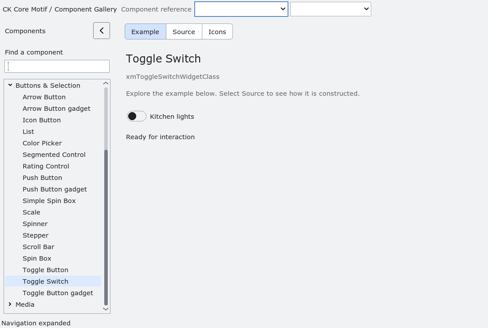

# Bugfix Notes Archive 13

## `text-scroll-cursor-line-table.md`

# Text cursor-scroll line-table guard

`ScrollCursorVertically` now returns without touching the line table when the
table is unavailable or contains no lines. This covers initialization and
teardown windows where an action can arrive before layout storage is ready,
avoiding a null dereference or an out-of-range `line[number_lines]` access.

The focused source contract is checked by
`tests/automated/check-text-scroll-cursor-line-table.py`.

## `text-scroll-cursor-parameter-bounds.md`

# Text cursor-scroll parameter bounds

`ScrollCursorVertically` now treats its percentage action parameter as a
bounded 0–100 value. Invalid text, negative values, and values above 100 use
the nearest endpoint; an empty line table resolves to line zero. The line
calculation avoids multiplying a large line count by the percentage directly,
and event coordinates are saturated before the Position-based hit-test.

The focused source contract is checked by
`tests/automated/check-text-scroll-cursor-parameter-bounds.py`.

## `text-scrolled-allocation-bounds.md`

# Scrolled Text allocation bounds

`XmCreateScrolledText` builds a derived widget name and a merged argument
array on the stack.  It now checks the name length before narrowing to Xt's
`Cardinal` size and checks the merged `Arg` byte count before `XmStackAlloc`.

Oversized inputs fail before the application lock or stack allocation; normal
widget creation is unchanged.

## `text-secondary-extend-selection.md`

# Secondary selection extension

Secondary-selection extension now checks the Boolean result from
`_XmTextGetSel2` before using its output positions.  If no secondary selection
exists, the operation restores redisplay and returns; it no longer compares or
passes uninitialized positions to the source scanner and selection setter.

The focused source contract is checked by
`tests/automated/check-text-secondary-extend-selection.py`.

## `text-secondary-resource-allocation.md`

# Text secondary-resource allocation

The Text widget's secondary-resource hook builds a two-entry table for its
input and output subobjects.  The table allocation is now checked before the
entries are initialized.  The output pointer is cleared first, and allocation
failure returns zero resources without dereferencing null storage.

The focused source contract is checked by
`tests/automated/check-text-secondary-resource-allocation.py`.

## `text-select-outline-bounds.md`

# Text line-selection bounds

`SelectOutLine` now handles an empty line table without subtracting one from
zero, and saturates movement at the first or last representable line instead
of relying on signed interpretation of an unsigned line index. Negative or
zero movement counts remain no-ops, and the historical left-selection
one-line adjustment is preserved.

The focused source contract is checked by
`tests/automated/check-text-select-outline-bounds.py`.

## `text-selection-array-byte-count.md`

# Text selection-array byte counts

Text input resource updates and initialization now compute the guarded
selection-array byte count once and reuse it for both allocation and copying.
This keeps the `SIZE_MAX`/`UINT_MAX` checks tied to the exact size passed to
Xt and `memcpy`, avoids signed-count conversion warnings, and preserves the
existing built-in-array fallback when the requested count is not representable
or allocation fails.

The focused source contract is checked by
`tests/automated/check-text-selection-array-byte-count.py`.

## `text-selection-empty-buffer.md`

# Text selection empty fallback buffer

When a selection cannot be decoded into locale text, the transfer path creates
a one-byte empty fallback buffer.  That allocation is now checked before the
terminator is written; failure releases the incoming value and rejects the
follow-up operation cleanly.

The focused source contract is checked by
`tests/automated/check-text-selection-empty-buffer.py`.

## `text-selection-hint-bounds.md`

# Text selection-hint bounds

Primary and secondary selection-start hints now saturate button-event
coordinates before storing them in the 16-bit hint fields used by drag and
multi-click selection. This keeps later distance checks and hit-tests
consistent for translated or unusually large coordinates.

The focused source contract is checked by
`tests/automated/check-text-selection-hint-bounds.py`.

## `text-selection-length-bounds.md`

# Text selection length bounds

Selection and drop imports now validate the length of converted locale text
before storing it in Motif's legacy `int` text-block field. Oversized converted
strings are rejected with their temporary buffers released, preventing a
wrapped length from reaching text replacement or follow-up move/delete logic.

The focused source contract is checked by
`tests/automated/check-text-selection-length-bounds.py`.

## `text-selection-source-failure.md`

# Text selection source-string failure

The `XA_STRING`, compound-text, and UTF-8 selection conversion paths now check
the source string before calling `XmbTextListToTextProperty`.  A failed source
read or allocation returns an empty conversion cleanly instead of passing a
null string into the Xlib text encoder.

The focused source contract is checked by
`tests/automated/check-text-selection-source-failure.py`.

## `text-selection-source-guard.md`

# Text selection source guard

`SetSelection` now returns cleanly when a text source has not yet been
attached to a widget. Its saved selection endpoints also remain
`XmTextPosition` values while comparing the previous and new ranges, avoiding
truncation for very large sources. Normal realized-widget selection ownership
and highlighting are unchanged.

`GetSelection` now also rejects missing output pointers or source data and
returns an empty selection, keeping both selection callbacks safe during
teardown.

The focused source contract is checked by
`tests/automated/check-text-selection-source-guard.py`.

## `text-selection-state-naming.md`

# Text selection-state naming

The legacy Text selection-transfer callbacks share process state through
closure pointers. The shared records are now named `insert_select_state` and
`primary_select_state`, distinct from callback-local closure variables. This
removes `-Wshadow` ambiguity without changing record layout, closure values, or
the public selection-transfer contract.

The source contract is covered by
`tests/automated/check-text-selection-state-naming.py`.

## `text-selection-target-allocation.md`

# Text selection target-list allocation

The text selection conversion path now checks allocation of the five-atom
`MOTIF_EXPORT_TARGETS` list.  An allocation failure reports an empty integer
conversion and returns without writing through a null target-list pointer.

The focused source contract is checked by
`tests/automated/check-text-selection-target-allocation.py`.

## `text-selection-target-guard.md`

# Text selection target validation

The text selection responder receives the requested target through a pointer.
It now rejects a null target before inspecting the atom, matching its existing
validation of the selection and output pointers. This preserves normal X11
selection conversion while preventing malformed internal callers from causing
a null dereference.

The same responder uses explicit Xt `Cardinal` and wire-length conversions
after its existing upper-bound checks, keeping strict 64-bit builds from
silently narrowing allocation sizes.

The contract is covered by
`tests/automated/check-text-selection-target-guard.py`.

## `text-set-string-wcs.md`

# Text wide-string setter

`XmTextSetStringWcs` now treats a null wide-string input as an empty value and
checks character-count, byte-size, and allocation limits before calling
`wcstombs`.  Unrepresentable or unavailable conversion storage leaves the
existing widget value unchanged rather than dereferencing null storage.

The focused source contract is checked by
`tests/automated/check-text-set-string-wcs.py`.

## `text-setvalues-wcs.md`

# Text SetValues wide-string conversion

Runtime text `SetValues` handling for `XmNwcValue` now bounds the conversion
buffer and checks allocation and `wcstombs` results before updating the source.
Failed conversion leaves the current source value intact while consuming the
invalid resource value safely.

The focused source contract is checked by
`tests/automated/check-text-setvalues-wcs.py`.

## `text-source-add-widget.md`

# Text-source widget attachment

Adding a widget to a shared text source now checks both the shared widget-array
and per-widget highlight-list reallocations.  A failure rolls back the
`numwidgets` increment and leaves the source arrays usable, instead of
dereferencing a null pointer or exposing a partially attached widget.

The attachment path also rejects a missing source, widget, or existing first
widget before it grows the shared array, so teardown inconsistencies fail
without dereferencing invalid state.

The corresponding removal path rejects missing source, widget, or widget-array
state before scanning or mutating the shared list, so teardown cannot turn
removal into a null dereference.

The focused source contract is checked by
`tests/automated/check-text-source-add-widget.py`.

## `text-source-block-payload.md`

# Text-source block payloads

Text-source string readers now reject a block that reports a positive length
but has no payload pointer.  This protects both byte copies and
`mbstowcs` conversions from malformed or failing source callbacks while
leaving valid block handling unchanged.

The focused source contract is checked by
`tests/automated/check-text-source-block-payload.py`.

## `text-source-byte-output-termination.md`

# Text-source byte-output termination

`_XmTextCharactersToBytes` promises a NUL-terminated byte stream.  The
one-byte branch now writes that terminator, and the 16-bit branch does so even
when every requested character produced output.  Callers retain responsibility
for reserving the extra byte described by the API contract.

## `text-source-byte-termination.md`

# One-byte text-source termination

`_XmTextBytesToCharacters` accepts an `add_null_terminator` flag.  The
one-byte branch now writes the requested terminator into the caller-provided
extra slot, matching the behavior of the 16-bit and wide-character branches.
Callers that pass `False` retain the previous length-only behavior.

## `text-source-compaction.md`

# Text-source compaction allocation

After a successful edit, the text source may shrink its gap buffer.  The
compaction path now computes the candidate capacity and commits the new
pointer, capacity, and gap bounds only after `XtRealloc` succeeds.  An
allocation or size failure leaves the existing larger buffer intact and keeps
the source usable.

The focused source contract is checked by
`tests/automated/check-text-source-compaction.py`.

## `text-source-conversion-failure.md`

# Wide text-source conversion failures

When a wide source value cannot be represented in the active multibyte
encoding, the text-source initializer keeps the source length at zero and now
also writes a terminating NUL into its allocated buffer.  Consumers therefore
see a valid empty string rather than an uninitialized buffer.

## `text-source-create-bounds.md`

# Text-source creation bounds

`_XmStringSourceCreate` now checks character-count and capacity growth before
performing source-buffer arithmetic.  Wide-character conversion storage and
the gapped text buffer are rejected when their sizes cannot be represented by
the allocator's `Cardinal` size, rather than wrapping and allocating a smaller
buffer than the input requires.

The focused source contract is checked by
`tests/automated/check-text-source-create-bounds.py`.

## `text-source-destroy-guard.md`

# Text source teardown guard

Text-source destruction now handles a null source and a partially initialized
source whose private data was never allocated. Partial teardown releases the
source object itself; normal teardown still frees the Unicode map, buffers,
widget list, and private data in the existing order.

The focused source contract is checked by
`tests/automated/check-text-source-destroy-guard.py`.

## `text-source-highlight-copy-bounds.md`

# Text-source highlight-copy bounds

When a second widget attaches to a shared text source, its highlight list is
grown to match the first widget.  The allocation size is now checked against
both `size_t` and Xt's `Cardinal` limit before the multiplication and cast.
Oversized highlight metadata is rejected without issuing a truncated
allocation request.

The focused source contract is checked by
`tests/automated/check-text-source-highlight-copy-bounds.py`.

## `text-source-length-narrowing.md`

# Text source length narrowing

Text source creation now checks the multibyte limit and the byte length of a
local-text value before passing either through legacy `int` interfaces. The
wide-text `wcstombs` result remains a `size_t`, so conversion failure cannot be
confused with a wrapped positive length. Oversized inputs fail during source
creation without changing the source state.

The focused source contract is checked by
`tests/automated/check-text-source-length-narrowing.py`.

## `text-source-pending-pointer-width.md`

# Text-source pending sentinel width

`_XmStringSourceSetPending` accepts either a Boolean snapshot pointer or the
legacy false/true sentinel values encoded as pointers.  The sentinel check now
uses `uintptr_t`, preserving the API behavior while avoiding a pointer-to-
`long` narrowing assumption on platforms with different integer widths.

The focused source contract is checked by
`tests/automated/check-text-source-pending-pointer-width.py`.

## `text-source-pending.md`

# Text-source pending snapshots

Pending-state snapshots now validate the widget count and allocator-size
arithmetic before allocating their Boolean array.  Allocation failure returns
`NULL` without entering the fill loop, avoiding a null dereference while
preserving the existing caller contract for successful snapshots.

They also reject a missing source or widget array before reading the count, so
a snapshot racing teardown fails safely instead of dereferencing torn-down
state.

The setter uses the same source and widget-array guard and becomes a no-op
during teardown, while valid snapshots and the existing sentinel values retain
their behavior.

The focused source contract is checked by
`tests/automated/check-text-source-pending.py`.

## `text-source-range-bounds.md`

# Text source range bounds

Legacy text-source reads now cap position advances before `position +
available` can overflow an integer-backed path. `GetString` also rejects an
incomplete source read rather than returning a silently truncated string, for
both narrow and wide results.

The focused source contract is checked by
`tests/automated/check-text-source-range-bounds.py`.

## `text-source-read-allocation.md`

# Text source read-buffer allocation

`ReadSource` keeps a reusable conversion buffer for source blocks. A failed
initial allocation or resize must stop the read before the conversion code
dereferences the buffer. Growth now uses a temporary pointer and updates the
stored buffer and length only after the allocation succeeds; an inconsistent
null buffer is rejected as well. Existing source contents remain owned by the
text source when a resize cannot be satisfied.

The behavior is deliberately a safe read failure. It preserves the existing
Text source API and avoids turning transient memory pressure into a crash or a
partially updated buffer.

`ReadSource` also rejects an invalid zero character-size state before doing
length arithmetic. This prevents malformed widget state from reaching a
division by zero while preserving the same safe read-failure behavior.

The edit path applies the corresponding `EditError` guard before converting a
replacement range, so an invalid character-size state cannot reach its byte
offset arithmetic either.

## `text-source-replace-growth.md`

# Text-source replace growth

Text edits now reject position deltas that cannot be represented by the
source's `int` length before changing UI state.  The gap-growth path also
checks capacity arithmetic and commits `XtRealloc` only after success.  If
growth cannot be completed, redisplay and the insertion point are restored and
the edit is rejected without changing source contents.

The focused source contract is checked by
`tests/automated/check-text-source-replace-growth.py`.

## `text-source-value-bounds.md`

# Text source value bounds

Text source value extraction now rejects byte sizes that cannot be represented
by Xt's `Cardinal` allocator length, and it keeps assembled byte and wide
character counts in `size_t` storage. It also returns cleanly when called for
an unattached or incomplete source instead of dereferencing a missing widget.
Normal attached-source extraction and terminator behavior are unchanged.

The focused source contract is checked by
`tests/automated/check-text-source-value-bounds.py`.

## `text-source-wide-callback-buffer.md`

# Wide text-source callback buffers

The text-source modify-verify bridge allocates a wide callback buffer before
converting a multibyte callback result.  It now writes a wide NUL on conversion
failure and after successful conversion, so callbacks always receive a valid
empty or terminated buffer alongside the reported length.

## `text-timer-point-bounds.md`

# Text timer-scrolling point bounds

Text selection autoscroll now saturates motion-event coordinates before storing
them in the 16-bit input positions used by the timer path. This prevents large
or translated X coordinates from wrapping and sending the autoscroll cursor to
the opposite side of the widget.

The focused source contract is checked by
`tests/automated/check-text-timer-point-bounds.py`.

## `text-transfer-point-bounds.md`

# Text selection-transfer point bounds

The selection-transfer path stores the initiating X event location in an
`XPoint`, whose coordinates are 16-bit fields even though X event coordinates
are exposed as `int`. The conversion now saturates at the representable
`Position` bounds instead of wrapping, preserving a stable paste/drop location
for translated or unusually large coordinates.

The focused source contract is checked by
`tests/automated/check-text-transfer-point-bounds.py`.

## `text-verify-allocation-guards.md`

# Text modify-verify allocation guards

The text source copies callback payloads into temporary character and
wide-character buffers before invoking modify-verify callbacks.  Those
allocations are now checked before copying or conversion.  An allocation or
size failure aborts the edit cleanly and releases any temporary character
buffer already owned by the operation, preventing null dereferences and
partially initialized callback data.

The focused source contract is checked by
`tests/automated/check-text-verify-allocation-guards.py`.

## `text-wide-conversion-overflow.md`

# Text wide conversion overflow result

`_XmTextBytesToCharacters` already reports an invalid multibyte sequence as
`-1`. When a valid conversion produced more characters than its legacy `int`
result can represent, it previously returned `0`, making an oversized value
look like an empty conversion. The overflow path now returns `-1` as well, so
callers can take the existing conversion-failure path instead of silently
dropping text.

The source contract is covered by
`tests/automated/check-text-wide-conversion-overflow-result.py`.

## `text-wide-init-length.md`

# Text wide-value initialization bounds

The Text widget’s wide-value initialization path counts characters with a
legacy signed counter before converting the value to the locale encoding.  The
counter now stops at `INT_MAX`, allowing the existing allocation guard to reject
an unrepresentable value before indexing or sizing can wrap.

Normal wide-value initialization is unchanged.

## `textfield-adjust-bounds.md`

# TextField AdjustText geometry bounds

`AdjustText` now computes margin and shadow/highlight thickness totals in
`uint64_t`. A widget with no usable content width returns without scrolling,
and fill-rectangle heights and origins are narrowed only after their bounds
are established.

The focused source contract is checked by
`tests/automated/check-textfield-adjust-bounds.py`.

## `textfield-baseline-bounds.md`

# TextField baseline bounds

`XmTextFieldGetBaseline` now computes its margin, shadow, highlight, and font
ascent total in `int64_t` before returning the legacy `int` result. Values
outside the public return range are clamped instead of wrapping due to
intermediate `Dimension` arithmetic.

The focused source contract is checked by
`tests/automated/check-textfield-baseline-bounds.py`.

## `textfield-baselines.md`

# TextField baseline callback bounds

`TextFieldGetBaselines` now validates its widget and output pointers, reports
allocation failure without publishing partial state, and computes the baseline
metric in widened arithmetic before clamping it to `Dimension`. Normal
one-baseline callbacks retain their existing result and ownership contract.

The focused source contract is checked by
`tests/automated/check-textfield-baselines.py`.

## `textfield-class-translation-allocation.md`

# TextField class translation allocation

TextField class initialization merges three translation fragments.  The
merged size is now checked with `size_t` arithmetic and Xt's allocation limit;
fast-subclass registration remains intact when the optional merged table cannot
be allocated.

The focused source contract is checked by
`tests/automated/check-textfield-class-translation-allocation.py`.

## `textfield-cursor-geometry.md`

# TextField cursor geometry failures

`PaintCursor` now stops before changing the cursor GC when `GetXYFromPos`
cannot represent the caret position in the X11 coordinate range. This avoids
drawing a misleading caret at `(0, 0)` after a geometry or text-layout
conversion failure.

The focused source contract is checked by
`tests/automated/check-textfield-cursor-geometry.py`.

## `textfield-delete-range-naming.md`

# TextField delete-target range naming

The TextField conversion callback keeps a selection range for ordinary text
exports. Its delete-target branch now names its own primary-selection range
`delete_left` and `delete_right`, rather than redeclaring `left` and `right`.
This removes the compiler shadowing warning and makes it explicit that the
delete operation uses the primary range while preserving the public transfer
and deletion behavior.

The source contract is covered by
`tests/automated/check-textfield-delete-range-naming.py`.

## `textfield-display-rect-bounds.md`

# TextField display-rectangle bounds

`TextFieldGetDisplayRect` now validates its output pointer and computes all
margin and shadow arithmetic in `uint64_t`. Overlarge margins produce a zero
content rectangle, while origins are clamped to the signed `XRectangle`
coordinate range instead of wrapping through `Position`.

The focused source contract is checked by
`tests/automated/check-textfield-display-rect-bounds.py`.

## `textfield-dostuff-length-bound.md`

# TextField locale-expanded transfer length bound

The drop-transfer path converts incoming compound or UTF-8 text to the
current locale before inserting it. In single-byte mode the converted byte
length is stored in the TextField selection record's `int` character count.
The implementation now checks the `strlen` result against `INT_MAX` before
the conversion, releases the transfer value, reports transfer failure, and
restores the insertion-point drawing state when the value is too large.

This keeps oversized locale-expanded transfers on the existing safe failure
path instead of allowing a `size_t` to `int` wrap. The source contract is
covered by `tests/automated/check-textfield-dostuff-length-bound.py`.

## `textfield-full-gc-bounds.md`

# TextField full-GC clip bounds

`SetFullGC` now computes shadow and highlight insets in `uint64_t`. If the
inset consumes the widget dimension, the corresponding clip dimension is
zero; otherwise subtraction happens only after the half-dimension check.
Origins are clamped to the signed X11 rectangle range.

The focused source contract is checked by
`tests/automated/check-textfield-full-gc-bounds.py`.

## `textfield-growth-capacity.md`

# TextField replacement growth capacity

TextField replacement and preedit paths now calculate the resulting character
count and allocation size with checked `size_t` arithmetic. The resulting
count is also bounded by the signed length field used by the public widget
state. Negative callback
lengths, underflow in replacement ranges, multiplication overflow, and
capacities that cannot be represented by the toolkit's unsigned allocation
field are rejected before `XtRealloc` is called.  Byte and wide-character
storage use the same checked growth policy, including the terminator.

The source-contract regression is
`tests/automated/check-textfield-growth-capacity.py`.

## `textfield-modify-verify-allocation.md`

# TextField modify-verify allocation handling

TextField SetValues now validates and checks the temporary snapshot used by
modify-verify callbacks before copying it.  If an approved replacement cannot
be allocated, the current proposed value is retained instead of dereferencing
a null buffer or freeing the live value.  Oversized and negative lengths are
rejected before multiplication.

The source-contract regression is
`tests/automated/check-textfield-modify-verify-allocation.py`.

## `textfield-mutator-inputs.md`

# TextField mutator input guards

The public TextField setters, replacement and insertion helpers, and add-mode
setter now return immediately for a NULL widget before asking Xt for an
application context. This preserves their void no-op behavior for invalid
widget input while preventing a precondition failure; valid text conversion,
selection, callbacks, and resource updates are unchanged.

The focused source contract is checked by
`tests/automated/check-textfield-mutator-inputs.py`.

## `textfield-page-bounds.md`

# TextField paging bounds

`PageLeft` and `PageRight` now validate the available content width before
performing page movement. Margin, shadow, and highlight totals are widened
before subtraction, and a widget with no usable viewport returns without
changing its horizontal offset.

The focused source contract is checked by
`tests/automated/check-textfield-page-bounds.py`.

## `textfield-position-metrics.md`

# TextField position metrics

`GetXYFromPos` now computes the baseline y-coordinate in `int64_t` and rejects
values outside the signed X11 `Position` range before either Xft or legacy
coordinate paths store it. This prevents large margin/font metrics from
wrapping the insertion-point coordinate.

The focused source contract is checked by
`tests/automated/check-textfield-position-metrics.py`.

## `textfield-preedit-start.md`

# TextField preedit startup endpoints

`PreeditStart` now initializes both replacement endpoints to the current
cursor before querying the selection. If no selection is available, the
pending-delete path therefore performs a defined zero-length replacement
instead of passing uninitialized positions to the text engine.

The focused source contract is checked by
`tests/automated/check-textfield-preedit-start.py`.

## `textfield-rect-bounds.md`

# TextField clip-rectangle bounds

`GetRect` now computes text margins, shadow thickness, and highlight thickness
in `uint64_t` before subtracting them from widget dimensions. Oversized margins
produce a zero content rectangle instead of wrapping through `Dimension`; the
signed `XRectangle` origins are clamped to their representable range.

The focused source contract is checked by
`tests/automated/check-textfield-rect-bounds.py`.

## `textfield-redisplay-bounds.md`

# TextField redisplay geometry bounds

`RedisplayText` now performs its margin and content-size checks in `uint64_t`
instead of allowing `Dimension` multiplication or addition to wrap. It also
rejects an unrepresentable baseline before passing it to the drawing path, so
oversized resources skip painting safely rather than using invalid geometry.

The focused source contract is checked by
`tests/automated/check-textfield-redisplay-bounds.py`.

## `textfield-selection-array-allocation.md`

# TextField selection-array replacement

TextField SetValues now allocates and copies a replacement selection array
before releasing the previous array or publishing the new pointer.  Invalid
sizes and allocation failure leave the existing selection state intact rather
than copying through a null pointer or losing the old array.

The source-contract regression is
`tests/automated/check-textfield-selection-array-allocation.py`.

## `textfield-selection-array-bounds.md`

# TextField selection-array copy bounds

TextField initialization copies the public selection-scan array into owned
storage.  The count is now checked before multiplication and Xt allocation,
and the widget field is replaced only after a successful copy.  Allocation
failure therefore avoids both null `memcpy` and losing the original resource
pointer.

The focused source contract is checked by
`tests/automated/check-textfield-selection-array-bounds.py`.

## `textfield-selection-restart-guard.md`

# TextField clipboard selection restart guard

After a clipboard replacement, TextField restarts the primary selection only
when the resulting primary range is nonempty and the destination is eligible.
The restart and its process lock are now enclosed in the same conditional
block. Previously, missing braces made the restart call unconditional even
when the range was empty, and the compiler's misleading-indentation warning
masked that control-flow error.

The source contract is covered by
`tests/automated/check-textfield-selection-restart-guard.py`.

## `textfield-selection-state-naming.md`

# TextField selection-state naming

The destination-selection transfer state is process-global because the legacy
transfer protocol passes it through callback closures. It is now named
`insert_select_state`, distinct from each callback's local closure pointer.
This removes `-Wshadow` ambiguity without changing the closure layout or
public transfer behavior.

The analogous primary-selection state is named `primary_select_state` for the
same reason.

The source contract is covered by
`tests/automated/check-textfield-selection-state-naming.py`.

## `textfield-setvalues-restore.md`

# TextField SetValues restoration

`XmTextField` runs modify-verify callbacks before accepting a resource update.
When a callback vetoes the update, SetValues restores the previous string. The
restore path now keeps the temporary `XtRealloc` result and copies only after
the allocation succeeds. This prevents a failed allocation from passing NULL
to `memcpy`; if the old allocation cannot be restored, the proposed value is
kept instead of corrupting memory.

The regression check is:

```sh
python3 tests/automated/check-textfield-setvalues-restore.py
```

## `textfield-size-bounds.md`

# TextField size bounds

`ComputeSize` now performs text, column, font-metric, and margin arithmetic in
`uint64_t`. Results larger than the X11 `Dimension` range are saturated rather
than wrapping to a small width or height.

The focused source contract is checked by
`tests/automated/check-textfield-size-bounds.py`.

## `textfield-state-accessors.md`

# TextField state accessor guards

TextField state getters and setters now reject a NULL widget before Xt
application-context lookup, returning their established empty values or doing
nothing. `XmTextFieldGetSelectionPosition` also rejects NULL output pointers
before writing the selected range. Valid state reads, updates, selection
behavior, and callback/resource semantics are unchanged.

The focused source contract is checked by
`tests/automated/check-textfield-state-accessors.py`.

## `textfield-string-getters.md`

# TextField string getter guards

The public `XmTextFieldGetString`, `XmTextFieldGetStringWcs`, and
`XmTextFieldGetLastPosition` getters now handle a NULL widget before asking Xt
for an application context. They return the existing empty-result values
(`NULL` for allocated strings and `0` for the position) without dereferencing
invalid input; valid widget and conversion behavior is unchanged.

The focused source contract is checked by
`tests/automated/check-textfield-string-allocation.py`.

## `textfield-substring-ranges.md`

# TextField substring range validation

`XmTextFieldGetSubstring` and `XmTextFieldGetSubstringWcs` now validate the
output buffer, start position, requested length, and capacity before pointer
arithmetic or conversion. Requests beyond the current value retain the normal
truncated result; invalid requests fail without touching caller storage. A
NULL widget now fails before application-context lookup, and a valid zero-length
wide request still writes its terminating null as before.

The focused source contract is checked by
`tests/automated/check-textfield-substring-ranges.py`.

## `textfield-timer-scroll-bounds.md`

# TextField timer-scroll edge bounds

TextField selection autoscroll now computes margin and text-edge thresholds in
`int64_t`. The left and right edge targets are clamped to the signed X11
`Position` range before being stored, preventing large margins or average
character widths from wrapping the timer-scroll position.

The focused source contract is checked by
`tests/automated/check-textfield-timer-scroll-bounds.py`.

## `textfield-transfer-lengths.md`

# TextField transfer length conversions

TextField selection insertion already rejects transfer payloads that cannot be
represented by its `int` editing API or by Xt's `Cardinal` allocator. The
conversion path now expresses those proven bounds explicitly: character counts
use `int`, byte allocations use checked `size_t` arithmetic cast to `Cardinal`,
and multibyte conversion limits use `size_t`.

This preserves the existing rejection behavior for oversized payloads while
avoiding implementation-defined unsigned-to-int narrowing on 64-bit builds.
The contract is covered by
`tests/automated/check-textfield-transfer-length-casts.py`.

## `textfield-validate-allocation.md`

# TextField validation allocation safety

`ValidateString` filters a new value before storing it in an `XmTextField`.
Both the narrow and wide-character branches now retain the `XtMalloc` result,
check it, and only then copy the validated bytes. Allocation failure leaves an
empty, internally consistent value instead of passing a null pointer to
`memcpy`.

The regression check is:

```sh
python3 tests/automated/check-textfield-validate-allocation.py
```

## `textfield-validate-string-bounds.md`

# TextField validation bounds

`XmTextField` validation accepts both locale byte strings and wide-character
strings.  The validator now checks the byte-string length before narrowing
`strlen()` to its legacy signed length type, and checks the wide-character
count before its counter can wrap.

Overly large values are rejected without allocation or mutation.  Ordinary
strings retain the existing validation and callback behavior.

## `textfield-wcs-callback-bounds.md`

# TextField WCS callback buffers

Both TextField modify-verify branches that construct a wide callback block now
validate signed lengths, wide-character multiplication, and Xt allocation
limits.  Allocation failure returns safely; the branch that owns a temporary
byte callback buffer releases it before returning.

The focused source contract is checked by
`tests/automated/check-textfield-wcs-callback-bounds.py`.

## `textfield-wcstombs-width.md`

# TextField multibyte conversion width

TextField selection conversion uses `wcstombs`, whose result is `size_t` (or
`(size_t)-1` on failure). The four text-target branches now retain that width
until assigning the X11 wire length, instead of storing it in `int`. This
prevents large valid conversions from being truncated or mistaken for a
conversion failure.

The contract is covered by
`tests/automated/check-textfield-wcstombs-width.py`.

## `textfield-wide-length-bound.md`

# TextField wide-transfer length bound

The TextField drop path stores the converted character count in `int` and then
allocates `(count + 1) * sizeof(wchar_t)`. Counts below `INT_MAX` are already
bounded for the Xt allocation; `INT_MAX` itself is not representable after the
terminator increment. The path now rejects that boundary before performing
`+ 1`, preserving safe failure for oversized transfers.

The boundary contract is covered by
`tests/automated/check-textfield-wide-length-bound.py`.

## `textout-width-saturation.md`

# TextOut width saturation

TextOut measures lines and margins in an Xt `Dimension`.  The resize path now
uses widened arithmetic and saturates at the representable Dimension maximum
when a very large document or metric would exceed it, instead of wrapping to a
small width.

Normal document measurements are unchanged.

## `textual-drag-icon-inputs.md`

# Textual drag-icon lookup input contract

`XmeGetTextualDragIcon` derives a screen, display, and root-window context
from its widget before creating or reusing the textual drag icon.  A null
widget has none of those resources; the function now returns `NULL` before
`XtScreen` or application-context lookup.  Valid-widget behavior is
unchanged.

## `time-picker-redisplay-guard.md`

# TimePicker redisplay and callback guards

`XmTimePicker` now skips drawing safely when its X11 GC is unavailable. Callback
routing compares resource names by content rather than pointer identity, so
activate and value-change callbacks remain correctly separated across callers.

The focused source contract is checked by
`tests/automated/check-time-picker-redisplay-guard.py`.

## `timepicker-range-redraw.md`

# TimePicker range redraw

`XmTimePickerSetRange` now invalidates a realized picker after successfully
changing its minimum and maximum times.  Range-dependent labels and controls
therefore repaint immediately, matching the DatePicker and Calendar range
APIs, without changing validation or notification behavior.

The focused source-contract check is:

```sh
python3 tests/automated/check-timepicker-range-redraw.py
```

## `todo-print-staging.md`

# Todo print staging and callback contracts

The Todo demo now uses a typed C23 definition for its menu-management callback.
When printing, it creates a unique temporary file beneath `TMPDIR`; if no
temporary directory is configured it uses the current directory rather than a
shared hard-coded system path.  The file is removed after the synchronous
print operation.  The print loop also skips absent pages and keeps the selected
range within the page array.

The companion database serializer also uses typed C23 declarations for its
newline escaping and unescaping helpers, so the full Todo executable builds
with the same compiler profile.

The focused source-contract check is:

```sh
python3 tests/automated/check-todo-print-staging.py
```

## `toggle-gadget-inputs.md`

# ToggleButton gadget input guards

The direct ToggleButton gadget state getter and setters now reject a NULL
widget before Xt application-context lookup. They retain the established
empty/no-op results (`False` for state/value operations and no action for the
void setter), while valid gadget state, drawing, and callback behavior is
unchanged.

The focused source contract is checked by
`tests/automated/check-toggle-gadget-inputs.py`.

## `toggle-pixmap-center-geometry.md`

# ToggleButton pixmap centering geometry

ToggleButton centers a label pixmap vertically inside the widget.  The
height difference is now computed with signed operands before the existing
non-negative clamp, so an oversized pixmap cannot wrap to a large positive
vertical position in a small button.

## `toggle-switch-redisplay-guards.md`

# ToggleSwitch redisplay guards

The switch skips drawing when its window or owned GC is absent. Content clips
to the allocated interior; one-pixel allocations do not wrap unsigned geometry.
Focus borders are omitted when the allocation cannot contain their thickness.

`tests/automated/run-toggle-switch-pixels.py` exercises missing-GC redisplay and
one-pixel allocations in addition to actual pixel symmetry, RTL, and disabled
rendering. Pass `--build` with the configured build directory and `--out` with
a fresh absolute results directory.

## `toggle-switch.md`

# ToggleSwitch

`XmToggleSwitch` is an additive binary control for applications that want a
compact on/off affordance without changing `XmToggleButton` behavior. Include
`<Xm/ToggleSwitch.h>` and create it with `XmCreateToggleSwitch` or one of its
variadic constructors.

The library measures the label and scales its track and knob with the display
scale. `XmNfontList` and `XmNrenderTable` supply the label font. Width and height
are independently automatic unless explicitly set; setting either axis to zero
restores its natural size. RTL places the track at the leading edge and mirrors
its state positions. Modern profiles use the shared symmetric rounded renderer,
with separate hover, pressed, disabled and keyboard-focus states.

The widget uses the normal Xt resource model:

- `XmNset` is the Boolean state.
- `XmNlabelString` supplies the label.
- `XmNvalueChangedCallback` receives an `XmToggleSwitchCallbackStruct` whose
  `set` member is the new state. The callback may destroy the widget; callers
  must not use the widget after returning from the callback.
- `XmToggleSwitchGetState` and `XmToggleSwitchSetState` provide typed state
  access. `notify=False` changes state without invoking callbacks.

Space and Return toggle the state when the widget is sensitive. A primary-button
press arms the control; release inside activates it. Release outside or disabling
the control cancels that press. Focus traversal is inherited from `XmPrimitive`; the focus ring is
drawn separately from the state indicator, so the control remains
understandable without relying on color alone.

When an `XmAccessibility` bridge is attached, the control exposes the
AT-SPI check-box role, its label as the accessible name, the checked state, a
single `activate` action, and value-change notifications. Queries and actions
remain on the owning Xt application thread.

`run-toggle-switch-pixels.py` compares actual window pixels at 100–200% scale
in 25% steps, including opposite margins and RTL mirroring. Track and knob
dimensions share pixel parity to keep their centers aligned at fractional scales.

`run-toggle-switch-failures.py` injects failed label copies, empty-label
allocation, render-table copies and GC allocation. It verifies retained ownership
and safe expose/destruction paths.

`run-toggle-switch-live.py` compares existing and freshly created switches
through classic/light/dark, both densities and repeated scale changes. Explicit
fonts and dimensions remain unchanged. A scale observer negotiates new natural
dimensions even when classic core fonts do not change.

`run-toggle-switch-colormap.py` checks a full application-owned indexed palette
whose screen black/white entries contain other colors. The on-state thumb uses
the highest-contrast existing foreground, background or shadow color, measured
against the track in that colormap; drawing does not allocate color cells.

The installed consumer fixture
`tests/automated/run-toggle-switch.py` covers construction, labels, state
notification, no-notify updates, keyboard focus, disabled rendering state,
accessibility query/action, resize metrics, and destruction from a value
callback under Xvfb.

<!-- gallery-demo-tabs: begin -->
## Component demo

Captured gallery example and its corresponding source excerpt.

::: tabs
== Demo



== Source

Actual gallery excerpt: class = xmToggleSwitchWidgetClass.
The host supplies parent, name, callback and client_data.
Shared factory locals: Widget example; XmString label = NULL.
The shared factory frees label, attaches callbacks and sizes the preview.
Helpers and the complete factory are in gallery_examples.c.

<<< @/demos/programs/ckmotif-gallery/gallery_examples.c#L405-L410

[Complete demo source](../demos/programs/ckmotif-gallery/gallery_examples.c) · [Public header](../lib/Xm/ToggleSwitch.h)

:::
<!-- gallery-demo-tabs: end -->

## `toolbar-allocation-failure.md`

# Toolbar action-array allocation failure

`XmToolbarSetActions` checks the action count before changing toolbar state, so
an oversized request is rejected without erasing the existing actions. It also
handles an `XtCalloc` failure before creating child widgets or dereferencing
the new array. Allocation failure after replacement begins retains the API's
existing semantics: the toolbar remains valid and can be populated by a later
call.

The focused source-contract check is:

```sh
python3 tests/automated/check-toolbar-allocation-failure.py
```

## `tooltip-child-allocation.md`

# Tooltip popup geometry and lifecycle

Motif creates one tooltip shell and label lazily for each top-level widget.
After the hover delay, the toolkit sets the label text, obtains its preferred
size and positions the complete popup inside the screen. It sizes both the
shell and label **before mapping**. The first visible frame contains the text;
a subtle one-pixel outline surrounds it. The frame, text and padding appear
together at their final size.

`XmNtoolTipPostDelay` still controls the hover delay. The `XmNtoolTipPostDuration`
timer starts when the complete popup is displayed. Leaving the control dismisses
it. Missing children and popup parents remain safe during posting/unposting.
The slide-context slot in the existing configuration trait is retained for ABI
compatibility; tooltip posting does not allocate a slide context.

`tests/automated/check-tooltip-child-failure-guards.py` checks failure guards.
`tests/automated/run-paint.py` also drives real pointer hovers and checks the
first mapped shell/label dimensions, all four outline edges, text pixels in
every sampled frame, stable geometry and dismissal under classic and scaled
modern appearance.

## `trait-hash-portability.md`

# Trait hash portability

Trait-table hashing now folds object and trait-name pointers into a
`uintptr_t`, then bounds the result before converting to Motif's signed
`XmHashValue` type. This avoids implementation-defined narrowing of 64-bit
pointer bits while preserving deterministic table lookup behavior.

## `transfer-block-allocation-failure.md`

# Transfer-block allocation failure

When a destination transfer cannot allocate its next `TransferBlock`, the
destination now reports failure through the normal completion path.  The
transfer context and any callback-owned destination data are released instead
of returning with an unobservable, half-open transfer.

Regression coverage: `tests/automated/check-transfer-block-allocation-failure.py`.

## `transfer-callback-context-guards.md`

# Guard transfer callback context lookups

Secondary-selection completion now disowns the selection and returns cleanly
if its conversion context has disappeared.  Clipboard callback processing
also tolerates a missing context while preserving successful conversion
behavior.  This closes teardown races after a context allocation failure or
late widget destruction.

The focused source regression is
`tests/automated/check-transfer-callback-context-guards.py`.

## `transfer-callback-value.md`

# Clipboard callback conversion values

`ClipboardCallback` now initializes and resets its conversion result before
each callback request. A declined conversion consequently leaves a known null
pointer for cleanup, preventing an uninitialized free while preserving the
existing deferred clipboard lifecycle.

The regression check is:

```sh
python3 tests/automated/check-transfer-callback-value.py
```

## `transfer-context-failure-guards.md`

# Guard transfer-context lookup failures

Selection conversion, secondary-transfer, clipboard-source, drag-source, and
destination paths now handle a missing conversion context explicitly.  They
return a conversion failure or unwind their application lock instead of
dereferencing a null context during allocation pressure or teardown.

The focused source regression is
`tests/automated/check-transfer-context-failure-guards.py`.
Named selection ownership retains its current conversion context until
`XtOwnSelection` succeeds.  A rejected timestamp or other ownership failure
therefore leaves the existing owner able to service requests; the context is
replaced only after the server confirms the new owner.

`XmeSecondarySink` follows the same ordering for the destination selection, so
an unsuccessful ownership request cannot discard the active secondary-transfer
context.

`XmeClipboardSource` likewise retains its existing clipboard context while a
clipboard-manager ownership request is pending and replaces it only after Xt
confirms ownership.

If subsequent `XmClipboardStartCopy` setup fails, the source now disowns the
manager-backed selection and clears the failed context so no stale owner is
left behind.

Target-list, snapshot, and zero-transfer failures after startup use the same
abort path, so manager-backed ownership is not retained after partial setup.

End-copy failures are checked explicitly.  An unsuccessful finalization now
attempts `XmClipboardCancelCopy` before the source clears its context and
reports failure, preventing a half-open clipboard transaction.

## `transfer-context-hash.md`

# Transfer context hash portability

Transfer conversion contexts now hash the display pointer and selection atom
with bounded `uintptr_t` arithmetic before converting to the toolkit hash type.
This avoids signed overflow and implementation-dependent pointer-to-`long`
truncation on 64-bit platforms.

## `transfer-context-initialization.md`

# Initialize transfer conversion contexts

Motif keeps per-selection conversion state in a shared hash table.  Newly
created records now initialize all flags, operation state, item identity,
location, client data, and drag-context pointers before publishing the record
to the table.  Key and context allocation failures are also handled without
inserting a partial record.

Existing conversion state and selection behavior are unchanged.  The focused
source regression is
`tests/automated/check-transfer-context-initialization.py`.

## `transfer-deferred-cleanup.md`

# Deferred clipboard target cleanup

Deferred clipboard target lists now have explicit ownership handling. A
successful but unusable list is released, a valid list transfers ownership to
the request loop, and a successful snapshot conversion must provide a value
before it is dereferenced. This closes leak and null-dereference paths during
deferred clipboard transfers.

The regression check is:

```sh
python3 tests/automated/check-transfer-deferred-cleanup.py
```

## `transfer-lose-cleanup.md`

# Selection-loss cleanup

Selection-loss conversion callbacks now have explicit ownership handling. The
clipboard MOVE loss path releases the DELETE conversion result, and the normal
loss path initializes its result pointer before cleanup. A converter that
declines to return data therefore cannot leak or expose an uninitialized value
to `XtFree`.

The regression check is:

```sh
python3 tests/automated/check-transfer-lose-cleanup.py
```

## `transfer-move-cleanup.md`

# Clipboard MOVE cleanup

The clipboard source path initializes its conversion value and clears it before
the final MOVE delete conversion. If that conversion declines to provide a
value, cleanup now still passes a known null pointer to `XtFree` instead of an
uninitialized pointer.

The regression check is:

```sh
python3 tests/automated/check-transfer-move-cleanup.py
```

## `transfer-target-cleanup.md`

# Clipboard target cleanup

The clipboard source resets the conversion output before requesting each
target and after freeing it. A failed conversion therefore cannot reuse the
previous target's freed pointer during cleanup, preventing a double-free while
retaining the normal per-target ownership contract.

The regression check is:

```sh
python3 tests/automated/check-transfer-target-cleanup.py
```

## `transfer-target-list-cleanup.md`

# Clipboard target-list cleanup

The clipboard source now releases a target-list conversion result when the
converter succeeds but returns an empty or non-`XA_ATOM` value. Successful
target lists transfer ownership to the loop explicitly, so neither path leaks
or double-frees the converter buffer.

The regression check is:

```sh
python3 tests/automated/check-transfer-target-list-cleanup.py
```

## `transform-subresources-bounds.md`

# Subresource transformation bounds

`_XmTransformSubResources` now validates the resource-count multiplication
before copying compiled subresources. An unrepresentable result returns an
empty resource list, matching its existing allocation-failure behavior and
preventing size wraparound.
Null or zero-length input lists are also treated as empty results before any
resource entry is inspected.

The focused regression check is
`tests/automated/check-transform-subresources-bounds.py`.

## `traversal-node-allocation.md`

# Traversal-node pool allocation

Traversal graph node-pool creation and growth now allocate into temporary
pointers and publish new storage only after success. Size arithmetic checks
both host `size_t` and Xt `Cardinal` byte limits, with explicit Xt-sized byte
arguments, and graph construction stops
cleanly when a node or control-graph entry cannot be allocated instead of
dereferencing a null pool.

`tests/automated/check-traversal-node-allocation.py` protects these paths.

Pool trimming is transactional as well: failed shrink reallocations leave the
current head and capacity unchanged, and the trim condition avoids overflowing
the entry-count addition.

## `traversal-root-shell-geometry.md`

# Traversal geometry for root shells

Traversal's rectangle calculation handles realized top-level shells with no
widget parent. Xt's `XtTranslateCoords` requires a parented widget, so the
shell window is translated to its root with `XTranslateCoordinates`; if the
window is not realized or cannot be translated, its requested root-relative
geometry is retained. Child widgets and gadgets retain their existing
parent-relative geometry and border offsets.

This fixes a crash during focus visibility calculations when other windows
obscure a control whose parent is the application shell, including Wsm's
workspace panel. The native `traversal-root-shell.c` regression checks root
shell, child widget and gadget rectangles against the appropriate Xt/Xlib
coordinate translation, then exercises focus traversal through the root shell.
It runs as part of `run-mwm-workspace-integration.py`.

## `traversal-row-allocation.md`

# Traversal row allocation

Traversal row construction now publishes replacement item and row arrays only
after their allocations succeed. Row growth checks both host `size_t` and Xt's
`Cardinal` byte limit before passing an explicit Xt-sized allocation. Failed
growth returns from sorting through an allocation-failure cleanup path,
releasing partial rows instead of losing the old item array or writing through
null storage.

`tests/automated/check-traversal-row-allocation.py` protects these paths.

## `traversal-stack-node-list.md`

# Traversal node-list stack buffers

Traversal sorting collects graph nodes in temporary arrays through
`XmStackAlloc`, whose heap path narrows the byte count to `unsigned`.  The
nearest-node, tab-graph, and control-graph paths now reject an unrepresentable
`num_nodes * sizeof(XmTraversalNode)` size and return cleanly when allocation
fails, before writing the temporary list.

## `traversal-tab-list.md`

# Traversal exclusive tab-list allocation

Exclusive tab-list creation, growth, and opportunistic shrinking now publish
replacement arrays only after allocation succeeds.  Failed changes leave the
existing list and capacity intact, avoiding null writes and lost tab entries.

`tests/automated/check-traversal-tablist-allocation.py` protects these paths.

## `tree-connector-gc.md`

# Tree connector rendering GC failure

Tree endpoint-gutter connector drawing uses a private graphics context so it
does not alter the shared connector GC's clipping state. If that temporary GC
cannot be allocated, Tree now skips only that connector extension and leaves
the normal parent-window connector rendering intact. This avoids invalid X
requests without changing Tree resources or layout behavior.

The focused source-contract regression is
`tests/automated/check-tree-connector-gc.py`.

## `tree-converter-abi.md`

# Tree resource converter ABI

`XmTree`'s connect-style, compress-style, and line-style resource converters
now use the full `XtTypeConverter` signature, including the converter-data
argument. They are registered without incompatible function-pointer casts, so
Xt invokes them through their declared ABI. Resource names, converted values,
and caching behavior are unchanged.

The focused regression check is
`tests/automated/check-tree-converter-abi.py`.

## `tree-initialize-list.md`

# Tree child-operation list initialization

`XmTree` needs its child-operation list before constraint callbacks or destroy
processing can run.  If `_XmListInit()` cannot allocate that list, the
initializer now reports an Xt error and stops instead of returning a partially
initialized widget whose later callbacks would dereference a null list.

The focused source contract is checked by
`tests/automated/check-tree-initialize-list.py`.

## `tree-view-colors.md`

# TreeView color changes

TreeView updates its private drawing context whenever `XmNforeground` or
`XmNbackground` changes. Text, disclosure marks and selection outlines therefore
follow the widget's current resources, including appearance defaults applied
after initialization and live theme changes. Explicit application palette
choices continue to use the ordinary resource-ownership rules.

Previously the context retained its initialization colors. In particular, a dark
background could be combined with the original black text even though querying
`XmNforeground` returned the correct light color.

Run `python3 tests/automated/run-tree-view-colors.py --prefix PREFIX --out NEW_DIR`
on Linux with Xvfb. The native regression checks the drawing context and rendered
pixels for four initial profiles, live profile changes and explicit palettes.
It passed with both Xft/SVG and core-font/non-SVG ABI 9 development builds.
The actual gallery window was also inspected with a verified executable and
loaded library; dark navigation labels, disclosure marks and selection outlines
use the light foreground. This fix does not claim a complete TreeView redesign.

## `tree-view-preorder-allocation.md`

# TreeView preorder scratch allocation

TreeView normalizes a caller-provided flat model into stable depth-first order
using two temporary arrays. Their byte count is now checked against host
`size_t` (where it is narrower) and Xt's `Cardinal` allocation range before
either array is allocated.
Unrepresentable public model counts fail without a wrapped allocation; valid
TreeView ordering and ownership behavior remain unchanged.

The focused source contract is covered by
`tests/automated/check-tree-view-preorder-allocation.py`.

## `tree-view-redisplay-guards.md`

# TreeView redisplay guards

`XmTreeView` now skips redisplay when its drawing GC is unavailable, treats null
item labels as empty strings, and clamps selected-row and focus rectangles for
narrow or short widgets. This prevents null-string faults and unsigned X11
geometry underflow while preserving ordinary tree rendering.

The focused source contract is checked by
`tests/automated/check-tree-view-redisplay-guards.py`.

## `treeview-geometry-regressions.md`

# TreeView geometry regression contracts

TreeView row positions are calculated through a `long long` intermediate and
clamped before they become X11 coordinates. Disclosure indicators use a
nine-pixel raster box centered within the configured row height, keeping the
crosshair symmetric for both compact and tall rows.

The source contracts are checked with:

```sh
python3 tests/automated/check-tree-view-coordinate-bounds.py
python3 tests/automated/check-tree-view-disclosure-geometry.py
```

## `treeview-render-table-failure.md`

# TreeView render-table replacement failures

`XmTreeView` owns a copy of the render table used for row labels. During a
resource update it copies the requested table before releasing the old one.
If the copy cannot be allocated, the existing valid table remains installed so
the tree stays drawable and can recover on a later update.

The focused source contract is checked with:

```sh
python3 tests/automated/check-treeview-text-metrics.py
```

## `ui-thread-completion-api-decision.md`

# WP-14 UI-thread completion API decision

WP-13 tested the smallest existing-Xt pattern that provides the required
handoff: worker-owned result records, a POSIX wakeup pipe, `XtAppAddInput`,
explicit cancellation, UI-thread draining, and context teardown.  The strict
installed-prefix fixture passed with four worker threads, 320 successful phase
one deliveries, a cancellation phase that freed queued results, no invalid
records, no allocation/post failures, and no worker-side Xt/Xlib calls.

That evidence demonstrates a viable application pattern, but it does not
establish a missing toolkit contract.  The pattern's ownership and wakeup
objects remain application-owned, and a library API would have to define
cross-platform wakeups, result allocation, cancellation races, context
shutdown, and error propagation for consumers that have not been identified in
this repository.

## Decision

**No-go for a public WP-14 API in the current tranche.**  Do not add a new
completion object, worker pool, hidden thread, or process-wide queue to
`libXm`.  Applications can continue using pipes, `XtAppAddInput`, work
procedures, or their existing event-loop integration while keeping all widget
and display operations on the owning Xt thread.

Re-open WP-14 only when at least one real installed consumer supplies a
reproducible requirement that the existing pattern cannot satisfy.  That
requirement must include result ownership, cancellation, application-context
shutdown, platform scope and latency expectations.  Any future API must be
additive, keep worker code free of Xt/Xlib calls, and pass the WP-13 lifecycle
and race fixture before release.

## `ui-thread-completion-prototype.md`

# WP-13 UI-thread completion prototype

`tests/automated/check-ui-completion-prototype.c` is a consumer-side
investigation fixture.  It does not add a threading API to `libXm` and does
not make Xt widgets safe for concurrent access.

The fixture uses an ordinary POSIX pipe as a wakeup channel and
`XtAppAddInput` as the existing Xt hand-off.  Four worker threads allocate
independent result records and write only their pointers to the pipe.  The Xt
input callback validates, consumes and frees those records on the owning UI
thread.  No worker calls Xt, Xlib or a widget.

It runs two phases:

1. 320 results are posted and all are delivered through the Xt input callback;
   the callback asserts that it runs on the recorded UI thread.
2. Four workers attempt a larger batch.  The UI requests cancellation after
   the first callback, workers stop at a cancellation boundary, queued results
   are drained and freed, the input source is removed, and the descriptors and
   application context are destroyed.

The fixture uses C11 atomics for cancellation, worker-completion and allocation
failure state.  A timer/input tie is handled by draining the pipe once more on
the UI thread before teardown, so removing the input source cannot silently
leak a queued result.  The runner builds against an absolute installed prefix,
checks the resolved `libXt`, runs under Xvfb with a fresh output directory and
writes a receipt with source/output hashes and command timings.

## Decision boundary

The prototype demonstrates that existing Xt input/work-procedure mechanisms
can provide a UI-thread completion hand-off when an application owns its
result queue and wakeup lifecycle.  It does not prove portability beyond the
POSIX/X11 cohort, nor does it provide a library-owned cancellation or context
shutdown contract.  WP-14 must only proceed if consumers need a standardized
cross-application ownership and cancellation API after comparing this pattern
with their existing pipes, work procedures or event-loop integration.

## `uil-argument-entry-allocation.md`

# UIL argument-entry allocation failure handling

The argument-pair semantic action now checks its argument-entry allocation
before installing forward-reference patches or publishing the node into the
parse frame.  An exhausted allocator therefore returns through the existing
error-safe parser path without dereferencing a null argument entry.

The source-contract regression is
`tests/automated/check-uil-argument-entry-allocation.py`.

## `uil-callback-entry-allocation.md`

# UIL callback-entry allocation failure handling

The callback reason/procedure binding action now checks its callback-entry
allocation before installing forward-reference patches or publishing the
entry in the parse frame.  Allocation failure returns through the existing
error-safe parser path without dereferencing a null callback node.

The source-contract regression is
`tests/automated/check-uil-callback-entry-allocation.py`.

## `uil-coercion-constructors.md`

# UIL semantic coercion constructors

Argument and procedure validation coerces localized and primitive values into
compound or wide-string semantic nodes.  Every coercion constructor call now
checks its result before writing expression metadata; failed allocations cause
the enclosing validation pass to return cleanly instead of dereferencing a
null node.

## `uil-color-count-bounds.md`

# UIL color-table count bounds

UIL color-table construction now bounds the number of list items before
incrementing its signed counter or multiplying by `sizeof(sym_color_element)`.
An unrepresentable table is diagnosed as too large and converted to the normal
error value instead of wrapping into an undersized allocation.

## `uil-color-item-allocation.md`

# UIL color-item allocation failure handling

`sar_make_color_item` now checks its temporary color-item node before saving
source metadata or filling fields.  An allocation failure selects the existing
null-frame error path without dereferencing a null node.  If later validation
rejects the color item, the temporary node is released before returning, so
the error path does not leak the partially built item.

The source-contract regression is
`tests/automated/check-uil-color-item-allocation.py`.

## `uil-color-table-allocation.md`

# UIL color-table allocation failures

Color-table semantic actions allocate a table node and an array of color
elements before copying list entries.  Both allocations are now checked.  A
partially allocated table is released and the target receives the existing
semantic error entry instead of a null array dereference.

## `uil-comment-overflow.md`

# UIL comment overflow handling

The UIL lexer preserves consecutive comments in a dynamically grown buffer.
If the incoming text or the required buffer size cannot fit the supported Xt
allocation and signed lexer limits, the lexer now reports the diagnostic and
returns `UILEOF` immediately.

The verified input and output lengths are then copied directly with `memcpy`,
with the newline and terminator written at their exact offsets.  This prevents
a returning Xt error handler from allowing wrapped size arithmetic to reach an
unbounded concatenation routine.

## `uil-compound-append-allocation.md`

# UIL compound-string append allocations

Compound-string operations can merge existing segments or copy them into a
new node.  The append and concatenate paths now validate their input nodes,
check copied-node allocation, and check the newly allocated concatenated
payload.  A failed payload allocation releases the node and returns the
existing semantic error value instead of dereferencing or copying through
`NULL`.

## `uil-compound-constructor-callers.md`

# UIL compound-string parser constructors

The parser creates compound-string nodes for expressions and component
values.  Both constructor call sites now check for allocation failure before
writing expression or component metadata, allowing the semantic action to
return cleanly when memory is unavailable.

## `uil-compound-string-allocation.md`

# UIL compound-string allocation failures

Mixed 8-bit/16-bit literals are assembled from a compound-string node and
component string nodes.  The lexer now checks each allocation before copying
or appending data, and localized-string length accumulation is checked before
signed arithmetic.  `sem_create_cstr` also returns cleanly when its semantic
node allocation fails, avoiding its own null dereference.

## `uil-control-entry-allocation.md`

# UIL control-entry allocation failure handling

The control-item and control-widget semantic actions now check their control
entry allocations before initialization or publishing the node into a list.
The control-widget action also restores the parse-frame order it temporarily
changes before returning on allocation failure, so an exhausted allocator
does not leave the parser with swapped frames.

The source-contract regression is
`tests/automated/check-uil-control-entry-allocation.py`.

## `uil-diagnostic-location-bounds.md`

# UIL diagnostic location bounds

UIL diagnostics include the source file name in a fixed 132-byte location
line.  A long source path or a localized format string can exceed that
capacity.  The location variants now use `snprintf` with the destination
size, preserving the normal diagnostic text while truncating only the display
line at the established listing boundary.

`tests/automated/check-uil-diagnostic-location-bounds.py` protects all source
location variants, including catalog and non-catalog builds.

## `uil-empty-filename-scan.md`

# UIL empty filename scanning

`open_source_file` derives the directory portion of a source filename before
opening it.  The old loop formed `&c_file_name[len - 1]` before checking
whether `len` was nonzero, so an empty filename produced a pointer before the
string object.  The scan now indexes from the end only while `len > 0`, which
keeps malformed or empty input within the object bounds.

## `uil-forward-list-allocation.md`

# UIL forward-list allocation failure handling

The forward-referenced nested-list action now checks its wrapper allocation
before installing the list patch or linking the wrapper into the list.  On
failure, the list and forward-reference chain remain untouched and the parser
action returns safely.

The source-contract regression is
`tests/automated/check-uil-forward-list-allocation.py`.

## `uil-icon-allocation.md`

# UIL icon allocation failure handling

`sar_make_icon` now checks both allocations used to construct an icon value:
the semantic value node and its `sym_icon_element` payload.  If either
allocation fails, a partially created node is released, the target is marked
as a semantic error, and the existing shared error entry is installed.  The
normal row and forward-reference setup is performed only for a fully
constructed icon.

This keeps malformed or resource-constrained UIL compilation on the existing
diagnostic path instead of dereferencing a null allocation result.

The source-contract regression is `tests/automated/check-uil-icon-allocation.py`.

## `uil-keysym-coercion-allocation.md`

# UIL keysym coercion allocation failure handling

Integer-to-keysym argument coercion now checks the two-byte temporary string
allocation before copying the value or changing its semantic type.  When the
allocation fails, the existing integer value remains intact and validation
continues through the normal type-error path instead of copying through a null
pointer.

The source-contract regression is
`tests/automated/check-uil-keysym-coercion-allocation.py`.

## `uil-lexer-buffer-allocation.md`

# UIL lexer buffer allocation failures

The lexer allocates a comment accumulator during initialization and grows a
linked lexical-buffer chain as tokens exceed the fixed buffer size.  Both
paths now check `XtMalloc` results before dereferencing or linking the
buffers.  Initial-buffer failure also releases the comment buffer; later
growth failure reports through Xt and returns `NULL` rather than dereferencing
an unallocated buffer.  Every growth call in `yylex` checks that result and
returns the lexer EOF code, so a returning Xt error handler cannot turn the
allocation failure into a null-buffer write.

## `uil-lexer-string-assembly.md`

# UIL lexer string assembly

Primitive strings may span multiple linked lexer buffers.  Their cumulative
length is stored in a signed `int` for the historical semantic-value ABI.  The
lexer now checks each fixed-buffer addition before accumulating it and stops
token construction if the semantic string node or payload cannot be created.
This prevents signed wraparound and null-value dereferences during long or
allocation-constrained inputs.

## `uil-machine-word-format.md`

# UIL 64-bit machine-listing word format

UIL copies each machine-code word into a fixed-width hexadecimal listing field.
On 64-bit hosts those fields now use sixteen zero-padded digits, so short
values cannot leave uninitialized bytes in the copied listing output. The
existing 32-bit eight-digit representation is unchanged.

Regression: `tests/automated/check-uil-machine-word-format.py`.

## `uil-nested-list-allocation.md`

# UIL nested-list allocation failure handling

Both nested-list entry paths now check their semantic node allocation before
initialization or forward-reference patching.  If a nested-list wrapper cannot
be allocated, the list is left unchanged and the parser action returns without
dereferencing a null wrapper.

The source-contract regression is
`tests/automated/check-uil-nested-list-allocation.py`.

## `uil-object-allocation.md`

# UIL object and section allocation failure handling

The UIL object, child-object, and section-link semantic actions now check
their symbol-node allocations before initialization or linking.  Object
creation selects the existing null-frame path when allocation is unavailable;
section linking simply returns without dereferencing a missing bookkeeping
node.  This keeps parser state valid under resource pressure and avoids
partial symbol-table writes.

The source-contract regression is
`tests/automated/check-uil-object-allocation.py`.

## `uil-output-bounds.md`

# UIL generated output bounds

The UIL-to-URM emitter creates fallback widget names from source coordinates
and formats URM failures with the latest error text.  Both values can exceed
the small legacy stack buffers, especially for long diagnostic messages.
The fallback name uses bounded `snprintf`.  For URM failures, the emitter first
measures the complete text, validates the resulting size, allocates exactly
that many bytes plus its terminator, and frees the temporary string after
delivering it to the diagnostic path.  Diagnostic detail is therefore retained
without a fixed 132-byte truncation boundary.

`tests/automated/check-uil-output-bounds.py` protects both formatting paths.

## `uil-output-size-overflow.md`

# UIL output-size overflow handling

The UIL serializer accumulates resource and compression-table sizes in signed
`int` fields because those sizes are part of the historical resource-context
interface.  The checked accumulation helpers use `INT_MAX` as an overflow
marker.  That marker must never be passed to `UrmResizeResourceContext`,
`bzero`, or the resource-context size fields as if it were a valid allocation.

`UilP2Out.c` now rejects an overflowed literal, argument compression table, or
class compression table before allocating or writing it.  The existing
diagnostic path reports the rejected output and the caller can continue with
the next UIL input instead of attempting an impossible allocation.

## `uil-parent-list-allocation.md`

# UIL parent-list allocation failure handling

The recursive control-list traversal now checks parent-list node allocations
before linking them into a widget.  If bookkeeping allocation fails, the
current control-list member is skipped safely; the traversal does not
dereference a null node or corrupt the existing parent list.

The source-contract regression is
`tests/automated/check-uil-parent-list-allocation.py`.

## `uil-resource-vector-allocation.md`

# UIL resource-vector allocation

UIL semantic initialization now verifies every resource-compression vector
after allocation.  Invalid limits and allocation failures stop initialization
before the vectors are indexed, instead of allowing a zero-size or null vector
to be dereferenced.

## `uil-root-dir-bounds.md`

# UIL root-directory allocation bounds

UIL’s root-directory helper now checks the environment or passwd-derived path
length before converting `strlen(path) + 2` to Xt’s `Cardinal` allocation size.
It also returns failure when Xt cannot allocate the buffer, rather than
dereferencing a null pointer while appending the separator.

## `uil-section-link-allocation.md`

# UIL section-link allocation failure handling

The value-binding and identifier-declaration semantic actions now check the
section-list node allocation before linking it.  If the compiler cannot
allocate that bookkeeping node, the action returns through its existing
error-safe path instead of dereferencing a null section entry.

The source-contract regression is
`tests/automated/check-uil-section-link-allocation.py`.

## `uil-source-cache-copy.md`

# UIL cached source copy

Cached UIL source lines copy their fixed 132-character representation directly,
including its terminator, matching the bounded file-read path.

## `uil-source-open-allocation.md`

# UIL source-opening allocation failures

`src_open_file` allocates a file-control block and, when no reusable buffer is
available, a source buffer.  Both objects are required by the subsequent open
and source-table setup.  The function now checks each allocation before use,
releases the file-control block if the second allocation fails, and reports
the failure through the existing Xt error mechanism.

## `uil-source-paths.md`

# UIL source-path output bounds

UIL stores the resolved filename of an included source in a legacy fixed-size
symbol-table field. `src_open_file` therefore receives the field capacity from
its caller and copies the resolved path with explicit truncation and a trailing
NUL. A path longer than that historical field remains usable for opening and
diagnostics through the file-control block; only the fixed-size bookkeeping
copy is truncated, matching the existing root-module record behavior.

The focused regression compiles the production copy helper with strict warnings
and ASan/UBSan. It checks a 2048-byte resolved path, an ordinary path, null
input, and a zero-sized destination:

```sh
python3 tests/automated/run-uil-source-path-copy-unit.py --out /absolute/fresh/results
```

## `uil-standard-color-table.md`

# UIL standard color-table singleton

The standard color table is initialized lazily and contains both a semantic
node and a two-element color array.  The constructor now checks both
allocations, releases a partial singleton, and returns the existing semantic
error entry when memory is unavailable.

## `uil-string-entry-bounds.md`

# UIL string-entry bounds

The UIL lexer’s string-value constructor uses an `int` length and allocates a
terminator byte.  It now rejects negative lengths and `INT_MAX` before
evaluating `length + 1`, preventing signed overflow from reaching `XtCalloc`.

Normal string values retain their existing representation and allocation.

## `uil-string-table-conversion.md`

# UIL string-table compound conversion

During semantic evaluation, narrow or localized string-table segments are
converted through a temporary compound-string node.  The evaluator now checks
that node before appending or copying it, returning cleanly if allocation
fails instead of dereferencing a null temporary value.

## `uil-string-value-allocation.md`

# UIL string-value allocation failures

`create_str_entry` first allocates a semantic node and then its string
payload.  It now checks both results before initialization.  If the payload
allocation fails, the node is placed on the existing semantic free-list and
the failure is reported through Xt, avoiding a null payload dereference and a
leaked node.

## `uil-symbol-node-allocation.md`

# UIL symbol-node allocation failures

Semantic actions create every symbol-table node through
`sem_allocate_node`.  The allocator now checks the `XtCalloc` result before
initializing the node header or linking the node into the allocated-node list.
An allocation failure is reported through Xt and returns `NULL`, avoiding the
allocator's own null dereference and preserving the existing error-handling
contract for callers.

## `uil-user-widget-references.md`

# MWM workspace management

The default MWM build enables `MWM_WSM`, the standalone Motif workspace protocol
used by `demos/programs/workspace/wsm`. It is separate from CDE's `WSM` build.
The historical Wsm README's restriction to Motif 2.0 no longer describes this
fork.

## Protocol and window ownership

MWM advertises CONNECT, EXTENSIONS, CONFIG_FORMAT, GET_STATE, SET_STATE and
REGISTER_WINDOW on the screen's `WM_Sn` selection. Versions 1–3 are negotiated.
No optional extensions are advertised. The obsolete, unimplemented virtual-root
panning targets are not advertised or accepted.

Window attributes are `x`, `y`, `width`, `height`, `iconic`, `hidden` and `maximized`.
Icon attributes are `x` and `y`. Coordinates and dimensions use 32-bit wire
scalars; flags use 8-bit scalars. Coordinates are interpreted as signed values
and restricted to the X11 coordinate range. Invalid dimensions are ignored.
GET_STATE returns complete snapshots even when differences are allowed.
SET_STATE accepts partial updates; unknown or destroyed client IDs are ignored.
Snapshots include transient windows and the protocol's corresponding icon IDs.

Workspace hiding unmaps the manager's frames while retaining client management
and the normal/iconic state. Transients follow their leader's visibility, and
hidden clients cannot receive keyboard focus. Geometry and iconic-state changes
retain workspace visibility. Newly managed clients are registered with Wsm;
registration replies are applied only to clients that remain managed.
If the workspace selection owner disappears or changes, MWM restores hidden
windows. Graceful Wsm exit also restores windows and removes its menu commands.

Both protocol peers validate complete message lengths, counts, attribute masks
and scalar/list widths before allocation decoding. Truncated and trailing data
are rejected. Wsm retrieves pointer-valued button IDs with pointer-sized storage
and does not retain callback-owned configuration reply structures.

## Using Wsm

Build with `./configure --enable-demos`, then `make -j6` and `make install`.
Run `PREFIX/bin/mwm` on the intended X display and open Wsm through the gallery,
or run `PREFIX/share/Xm/wsm/wsm` directly. Its workspace buttons switch rooms;
its menus configure window membership, copying/linking and persistence.
Wsm stores state in `~/.wsmdb` by default; use `-file /path/to/state` for an
independent session. Each X screen has its own workspace selection.

## Automated acceptance

The wire validator can be tested without an X server:

```sh
python3 tests/automated/run-wsm-wire-validation.py
```

The native acceptance runner requires a built source tree, Xvfb and X11 tools.
It starts the exact MWM executable on a private display, queries its advertised
targets, exercises the real protocol and runs Wsm's actual workspace-button
callbacks and persistence path:

```sh
python3 tests/automated/run-mwm-workspace-integration.py \
  --build-root /absolute/build \
  --out /absolute/fresh/evidence
```

On macOS, temporary outputs must be under an approved mounted temporary volume.
The Linux runner records executable identity, input hashes, commands, results
and logs, and closes the processes it started. The standalone protocol probe
returns 2 when the manager lacks required workspace targets, 1 for probe errors,
and 0 when the required target set is present.


Empty SET_STATE replies are valid selection acknowledgements, even when Xt
supplies an allocated empty value. The transfer callback preserves that result;
the protocol transport releases the delivered allocation after decoding.
Packed parameter buffers belong to UTM until it copies them into the selection
request. Menu command replies release their delivered values as well.

## `uil-value-entry-allocation.md`

# UIL token value allocation failures

`sem_create_value_entry` creates the semantic node for token values and, for
string types, allocates a payload.  The node and both narrow/compound payload
allocations are now checked.  Failed payloads release the node and return the
existing semantic error value instead of allowing a null copy destination.

## `uil-wide-string-caller.md`

# UIL wide-string semantic-action failure

The wide-string semantic action now checks the constructor result before
writing expression or source metadata.  Allocation failure therefore exits
the action cleanly instead of dereferencing a missing semantic node.

## `uil-wide-string-constructor.md`

# UIL wide-string constructor allocation

`sem_create_wchar_str` creates the semantic node used for wide-string values.
It now checks the central node allocator before initializing the node and
returns `NULL` on allocation failure, matching the compound-string constructor
contract.

## `uil-wmd-path-failures.md`

# UIL WMD path setup failures

`init_wmd_path` now rejects a missing database filename, an unavailable home
directory expansion, formatting sizes that cannot be represented by Xt's
allocation interface, and WMD-path allocation failure.  `db_open_file` stops
before pathname resolution when that setup fails, and also returns after an
unresolved pathname or failed database-file open.  Valid absolute paths,
`WMDPATH`, and the historical default search-path expansion remain unchanged.

This prevents error handling for a missing or unallocatable WMD search path
from passing null pointers to the path resolver or file opener.

The account lookup used when neither `HOME` nor `USER` is available also keeps
the process ID in `uid_t`, avoiding a narrowing conversion before `_XGetpwuid`
selects the fallback home directory.

## `unique-event-allocation.md`

# Unique-event state allocation

Motif keeps a small per-display stamp to identify duplicate menu events.  The
stamp allocation is now checked before publishing it into display state, and
event processing returns safely when the state cannot be created.  Existing
duplicate-event behavior is unchanged when allocation succeeds.

`tests/automated/check-unique-event-allocation.py` protects this contract.

## `unit-overflow-nan.md`

# Unit conversion NaN overflow

The internal unit-conversion overflow check now rejects NaN values as well as
values outside the signed integer range. NaN comparisons otherwise evaluate
false, which could allow an invalid parsed value to reach integer conversion.
Finite values retain the existing rounding and range behavior.

`tests/automated/check-unit-overflow-nan.py` protects this contract.

## `update-display-inputs.md`

# `XmUpdateDisplay` input contract

`XmUpdateDisplay` drains pending exposure events for the display associated
with a widget.  A null widget has no display and is not a valid target.  The
function now returns immediately before display lookup or application-context
setup when passed `NULL`, which makes cleanup and optional refresh paths safe.

The event-draining behavior for valid widgets is unchanged.

## `utf8-conversion-bounds.md`

# UTF-8 conversion bounds

`_XmUtf8ToUcs2` is used by text and compound-string rendering paths.  Its
legacy parser assumed that every 2- or 3-byte sequence was complete and that
`seg_len * sizeof(XChar2b)` could not overflow.  A truncated or malformed
segment could therefore read past the supplied buffer, and an extreme length
could wrap the allocation size.

The helper now tracks remaining bytes, validates continuation bytes before
reading them, consumes malformed input as `?`, and checks the allocation
product.  Valid UTF-8 conversion remains unchanged.  The source regression in
`tests/automated/check-utf8-conversion-bounds.py` protects both bounds.

## `utf8-conversion-input-validation.md`

# UTF-8 conversion input validation

`_XmUtf8ToUcs2` now rejects a missing output-length pointer and a null input
buffer when bytes are requested. It returns `NULL` without dereferencing
invalid inputs. UTF-8 scalar boundaries are validated, including overlong and
surrogate encodings; malformed sequences and valid supplementary code points
that cannot be represented by UCS-2 produce one replacement character.

## `utm-payload-failure-cleanup.md`

# UTM payload failure cleanup

UTM packages own their parameter payload until the transfer is handed to
Motif's selection machinery.  Queue failure, sink rejection, and a missing
destination callback now release both the package and its payload.  Successful
transfers retain the existing ownership handoff to `XmTransferSetParameters`.

## `utm-send-widget-guard.md`

# UTM send widget guard

`UTMSendMessage` now rejects a null widget before allocating or queueing a UTM
package.  This protects all WSM callers from passing a missing requestor to
`XmeNamedSink`.  The parameter payload remains caller-owned on this early
return, matching the existing ownership contract for failed sends.

## `vendors-lock-balance.md`

# VendorS secondary-object lock balance

VendorS secondary-object initialization now reads the class size under one
process lock, releases it, and only then performs allocations. The previous
double acquisition and mismatched release could deadlock on nonrecursive
locks before a vendor shell was initialized.

## `vendorshell-modal-growth.md`

# Vendor-shell modal table growth

`AddGrab` keeps the vendor-shell modal records in a dynamically grown table.
The table is shared by the display's modal-input bookkeeping, so a failed
resize must leave both the old pointer and its capacity unchanged.  Growth
now validates the addition and the byte multiplication against both `size_t`
and the `Cardinal`-sized Xt allocator interface.  It uses a temporary pointer,
publishes the new capacity only after `XtRealloc` succeeds, and returns without
adding the grab when the resize cannot be represented or allocated.

This preserves the existing modal ordering and input semantics while avoiding
an overflow or null dereference under allocation pressure.

## `vertical-pixels-inputs.md`

# Vertical pixel conversion input contract

`XmeToVerticalPixels` now rejects a null widget or output value pointer before
screen/unit lookup, returning `XmSYNTHETIC_LOAD`, matching the existing
horizontal conversion contract.  Valid vertical conversions are unchanged.

## `virtkeys-binding-growth.md`

# Virtual-key binding table growth

`FillBindingsFromDB` appends resource-derived virtual-key bindings to a shared
table.  Growth now checks count addition and byte multiplication against both
`size_t` and Xt's `Cardinal` allocation range, uses a temporary realloc pointer,
and releases converted input before returning on failure.  Existing bindings
remain published when a new allocation cannot be made.

## `virtkeys-empty-line-bounds.md`

# Virtual-key empty-line bounds

`_XmVirtKeysLoadFileBindings` reads resource files in bounded chunks.  A
blank chunk is valid input (for example, an empty line between comments), so
the parser must not inspect `line[length - 1]` until it has established that
the length is nonzero.  The comment-continuation and comment-line paths now
share the measured length and safely handle empty chunks while preserving the
existing binding grammar.

The regression contract is checked by
`tests/automated/check-virtkeys-empty-line-bounds.py`.

## `virtkeys-fallback-allocation.md`

# Virtual-key fallback allocation

Virtual-key fallback loading now skips failed filename construction before
calling `fopen`, checks both built-in binding copies, and returns without
calling `strlen` when no fallback buffer could be allocated. Successful
vendor and generic fallback selection is unchanged.

`tests/automated/check-virtkeys-fallback-allocation.py` protects this
contract.

## `virtkeys-invalid-keycode.md`

# Virtual-key invalid-keycode guard

`XmTranslateKey` is an Xt key translator and can be called for a keycode that
is outside the server's current keymap range.  The virtual-key path now checks
the `XtGetKeysymTable` result and the display's `[min,max]` keycode range before
indexing the table.  Invalid input leaves the result produced by Xt unchanged;
it does not read before or after the keymap.

`tests/automated/run-virtkeys-invalid-regression.py` compiles the installed
consumer with `-Wall -Wextra -Werror`, calls both invalid boundary values on a
private Xvfb server, and relies on ASan/UBSan builds to catch an out-of-range
read.  The fixture does not redefine virtual-key bindings or claim behavior for
valid keyboard layouts.

## `virtkeys-vendor-allocation.md`

# Virtual-key vendor formatting allocation

Vendor-specific virtual-key binding loading now checks the server-vendor
value and its formatted vendor/version buffer before formatting. An allocation
failure simply skips vendor-file matching; generic fallback handling remains
available to the caller.

`tests/automated/check-virtkeys-vendor-allocation.py` protects this contract.

## `virtual-binding-converter-bounds.md`

# Virtual-binding converter bounds

The virtual-key resource converter parses a binding string into an array of
`XmKeyBindingRec` values. It now validates the parsed count against both native
`size_t` and Xt's `Cardinal` allocation ranges before it derives the output
byte count. Oversized input fails as a normal resource conversion failure,
rather than wrapping the result size before allocation or copying.

The focused regression check is
`tests/automated/check-virtual-binding-converter-bounds.py`.

## `virtual-binding-converter-inputs.md`

# Virtual-binding converter input validation

The internal Xt converter for virtual-key binding resources now rejects a
missing display, source value, source string, or destination value before it
accesses converter state. Valid resource conversion behavior is unchanged;
invalid direct-converter input now fails normally instead of dereferencing a
null pointer.

The focused regression check is
`tests/automated/check-virtual-binding-converter-inputs.py`.

## `virtual-binding-fallback-inputs.md`

# Virtual-binding fallback loader inputs

The fallback virtual-key binding loader now rejects a null display or output
pointer before clearing the output or interning X11 atoms. Valid fallback
lookup, allocation, and property-publication behavior is unchanged.

The focused regression check is
`tests/automated/check-virtual-binding-fallback-inputs.py`.

## `virtual-binding-property-length.md`

# Virtual-binding X11 property length

Fallback virtual-key bindings may originate in a user binding file, whereas
`XChangeProperty` accepts its element count as `int`. The binding publisher now
validates the byte length before that conversion. An oversized binding remains
available to the current process but is not published with a truncated root
window property length.

The focused regression check is
`tests/automated/check-virtual-binding-property-length.py`.

## `virtual-key-result-bounds.md`

# Virtual-key lookup result bounds

`XmeVirtualToActualKeysyms` returns its match count as `int` and allocates an
Xt-owned `XmKeyBindingRec` result array. It now refuses an unrepresentable
match count and validates native and Xt allocation-byte limits before creating
the result. Existing successful lookup and caller ownership behavior are
unchanged.

The focused regression check is
`tests/automated/check-virtual-key-result-bounds.py`.

## `warning-message-templates.md`

# Warning message templates

Motif warnings are built from a template: the default text in the source, or
the text a message catalog or the Xt error database supplies for it. A user can
replace both, so a template is text to expand, never a format string to pass to
`snprintf`. Earlier, `MotifWarningHandler` (which prints every `XmeWarning` and
`_XmWarningMsg` message) and the DataField and drop-site diagnostics passed such
templates to `snprintf` together with the warning's parameters, so a template
containing `%n` or more conversions than parameters could write to or read
from arbitrary addresses.

`_XmExpandMessage` (declared in `XmI.h`) now expands the templates:

- every conversion, that is `%` with any flags, width, precision and length
  modifiers up to its conversion letter, is replaced by the next string
  parameter; a conversion without a parameter expands to nothing;
- `%%` is a literal `%`, and a `%` that never reaches a conversion letter is
  ordinary text;
- the output is cut to the buffer and always terminated, and the function
  returns the length it needs so that a first call with no buffer can size the
  second.

Because every parameter is expanded as a string, callers pass strings only. The
representation type check, which used to pass the offending number as a
pointer value, now formats it as text, and the DataField character warning
shows the character or its octal code. A message without parameters, such as
the one `XmeWarning` takes, is still shown unchanged.

## Catalog messages

Message catalogs are optional (`--enable-message-catalog`). Where they are
enabled, `_XmCatgets` and `_MrmCatgets` now pass the text of the catalog through
`_XmMessageOrDefault` together with the built-in text. The catalog text is used
only if it asks for exactly the arguments of the built-in text: the same number
of conversions, each with the same length modifier and conversion letter, no `*`
or positional argument, no `n` conversion and no field wider than three digits.
Otherwise the built-in text is used. This covers the messages that Motif and
the resource manager pass to `snprintf` with their own arguments.

## Validation

`tests/automated/run-message-templates.py PREFIX RESULTS` compiles
`tests/automated/check-message-templates.c` against an installed toolkit built
with `--enable-sanitizers` and runs it on a virtual X display. It checks the
expansion rules directly, and runs hostile templates (`%n`, `%s` beyond the
parameters, huge widths, `*`, positional conversions) through
`_XmWarningMsg`, `XmeWarning`, the representation type check and the
DataField value check. The toolkit before this change writes through the
parameter and fails.

## `widget-geometry-inputs.md`

# Widget geometry query input contract

`XmWidgetGetBaselines` and `XmWidgetGetDisplayRect` now reject a null widget
or missing output pointer before app-context lookup and widget-class access.
They return `False` for invalid queries. `XmWidgetGetDisplayRect` also returns
the selected primitive or gadget display-rectangle trait's result instead of
reporting success when that trait declines the query.

The focused source-level regression is
`tests/automated/check-widget-geometry-inputs.py`.

## `wm-feedback-size-limit-header.md`

# WmFeedback size-limit header

`clients/mwm/WmFeedback.c` compares feedback-string lengths with `UINT_MAX`
before allocating a copy.  The source now includes `<limits.h>` directly so
the guard is defined when Mwm is compiled independently of incidental
transitive headers.  This preserves the existing allocation behavior while
making the Mwm build portable across C library/header layouts.

The automated check is `tests/automated/check-wm-feedback-size-limit-header.py`.

## `wmcmd-label-bounds.md`

# Mwm menu-info label bounds

Mwm’s menu-info replies keep labels in fixed protocol buffers. The previous
`strcpy` calls allowed a long resource-defined label to overwrite adjacent
state. All three menu-info paths now use bounded `snprintf`, retaining the
existing buffer sizes and safely truncating labels that do not fit; missing
labels become empty strings.

`tests/automated/check-wmcmd-label-bounds.py` guards these copies.

## `wml-build.md`

# WML build reliability

The WML support tools are part of the Motif build and are required when the
UIL database is generated.  `wmluiltok` now has an explicit `main` entry point,
so it builds with current flex versions that no longer supply an implicit
scanner driver.

The Exm WML database generator likewise uses typed C definitions for its
entry point and emitters, rather than K&R declarations.  This preserves its
database output while allowing the `wmldbcreate` object to compile under the
current C23 configuration.  `tests/automated/check-wmldbcreate-c23.py` checks
the relevant source contracts.

The generated `Uil.c`/`Uil.h` parser pair and the `UilLexPars.c`/
`UilLexPars.h` compatibility symlinks are created through stamp rules.  This
makes `make -j` deterministic: concurrent object prerequisites no longer run
two yacc recipes or race while creating the generated header.  The links point
to generated files in the same build directory, so out-of-tree builds do not
retain dangling source-tree links.  `make clean` removes the stamps and all
generated parser files.

The client UIL build links its generated parser source to the corresponding
`tools/wml` file in the build tree, not to a generated file that would have to
exist in the source checkout.

The WML specification lexer keeps its historical fixed-size semantic buffers,
but now checks identifier and quoted-string lengths before copying them. An
oversized token is reported as a lexer error instead of overwriting the next
parser buffer. The source contract is checked by
`tests/automated/check-wml-build.py`, and the normal native WML build exercises
the generated lexer.

`wmluiltok` also rejects more than ten synonyms for one token and more than
1000 token records before inserting into its fixed tables. The negative case is
covered by `tests/automated/run-wml-token-regression.py`; its error status keeps
malformed generator input from being treated as a successful build step.

The build now generates `wmluiltok.c` explicitly from the checked-in lexer and
generates the `Uil.c`/`Uil.h` parser pair from `Uil.y` before creating the
compatibility names used by `wmldbcreate`. This prevents stale generated files,
parallel `UilLexPars.h` collisions, and linker failures caused by a lexer object
that predates its `main` entry point.

The WML specification lexer (`wmllex.c`) is generated explicitly from
`wmllex.l` as part of the same out-of-tree build. A fresh checkout therefore
does not require a checked-in generated lexer; the selected `LEX` implementation
must be available when building the WML tools.

The keyword-table emitter also handles WML names at the lexer-supported input
length. It now allocates the temporary case-folded name and generated
`sym_k_...` literal from the measured input, rather than placing either in a
100-byte stack buffer. This preserves generated output for ordinary names and
stops generation on allocation failure without overwriting generator state. The focused
source regression is `tests/automated/check-wml-keyword-buffer-bounds.py`.

The `tokens.dat` reader likewise limits each generated grammar-token field to
the capacity of its legacy record buffer and uses a temporary allocated copy
when lowercasing keyword spellings. It fails cleanly if either token allocation
fails; `tests/automated/check-wml-grammar-token-bounds.py` covers that contract.

WML's shared dynamic string-copy helper now returns `NULL` when allocation
fails, before attempting a copy. This prevents a low-memory generator run from
turning an ordinary allocation failure into a null-pointer write; the focused
regression is `tests/automated/check-wml-string-allocation.py`.

Resolver diagnostics now use bounded formatting for class, character-set, and
reference names, so malformed long names cannot overwrite the diagnostic stack
buffer. The regression is `tests/automated/check-wml-diagnostic-bounds.py`.

The WML class-mask emitters write each `_BIT_MASK` term directly to the
generated header instead of assembling a complete row in fixed 100- and
500-byte buffers. Long valid class names can therefore be emitted without
overwriting generator storage, while the established generated header layout is
unchanged. `tests/automated/check-wml-class-mask-bounds.py` checks this source
contract; the native WML target verifies the generated headers.

Character-set `$LANG` names and aliases are likewise copied into an
input-sized uppercase buffer before emission. A failed allocation stops WML
generation instead of writing through the former 200-byte local array or
continuing with a partial header. The source regression is
`tests/automated/check-wml-charset-name-bounds.py`.

The `wmluiltok` lexer now copies token fields through a checked helper. A
low-memory token parse terminates with a diagnostic rather than applying
`strcpy` to a null allocation result. The focused source regression is
`tests/automated/check-wml-lexer-copy-failure.py`; the native WML target
regenerates and runs this lexer.

WML's central dynamic handle-list allocation now checks its requested element
count and allocation result before publishing list state. Initial allocation
and growth fail with a diagnostic rather than leaving a null or undersized
vector to be dereferenced later. The focused regression is
`tests/automated/check-wml-handle-list-allocation.py`.

`wmldbcreate` validates its dynamic string-length table count and allocation,
and rejects strings that cannot be represented by the established `int` length
field. This prevents a failed allocation or narrowing overflow from corrupting
database creation. The focused regression is
`tests/automated/check-wmldb-length-allocation.py`.

WML syntax construction now routes descriptor and alias-vector allocation
through checked helpers. Invalid sizes and allocation failures stop parsing
before any incomplete object is linked into parser state. The focused
regression is `tests/automated/check-wml-syntax-builder-allocation.py`.

WML handle-list insertion now requires a successful copy of its lookup name
before publishing the entry, avoiding null-name comparisons after low-memory
failures. The focused regression is
`tests/automated/check-wml-handle-list-name-copy.py`.

WML semantic-resolution objects are allocated through a checked helper, so a
low-memory failure stops resolution before any partially initialized object is
linked into the generated model. The focused regression is
`tests/automated/check-wml-resolver-allocation.py`.

WML resolver symbol codes now use full-width integers internally. This avoids
silent signed-16-bit truncation if a generated catalogue exceeds 32,767 entries;
existing catalogue output remains unchanged. The focused regression is
`tests/automated/check-wml-symbol-code-width.py`.

The WML grammar-token reader rejects negative, oversized, and duplicate IDs
before it inserts into its fixed token vector, and frees rejected records. The
focused regression is `tests/automated/check-wml-token-id-bounds.py`.

The WML keyword-table and manual writers emit fixed text through `fputs` or
literal `fprintf` formats, rather than treating a mutable template as a runtime
format string. The focused regression is
`tests/automated/check-wml-output-format-safety.py`.

On 2026-10-25, an isolated AArch64 `uconsole` bootstrap copied the source to a
fresh temporary tree, ran `autoreconf -fi`, configured with the optional text,
Xft, AT-SPI and XLibre features disabled, generated the normal `makestrs` and
XmString prerequisites, built `libXm.la`, and then ran `make -j2 -C
tools/wml all`. The build generated `wmllex.c` from `wmllex.l`, generated the
UIL parser and compatibility links, built `wml`, `wmluiltok` and `wmldbcreate`,
and created `motif.wmd`. The recorded hashes were:

| Input/output | SHA-256 |
| --- | --- |
| `tools/wml/wmllex.l` | `1b09024869b107af3b4c4e5d3fe8500d1ab9e26b0eec7b5116d6a67fb0762fb3` |
| generated `tools/wml/wmllex.c` | `5b6335ab2f31e9ec3110fee255c08c54e7ad114eb6ffed72c536925ac8b38476` |

This confirms that the absent source-tree `wmllex.c` is intentional and that
the out-of-tree rule supplies it. The bootstrap still emits pre-existing
`-Wall` format/legacy-cast warnings in unrelated Motif/WML sources; no
missing-lexer or generated-parser error occurred, and the warnings are not
described as a warning-free build.

The generated C file can contain build-directory context from the selected
`flex` implementation, so its digest is evidence for one build result rather
than a source reproducibility key. A later incremental `uconsole` build using
`flex 2.6.4` (GCC 14.2.0) retained the same lexer-source digest and generated
the following output:

| Input/output | SHA-256 |
| --- | --- |
| `tools/wml/wmllex.l` | `1b09024869b107af3b4c4e5d3fe8500d1ab9e26b0eec7b5116d6a67fb0762fb3` |
| generated `tools/wml/wmllex.c` | `8774317dc630ca4052891b75149f40fdf6300d043135e5ceccabf5190ed35810` |

The stable acceptance condition is successful generation and compilation from
the checked-in `.l` source; generated-output hashes remain useful provenance
for the exact build directory and toolchain recorded alongside them.

The WML key-table emitter now converts its bounded keyword length once to the
`int` field required by the generated table, eliminating the `size_t`/`%d`
format mismatch while retaining the existing generated output. The source
contract verifier checks this conversion.

WML's internal `ObjectPtr` is a standard `void *` generic object pointer. This
keeps the heterogeneous handle and token tables type-correct when current C
compilers diagnose unrelated structure-pointer arguments instead of accepting
the historical pre-ANSI `char *` convention. The representation and generated
tables are unchanged, and the source contract verifier rejects a regression to
the character-pointer definition.

UIL modules that export only literals or icons have no top-level widget
descriptors. `UrmIFMInitModule` now writes the valid empty descriptor table for
that case, so the `demos/programs/animate/dog.uil` full-tree target succeeds;
`tests/automated/run-uil-zero-topmost.py` is the focused regression check.

Generated lexer and parser outputs are not listed in `EXTRA_DIST`, so source
archives and fresh checkouts do not claim to contain files that are created
only by the build.

`tests/automated/check-wmd.py` performs a source-only WMD contract check when
run without arguments, which keeps the broad contract sweep independent of a
generated build tree. Pass an absolute build root and fresh results directory
to run the executable generation and UIL round-trip checks.

## `wml-output-counts.md`

# WML database output counts

`wmldbcreate` serializes generated tables whose legacy metadata stores sizes
and counts as signed integers. Before passing those values to `fwrite`, the
generator now verifies that they are non-negative and converts them through one
checked helper. It also rejects a negative enum-set value count and validates
the bit-vector count before rounding it up.

This prevents a malformed generated input from converting a negative legacy
count into a huge `size_t` write length. Valid generated databases retain their
existing byte layout.

The key-table and enum-set record formats retain their historical pointer-sized
fields so existing readers continue to receive the same record layout. Their
on-disk pointer slots are now zeroed in temporary serialization copies. UIL
readers reconstruct `at_name` pointers from the following string payload and
enum-set value pointers from their following value payload, so storing live
process addresses was both unnecessary and made identical databases vary with
address-space randomization.

The focused source-contract regression is:

```sh
python3 tests/automated/check-wmldb-output-counts.py
```

## `wml-table-selectors.md`

# WML database table selectors

`wmldbcreate` builds the binary table database consumed by the UIL toolchain.
Its internal emitters select one generated table for each table identifier.
Every selector now rejects an unrecognized identifier before using its table
pointer or header. This converts a programming/configuration error into a
clear generator failure instead of allowing an uninitialized header or pointer
to reach `fwrite`.

The source-contract regression is:

```sh
python3 tests/automated/check-wmldb-table-selectors.py
```

## `workspace-client-window-c23.md`

# Workspace client-window C23 contracts

The Workspace demo's ICCCM client-window discovery helpers now use typed Xlib
declarations for display, window, atom, and property-result arguments.  The
recursive search continues to look for `WM_STATE` properties through child
windows, and the client-window module is accepted by the current C23 compiler
configuration.

The generated popup-menu post handler likewise declares the standard Xt event
handler arguments explicitly, so it can be registered directly with
`XtAddEventHandler` without an incompatible function pointer.

The focused source-contract check is:

```sh
python3 tests/automated/check-workspace-client-window-c23.py
```

## `wsm-debug-inputs.md`

# WSM diagnostic input validation

The WSM request and reply formatting helpers accept a missing input record and
return a stable `<none>` diagnostic.  They also tolerate malformed nested
array pointers, missing list payloads, and invalid Xrm quarks while reporting
counts.  Diagnostic reporting therefore does not turn a prior protocol or
caller failure into a null-pointer crash.

Regression: the native `tests/automated/wsm-config-replacement.c` fixture
checks both diagnostic helpers before it opens its Xvfb display.

## `wsm-display-inputs.md`

# WSM display input validation

The common WSM display-metadata lookup rejects a null `Display` before it
interns protocol atoms.  The per-screen lookup also rejects negative screen
numbers and values outside `ScreenCount(display)` before it creates selection
atoms or cache state.  The configuration-cache clear helper applies the same
boundary before it initializes display metadata.  Dependent selection, screen,
configuration, and target lookup helpers therefore return their established
null or `None` failure values instead of passing invalid display or screen
inputs into Xlib.

Regressions: `tests/automated/check-wsm-display-inputs.py` checks that the
guards occur before Xlib/cache operations; the native
`tests/automated/wsm-config-replacement.c` fixture exercises negative and
out-of-range screen values under Xvfb.

## `wsm-selection-format-bounds.md`

# WSM selection-name formatting

The MWM workspace-management library derives one pair of X selection names
for each screen. The names are now formatted with `snprintf` into the existing
`BUFSIZ` buffer, keeping the multiscreen path bounded while preserving the
standard `WM_S<number>` and `WSM_S<number>` atom names.

The focused source contract is checked with:

```sh
python3 tests/automated/check-wsm-selection-format-bounds.py
```

## `wsm-unpack-entry-guards.md`

# WSM unpack entry guards

The WSM request and reply unpackers are shared protocol boundaries.  They now
clear their destination records before decoding, reject a null destination,
and reject missing payloads except for the protocol message types whose
payload is explicitly empty (`WSM_CONFIG_FMT` requests and `WSM_SET_STATE`
replies).

Malformed callers therefore leave a deterministic, unallocated record for
`FreeRequest`/`FreeReply` instead of dereferencing null or stale storage.

## `wsm-widget-input-validation.md`

# WSM widget input validation

`WSMSendMessage` and `WSMDefaultOwnSelection` now reject null widget inputs
before calling Xt or querying a display.  `WSMSendMessage` also rejects a null
request.  Existing realized-widget and selection checks remain in place, and
valid callers retain the same protocol behavior.  `WSMIsKnownTarget` and
`WSMGetTargetList` apply the same validation before querying display state;
`WSMGetTargetList` also preserves its zero-output contract for a null length
pointer.  `WSMProcessProtoTarget` rejects missing response pointers and
inconsistent input buffers before unpacking a request.

## `xcontext-null.md`

# XContext null initialization

`XContext` is an integer Xlib identifier. The non-DnD context owners now use
integer zero for their uninitialized state instead of casting the pointer-valued
`NULL` macro. This avoids pointer-to-integer diagnostics on 64-bit builds while
preserving the existing zero sentinel and context lifecycle.

The focused source check is
`tests/automated/check-xcontext-zero.py`. The held DragBS and DragIcon transfer
paths are intentionally outside this change.
With no arguments the check scans the checkout's `lib/Xm/*.c` sources; explicit
paths remain available for targeted validation.

## `xft-color-cache.md`

# Xft colour cache

Xft draws with RGB values, and turning a pixel into one takes a server round
trip (`XQueryColor`). `_XmXftGetXftColor` keeps the answers so that renditions
and lists do not ask again for every draw. The cache was one process-wide array
that grew without limit, was never released and compared the pixel alone: a
second display, or a colormap other than the default one, was given the colours
of whichever lookup came first.

The cache is now organised as follows.

- `_XmXftGetXftColor(display, colormap, pixel)` takes the colormap the pixel
  belongs to. `XmList` passes the colormap of the widget; renditions, which have
  no widget, pass the default colormap of the default screen.
- Each display has its own table of 128 entries keyed by colormap and pixel,
  replaced in turn when it is full, so the memory is bounded.
- The table is released when the display is closed, through a close-display
  hook registered with Xlib the first time something is cached for the display.
  `_XmXftColorCacheCount(display)` reports the number of cached colours for
  a display (all displays when it is NULL).
- Only colormaps whose cells cannot change are cached: the default colormap of
  a screen whose default visual is TrueColor, StaticColor or StaticGray. The
  cells of any other colormap can be rewritten by any client, so those lookups
  always ask the server.
- The list of tables is protected by the process lock, which is not held while
  the server answers.
- A failed `XQueryColor` leaves the colour black instead of using
  uninitialised components, and `_XmXftDrawString2` takes its colour from the
  same cache and gives up when the graphics context cannot be read.

## Validation

`tests/automated/run-xft-color-cache.py PREFIX RESULTS` starts a 24-bit
TrueColor and an 8-bit PseudoColor virtual X server and runs
`tests/automated/check-xft-color-cache.c`, built with the same sanitizers as
the toolkit, against both. It checks that a repeated lookup does not reach the
server, that the same pixel number gives each display its own colour, that
writable and non-default colormaps are not cached and follow changes to their
cells, that the table stays within 128 entries while giving correct answers,
and that closing a display releases its colours. `--old-api` builds the program
for the earlier cache, which returns the colour of the first display for the
second.

## `xft-draw-cache-growth.md`

# Xft draw-cache growth

The optional Xft draw cache grows when all existing slots are occupied.  The
growth arithmetic now checks the signed capacity and both `size_t` and Xt
`Cardinal` byte limits, uses a temporary realloc pointer, and destroys the new
Xft draw object if the cache cannot be enlarged.  Existing cache entries remain
valid on failure.

## `xim-callback-index.md`

# XIM callback slot validation

Input-method callback registration stores callbacks in a fixed four-slot
array.  The internal helper now rejects a null callback or an out-of-range
slot before indexing it.  Valid preedit callback registration is unchanged.

`tests/automated/check-xim-callback-index.py` protects this contract.

## `xim-info-allocation.md`

# XIM info allocation

XIM setup now checks both the per-input-context record and its preedit buffer
before initialization.  If either allocation fails, the partially allocated
record is released and `create_xic_info` returns `NULL`, matching its caller
contract.  Successful input-method setup is unchanged.

`tests/automated/check-xim-info-allocation.py` protects this contract.

## `xim-recreate-allocation.md`

# External XIC reconstruction allocation

When an application-created XIC is first seen, Motif reconstructs a private
record for it.  That record is now checked before initialization; allocation
failure returns `NULL` and leaves the existing XIC untouched.  Successful
reconstruction and input-method behavior are unchanged.

`tests/automated/check-xim-recreate-allocation.py` protects this contract.

## `xlibre-dpi-contract.md`

# XLibre per-output DPI contract

The optional `--enable-xlibre-dpi` build enables a narrow probe for the XLibre
RandR output property named `DPI`. This is a scale hint, not a change to the
X11 coordinate system. XLibre defines 96 as the unscaled baseline; 144 and
192 therefore represent 1.5x and 2x hints.

The probe accepts a value only when all of these conditions hold:

- either the server vendor string is `XLibre` (or starts with `XLibre` followed
  by whitespace) **or** a rootless XWayland compositor explicitly opts into the
  contract by publishing `_MOTIF_RANDR_OUTPUT_DPI` (`CARDINAL`, format 32,
  value `1`) on the default root window alongside per-output `DPI` properties;
- RandR is present at version 1.2 or newer;
- the output property has type `INTEGER`, format 32, exactly one item and no
  trailing data; and
- the signed value is in the documented range 1 through 4096 DPI.

Realized shells registered with `_XmXlibreDpiInstallShell` observe both RandR
output/property notifications and shell `ConfigureNotify` moves across outputs,
coalescing updates into a single UI-thread work procedure.

Missing, malformed, out-of-range and non-XLibre values are unsupported and do
not become a zero or guessed scale. The optional build is disabled by default;
requesting it without the Xrandr development header and library fails during
configuration rather than producing a partially working library.

This package only validates and reads the property. It intentionally does not
yet select an output for a shell, subscribe to RandR events or reflow realized
widgets. Those operations require a separate UI-thread transaction contract.
The installed fixture checks the parser's valid and invalid cases and verifies
that ordinary Xvfb falls back safely. Pass `--display` to the runner when a
real XLibre display is available; in that mode every reported output must
expose a valid `DPI` property.
If a realized shell's client-area or RandR resource query is temporarily
unavailable, the observer returns the existing global display scale and output
`None`. It does not retain a stale per-output scale across a transient query
failure. Output removal with valid RandR resources follows the same fallback
through the no-selected-output path.

The vendor check is token-based rather than a substring search: names such as
`NotXLibre` and `XLibre-server` are rejected. This keeps the optional adapter
bound to the server family that defines the property instead of treating an
unrelated implementation's name as evidence of the contract.

The property decoder validates that metadata before reading the Xlib buffer.
This ordering matters on 64-bit hosts: a malformed format-8 or format-16
reply can be shorter than the `long` representation Xlib uses for format 32.
The installed contract fixture passes a null buffer for those malformed shapes
and verifies rejection under the sanitizer configuration, so the safety
guarantee does not depend only on the final Boolean result.

The internal shell-boundary policy is now defined without changing the public
Widget ABI. For a realized shell client area, the output containing its center
is selected. If the center is in no output (for example while a window is in a
gap), the nearest output rectangle is selected using the sum of horizontal and
vertical distances; equal distances use the lowest RandR output id. Empty or
invalid geometry returns `None`, allowing the caller to retain the existing
global-DPI fallback. All descendants of a shell will therefore have one
selected scale rather than mixing output scales.

The installed fixture checks the parser, ordinary-Xvfb fallback and this
selection policy. Pass `--display` to the runner when a real XLibre display is
available; in that mode every reported output must expose a valid `DPI`
property. Each successful run writes `receipt.json` beside its logs with the
source hashes, exact compile/run commands, display mode, elapsed time and
installed-library fingerprint. The live shell integration below is separately
gated because it requires a real multi-output XLibre session.

## Live shell integration (opt-in build)

When `--enable-xlibre-dpi` is enabled, a realized VendorShell is registered
with the owning Xt application context. The toolkit selects the RandR
notifications on the screen root, registers an `XtSetEventDispatcher` handler
for `RRScreenChangeNotify` and `RRNotify` (alongside the display-fd `XtAppAddInput`
drain so both `XtAppMainLoop()`/`XtAppNextEvent()` and `XtAppProcessEvent()`
event loops receive RandR changes), observes shell `ConfigureNotify` events for
cross-output window moves, and schedules one Xt work procedure for a burst
of changes. The work procedure resolves the shell's current output and scale,
applies the shared UI-thread scale transaction to that shell's descendant
hierarchy, and then calls the internal change hook after the resize is stable.
Explicit pixel resources are never rewritten; registered controls update only
documented derived/default metrics. Shell destruction removes the input and
pending work procedure before releasing the state.

The installed observer fixture runs on the requested `--display` when a real
XLibre server is supplied. It checks registration for two realized shells on
one Xt display, positive shell and descendant scale lookup, idempotent
re-registration, explicit unregistration before shell destruction, retirement
of one shell without invalidating the other, and refusal before realization.
Explicit unregistration removes the destroy callback before releasing the
state, so a later shell teardown cannot call through a stale closure. Without
`--display` it runs under Xvfb and requires the ordinary-server fallback. This
keeps the fallback test from being mistaken for live XLibre qualification.

The queued observer work procedure retains its state while it runs. This is
required because the normal Xt resize transaction can dispatch application
callbacks, and one of those callbacks may destroy the shell and retire the
observer before the work procedure has returned. Retirement unlinks the state
and cancels future input/work notifications, but reclamation waits for the
active work reference. The work procedure also skips the optional change hook
after reentrant destruction. `check-xlibre-lifetime.py` keeps these ordering
invariants in the automated source-contract checks; the live multi-output
destruction case still requires an XLibre display.

The live property-mutation fixture is
`tests/automated/run-xlibre-live.py`. With `--display`, it changes the
selected output's writable `DPI` property, waits for one coalesced observer
callback, verifies the callback's old/new output and scale values, confirms
the shell's descendant scale, and restores the original property during
cleanup. Without `--display`, it runs under Xvfb only to verify that the
fixture refuses to claim a live XLibre session (exit status 77). Its fallback
ASan/UBSan run passed on `uconsole`; a real-display pass remains required for
qualification.

On 2026-10-25, a fresh x86_64 adapter-enabled prefix compiled this lifetime
change and passed the parser/fallback, deterministic output-selection and
ordinary-server observer fixtures under Xvfb. The installed
`libXm.so.8.0.0` fingerprint was
`58bc39a032d63a600942e90554ab67655dd08eed4b3303e878b59e3f135ccf94`; the
task-local runner output is retained at
`/mnt/v/tmp/ckmotif-x86-20261025/results/xlibre-r2/`. No real XLibre
multi-output server was available, so live property mutation, output
hotplug, spanning-window reflow and destruction during queued reflow remain
unqualified.

The decode-hardening follow-up was rebuilt on AArch64 `uconsole` on
2026-10-25; the recorded bootstrap/install log window is 14:00:04 through
14:03:17 UTC, installing to
`/tmp/ckmotif-xlibre-hardening-20261025/prefix`. The first timestamp is the
earliest recorded bootstrap event, not an inferred command-start time.
Three fresh ordinary-Xvfb contract runs and a consumer ASan/UBSan run
(`ASAN_OPTIONS=detect_leaks=0`, `UBSAN_OPTIONS=halt_on_error=1`) passed. The
installed `libXm.so.8.0.0` SHA-256 was
`21d18b98341991c6e0e04ce3d56121c1c2f76c7b3e4b9e3809e39a53c52f6a59`; logs
remain under `/tmp/ckmotif-xlibre-hardening-20261025/`. This is malformed
property safety evidence only and does not qualify a real multi-output
XLibre server.

The vendor-token follow-up was an incremental rebuild ending at 14:05:29 UTC
on the same host and prefix. Three fresh installed contract runs and the
consumer ASan/UBSan decoder run passed; the resulting `libXm.so.8.0.0`
fingerprint is
`e8e0655256f43b187ea45c06e78f603976835bd1207959ae8ee9da122a6150f1`.
The separate `vendor-v1` through `vendor-v3` and `sanitizer-vendor` receipts
remain under `/tmp/ckmotif-xlibre-hardening-20261025/`.

The transient-query fallback rebuild completed at 14:06:32 UTC on the same
prefix. Three fresh installed contract runs, the source-contract guard and a
consumer ASan/UBSan decoder run passed; the installed library fingerprint is
`dc2ff61fd9994fcb261a861fd702657c80f2add301ccdee7cb13f7e764df6144`.
The `fallback-f1` through `fallback-f3` and `sanitizer-fallback` receipts are
retained under `/tmp/ckmotif-xlibre-hardening-20261025/`.
The receipt-schema validation run is retained at
`/tmp/ckmotif-xlibre-hardening-20261025/receipt-r1/receipt.json` and records
the same installed fingerprint.

The live-fixture fallback compile and Xvfb rejection run passed at
`/tmp/ckmotif-xlibre-hardening-20261025/live-fallback-r2/`; its consumer
ASan/UBSan fallback run passed at
`/tmp/ckmotif-xlibre-hardening-20261025/live-sanitizer-fallback/` and returned
the required status 77. The installed prefix fingerprint was unchanged at
`dc2ff61fd9994fcb261a861fd702657c80f2add301ccdee7cb13f7e764df6144`.
The companion `check-xlibre-live-source.py` regression also verifies that the
fixture restores the original property before observer teardown and retains an
explicit distinction between an ordinary-Xvfb skip and a real-display pass.
Each run writes a `receipt.json` with the fixture/header/runner hashes, the
installed `libXm` hash, exact compile/run commands, elapsed time and whether
the expected pass or skip contract was observed. Its `result` is explicitly
`pass` for a real XLibre display, `skip` for ordinary Xvfb, or `fail` for an
unexpected outcome.

This is an implementation step toward the live contract, not a claim that a
generic Xorg server provides per-output DPI. The remaining qualification must
exercise property changes, output removal/addition, a spanning window and
destruction during a queued update on a real multi-output XLibre session.

## `xm-cache-allocation-failure.md`

# Xm pixmap-cache allocation failure handling

`_XmCachePixmap` now checks cache-table initialization and every heap
allocation before publishing a cache entry. If the table, entry, color data,
or copied image name cannot be allocated, it frees the partial entry and
returns `False` without touching the hash tables.

This prevents memory pressure from becoming a null dereference or a partially
owned cache record. Successful cache insertion is unchanged. The source-level
regression is `tests/automated/check-xm-cache-allocation-failure.py`.

## `xm-chcolor-null.md`

# XmChangeColor null-safety

`XmChangeColor` now returns for a null widget before app-context lookup, class
checks, or parent color access. Valid widget and gadget color updates remain
unchanged.

## `xm-clean-pixmap-cache-null.md`

# Xm pixmap-cache cleanup with uninitialized tables

`_XmCleanPixmapCache` now skips absent GC and pixmap hash tables. Cleanup is
therefore safe after lazy cache initialization fails, while initialized tables
continue to use the existing cleanup callbacks.

The source-level regression is
`tests/automated/check-xm-clean-pixmap-cache-null.py`.

## `xm-color-api-null.md`

# Xm color API null-safety

`XmGetColors` now returns for a null screen before display/app-context lookup.
`XmeGetDefaultPixel` returns for a null widget or `XrmValue` output before
writing conversion results. Optional color output pointers and valid color
calculation behavior remain unchanged.

## `xm-combobox-api-null.md`

# XmComboBox API null-safety

The ComboBox compatibility helpers now reject null widgets before app-context
locking: add, delete, select, set, and update operations return safely.
`XmCombinationBoxGetValue` returns `NULL` for null or non-ComboBox widgets.
It also holds the application lock and returns `NULL` when its ComboBox or edit
child is entering teardown, rather than reaching a partially destroyed child.
Valid ComboBox behavior and child-list synchronization remain unchanged.

## `xm-command-api-null.md`

# XmCommand API null-safety

`XmCommandGetChild`, `XmCommandSetValue`, `XmCommandAppendValue`, and
`XmCommandError` now validate the command widget before Xt app-context access.
Set, append, and error operations also reject null strings before entering the
command state machine. Valid command operations retain their existing behavior.

## `xm-create-image-null.md`

# Xm image-construction failure handling

The shared `_XmCreateImage` macro now checks the `XCreateImage` result before
writing XImage fields. The built-in image cache also stops cleanly when its
shared XImage cannot be created, avoiding null dereferences in low-memory or
server-failure paths.

The source-level regression is `tests/automated/check-xm-create-image-null.py`.

## `xm-default-render-null.md`

# Default render-table null-safety

`XmeGetDefaultRenderTable` now returns `NULL` for a null widget before Xt
app-context, ancestor, or display traversal. Valid trait and fallback render
table lookup remains unchanged.

## `xm-display-api-null.md`

# Xm display and drag lookup null-safety

`XmGetDragContext` and `_XmGetDragContextFromHandle` now return `NULL` for a
null widget before Xt display lookup. `XmGetXmDisplay` returns `NULL` for a
null `Display`. Valid drag-context and display lookup behavior remains unchanged.

## `xm-dropdown-api-null.md`

# XmDropDown API null-safety

`XmDropDownGetValue`, `XmDropDownGetChild`, and the label, arrow, text, and
list getters now return `NULL` for null widgets before Xt context or subclass
checks. Valid DropDown child and value behavior remains unchanged.

## `xm-extutil-geometry-null.md`

# Xm geometry wrapper null-safety

The private `_XmMoveWidget`, `_XmResizeWidget`, and `_XmConfigureWidget`
wrappers now return immediately for a null widget. Valid drag-and-drop geometry
updates still use the existing drop-site lifecycle and Xt operations. This
prevents teardown paths from invoking Xt with an invalid object.

## `xm-extutil-null.md`

# Xm geometry helper null-safety

The private geometry helpers in `XmExtUtil.c` are used by composite widgets while
negotiating preferred sizes.  `_XmRequestNewSize` now rejects a null widget and
only writes negotiated dimensions when the corresponding output pointer is
provided.  `_XmHWQuery` rejects a null widget or preferred geometry record before
reading either object.  Invalid helper inputs return `XtGeometryNo` without
calling Xt or dereferencing caller-owned memory; valid calls retain the existing
geometry negotiation behavior.

These checks keep malformed or partially initialized widget requests from
crashing the process while preserving the existing Motif ABI and result values
for valid callers.

## `xm-extutil-widget-null.md`

# Xm widget utility null-safety

The private widget utility helpers now return safely when given a null widget:
`_XmGadgetWarning`, `_XmGetFocus`, `_XmSetValuesOnChildren`, and
`_XmUtilIsSubclassByNameQ`. Valid widget behavior and ABI remain unchanged.
This protects teardown and partially initialized widget paths from entering Xt
macros or class-chain dereferences with invalid state.

## `xm-filesb-api-null.md`

# XmFileSelectionBox API null-safety

`XmFileSelectionBoxGetChild` now returns `NULL` for a null widget, and
`XmFileSelectionDoSearch` returns before app-context access for a null widget.
Valid child lookup and search behavior remain unchanged.

## `xm-gadgetutil-null.md`

# Gadget utility null-safety

`XmeConfigureObject` now returns for a null widget.
`XmeRedisplayGadgets` returns for a null manager widget, and when a null event
would be needed for rectangle-based redisplay. Valid gadget configuration and
redisplay behavior remain unchanged.

## `xm-gc-cache-failure.md`

# Xm GC cache failure handling

`GetGCForPutImage` now handles lazy GC-table and `GCData` allocation failure
by creating an uncached GC. It creates a cache entry only after `XCreateGC`
succeeds, so failed server-side GC creation cannot publish a null resource.

The source-level regression is `tests/automated/check-xm-gc-cache-failure.py`.

## `xm-gc-callsite-rollback.md`

# Xm GC call-site rollback

When `GetGCForPutImage` cannot create a GC, `_XmGetScaledPixmap` now removes
the provisional pixmap from both caches, frees the X pixmap, and releases the
temporary image and pixel state. The null GC is never passed to
`_XmPutScaledImage`.

The source-level regression is `tests/automated/check-xm-gc-callsite-rollback.py`.

## `xm-geometry-compare.md`

# Xm geometry comparison fixes

`XmCompareXtWidgetGeometryToWidget` now compares requested width with the
widget width, and both geometry comparison helpers reject null arguments.
Existing request-mode comparisons remain unchanged.

The source-level regression is `tests/automated/check-xm-geometry-compare.py`.

## `xm-get-image-output.md`

# Xm image-cache output validation

`GetImage` is the shared image-cache reader behind `_XmGetImage` and pixmap
scaling. It now rejects a null image output pointer and clears a valid output
before any cache lookup or filename validation. A failed lookup therefore
cannot leave a caller's previous `XImage *` exposed as though it were current.

Successful cache hits and image loads retain their existing behavior. The
source-level regression is `tests/automated/check-xm-get-image-output.py`.

## `xm-get-image-screen-validation.md`

# Xm image-cache screen validation

`GetImage` needs a valid screen before it can obtain a display. It now rejects
a null `Screen *` together with a null image output before calling
`DisplayOfScreen`, while still clearing valid image outputs on failure.

This prevents `_XmGetImage` callers with an invalid screen from crashing in the
cache entry point. Valid screen and image loads are unchanged. The source-level
regression is `tests/automated/check-xm-get-image-screen.py`.

## `xm-get-pixmap-data-validation.md`

# Xm pixmap-data validation

`_XmGetPixmapData` now rejects a null screen, unspecified pixmap, missing
output pointers, or an unavailable cache before dereferencing them. Valid
outputs are cleared before lookup, so a failed lookup cannot expose stale
metadata. Successful lookups retain the existing values and internal name
pointer contract.

The source-level regression is
`tests/automated/check-xm-get-pixmap-data-validation.py`.

## `xm-gmutils-query-null.md`

# Geometry reply null-safety

`XmeReplyToQueryGeometry` now returns `XtGeometryNo` for a null widget or
desired geometry record. A null intended request is treated as having no
requested width/height flags. Valid geometry negotiation remains unchanged.

## `xm-hierarchy-api-null.md`

# XmHierarchy API null-safety

`XmHierarchyOpenAllAncestors` now returns for a null node, and
`XmHierarchyGetChildNodes` returns `NULL` before app-context handling. Valid
ancestor updates and child-list ownership remain unchanged.

## `xm-image-cache-init-failure.md`

# Xm image-cache initialization failure handling

`GetImage` lazily creates the image hash table. It now checks the result of
`InitializeImageSet()` before querying the table, returning `False` when table
allocation fails instead of passing a null table to `_XmGetHashEntry`.

Successful initialization and image lookup are unchanged. The source-level
regression is `tests/automated/check-xm-image-cache-init-failure.py`.

## `xm-image-cache-string-null.md`

# Xm image-cache string null safety

`_XmInImageCache` now rejects a null image name before hash lookup. The shared
image-name comparator and hash function also tolerate null keys defensively,
while non-null names retain the existing matching and hash behavior.

The source-level regression is
`tests/automated/check-xm-image-cache-string-null.py`.

## `xm-image-file-open-cleanup.md`

# Xm image-file open cleanup

When JPEG/PNG support is enabled and the resolved image path cannot be
opened, `GetImage` now frees the path returned by `XmGetIconFileName` before
returning failure. Successful and other format paths retain their existing
ownership behavior.

The source-level regression is
`tests/automated/check-xm-image-file-open-cleanup.py`.

## `xm-image-table-initialization.md`

# Xm image-table initialization

`InitializeImageSet` now constructs the built-in image hash table privately and
publishes it only after every built-in `ImageData` entry has been allocated and
inserted. Concurrent callers serialize on the Motif process lock and reuse the
first completed table. A failed table or entry allocation releases all partial state and
leaves `image_set` null so a later call can retry. The shared hash-table
allocator now also releases its opaque table record when bucket allocation
fails, so callers only receive complete tables.

Successful built-in image lookup is unchanged. The source-level regression is
`tests/automated/check-xm-image-table-initialization.py`.

## `xm-install-image-failure.md`

# Xm image-install failure handling

`_XmInstallImage` now returns `False` when lazy image-table initialization,
`ImageData` allocation, or image-name duplication fails. Partial records are
freed before unlocking, and successful installs retain the existing duplicate
checking and caller-owned `XImage` behavior.

The source-level regression is `tests/automated/check-xm-install-image-failure.py`.

## `xm-iso10646-registry.md`

# ISO-10646 registry detection

`_XmIsISO10646` now rejects missing display/font inputs and handles a failed
`XGetAtomName` lookup without passing a null registry name to `strcmp` or
`XFree`.  The function still recognizes both canonical case spellings when the
lookup succeeds.

## `xm-list-mutator-null.md`

# XmList mutator null-safety

`XmListSetKbdItemPos`, `XmListSetHorizPos`, and `XmListSetAddMode` now return
safely when passed a null widget, before app-context locking or list-state access.
Valid list mutations retain their existing behavior.

## `xm-list-posbounds-null.md`

# XmList position-bounds null-safety

`XmListPosToBounds` now rejects a null widget before entering Xt realization and
app-context handling. Optional coordinate outputs and all valid realized-list
geometry calculations remain unchanged.

## `xm-list-query-null.md`

# XmList query output validation

`XmListGetMatchPos` and `XmListGetSelectedPos` now validate their output
pointers before initialization and reject null widgets. Match queries also reject
a null item before entering the app context. Invalid calls return `False` with
provided outputs initialized to an empty result; valid list queries retain their
existing allocation and result behavior.

## `xm-list-readonly-null.md`

# XmList read-only query null-safety

The read-only list queries `XmListItemExists`, `XmListItemPos`,
`XmListGetKbdItemPos`, and `XmListYToPos` now reject null widgets before
entering Xt app-context handling. Item-based queries also reject null items.
They return their documented empty result (`False` or `0`) while valid calls
retain their existing behavior.

## `xm-list-selection-null.md`

# XmList selection helper null-safety

`XmListUpdateSelectedList` and `XmListPosSelected` now reject null widgets
before app-context locking and list-state access. Valid selection regeneration
and position queries retain their existing behavior.

## `xm-mainw-api-null.md`

# XmMainWindow API null-safety

`XmMainWindowSetAreas` now returns for a null main-window widget, and
`XmMainWindowSep1`, `XmMainWindowSep2`, and `XmMainWindowSep3` return `NULL`
before app-context lookup for null widgets. Valid area updates and separator
lookups remain unchanged.

## `xm-messagebox-child-null.md`

# XmMessageBox child lookup null-safety

`XmMessageBoxGetChild` now returns `NULL` for a null widget before Xt
app-context lookup. Valid child identifiers and message-box child results are
unchanged.

## `xm-notebook-page-null.md`

# XmNotebook page-info null-safety

`XmNotebookGetPageInfo` now returns `XmPAGE_INVALID` for a null notebook or
output structure before app-context lookup. Valid page searches and output
contents remain unchanged.

## `xm-null-cursor-failure.md`

# Xm null-cursor failure handling

`XmeGetNullCursor` now checks both the temporary pixmap and cursor creation
results. It releases the application lock and returns `None` without caching
invalid state when the X server cannot create either resource.

The source-level regression is `tests/automated/check-xm-null-cursor-failure.py`.

## `xm-object-at-point-input.md`

# XmObjectAtPoint input validation

`XmObjectAtPoint` now returns `NULL` immediately for a null widget instead of
passing it to Xt class and application-context helpers.  Manager-widget
dispatch and object selection are unchanged for valid widgets.

## `xm-paned-getpanes-null.md`

# XmPanedGetPanes null-safety

`XmPanedGetPanes` now returns zero for a null paned widget or missing output
pointers before app-context access. Valid pane lists and counts remain unchanged.

## `xm-pixmap-compare-null.md`

# Xm pixmap comparator null safety

`ComparePixmapDatas` now rejects null records or missing color metadata before
comparing cache keys. Valid pixmap entries retain the existing matching rules,
while malformed partial state cannot trigger a null dereference.

The source-level regression is `tests/automated/check-xm-pixmap-compare-null.py`.

## `xm-pixmap-data-optional-outputs.md`

# Xm pixmap-data optional outputs

`_XmGetPixmapData` now validates the screen and pixmap, clears only supplied
outputs, and preserves the historical optional-output contract. Callers may
pass null output pointers, including metadata-only lookups used by Motif
widgets.

The source-level regression is
`tests/automated/check-xm-pixmap-data-optional-outputs.py`.

## `xm-pixmap-hotspot-output.md`

# Xm pixmap hotspot output initialization

`_XmGetPixmapData` returns cached pixmap geometry and optional image hotspot
metadata. When the cache had no matching `ImageData` entry, it returned
`True` without assigning `hot_x` or `hot_y`, allowing callers such as
`XmGetPixmapData` to observe indeterminate coordinates.

The cache lookup now initializes both hotspot outputs to zero before checking
optional image metadata. Existing metadata still replaces those defaults, while
cache hits without metadata have deterministic coordinates. The source-level
regression is `tests/automated/check-xm-pixmap-hotspot-output.py`.

## `xm-pixmap-set-initialization.md`

# Xm pixmap-set initialization

`InitializePixmapSets` now checks the published cache pointers while holding
the Motif process lock. A concurrent first caller reuses the tables published
by the first successful initializer instead of allocating a second pair or
overwriting global state. Partial allocation cleanup remains unchanged.

The source-level regression is
`tests/automated/check-xm-pixmap-set-initialization.py`.

## `xm-pixmap-table-initialization.md`

# Xm pixmap-table initialization

`InitializePixmapSets` now allocates both pixmap hash tables before publishing
their globals. If the second allocation fails, the first table is freed and the
cache remains uninitialized and retryable instead of exposing a half-initialized
pair.

Successful initialization is unchanged. The source-level regression is
`tests/automated/check-xm-pixmap-table-initialization.py`.

## `xm-protocols-shell-null.md`

# Xm protocol API null-safety

The public protocol-management APIs now return immediately for a null shell before Xt app-context lookup. Valid protocol state and callback behavior remain unchanged.

## `xm-query-cursor-size-null.md`

# Xm cursor-size query validation

`XmeQueryBestCursorSize` now rejects null widgets or output pointers and
returns safely when no `XmScreen` is available. Valid queries retain the
existing maximum cursor dimensions.

The source-level regression is
`tests/automated/check-xm-query-cursor-size-null.py`.

## `xm-rcmenu-api-null.md`

# XmRowColumn menu API null-safety

`XmGetPostedFromWidget` and `XmGetTearOffControl` now return `NULL` for null
menus. `XmMenuPosition` returns for a null menu or button event before Xt
app-context handling. Valid menu lookup and positioning behavior remain
unchanged.

## `xm-render-table-growth.md`

# Render-table growth bounds

`XmRenderTableCvtFromProp` grows its rendition array in fixed increments. The
growth check now rejects sizes that overflow either `size_t` or Xt's
`Cardinal` allocation width before calling `XtRealloc`, preserving the
property-conversion cleanup path on oversized input.

The optional Xft color cache applies the same checks before growing its
per-process color array, so a large cache cannot wrap the `Cardinal` byte
count. Its growth is failure-atomic: an allocation failure leaves the previous
cache pointer and count intact, returns the freshly queried color for the
current draw, and lets later requests continue to use the existing entries.

The focused regression check is
`tests/automated/check-xm-render-table-growth.py`.

## `xm-resind-null.md`

# Resource unit conversion null-safety

Unit conversion APIs now reject null widgets, screens, and conversion values
before Xt/display access. Numeric conversion functions return zero for invalid
inputs; Xme import hooks return `XmSYNTHETIC_LOAD` and export hooks leave the
value untouched. Valid unit conversions are unchanged.

## `xm-scale-api-null.md`

# XmScale API null-safety

`XmScaleSetValue` now returns for null or non-Scale widgets, and
`XmScaleGetValue` returns for null/non-Scale widgets or a null output pointer
before Xt context lookup. Valid scale updates and reads retain their existing
behavior.

## `xm-scaled-pixmap-entry-allocation.md`

# Xm scaled-pixmap cache-entry allocation

`_XmGetScaledPixmap` now checks allocation of the cache record, its color
metadata, and its copied image name before dereferencing or publishing the
entry. Failure cleanup restores any temporary XImage conversion, releases
allocated image pixels, and frees partial cache state while preserving the
existing process-lock ownership.

The source-level regression is
`tests/automated/check-xm-scaled-pixmap-entry.py`.

## `xm-scaled-pixmap-table-null.md`

# Xm scaled-pixmap table initialization failure

`_XmGetScaledPixmap` now stops with `XmUNSPECIFIED_PIXMAP` when lazy pixmap
cache initialization cannot publish both required tables. This prevents a null
hash lookup while retaining the existing successful cache path.

The source-level regression is
`tests/automated/check-xm-scaled-pixmap-table-null.py`.

## `xm-scratch-pixmap-failure.md`

# Xm scratch-pixmap allocation failure handling

`_XmAllocScratchPixmap` now rejects missing cache tables, handles scratch-key
allocation failure, and frees the key when `XCreatePixmap` returns `None`.
Failed resources are never inserted into the in-use table.

The source-level regression is `tests/automated/check-xm-scratch-pixmap-failure.py`.

## `xm-screen-inputs.md`

# XmGetXmScreen state validation

`XmGetXmScreen` now returns cleanly when the display reports children without a
child array, or when the supplied `Screen*` is not one of that display’s
screens. Valid lookups and implied screen creation remain unchanged.

`tests/automated/check-xm-screen-inputs.py` protects this contract.

## `xm-screen-lifecycle-failure.md`

# Xm screen lifecycle failure handling

Screen initialization now checks `XmScreenInfo` allocation before field
access. Screen destruction skips absent scratch and in-use hash tables, so a
partially initialized screen can still be torn down safely. Normal initialized
screens retain the existing cleanup callbacks.

The source-level regression is
`tests/automated/check-xm-screen-lifecycle-failure.py`.

## `xm-scrollbar-api-null.md`

# XmScrollBar API null-safety

`XmScrollBarGetValues` and `XmScrollBarSetValues` now return immediately for a
null widget before obtaining an Xt application context. `GetValues` continues to
allow optional output pointers, and valid get/set operations retain their prior
behavior.

## `xm-selectionbox-child-null.md`

# XmSelectionBox child lookup null-safety

`XmSelectionBoxGetChild` now returns `NULL` for a null selection-box widget
before Xt app-context handling. Valid child identifiers and returned child
widgets remain unchanged.

## `xm-setvalues-args-null.md`

# Xm child update argument validation

`_XmSetValuesOnChildren` now returns before recursion when a nonzero argument
count is paired with a null `ArgList`. Empty updates (`num_args == 0`) and valid
argument lists retain their existing recursive behavior. This prevents malformed
partial-update calls from entering `XtSetValues` with an invalid array.

## `xm-stippled-pixmap-failure.md`

# Xm stippled-pixmap failure handling

`XiCreateStippledPixmap` now rejects a null screen, returns failure when the
server cannot create the pixmap, and frees the pixmap if cache-entry
allocation fails. `XiReleaseStippledPixmap` ignores null screens and
unspecified pixmaps. Failed resources are never cached.

The source-level regression is `tests/automated/check-xm-stippled-pixmap-failure.py`.

## `xm-stippled-pixmap-race.md`

# Xm stippled-pixmap cache serialization

`XiCreateStippledPixmap` now locks cache lookup and rechecks the cache before
publishing a newly created entry. Concurrent callers share one matching
pixmap; a duplicate created during the race is freed immediately.

The source-level regression is
`tests/automated/check-xm-stippled-pixmap-race.py`.

## `xm-toggle-api-null.md`

# XmToggleButton state API null-safety

`XmToggleButtonGetState`, `XmToggleButtonSetState`, and
`XmToggleButtonSetValue` now reject null widgets before Xt context lookup or
gadget dispatch. Valid widget and gadget behavior, including callbacks, remains
unchanged.

## `xmapdef-c23-file-safety.md`

# xmapdef file-viewer safety

The historical `xmapdef` application-defined-scroller demo now uses typed C23
function declarations for its factories, callbacks, and file-viewer helpers.
Its line-table replacement loop releases only valid old entries, closes each
successfully opened input stream, and clamps scrollbar-derived draw ranges
before indexing line storage.  A failed file-selection request also releases
the temporary Motif text string.

The focused source-contract check is:

```sh
python3 tests/automated/check-xmapdef-c23-file-safety.py
```

## `xme-class-dialog-creation.md`

# Xme class-dialog creation

`XmeCreateClassDialog` now treats child-widget creation as part of the dialog
transaction.  If the requested child cannot be created, the temporary dialog
shell is destroyed and the helper returns `NULL` before registering callbacks
on a null child.  Successful shell/child creation and callback behavior are
unchanged.

## `xme-pixmap-data-screen-validation.md`

# Xme pixmap-data screen validation

`XmeGetPixmapData` obtains an application context through
`DisplayOfScreen(screen)`. It now rejects a null screen before that access and
returns `False`, while retaining its existing support for nullable result
pointers.

Valid screen queries and cache population are unchanged. The source-level
regression is `tests/automated/check-xme-pixmap-data-screen.py`.

## `xmfontlist-create-failure.md`

# Font-list constructor failures

`XmFontListCreate` and `XmFontListCreate_r` now propagate a failed rendition
allocation immediately.  They no longer pass a null rendition into render
table construction, which keeps allocation failures deterministic and avoids
dereferencing incomplete entries.

## `xmfontlist-locking.md`

# XmFontList constructor locking

`XmFontListCreate`, `XmFontListAdd`, `XmFontListEntryCreate`,
`XmFontListCreate_r`, `XmFontListEntryCreate_r`,
`XmFontListEntryLoad`,
`XmFontListAppendEntry`, `XmFontListEntryGetFont`, and
`XmFontListEntryGetTag`, and `XmeRenderTableGetDefaultFont` now delegate
synchronization to charset, rendition, and
render-table helpers instead of
holding a process/app lock across those calls. Their validation and ownership
behavior remain unchanged.

`XmFontListInitFontContext` now reports allocation failure before touching the
new context record.

`XmFontListEntryGetFont` also rejects a null type-output pointer before
retrieving rendition resources, avoiding an invalid write on malformed calls.

`XmFontListGetNextFont` advances its context and retains a shared rendition
handle under lock, then retrieves the font and tag after unlocking so rendition
accessors do not recurse into the process lock without exposing a use-after-free
when another thread updates the table.

If copying the returned charset fails, `XmFontListGetNextFont` releases its
retained rendition and reports failure instead of returning a successful step
with a null charset.

`XmFontListRemoveEntry` now retrieves rendition data before taking the table
mutation lock and uses a copied tag while removing the entry. This avoids
recursive locking and keeps the comparison stable if the table releases the
rendition during removal.

## `xmfontlist-null-tag.md`

# Font-list helpers with missing tags

Font-list entries normally carry a charset tag, but a malformed or partially
initialized rendition can expose a null tag.  `XmFontListEntryGetTag` now
returns null without copying it, and `XmFontListGetNextFont` releases its
retained rendition and reports failure instead of passing the null value to
`XtNewString`.

## `xmfontlist-remove-null-tag.md`

# Removing a font-list entry with no tag

`XmFontListRemoveEntry` now returns the original list when the supplied
rendition has no tag.  It avoids copying a null tag and leaves the existing
font list unchanged, matching the defensive behavior of the other font-list
tag helpers.

## `xmfonts-c23-lifecycle.md`

# xmfonts C23 contracts and font lifecycle

The historical `xmfonts` demo now uses typed C23 declarations for its entry
point, widget factories, and callbacks.  Font-name messages use bounded
formatting and release the string returned by Motif's compound-string
conversion.

Each sample dialog now connects its **Close** button to the existing cleanup
callback.  The callback frees the loaded X font and destroys the dialog shell,
so repeatedly sampling installed fonts does not retain one server-side font per
closed window.

The focused source-contract check is:

```sh
python3 tests/automated/check-xmfonts-c23-lifecycle.py
```

## `xmform-c23-layout.md`

# xmform C23 layout contracts

The `xmform` layout demonstration now declares its factory and internal form
helpers with typed C23 signatures.  Its letter-form input treats an empty
command-line string as a single blank form, and the distribution helper also
returns safely for an empty child list rather than dividing by zero.

The focused source-contract check is:

```sh
python3 tests/automated/check-xmform-c23-layout.py
```

## `xmfuncs-compatibility-macros.md`

# Xmfuncs compatibility macros

`Xmfuncs.h` supplies legacy `bcopy` and `bzero` mappings on ANSI C systems
which lack those historical interfaces. Modern platform headers may already
provide fortified macro versions of the same interfaces. The Motif mappings now
only apply when a platform has not already defined them, preserving the
platform's bounds-aware implementation and avoiding macro-redefinition warnings
in strict macOS builds.

This does not alter the legacy fallback on systems which do not provide either
name. The focused source contract is:

```sh
python3 tests/automated/check-xmfuncs-compatibility-macros.py
```

## `xmheap-allocation.md`

# Legacy XmHeap allocation

The compatibility heap constructor now checks its private record allocation
before initializing the segment fields.  Segment allocation also checks its
size arithmetic and result before writing the heap link, and rejects segment
sizes too small to hold the bookkeeping pointer.  Allocation failure returns
`NULL` cleanly; existing callers can use their normal no-heap fallback, while
successful heap behavior is unchanged.

`tests/automated/check-xmheap-allocation.py` protects this contract.

## `xmim-registration-owned-value-cleanup.md`

# XmIm registration snapshot cleanup

`XmIm` copies input-method resources such as font/render tables, preedit
callbacks, spot locations, and areas so they survive input-context recreation.
When the per-widget snapshot array cannot grow, it now releases every newly
owned copy before continuing. This covers both an allocation failure and the
legacy `Cardinal` size limit.

The focused source-contract regression check is
`tests/automated/check-xmim-registration-owned-value-cleanup.py`.

## `xmlist-queue-free-fallback.md`

# Queue cleanup without a temporary allocation

`_XmQueueFree` now walks the active and free block lists directly. Teardown no
longer depends on a temporary stack (or on that stack growing successfully),
so every allocated block is released during memory pressure.

The source-contract regression is
`tests/automated/check-xmlist-queue-free-fallback.py`.

## `xmos-build-filename-bounds.md`

# Xmos file-name construction bounds

`_XmOSBuildFileName` now rejects missing inputs and checks absolute and joined
path lengths before allocating the returned string. The checks cover both
`size_t` addition overflow and the maximum `Cardinal` allocation width.

The focused source regression is
`tests/automated/check-xmos-build-filename-bounds.py`.

## `xmos-cache-bounds.md`

# Xmos directory-cache entry bounds

`AddEntryToCache` stores each directory name in the flexible trailing
`file_name` member of `XmDirCacheRec`. The allocation now includes one byte
for the terminating NUL written by `strcpy`. This preserves the existing
directory-cache behavior while preventing a one-byte heap overwrite for every
cached entry. Both the flexible-entry allocation and cache-table growth are
also bounded to Xt's `Cardinal` width, so a wide `size_t` cannot be silently
truncated by `XtMalloc` or `XtRealloc`.

The directory-entry enumerator applies the same rule to its qualified path
length and to both full-path and basename result allocations, avoiding a
length narrowing or wrap before the returned strings are written.

`tests/automated/check-xmos-cache-bounds.py` guards the allocation contract.
The validated entry size is explicitly converted to Xt's `Cardinal` type only
after the existing upper-bound check, keeping strict conversion builds quiet.
The cache-count value is already an unsigned Xt-sized count, so its
`UINT_MAX / sizeof` product guard is the complete overflow check; a redundant
`SIZE_MAX` comparison is intentionally avoided.

## `xmos-directory-length-bounds.md`

# Xmos directory-entry length bounds

The shared `_XmOSGetDirEntries` path now keeps directory-entry lengths in
`size_t` from `strlen` through the cache helper. `AddEntryToCache` performs the
existing `SIZE_MAX`/`UINT_MAX` checks on that widened value before allocation,
so a long directory entry cannot narrow before validation.

The focused source regression is
`tests/automated/check-xmos-directory-lengths.py`.

## `xmos-empty-path.md`

# Path normalization empty-path guard

The Motif path helper normalizes a constructed path by checking its final
character before appending a slash.  A valid empty result can reach that
normalization step, so indexing `userDirLen - 1` without a zero-length check
would read before the allocated string.  The helper now treats an empty path
as needing a slash, preserving the existing normalized-path contract without
an out-of-bounds read.

The regression contract is checked by
`tests/automated/check-xmos-empty-path.py`.

## `xmos-filename-allocation.md`

# XmOS filename allocation

Home-directory caching and `_XmOSBuildFileName` now check their allocated
buffers before copying. A failed home-directory copy falls back to the
existing empty-name behavior, while filename construction returns `NULL`
without changing successful absolute or relative path handling.

`tests/automated/check-xmos-filename-allocation.py` protects this contract.

## `xmos-init-path-allocation.md`

# XmOS initialization path allocation

`_XmOSInitPath` now checks all generated path allocations, including the
absolute-path copy and the environment/default path forms, before formatting
or copying into them. Allocation failure returns `NULL` without changing
successful path resolution behavior.

`tests/automated/check-xmos-init-path-allocation.py` protects this contract.

## `xmos-init-path-bounds.md`

# Xmos default resource path bounds

`_XmOSInitPath` expands the default and `XAPPLRES` resource search templates
with home, installation, and include directories.  The old code estimated
those allocations by multiplying string lengths before calling `sprintf`.

Both templates now use a measured `snprintf` pass, exact allocation, and a
bounded second pass.  Search order and template contents are unchanged.

The measured, nonnegative length is explicitly converted to Xt's `Cardinal`
allocation type after the error check, avoiding an implicit narrowing in
strict conversion builds.

`tests/automated/check-xmos-init-path-bounds.py` protects both branches.

## `xmos-initial-direction-bounds.md`

# Xmos initial-character direction bounds

`_XmOSGetInitialCharsDirection` now validates its input/output pointers and
keeps byte counts in `size_t` until they are known to fit the public
`unsigned int` result. Wide-character multiplication is checked, and the
internal `Wcslen` helper handles a null input without undefined pointer
subtraction.

The focused source regression is
`tests/automated/check-xmos-initial-direction-bounds.py`.

## `xmos-mask-name-length.md`

# Xmos mask-name length handling

`_XmOSGenerateMaskName` now keeps the image-name prefix length in `size_t`
instead of narrowing a pointer difference to `int`. It also returns safely for
missing input or output buffers before path parsing.

The focused source regression is
`tests/automated/check-xmos-mask-name-length.py`.

## `xmos-qualified-dir-bounds.md`

# Qualified directory length bounds

`GetQualifiedDir` now keeps `strlen` results in `size_t` until the input has
been checked against the `int`, host-size, and Xt `Cardinal` limits.  This
prevents narrowing and allocation-size wraparound when callers provide very
long directory or filter strings, while preserving ordinary path expansion.

The focused source-contract check is:

```sh
python3 tests/automated/check-xmos-qualified-dir-bounds.py
```

## `xmos-qualified-dir-helper-bounds.md`

# Qualified-directory helper bounds

The internal `GetQualifiedDir` helper now retains path lengths as `size_t`
and uses one checked allocator for home-directory, absolute, and relative
path construction.  Overflow or an Xt `Cardinal`-unrepresentable result now
returns `NULL` instead of narrowing a length or allocating too little space.

The focused source-contract check is:

```sh
python3 tests/automated/check-xmos-qualified-dir-helper-bounds.py
```

## `xmrender-copy-propagation.md`

# XmRenderT rendition-copy failure propagation

`_XmRenditionCopy` now checks the result of shared or cloned rendition
allocation before copying scratch state. Allocation failure returns `NULL`
cleanly instead of dereferencing an invalid rendition handle.

`tests/automated/check-xmrender-copy-propagation.py` protects this contract.

## `xmrender-rendition-allocation.md`

# XmRenderT rendition allocation

Rendition cloning and renewal now check record allocation before clearing or
copying the record. Cloning also checks its handle allocation and releases the
record if the handle cannot be created, preserving safe failure behavior for
render-table updates.

`tests/automated/check-xmrender-rendition-allocation.py` protects this
contract.

## `xmrender-shared-handle-allocation.md`

# Shared XmRenderT handle allocation

Shared rendition copies now check their handle allocation before publishing the
shared pointer. On failure, the temporary reference increment is undone and
`NULL` is returned; successful sharing is unchanged.

`tests/automated/check-xmrender-shared-handle-allocation.py` protects this
contract.

## `xmrender-tag-copy-allocation.md`

# XmRenderT scratch-tag copy allocation

Cloned renditions now check scratch-tag array allocation before copying tags.
If it fails, the partial rendition and handle are released and the copy
returns `NULL`, preserving atomic render-state updates.

`tests/automated/check-xmrender-tag-copy-allocation.py` protects this contract.

## `xmstring-asn1-failure-cleanup.md`

# XmString ASN.1 conversion failure cleanup

Non-optimized ASN.1 conversion now commits rendition counts only after their
arrays grow successfully. Separator conversion also checks its line and entry
allocations. Any failure releases rendition scratch storage and the partially
built string before returning `NULL`.

## `xmstring-byte-conversion-locking.md`

# XmString byte-stream conversion locking

`XmCvtByteStreamToXmString` now delegates synchronization to its cache and
representation helpers instead of holding the process lock across conversion.
This prevents recursive locking while preserving the existing validation and
conversion behavior.

## `xmstring-cache-allocation.md`

# XmString cache allocation

Compound-string scanning and rendering caches are optional performance
structures.  Their constructors now check allocation before initializing or
linking a cache entry.  If memory is unavailable, cache lookup/set operations
fall back to their existing uncached behavior instead of dereferencing a null
entry; string content and rendering semantics are unchanged.

`tests/automated/check-xmstring-cache-allocation.py` protects this contract.

## `xmstring-cached-create.md`

# Cached XmString constructor safety

`XmStringDirectionCreate` and `XmStringSeparatorCreate` now check cached
representation allocations before initialization. Their rare reference-count
rollover paths also release the process lock before calling `XmStringFree` and
recursing, avoiding recursive-lock deadlocks.

## `xmstring-charset-allocation.md`

# XmString default charset allocation

The default compound-string charset is cached after parsing the locale. Its
length is checked against the cached `int` field and Xt's `Cardinal` width
before allocation. If sizing or allocation fails, lookup returns
`XmFALLBACK_CHARSET` while leaving initialization incomplete so a later call
can retry. This prevents narrow conversion and null writes while preserving the
normal locale-derived value when memory is available.

`tests/automated/check-xmstring-charset-allocation.py` protects this contract.

## `xmstring-compact-layout.md`

# XmString compact-layout safety

An optimized single-segment `XmString` stores its text directly after a
compact header.  The internal optimized-entry representation can place its
`data` union at a different, padded offset on some ABIs.  Treating the compact
allocation as an entry and reading `_XmEntryTextGet` can therefore inspect
bytes that were never allocated as an `XtPointer`.

Concatenation and underline matching now compare the compile-time layouts
before using the entry representation.  When padding differs, the existing
copy-to-an-entry path is used; when the layouts match, the zero-copy path is
retained.  This preserves rendering and ownership behavior while making
64-bit and other padded layouts memory-safe.

The source-contract regression is
`tests/automated/check-xmstring-compact-layout.py`.

The integrated Xft/SVG Periodic native fixture also exercises real menu mnemonic
rendering, notebook switching, resizing and widget teardown under Valgrind.
The original compact probe produced an eight-byte invalid read; the corrected
build finishes with zero invalid-access errors (leak and undefined-value checks
disabled). This native result supplements the source-contract regression.

## `xmstring-component-allocation.md`

# XmString component allocation failures

Cached tab and empty-string constructors now return `NULL` when their
representation allocation fails. Cloning and component-to-string conversion
also stop before copying into a missing representation, allowing callers to
release partial work and report failure safely.

## `xmstring-component-length.md`

# XmString component lengths

`XmeStringGetComponent` exposes rendition and tag lengths as `unsigned int`
while native string lengths are `size_t`.  The component path now checks the
conversion before narrowing and ends the context safely if a length cannot be
represented.  Copied component data is released on that failure path.

The extractor also keeps text segment byte counts in the same unsigned type as
the Compound String representation and public output. A valid count above
`INT_MAX` therefore cannot become negative while choosing a direction,
allocating a copied component, or returning its length.

The focused check is
`tests/automated/check-xmstring-component-length.py`.

## `xmstring-concat-allocation.md`

# Optimized XmString concatenation allocation

When two compatible strings can remain optimized, `XmStringConcatAndFree`
allocates one combined representation. The function now checks that allocation
before writing its header or text. Failure releases both owned inputs,
unlocks the process state, and returns `NULL` without dereferencing a failed
allocation.

## `xmstring-concat-bounds.md`

# XmString concatenation allocation bounds

`XmStringConcatAndFree` combines line tables from two non-optimized strings.
The implementation now rejects counts that would wrap an unsigned line-count
calculation or exceed the byte range accepted by Xt allocation APIs. On this
failure path it releases both input strings, unlocks the Motif process lock,
and returns `NULL` without partially modifying either input.

The table byte count is converted explicitly to an Xt `Cardinal`, making the
allocation width and its checked range visible at the call site.

## `xmstring-concat-copy-failure.md`

# XmString concatenation copy failures

`XmStringConcat` copies both operands before handing ownership to
`XmStringConcatAndFree`. If copying the second non-NULL operand fails, the
function now frees the first copy and returns `NULL` instead of treating the
missing operand as an empty string and returning a partial result.

The focused source-contract check is:

```text
python3 tests/automated/check-xmstring-concat-copy-failure.py
```

## `xmstring-concat-entry-resize.md`

# Mutable XmString entry-array resize

The mutable non-optimized concatenation path now checks its entry-array
`XtRealloc`.  On failure it restores a temporarily detached segment array,
releases the consumed inputs, and returns null before writing through the
failed allocation.

## `xmstring-concat-line-copy-failure.md`

# XmString concatenation line-copy failure handling

When a non-mutating `XmStringConcat` copies the first line from its second
operand, the allocation can fail. The concatenation now releases both owned
operands and returns `NULL` before it records the missing line or uses it as a
Compound String entry.

The focused source-contract regression check is
`tests/automated/check-xmstring-concat-line-copy-failure.py`.

## `xmstring-concat-optimized-a.md`

# Optimized-a XmString concatenation failures

When concatenation converts an optimized left operand, conversion and the
subsequent entry-array resize can both fail.  The path now checks both results,
restores a temporarily detached segment array, and releases the owned inputs
before returning null.

## `xmstring-concat-realloc.md`

# Optimized XmString concatenation resize

When concatenation reuses an optimized string as a segment, its storage may
need to grow.  A failed `XtRealloc` now restores the string reference count,
releases both consumed inputs through the normal failure path, and returns
null before `memmove`, avoiding a null-pointer write or leaked ownership.

## `xmstring-context-copy-failure.md`

# XmString context-copy failure state

`_XmStringContextCopy` duplicates active rendition state for look-ahead and
unparse operations.  If the source state is malformed or the duplicate cannot
be allocated, the target context now records an error instead of looking like
a valid context with silently missing renditions.  Subsequent component
iteration stops through the existing context-error path.

The focused source-contract check is:

    python3 tests/automated/check-xmstring-context-copy-failure.py

## `xmstring-conversion-failures.md`

# XmString conversion allocation failures

Internal XmString conversion constructors now check representation allocation
before initializing headers or segments. Segment extraction and both ASN.1
conversion directions propagate `NULL` cleanly, allowing callers to release
partial work instead of dereferencing a failed representation.

## `xmstring-copy-width.md`

# Copied wide XmString segment width

The internal segment reader can copy component data for callers that request
owned text.  The count that it holds for a text component is a number of bytes
for every text type, wide-character text included (the component iterator
reports the byte count of the segment).  An earlier change multiplied the count
by `sizeof(wchar_t)` for wide text, which read four times the data of the
segment.  The copy takes the byte count for all types, pads it to a whole number
of wide characters and ends it with a null wide character; see
[xmstring-stream-bounds.md](xmstring-stream-bounds.md).  The source regression in
`tests/automated/check-xmstring-copy-width.py` protects the copy, and
`tests/automated/check-xmstring-stream-bounds.c` runs it on a wide text stream.

## `xmstring-create-failure.md`

# XmString creation allocation failure

`_XmStringNCreate` now checks the result of `_XmStrCreate` for both optimized
and non-optimized representations before initializing headers or segments.
Allocation failure returns `NULL` cleanly instead of dereferencing an invalid
representation.

The same path now keeps the measured length in `size_t` and rejects a source
whose byte count cannot be represented by the legacy `unsigned int` segment
field before allocating or copying it.

Only `XmSTRING_TAG_STRLEN` (`-1`) requests length discovery from the NUL
terminator. Other negative lengths are malformed internal input and now return
`NULL` instead of silently changing the requested operation to an unbounded
string measurement.
