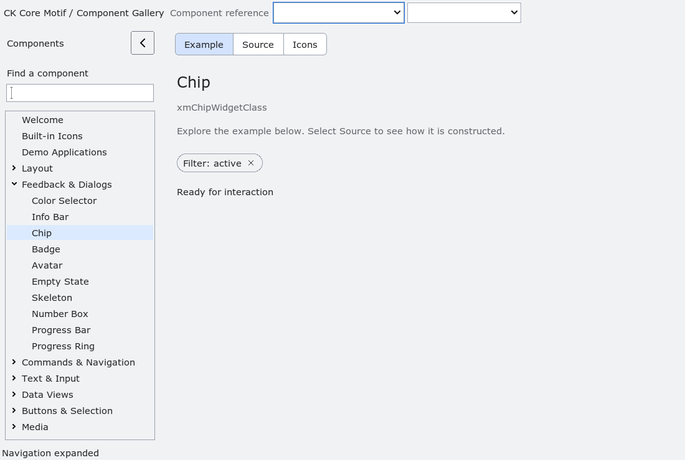

# Chip

`XmChip` is an opt-in compact label with an optional leading pixmap and an
optional remove affordance.  The label is copied at creation and through the
normal `XmNchipLabel` resource; the pixmap is borrowed under the ordinary
Motif pixmap lifetime rules.  The chip does not own a collection, attach to a
host widget, launch a command, or remove itself automatically.

Space, Return, keypad Return, or the body invokes `XmNchipActivateCallback`.
When `XmNchipRemovable` is true, Delete, Backspace, or the trailing remove
affordance invokes `XmNchipRemoveCallback`.  The callback receives
`XmCHIP_REASON_REMOVE`; application code owns the decision to destroy or
replace the chip. Callbacks may destroy the chip; the implementation performs
no widget access after invoking them. Pointer activation uses button 1 and
commits on release over the same body/removal target. Releasing outside the
control or over the other target cancels the action.

The control arranges the icon, measured compound label and removal mark in one
horizontal group. Explicit line breaks are preserved. Natural dimensions grow
with the text, pixmap, DPI and density; explicitly supplied width/height remain
application-owned until set to zero. Drawing and pointer targets share one
layout, including RTL mirroring. The control does not wrap or scroll its text;
undersized allocations clip content inside the available area.

Modern profiles use a symmetric capsule outline, a rounded focus ring and
hover/press feedback. Disabled chips reject pointer, keyboard and accessible
activation. Accessibility exposes the label as the button's name, with action
0 (`activate`) and, when removable, action 1 (`remove`). Removal remains an
application callback and does not destroy the widget automatically.

Native geometry and interaction fixtures cover both modern profiles, 1x,
1.5x, 2x and 3x, RTL, live font/profile/density changes, colour and monochrome
pixmaps, explicit dimensions, release cancellation, keyboard input, focus
symmetry and callback destruction. The Chip private-record changes belong to
the pending ABI-9 cohort; subclasses must rebuild with matching headers.

<!-- gallery-demo-tabs: begin -->
## Component demo

Captured gallery example and its corresponding source excerpt.

::: tabs
== Demo

== Source

Actual gallery excerpt: class = xmChipWidgetClass.
The host supplies parent, name, callback and client_data.
Shared factory locals: Widget example; XmString label = NULL.
The shared factory frees label, attaches callbacks and sizes the preview.
Helpers and the complete factory are in gallery_examples.c.

<<< @/demos/programs/ckmotif-gallery/gallery_examples.c#L350-L353

[Complete demo source](../demos/programs/ckmotif-gallery/gallery_examples.c) · [Public header](../lib/Xm/Chip.h)

:::
<!-- gallery-demo-tabs: end -->
