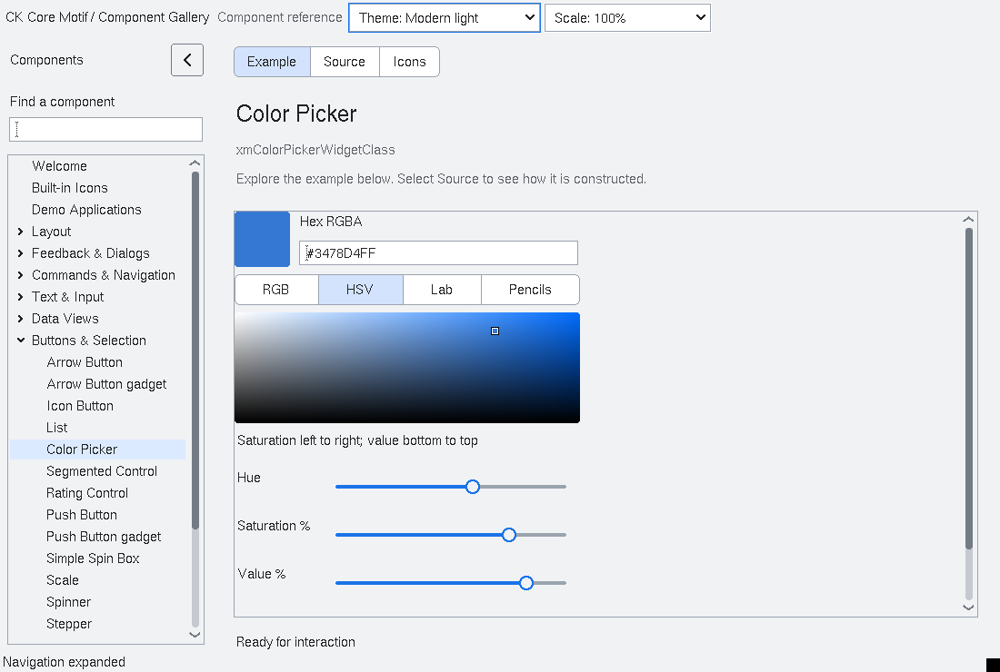
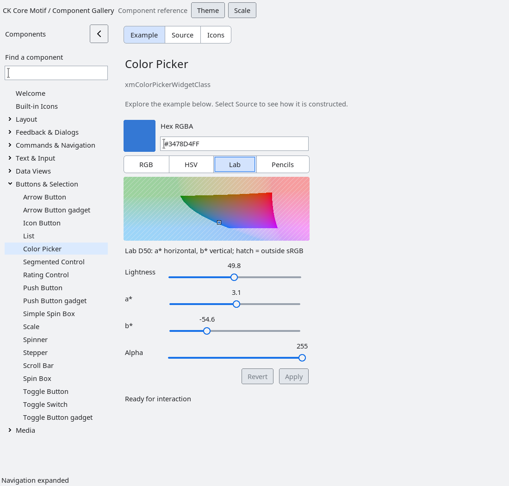
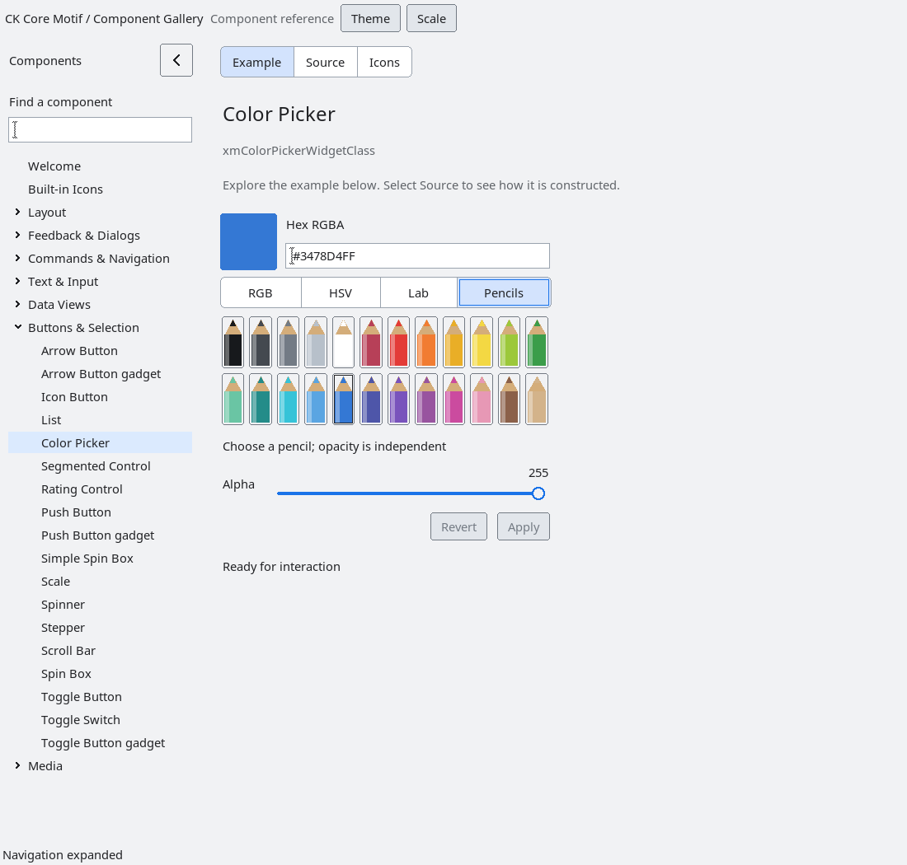

# ColorPicker

`XmColorPicker` provides four mutually exclusive, tab-like modes using the native
SegmentedControl. HSV is the default. The library owns all styling and measured
geometry; the gallery only creates the control and sets its initial color.

| Mode | Visual selection | Numeric controls |
| --- | --- | --- |
| RGB | Shared color/alpha preview | Red, green, blue, alpha (0–255) and hex |
| HSV | Saturation/value field; hue sets the field's color | Hue (degrees), saturation/value (%) and alpha |
| Lab | a*/b* field at the selected lightness | CIE Lab D50 lightness, a*, b* and alpha |
| Pencils | 24 colored pencils, each a named native button | Shared alpha and hex |

The swatch, hex editor, Apply and Revert remain available in every mode. Switching
modes does not convert, commit or change the current color; it preserves pending
hex text. A common measured width prevents the editor and mode strip shifting
horizontally. Natural height follows the selected content. Constrained hosts may
scroll the composite. Explicit width/height independently own their axes; setting
an axis to zero restores its natural size. Layout and pencil ordering mirror for
right-to-left applications, while color-field axes retain their documented meaning.

## Visual selection modes

The following gallery captures show the library-owned modern light appearance.
Use the mode strip inside the component to change the editing model.

::: tabs
== HSV

== Lab

== Pencils

:::

## Color and gamut contract

Committed and preview values are 32-bit **sRGB** `0xRRGGBBAA`, with eight bits per
channel. The unsigned-long API normalizes values to the low 32 bits. Hex accepts
six or eight digits, optionally prefixed by `#`; six digits imply opaque alpha.
Canonical text is `#RRGGBBAA`.

HSV operates on encoded sRGB. Achromatic edits preserve the chosen hue; editing
black also retains the chosen saturation until another color source replaces it.
Lab uses the D50 white point, sRGB transfer functions, and Bradford chromatic
adaptation between D65 and D50. The conversion follows the
[CSS Color 4 color-conversion model](https://www.w3.org/TR/css-color-4/#color-conversion-code).
This is an sRGB picker, not an ICC-managed monitor or wide-gamut editor.

Muted hatching marks Lab coordinates outside sRGB. Selecting those coordinates
retains the requested Lab cursor and slider values, clips the resulting RGB
channels to the output range, and shows an explicit gamut notice. The swatch and
hex editor show that actual clipped output. Applying commits the displayed sRGB
value. Alpha is independent of every color mode and composites over a checkerboard.

## Editing and API

Valid text, slider, color-field and pencil edits update the preview. A changed
packed value emits `XmNcolorPickerPreviewCallback`; selecting a different mode
alone does not. Apply or Return commits and emits
`XmNcolorPickerValueChangedCallback` only when the committed color changes.
Invalid text leaves both values intact; attempting to commit shows validation.
Revert or Escape restores the committed preview and text. Native buttons support
release-outside cancellation. The field supports mouse dragging, arrow keys,
Shift+arrow for larger steps, Home/End for horizontal endpoints, and Return.

- `XmColorPickerGetValue` / `XmColorPickerGetPreviewValue`: committed/preview RGBA.
- `XmColorPickerSetValue`: replace both values, optionally notify commit.
- `XmColorPickerPreviewValue`: replace preview only.
- `XmColorPickerSetMode` / `XmColorPickerGetMode`: `XmCOLOR_PICKER_RGB`,
  `XmCOLOR_PICKER_HSV`, `XmCOLOR_PICKER_LAB` or `XmCOLOR_PICKER_PENCILS`.
- `XmColorPickerPreviewHSV`: hue 0–360, saturation/value 0–1; preserves alpha.
- `XmColorPickerPreviewLab`: L* 0–100 and a*/b* −128–127; preserves alpha.
- `XmColorPickerCommit(widget, notify)`: False for invalid text.
- `XmColorPickerRevert`: restore committed color.
- `XmColorPickerGetTextField`: borrowed editor owned by the picker.

Invalid/non-finite model arguments are rejected without changing the preview.
Callbacks may destroy the picker. Native fonts and foregrounds inherit application
settings while retaining explicit child overrides. The color field caches its
raster by model parameter, allocation, sensitivity, background and colormap.
TrueColor uses visual masks; indexed displays use a bounded, owned palette with
nearest existing-color fallback. Cached pixmaps and allocated colors are released.

The field skips a transient zero-sized allocation and abandons a failed server
pixmap allocation before issuing any drawing request.  The next valid expose
retries the cache creation; no stale or invalid drawable is retained.
`tests/automated/check-colorpicker-plane-allocation.py` keeps that drawable
allocation contract explicit.

## Accessibility and validation

The parent exposes a color-chooser role with packed committed value, hex text and
Apply/Revert actions. Visible RGBA and model channels expose named sliders with
their actual bounds and units. Pencil buttons expose their color names and native
activation; the two-dimensional field also has a descriptive focusable identity.
Numeric sliders provide an alternative to every visual field edit. Semantic
writes respect sensitivity, visibility and modal admission.

`run-colorpicker-native.py` checks editing, alpha pixels, geometry, live metrics,
semantic actions and callback destruction. `run-colorpicker-modes.py` checks the
four modes, native pointer/keyboard input, RTL, tiny allocations, gamut handling,
alpha preservation and accessibility. It also checks 4,096 sRGB/HSV/Lab round trips
and known D50 reference values. Run both in Xft/SVG and core-font/non-SVG builds.
The pending epoch-9 private layout changes require consumer/subclass rebuilds.
The separate legacy `XmColorSelector` remains available.

<!-- gallery-demo-tabs: begin -->
## Component demo

Captured gallery example and its corresponding source excerpt.

::: tabs
== Demo

== Source

Actual gallery excerpt: class = xmColorPickerWidgetClass.
The host supplies parent, name, callback and client_data.
Shared factory locals: Widget example; XmString label = NULL.
The shared factory frees label, attaches callbacks and sizes the preview.
Helpers and the complete factory are in gallery_examples.c.

<<< @/demos/programs/ckmotif-gallery/gallery_examples.c#L529-L530

[Complete demo source](../demos/programs/ckmotif-gallery/gallery_examples.c) · [Public header](../lib/Xm/ColorPicker.h)

:::
<!-- gallery-demo-tabs: end -->
