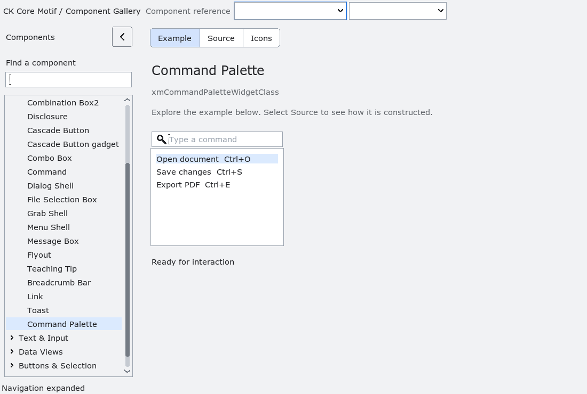

# CommandPalette

`XmCommandPalette` is an opt-in, non-modal command chooser.  The application
owns the command model and dispatches the stable `id` received from
`XmNcommandPaletteInvokeCallback`; the toolkit only filters and presents the
model.  `user_data` is borrowed and is returned unchanged with the callback.

`XmCommandPaletteSetItems` copies each item ID, label and shortcut, so callers
may release their input strings after the call.  Filtering is an explicit,
case-insensitive substring match over labels.  Empty or unmatched filters do
not execute commands.  `XmCommandPaletteShow` focuses the search field and
remembers the prior focus; dismissal restores it when that widget is still
managed.  Escape, search activation and list default activation are all
bounded to the instance. Escape respects widget sensitivity: a disabled
palette remains shown until its owner explicitly enables or dismisses it.

The palette has no process-global command registry, navigation policy or
implicit execution from drawing/filter callbacks.  Accessibility exposes the
instance as a named panel with one explicit invoke action; its child search
field and list retain their native text and selection semantics.  The
installed fixture covers copied model ownership, filtering, dispatch,
accessibility, no-match behavior, dismissal and teardown.

The source-contract checks also reject accidental patch markers in this
translation unit, so malformed hand-edited source cannot silently bypass the
CommandPalette checks.

<!-- gallery-demo-tabs: begin -->
## Component demo

Captured gallery example and its corresponding source excerpt.

::: tabs
== Demo

== Source

Actual gallery excerpt: class = xmCommandPaletteWidgetClass.
The host supplies parent, name, callback and client_data.
Shared factory locals: Widget example; XmString label = NULL.
The shared factory frees label, attaches callbacks and sizes the preview.
Helpers and the complete factory are in gallery_examples.c.

<<< @/demos/programs/ckmotif-gallery/gallery_examples.c#L839-L858

[Complete demo source](../demos/programs/ckmotif-gallery/gallery_examples.c) · [Public header](../lib/Xm/CommandPalette.h)

:::
<!-- gallery-demo-tabs: end -->
