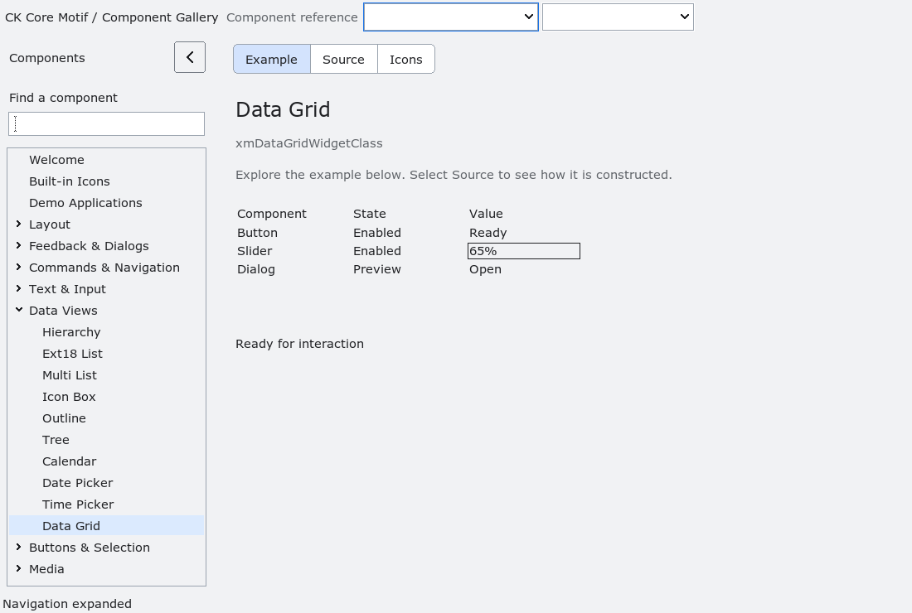

# XmDataGrid

`XmDataGrid` is the released bounded table control from WP-27.  It copies a
model snapshot supplied through `XmDataGridSetModel`; application-owned row
and column IDs remain opaque and stable, while titles and cell text are copied
into toolkit-owned storage.  The model is limited to 4096 rows and 256
columns.  Invalid models (null IDs, duplicate IDs, missing values, or counts
above those limits) are rejected without replacing the previous snapshot.

The control realizes only the finite visible viewport.  Header and row metrics,
top-row scrolling, and RTL column presentation are resources; wheel events,
keyboard traversal, and `XmDataGridSetTopRow` all clamp to the bounded model.
Home selects the first model row even when the grid has no current selection;
End selects the final model row rather than merely the first row of the final
viewport. The first arrow-key command from an empty selection selects the
first cell instead of skipping past it in the command's direction.
Arrow and paging keysyms work even when the X input event produces no text.
Sorting is request-only: `XmDataGridRequestSort` and header activation emit a
sort callback, but never reorder application data.

Selection identifies a row and column by their stable IDs; repeated requests
for the already-selected cell do not emit duplicate selection callbacks.
Editing is an
explicit begin/set/commit/cancel sequence.  Applications can report a
validation error with `XmDataGridSetEditError`; commit then fails and emits the
edit-failed callback without changing the copied model value.  A successful
commit replaces the copied value and emits the edit-committed callback.  The
callbacks are last actions in their mutation paths and may destroy the widget.

The accessibility bridge reports table role, row/column counts, and the current
bounded value summary.  A future release may add richer semantic cell
providers, but this release does not infer formulas, charts, arbitrary data
binding, lazy providers, variable-height rows, frozen panes, merged cells, or
background callbacks.  Those restrictions are part of the public contract.

<!-- gallery-demo-tabs: begin -->
## Component demo

Captured gallery example and its corresponding source excerpt.

::: tabs
== Demo

== Source

Actual gallery excerpt: class = xmDataGridWidgetClass.
The host supplies parent, name, callback and client_data.
Shared factory locals: Widget example; XmString label = NULL.
The shared factory frees label, attaches callbacks and sizes the preview.
Helpers and the complete factory are in gallery_examples.c.

<<< @/demos/programs/ckmotif-gallery/gallery_examples.c#L673-L692

[Complete demo source](../demos/programs/ckmotif-gallery/gallery_examples.c) · [Public header](../lib/Xm/DataGrid.h)

:::
<!-- gallery-demo-tabs: end -->
