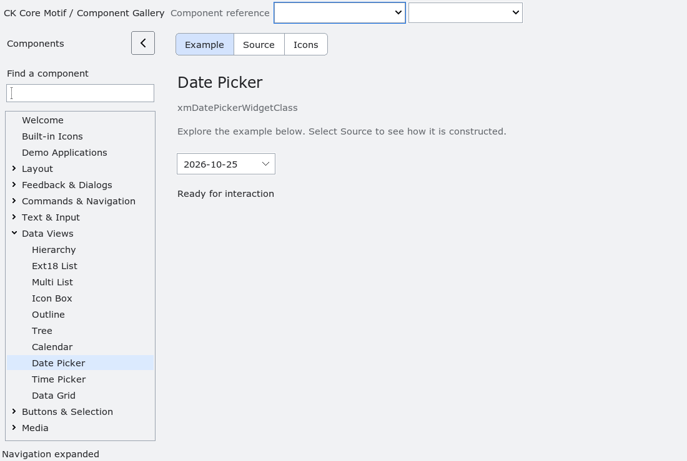

# XmDatePicker

`XmDatePicker` is a compact date-only editor whose popup is an `XmCalendar`.
It shares the Calendar civil-date contract: proleptic Gregorian years 1–9999,
no time zone, and no conversion to an instant.  `XmDatePickerSetRange` rejects
an invalid or inverted range and rejects a range that would exclude the current
date.  A rejected update leaves the picker unchanged.

Pointer, Return, keypad Enter, and Space toggle the popup.  Choosing a valid
calendar date updates the picker and closes the popup.  The popup is an
override-redirect, non-modal shell and is positioned below the owner, clamped
to the screen.  `XmNdatePickerDateChangedCallback` is delivered after the
popup has closed; callback code may destroy the picker.  `XmNdatePickerOpenChangedCallback`
reports popup open/close transitions.

The compact field uses an unambiguous `YYYY-MM-DD` representation.  Locale
formatting and time-zone interpretation are intentionally outside this
date-only control and are separate work.

<!-- gallery-demo-tabs: begin -->
## Component demo

Captured gallery example and its corresponding source excerpt.

::: tabs
== Demo

== Source

Actual gallery excerpt: class = xmDatePickerWidgetClass.
The host supplies parent, name, callback and client_data.
Shared factory locals: Widget example; XmString label = NULL.
The shared factory frees label, attaches callbacks and sizes the preview.
Helpers and the complete factory are in gallery_examples.c.

<<< @/demos/programs/ckmotif-gallery/gallery_examples.c#L795-L798

[Complete demo source](../demos/programs/ckmotif-gallery/gallery_examples.c) · [Public header](../lib/Xm/DatePicker.h)

:::
<!-- gallery-demo-tabs: end -->
