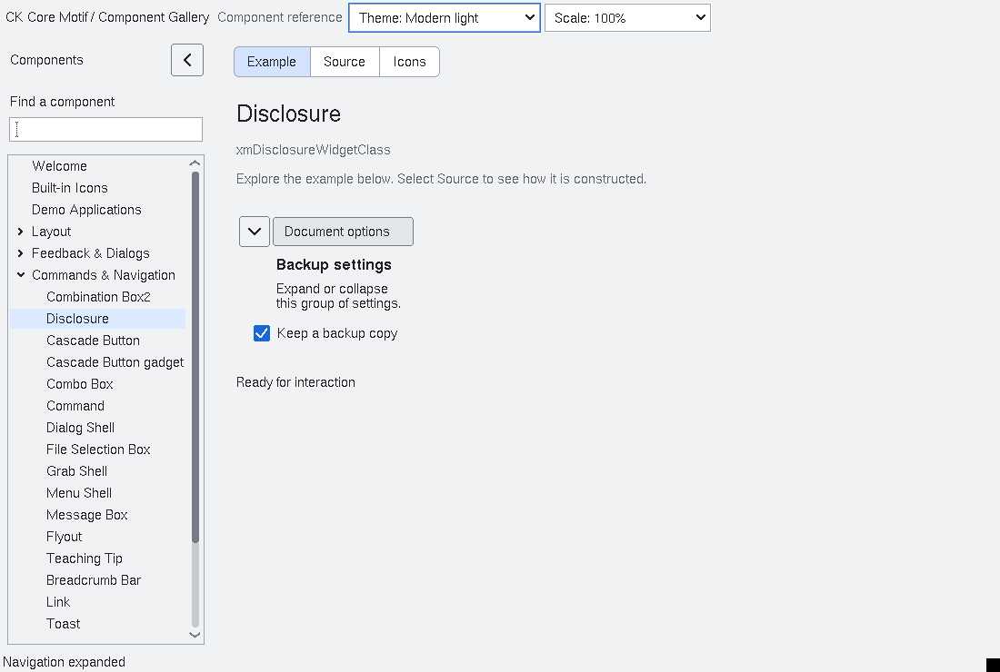

# Disclosure sections

`<Xm/Disclosure.h>` defines a native `XmManager` subclass for a collapsible
section. Both the earlier ABI 5 and the `b726c1d` ABI 6 native ARM64 cohorts pass
its interaction, geometry, lifecycle and accessibility fixtures. The ABI 6
cohort also passes first-collapse state delivery and the covered Orca speech
baseline. Consumers must rebuild against the selected exact
header/library cohort; other architectures and application integration have
separate acceptance checks.

<!-- gallery-demo-tabs: begin -->
## Component demo

Captured gallery example and its corresponding source excerpt.

::: tabs
== Demo



== Source

Actual gallery excerpt: class = xmDisclosureWidgetClass.
The host supplies parent, name, callback and client_data.
Shared factory locals: Widget example; XmString label = NULL.
The shared factory frees label, attaches callbacks and sizes the preview.
Helpers and the complete factory are in gallery_examples.c.

<<< @/demos/programs/ckmotif-gallery/gallery_examples.c#L818-L835

[Complete demo source](../demos/programs/ckmotif-gallery/gallery_examples.c) · [Public header](../lib/Xm/Disclosure.h)

:::
<!-- gallery-demo-tabs: end -->

## Construction and ownership

Create a section with `XmCreateDisclosure` or `xmDisclosureWidgetClass`. The
section owns its header, arrow indicator and stable `XmRowColumn` content host.
Create application children beneath `XmDisclosureGetContent(section)`, never
directly beneath the disclosure widget.

```c
#include <Xm/Disclosure.h>
#include <Xm/Label.h>

Widget section = XmCreateDisclosure(parent, "details", NULL, 0);
Widget content = XmDisclosureGetContent(section);
XtVaCreateManagedWidget("summary", xmLabelWidgetClass, content, NULL);
XtManageChild(section);
```

`XmDisclosureGetContent` and `XmDisclosureGetHeader` return borrowed child
widgets. Do not destroy/reparent them, change their managed/mapped state, or
change internal header presentation resources. `GetHeader` is the explicit
keyboard focus target. Normal Xt parent destruction destroys owned children;
application children retain their ordinary Xt lifetime within the content host.

## Resources and transitions

| Resource | Contract |
| --- | --- |
| `XmNexpanded` | Boolean, initially `True`. |
| `XmNlabelString` | Header label; the widget keeps its own copy. |
| `XmNexpandedCallback` | Called once for a notified actual expansion-state transition. |
| `XmNmarginWidth`, `XmNmarginHeight`, `XmNspacing` | Native layout dimensions. |

`XmDisclosureGetExpanded(section)` queries state.
`XmDisclosureSetExpanded(section, expanded, notify)` changes it, with explicit
notification control. Setting `XmNexpanded` through Xt also notifies on an actual
transition. Initial construction and repeated assignment of the same state do
not notify.

A callback receives `XmDisclosureCallbackStruct`: `reason` is
`XmCR_VALUE_CHANGED`, `event` may be `NULL` for programmatic changes, and
`expanded` is the new Boolean state. Applications should use this callback to
observe presentation state, rather than destroy and recreate section contents.

Collapse changes mapping of the stable content host while preserving its
managed state, descendants' individual managed states and application data.
If focus is inside collapsing content, it moves to the header. The widget
negotiates the collapsed natural height and restores content layout on expansion.
All widget operations and callbacks run on the owning Xt thread.

Header pointer and keyboard activation are inactive while the Disclosure or an
ancestor is insensitive. This affects user input only:
`XmDisclosureSetExpanded` remains the explicit programmatic state API.

## Validation boundary

The native fixture checks pointer/keyboard activation, callback counts and
notification suppression, focus transfer, geometry negotiation, preserved child
managed states, resizing, multiple instances and callback-triggered destruction.
A real D-Bus observer checks expanded state and the header action. These checks
pass for the installed native ARM64 cohort; they do not substitute for screen-reader
or application usability checks. See [current status](status.md).
