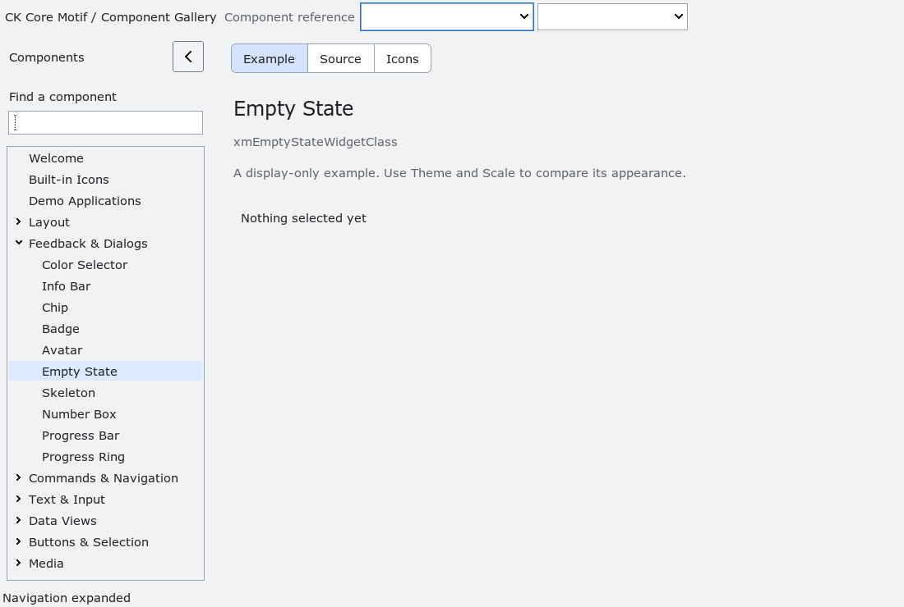

# EmptyState

`XmEmptyState` is an additive presentation manager for an empty view.  It
owns an optional icon label, a message label and an optional action button;
applications own the model that decides whether the empty view is shown and
the callback that performs the action.  The widget never replaces, hides or
mutates the application-owned data view.

`XmNemptyStateMessage` and `XmNemptyStateActionLabel` are copied `XmString`
resources.  `XmNemptyStateIcon` borrows the application `Pixmap`, which must
remain valid while the widget uses it.  Margins and spacing are explicit
dimension resources.  An empty action label leaves the button unmapped.

`XmEmptyStateInvokeAction` dispatches the application callback without
launching a command or changing view state.  Accessibility exposes the
composite as a panel named from the message and reports one action only when
the action button is present.  The installed fixture covers action dispatch,
dynamic action visibility, accessibility, constrained geometry and teardown.

The action button does not invoke its callback while the EmptyState or an
ancestor is insensitive. `XmEmptyStateInvokeAction` remains available as the
explicit programmatic dispatch API.

<!-- gallery-demo-tabs: begin -->
## Component demo

Captured gallery example and its corresponding source excerpt.

::: tabs
== Demo

== Source

Actual gallery excerpt: class = xmEmptyStateWidgetClass.
The host supplies parent, name, callback and client_data.
Shared factory locals: Widget example; XmString label = NULL.
The shared factory frees label, attaches callbacks and sizes the preview.
Helpers and the complete factory are in gallery_examples.c.

<<< @/demos/programs/ckmotif-gallery/gallery_examples.c#L396-L398

[Complete demo source](../demos/programs/ckmotif-gallery/gallery_examples.c) · [Public header](../lib/Xm/EmptyState.h)

:::
<!-- gallery-demo-tabs: end -->
