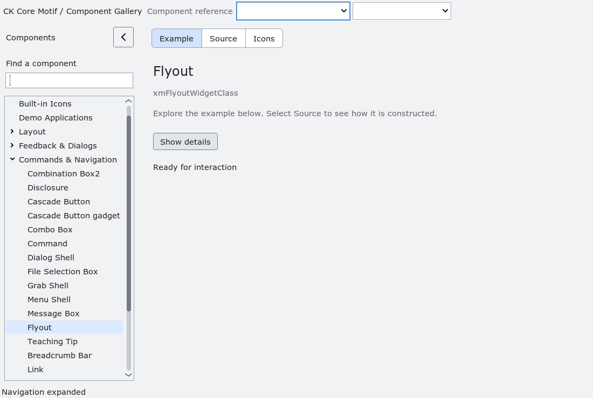

# Flyout

`XmFlyout` is an additive, non-modal anchored popup handle.  Create it as an
unmanaged child of its owner with `XmCreateFlyout`, configure
`XmNflyoutText`, `XmNflyoutOffsetX` and `XmNflyoutOffsetY`, and call
`XmFlyoutShow` or `XmFlyoutHide` explicitly.

Showing creates a transient override-redirect shell positioned below the owner
and clamped to the current screen. In Modern profiles it aligns to the owner's
left edge with an eight-logical-pixel gap, choosing above the owner when there
is insufficient space below. Classic retains centered placement. Explicit X/Y
offsets remain additive. The Modern label has density- and scale-aware padding;
its margins remain application-overridable. Owner geometry and visible text
updates also refresh placement.  The shell uses `XtGrabNone`: it never
changes menu or dialog admission and does not intercept unrelated events.
Owner unmap, owner button activation, Escape/Return in the popup, explicit
hide, owner destruction and flyout destruction all have deterministic cleanup.
`XmNflyoutDismissCallback` reports explicit or interaction-driven dismissal;
owner destruction does not call application callbacks after the owner is gone.
The flyout never moves keyboard focus.  Existing Motif tooltip resources and
behavior remain unchanged; delayed tooltips and teaching-tip content can be
layered on this primitive by a later package.

`tests/automated/run-flyout.py` validates show/hide, dismissal callbacks,
screen-edge placement through the installed prefix, and owner teardown under
Xvfb. Popup destroy callbacks detach before the handle is freed, including
when Xt defers the popup's destruction.

The gallery uses a compact trigger-only owner and leaves both Flyout and
TeachingTip handles unmanaged, avoiding an empty visible primitive. The details
example uses a two-line panel rather than a long tooltip-shaped strip.
`tests/automated/run-flyout-gallery.py --build ABS_BUILD --results ABS_NEW_DIR`
tests the production factory, callback activation, hidden helper, trigger bounds,
popup padding and placement across palettes, scales and densities, bottom-edge
flipping and repeated Flyout/TeachingTip teardown. Use
`ckmotif-gallery --component xm.flyoutwidgetclass --open-example` to inspect the
opened panel without sending desktop mouse or keyboard input.

<!-- gallery-demo-tabs: begin -->
## Component demo

Captured gallery example and its corresponding source excerpt.

::: tabs
== Demo

== Source

Actual gallery excerpt: class = xmFlyoutWidgetClass.
The host supplies parent, name, callback and client_data.
Shared factory locals: Widget example; XmString label = NULL.
The shared factory frees label, attaches callbacks and sizes the preview.
Helpers and the complete factory are in gallery_examples.c.

<<< @/demos/programs/ckmotif-gallery/gallery_examples.c#L862-L881

[Complete demo source](../demos/programs/ckmotif-gallery/gallery_examples.c) · [Public header](../lib/Xm/Flyout.h)

:::
<!-- gallery-demo-tabs: end -->
