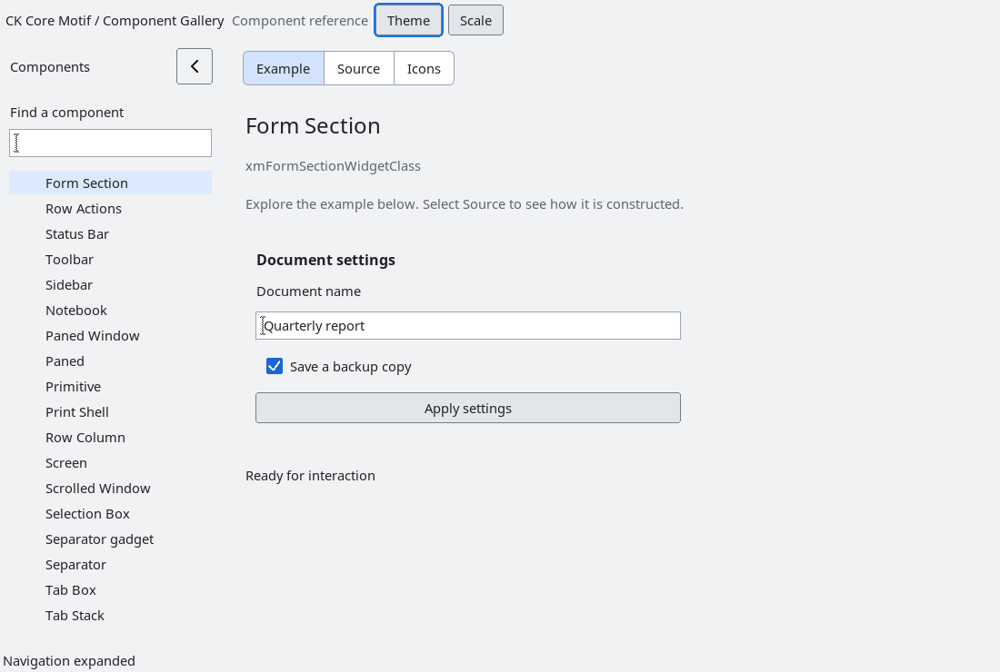

# FormSection

`XmFormSection` is a presentation-only manager with an owned header, an
application-owned content host, and an optional footer.  Create application
children only under `XmFormSectionGetContent`; the section owns its internal
header/content/footer children and performs normal Xt geometry negotiation.

`XmNformSectionHeader` and `XmNformSectionFooter` are copied `XmString`
values.  Margin and spacing resources are explicit and scale through normal
Motif dimension conversion.  A missing footer remains unmapped, and narrow
widths clamp child geometry without changing content ownership or managed
states.  The section has no form-data model, validation behavior, focus trap,
or implicit overlay.

The section supplies the header and footer typography. Its content host uses a
vertical layout without sharing label margins across controls: adding a toggle
does not indent neighbouring field labels. The section owns the outer padding;
the content host adds no second padding layer. In modern profiles, outer
padding and header/content/footer spacing follow display scale and density.
Explicit section margin and spacing resources remain application choices.

Accessibility exposes the section as a panel named from its header.  The
installed fixture covers header/footer ownership, content-child lifetime,
narrow geometry, accessibility, and destruction.

<!-- gallery-demo-tabs: begin -->
## Component demo

Captured gallery example and its corresponding source excerpt.

::: tabs
== Demo

== Source

Actual gallery excerpt: class = xmFormSectionWidgetClass.
The host supplies parent, name, callback and client_data.
Shared factory locals: Widget example; XmString label = NULL.
The shared factory frees label, attaches callbacks and sizes the preview.
Helpers and the complete factory are in gallery_examples.c.

<<< @/demos/programs/ckmotif-gallery/gallery_examples.c#L969-L1010

[Complete demo source](../demos/programs/ckmotif-gallery/gallery_examples.c) · [Public header](../lib/Xm/FormSection.h)

:::
<!-- gallery-demo-tabs: end -->
