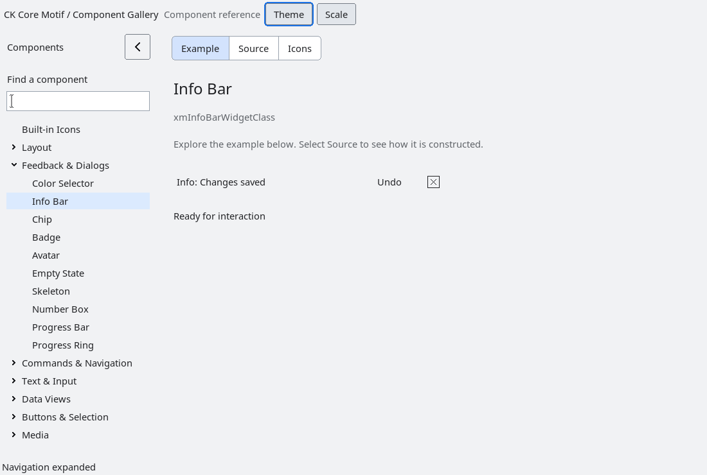

# InfoBar

`XmInfoBar` is an additive inline information, warning or error banner. Its
`XmNinfoSeverity` and `XmNinfoMessage` are explicit resources; an optional
`XmNinfoActionLabel` invokes `XmNinfoActionCallback`, and
`XmNinfoClosable` enables Escape or close-glyph dismissal through
`XmNinfoDismissCallback`. The bar never grabs input or moves keyboard focus.
Its accessible representation exposes the message text as a live panel.
Existing MessageBox, dialog and application status-area behavior is unchanged.

<!-- gallery-demo-tabs: begin -->
## Component demo

Captured gallery example and its corresponding source excerpt.

::: tabs
== Demo

== Source

Actual gallery excerpt: class = xmInfoBarWidgetClass.
The host supplies parent, name, callback and client_data.
Shared factory locals: Widget example; XmString label = NULL.
The shared factory frees label, attaches callbacks and sizes the preview.
Helpers and the complete factory are in gallery_examples.c.

<<< @/demos/programs/ckmotif-gallery/gallery_examples.c#L529-L532

[Complete demo source](../demos/programs/ckmotif-gallery/gallery_examples.c) · [Public header](../lib/Xm/InfoBar.h)

:::
<!-- gallery-demo-tabs: end -->
