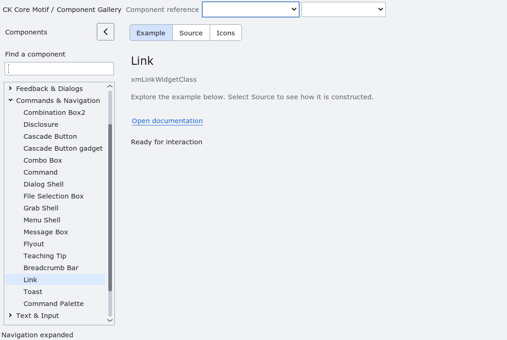

# Link

`XmLink` is an application-dispatched link affordance.  The control owns a
copy of its `XmNlinkLabel` and `XmNlinkTarget` values, draws a visible
underlined label, and exposes `XmNlinkVisited` plus
`XmNlinkVisitOnActivate`.  Space, Return, keypad Return, and pointer press
invoke `XmNlinkActivateCallback` with the target payload.  The default visit
policy marks the link visited before the callback; applications may disable
that policy and manage the state themselves.

The widget never launches a URL, opens a file, or invokes an external program.
The application owns dispatch, target interpretation, navigation and lifetime.
Accessibility exposes the link as a one-action button with its label as the
accessible name.  Focus and visited state remain visible without relying on
colour alone.

## Natural sizing and appearance

With width or height omitted (or set to zero), Link measures that dimension from
its render table and compound label. Automatic dimensions follow label, font,
DPI and appearance changes. A nonzero dimension supplied by the application is
preserved independently, including an assignment equal to the current size.
Setting it back to zero restores automatic sizing. Geometry queries use the
same measurement as construction and live updates, while retaining explicit
dimensions. Actual allocations remain subject to normal parent geometry
negotiation.

Modern profiles apply the shared comfortable/compact minimum height. Padding
scales with DPI and reserves room for both visited-state underline rules, so
visiting a link does not shift adjacent controls. Underlines follow the measured
text position; foreground and disabled colors follow the current appearance.

<!-- gallery-demo-tabs: begin -->
## Component demo

Captured gallery example and its corresponding source excerpt.

::: tabs
== Demo

== Source

Actual gallery excerpt: class = xmLinkWidgetClass.
The host supplies parent, name, callback and client_data.
Shared factory locals: Widget example; XmString label = NULL.
The shared factory frees label, attaches callbacks and sizes the preview.
Helpers and the complete factory are in gallery_examples.c.

<<< @/demos/programs/ckmotif-gallery/gallery_examples.c#L383-L386

[Complete demo source](../demos/programs/ckmotif-gallery/gallery_examples.c) · [Public header](../lib/Xm/Link.h)

:::
<!-- gallery-demo-tabs: end -->
