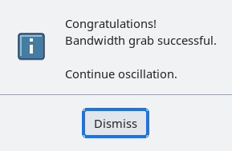
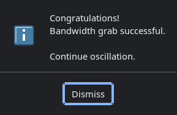

# MessageBox symbols follow the dialog palette

Default dialog symbols are cached pixmaps rendered with the dialog's palette.
Previously, changing a MessageBox background left its existing symbol unchanged.
SVG transparency had already been composited against the old background, leaving
a visible gray rectangle when a classic-created dialog acquired modern colors.

MessageBox now reacquires internally owned symbols when background, foreground,
top/bottom shadow or highlight colors change. It acquires the new cache reference
before releasing the old one, and updates the symbol child through its normal
layout path. Application-supplied symbol pixmaps retain their contents and
ownership when the palette changes. Existing dialog-type replacement behavior
and image-override precedence are unchanged.

`tests/automated/check-dialog-icons.c` exercises all five default symbols through
black and white background changes and reads actual pixmap corner pixels. It
also checks that explicit custom pixmaps survive palette changes. Existing
coverage checks vector detail, scaling, cache references and bitmap fallback.
The regression fails on the previous implementation with a stale corner pixel.

The Periodic demo supplies an actual-application visual check: open Information,
Warning, Error, Question and Working from the notebook's Dialogs page in light
and dark themes. Transparent corners should blend into the dialog surface.

## Actual dialog captures

These captures come from the verified Periodic process after opening its
Information dialog through the notebook, with the dialog's transient owner
checked against the process's main window.

::: tabs
== Modern light

== Modern dark

:::

## Live scale changes

An existing MessageBox observes display-scale changes and reacquires its default
symbol at the new raster size. The symbol label's normal geometry request then
updates the dialog layout. Explicit custom symbol pixmaps remain unchanged.
The observer is removed during destruction, without adding private instance
fields or changing the MessageBox layout.

Native coverage checks all five symbols through 100%, 150%, 200% and back to
100%, along with custom-pixmap preservation. Realized light and dark information
dialogs also verify that the symbol child accommodates the new raster dimensions.
Previously the 150% case retained a 40-by-40 raster instead of 60-by-60.
