# CK Core Motif component catalogue

<!-- Generated from docs/modern-gallery-manifest.json; do not edit. -->
<!-- manifest-sha256: 3464be585011b31b215ed5a16ba8e4a4f96e7cbb49adbd9f7195d7a2aa19dc32 -->

This catalogue is generated from the gallery manifest. Each anchor is
the documentation target recorded by the corresponding manifest entry.

## buttons-selection

### `xm.arrowbuttonwidgetclass`

- Class: `xmArrowButtonWidgetClass`
- Example: `gallery.source.arrowbuttonwidgetclass`
- Interaction: `gallery.interaction.arrowbuttonwidgetclass`
- Screenshot: `gallery.screenshot.arrowbuttonwidgetclass`
- Capability: constructible

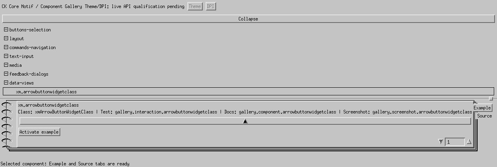

### `xm.arrowbuttongadgetclass`

- Class: `xmArrowButtonGadgetClass`
- Example: `gallery.source.arrowbuttongadgetclass`
- Interaction: `gallery.interaction.arrowbuttongadgetclass`
- Screenshot: `gallery.screenshot.arrowbuttongadgetclass`
- Capability: constructible

### `xm.iconbuttonwidgetclass`

- Class: `xmIconButtonWidgetClass`
- Example: `gallery.source.iconbuttonwidgetclass`
- Interaction: `gallery.interaction.iconbuttonwidgetclass`
- Screenshot: `gallery.screenshot.iconbuttonwidgetclass`
- Capability: constructible

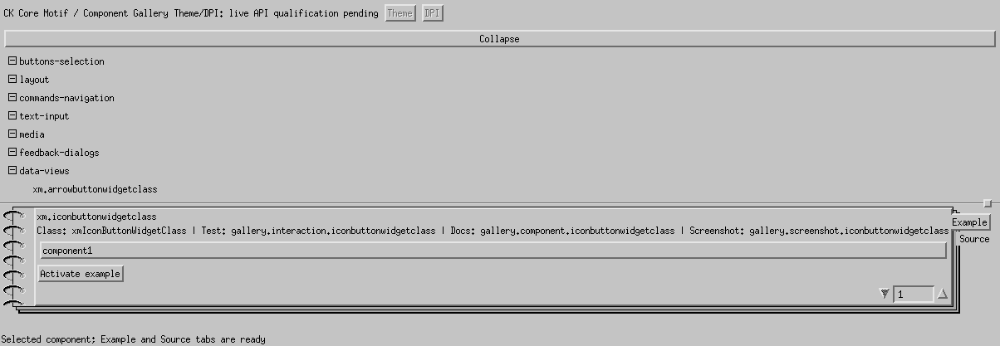

### `xm.listwidgetclass`

- Class: `xmListWidgetClass`
- Example: `gallery.source.listwidgetclass`
- Interaction: `gallery.interaction.listwidgetclass`
- Screenshot: `gallery.screenshot.listwidgetclass`
- Capability: constructible

### `xm.colorpickerwidgetclass`

- Class: `xmColorPickerWidgetClass`
- Example: `gallery.source.colorpickerwidgetclass`
- Interaction: `gallery.interaction.colorpickerwidgetclass`
- Screenshot: `gallery.screenshot.colorpickerwidgetclass`
- Capability: constructible

### `xm.segmentedcontrolwidgetclass`

- Class: `xmSegmentedControlWidgetClass`
- Example: `gallery.source.segmentedcontrolwidgetclass`
- Interaction: `gallery.interaction.segmentedcontrolwidgetclass`
- Screenshot: `gallery.screenshot.segmentedcontrolwidgetclass`
- Capability: constructible

### `xm.ratingcontrolwidgetclass`

- Class: `xmRatingControlWidgetClass`
- Example: `gallery.source.ratingcontrolwidgetclass`
- Interaction: `gallery.interaction.ratingcontrolwidgetclass`
- Screenshot: `gallery.screenshot.ratingcontrolwidgetclass`
- Capability: constructible

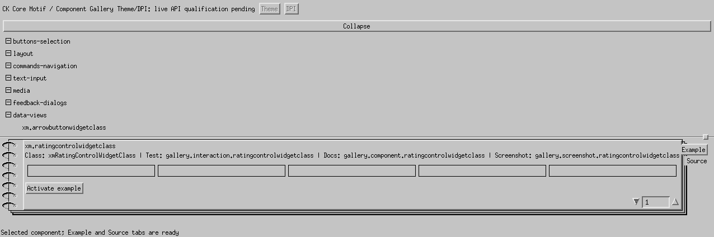

### `xm.pushbuttonwidgetclass`

- Class: `xmPushButtonWidgetClass`
- Example: `gallery.source.pushbuttonwidgetclass`
- Interaction: `gallery.interaction.pushbuttonwidgetclass`
- Screenshot: `gallery.screenshot.pushbuttonwidgetclass`
- Capability: constructible

### `xm.pushbuttongadgetclass`

- Class: `xmPushButtonGadgetClass`
- Example: `gallery.source.pushbuttongadgetclass`
- Interaction: `gallery.interaction.pushbuttongadgetclass`
- Screenshot: `gallery.screenshot.pushbuttongadgetclass`
- Capability: constructible

### `xm.simplespinboxwidgetclass`

- Class: `xmSimpleSpinBoxWidgetClass`
- Example: `gallery.source.simplespinboxwidgetclass`
- Interaction: `gallery.interaction.simplespinboxwidgetclass`
- Screenshot: `gallery.screenshot.simplespinboxwidgetclass`
- Capability: constructible

### `xm.scalewidgetclass`

- Class: `xmScaleWidgetClass`
- Example: `gallery.source.scalewidgetclass`
- Interaction: `gallery.interaction.scalewidgetclass`
- Screenshot: `gallery.screenshot.scalewidgetclass`
- Capability: constructible

### `xm.spinnerwidgetclass`

- Class: `xmSpinnerWidgetClass`
- Example: `gallery.source.spinnerwidgetclass`
- Interaction: `gallery.interaction.spinnerwidgetclass`
- Screenshot: `gallery.screenshot.spinnerwidgetclass`
- Capability: constructible

### `xm.stepperwidgetclass`

- Class: `xmStepperWidgetClass`
- Example: `gallery.source.stepperwidgetclass`
- Interaction: `gallery.interaction.stepperwidgetclass`
- Screenshot: `gallery.screenshot.stepperwidgetclass`
- Capability: constructible

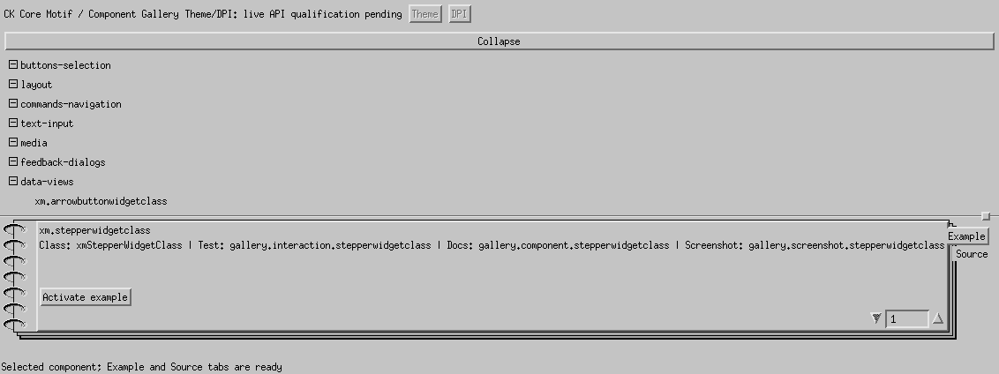

### `xm.scrollbarwidgetclass`

- Class: `xmScrollBarWidgetClass`
- Example: `gallery.source.scrollbarwidgetclass`
- Interaction: `gallery.interaction.scrollbarwidgetclass`
- Screenshot: `gallery.screenshot.scrollbarwidgetclass`
- Capability: constructible

### `xm.spinboxwidgetclass`

- Class: `xmSpinBoxWidgetClass`
- Example: `gallery.source.spinboxwidgetclass`
- Interaction: `gallery.interaction.spinboxwidgetclass`
- Screenshot: `gallery.screenshot.spinboxwidgetclass`
- Capability: constructible

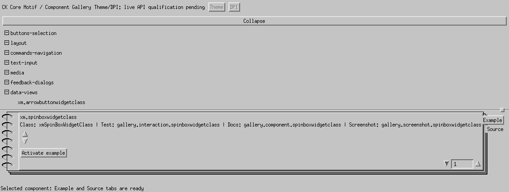

### `xm.togglebuttonwidgetclass`

- Class: `xmToggleButtonWidgetClass`
- Example: `gallery.source.togglebuttonwidgetclass`
- Interaction: `gallery.interaction.togglebuttonwidgetclass`
- Screenshot: `gallery.screenshot.togglebuttonwidgetclass`
- Capability: constructible

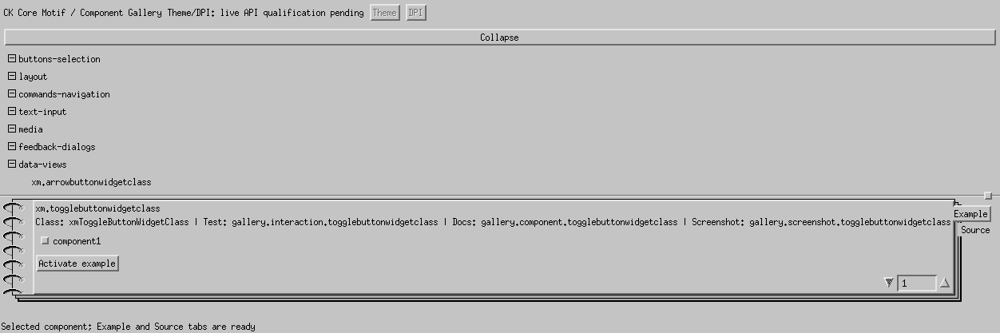

### `xm.toggleswitchwidgetclass`

- Class: `xmToggleSwitchWidgetClass`
- Example: `gallery.source.toggleswitchwidgetclass`
- Interaction: `gallery.interaction.toggleswitchwidgetclass`
- Screenshot: `gallery.screenshot.toggleswitchwidgetclass`
- Capability: constructible

### `xm.togglebuttongadgetclass`

- Class: `xmToggleButtonGadgetClass`
- Example: `gallery.source.togglebuttongadgetclass`
- Interaction: `gallery.interaction.togglebuttongadgetclass`
- Screenshot: `gallery.screenshot.togglebuttongadgetclass`
- Capability: constructible

## layout

### `xm.bulletinboardwidgetclass`

- Class: `xmBulletinBoardWidgetClass`
- Example: `gallery.source.bulletinboardwidgetclass`
- Interaction: `gallery.interaction.bulletinboardwidgetclass`
- Screenshot: `gallery.screenshot.bulletinboardwidgetclass`
- Capability: constructible

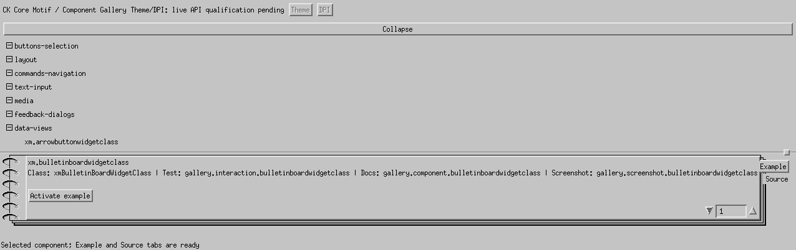

### `xm.columnwidgetclass`

- Class: `xmColumnWidgetClass`
- Example: `gallery.source.columnwidgetclass`
- Interaction: `gallery.interaction.columnwidgetclass`
- Screenshot: `gallery.screenshot.columnwidgetclass`
- Capability: constructible

### `xm.containerwidgetclass`

- Class: `xmContainerWidgetClass`
- Example: `gallery.source.containerwidgetclass`
- Interaction: `gallery.interaction.containerwidgetclass`
- Screenshot: `gallery.screenshot.containerwidgetclass`
- Capability: constructible

### `xm.displayclass`

- Class: `xmDisplayClass`
- Example: `gallery.source.displayclass`
- Interaction: `gallery.interaction.displayclass`
- Screenshot: `gallery.screenshot.displayclass`
- Capability: inventory-only

### `xm.dragcontextclass`

- Class: `xmDragContextClass`
- Example: `gallery.source.dragcontextclass`
- Interaction: `gallery.interaction.dragcontextclass`
- Screenshot: `gallery.screenshot.dragcontextclass`
- Capability: inventory-only

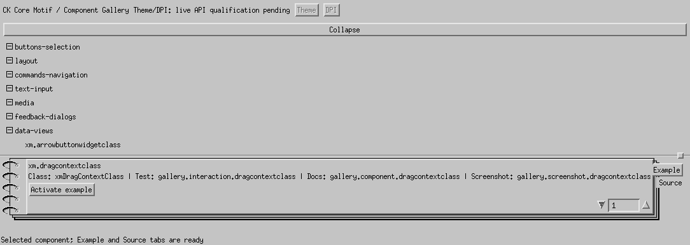

### `xm.dragiconobjectclass`

- Class: `xmDragIconObjectClass`
- Example: `gallery.source.dragiconobjectclass`
- Interaction: `gallery.interaction.dragiconobjectclass`
- Screenshot: `gallery.screenshot.dragiconobjectclass`
- Capability: inventory-only

### `xm.dragovershellwidgetclass`

- Class: `xmDragOverShellWidgetClass`
- Example: `gallery.source.dragovershellwidgetclass`
- Interaction: `gallery.interaction.dragovershellwidgetclass`
- Screenshot: `gallery.screenshot.dragovershellwidgetclass`
- Capability: constructible

### `xm.drawnbuttonwidgetclass`

- Class: `xmDrawnButtonWidgetClass`
- Example: `gallery.source.drawnbuttonwidgetclass`
- Interaction: `gallery.interaction.drawnbuttonwidgetclass`
- Screenshot: `gallery.screenshot.drawnbuttonwidgetclass`
- Capability: constructible

### `xm.formwidgetclass`

- Class: `xmFormWidgetClass`
- Example: `gallery.source.formwidgetclass`
- Interaction: `gallery.interaction.formwidgetclass`
- Screenshot: `gallery.screenshot.formwidgetclass`
- Capability: constructible

### `xm.framewidgetclass`

- Class: `xmFrameWidgetClass`
- Example: `gallery.source.framewidgetclass`
- Interaction: `gallery.interaction.framewidgetclass`
- Screenshot: `gallery.screenshot.framewidgetclass`
- Capability: constructible

### `xm.gadgetclass`

- Class: `xmGadgetClass`
- Example: `gallery.source.gadgetclass`
- Interaction: `gallery.interaction.gadgetclass`
- Screenshot: `gallery.screenshot.gadgetclass`
- Capability: inventory-only

### `xm.mainwindowwidgetclass`

- Class: `xmMainWindowWidgetClass`
- Example: `gallery.source.mainwindowwidgetclass`
- Interaction: `gallery.interaction.mainwindowwidgetclass`
- Screenshot: `gallery.screenshot.mainwindowwidgetclass`
- Capability: constructible

### `xm.managerwidgetclass`

- Class: `xmManagerWidgetClass`
- Example: `gallery.source.managerwidgetclass`
- Interaction: `gallery.interaction.managerwidgetclass`
- Screenshot: `gallery.screenshot.managerwidgetclass`
- Capability: inventory-only

### `xm.treeviewwidgetclass`

- Class: `xmTreeViewWidgetClass`
- Example: `gallery.source.treeviewwidgetclass`
- Interaction: `gallery.interaction.treeviewwidgetclass`
- Screenshot: `gallery.screenshot.treeviewwidgetclass`
- Capability: constructible

### `xm.dividerwidgetclass`

- Class: `xmDividerWidgetClass`
- Example: `gallery.source.dividerwidgetclass`
- Interaction: `gallery.interaction.dividerwidgetclass`
- Screenshot: `gallery.screenshot.dividerwidgetclass`
- Capability: constructible

### `xm.formsectionwidgetclass`

- Class: `xmFormSectionWidgetClass`
- Example: `gallery.source.formsectionwidgetclass`
- Interaction: `gallery.interaction.formsectionwidgetclass`
- Screenshot: `gallery.screenshot.formsectionwidgetclass`
- Capability: constructible

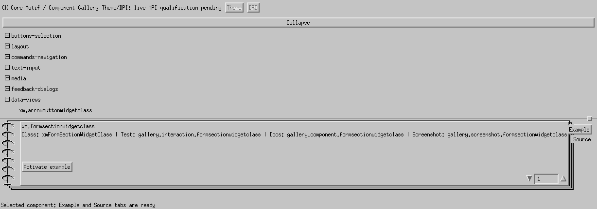

### `xm.rowactionswidgetclass`

- Class: `xmRowActionsWidgetClass`
- Example: `gallery.source.rowactionswidgetclass`
- Interaction: `gallery.interaction.rowactionswidgetclass`
- Screenshot: `gallery.screenshot.rowactionswidgetclass`
- Capability: constructible

### `xm.statusbarwidgetclass`

- Class: `xmStatusBarWidgetClass`
- Example: `gallery.source.statusbarwidgetclass`
- Interaction: `gallery.interaction.statusbarwidgetclass`
- Screenshot: `gallery.screenshot.statusbarwidgetclass`
- Capability: constructible

### `xm.toolbarwidgetclass`

- Class: `xmToolbarWidgetClass`
- Example: `gallery.source.toolbarwidgetclass`
- Interaction: `gallery.interaction.toolbarwidgetclass`
- Screenshot: `gallery.screenshot.toolbarwidgetclass`
- Capability: constructible

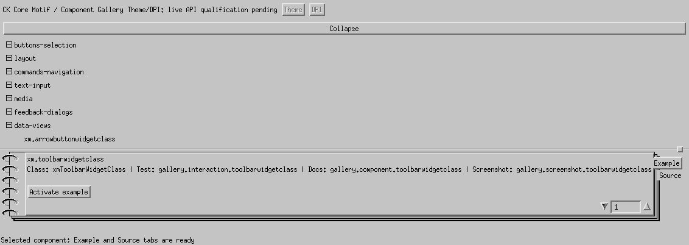

### `xm.sidebarwidgetclass`

- Class: `xmSidebarWidgetClass`
- Example: `gallery.source.sidebarwidgetclass`
- Interaction: `gallery.interaction.sidebarwidgetclass`
- Screenshot: `gallery.screenshot.sidebarwidgetclass`
- Capability: constructible

### `xm.notebookwidgetclass`

- Class: `xmNotebookWidgetClass`
- Example: `gallery.source.notebookwidgetclass`
- Interaction: `gallery.interaction.notebookwidgetclass`
- Screenshot: `gallery.screenshot.notebookwidgetclass`
- Capability: constructible

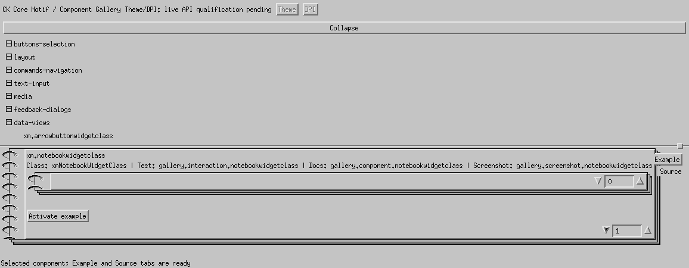

### `xm.panedwindowwidgetclass`

- Class: `xmPanedWindowWidgetClass`
- Example: `gallery.source.panedwindowwidgetclass`
- Interaction: `gallery.interaction.panedwindowwidgetclass`
- Screenshot: `gallery.screenshot.panedwindowwidgetclass`
- Capability: constructible

### `xm.panedwidgetclass`

- Class: `xmPanedWidgetClass`
- Example: `gallery.source.panedwidgetclass`
- Interaction: `gallery.interaction.panedwidgetclass`
- Screenshot: `gallery.screenshot.panedwidgetclass`
- Capability: constructible

### `xm.primitivewidgetclass`

- Class: `xmPrimitiveWidgetClass`
- Example: `gallery.source.primitivewidgetclass`
- Interaction: `gallery.interaction.primitivewidgetclass`
- Screenshot: `gallery.screenshot.primitivewidgetclass`
- Capability: inventory-only

### `xm.printshellwidgetclass`

- Class: `xmPrintShellWidgetClass`
- Example: `gallery.source.printshellwidgetclass`
- Interaction: `gallery.interaction.printshellwidgetclass`
- Screenshot: `gallery.screenshot.printshellwidgetclass`
- Capability: constructible

### `xm.rowcolumnwidgetclass`

- Class: `xmRowColumnWidgetClass`
- Example: `gallery.source.rowcolumnwidgetclass`
- Interaction: `gallery.interaction.rowcolumnwidgetclass`
- Screenshot: `gallery.screenshot.rowcolumnwidgetclass`
- Capability: constructible

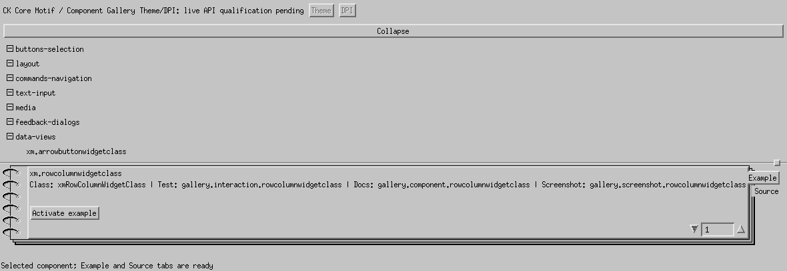

### `xm.screenclass`

- Class: `xmScreenClass`
- Example: `gallery.source.screenclass`
- Interaction: `gallery.interaction.screenclass`
- Screenshot: `gallery.screenshot.screenclass`
- Capability: inventory-only

### `xm.scrolledwindowwidgetclass`

- Class: `xmScrolledWindowWidgetClass`
- Example: `gallery.source.scrolledwindowwidgetclass`
- Interaction: `gallery.interaction.scrolledwindowwidgetclass`
- Screenshot: `gallery.screenshot.scrolledwindowwidgetclass`
- Capability: constructible

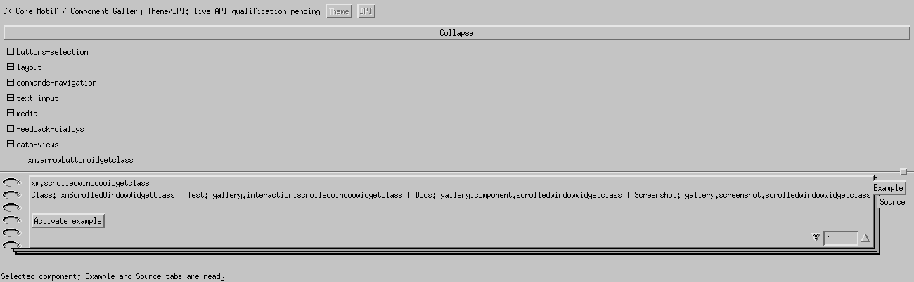

### `xm.selectionboxwidgetclass`

- Class: `xmSelectionBoxWidgetClass`
- Example: `gallery.source.selectionboxwidgetclass`
- Interaction: `gallery.interaction.selectionboxwidgetclass`
- Screenshot: `gallery.screenshot.selectionboxwidgetclass`
- Capability: constructible

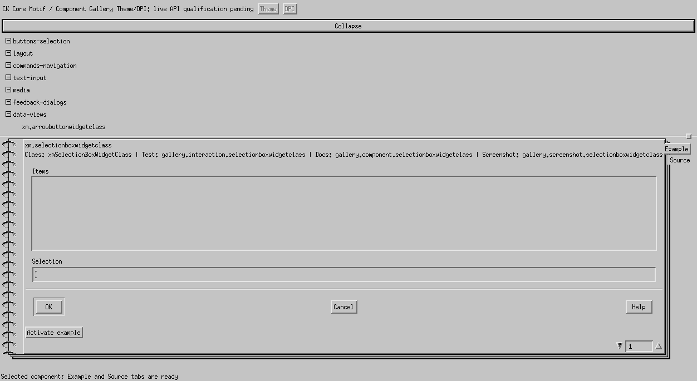

### `xm.separatorgadgetclass`

- Class: `xmSeparatorGadgetClass`
- Example: `gallery.source.separatorgadgetclass`
- Interaction: `gallery.interaction.separatorgadgetclass`
- Screenshot: `gallery.screenshot.separatorgadgetclass`
- Capability: constructible

### `xm.separatorwidgetclass`

- Class: `xmSeparatorWidgetClass`
- Example: `gallery.source.separatorwidgetclass`
- Interaction: `gallery.interaction.separatorwidgetclass`
- Screenshot: `gallery.screenshot.separatorwidgetclass`
- Capability: constructible

### `xm.tabboxwidgetclass`

- Class: `xmTabBoxWidgetClass`
- Example: `gallery.source.tabboxwidgetclass`
- Interaction: `gallery.interaction.tabboxwidgetclass`
- Screenshot: `gallery.screenshot.tabboxwidgetclass`
- Capability: constructible

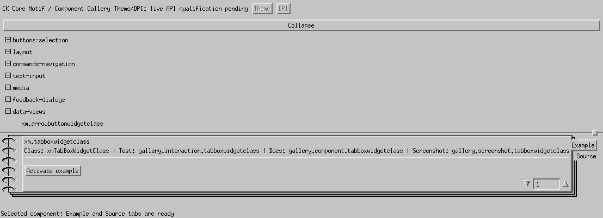

### `xm.tabstackwidgetclass`

- Class: `xmTabStackWidgetClass`
- Example: `gallery.source.tabstackwidgetclass`
- Interaction: `gallery.interaction.tabstackwidgetclass`
- Screenshot: `gallery.screenshot.tabstackwidgetclass`
- Capability: constructible

## commands-navigation

### `xm.cascadebuttonwidgetclass`

- Class: `xmCascadeButtonWidgetClass`
- Example: `gallery.source.cascadebuttonwidgetclass`
- Interaction: `gallery.interaction.cascadebuttonwidgetclass`
- Screenshot: `gallery.screenshot.cascadebuttonwidgetclass`
- Capability: constructible

### `xm.cascadebuttongadgetclass`

- Class: `xmCascadeButtonGadgetClass`
- Example: `gallery.source.cascadebuttongadgetclass`
- Interaction: `gallery.interaction.cascadebuttongadgetclass`
- Screenshot: `gallery.screenshot.cascadebuttongadgetclass`
- Capability: constructible

### `xm.comboboxwidgetclass`

- Class: `xmComboBoxWidgetClass`
- Example: `gallery.source.comboboxwidgetclass`
- Interaction: `gallery.interaction.comboboxwidgetclass`
- Screenshot: `gallery.screenshot.comboboxwidgetclass`
- Capability: constructible

### `xm.commandwidgetclass`

- Class: `xmCommandWidgetClass`
- Example: `gallery.source.commandwidgetclass`
- Interaction: `gallery.interaction.commandwidgetclass`
- Screenshot: `gallery.screenshot.commandwidgetclass`
- Capability: constructible

### `xm.dialogshellwidgetclass`

- Class: `xmDialogShellWidgetClass`
- Example: `gallery.source.dialogshellwidgetclass`
- Interaction: `gallery.interaction.dialogshellwidgetclass`
- Screenshot: `gallery.screenshot.dialogshellwidgetclass`
- Capability: constructible

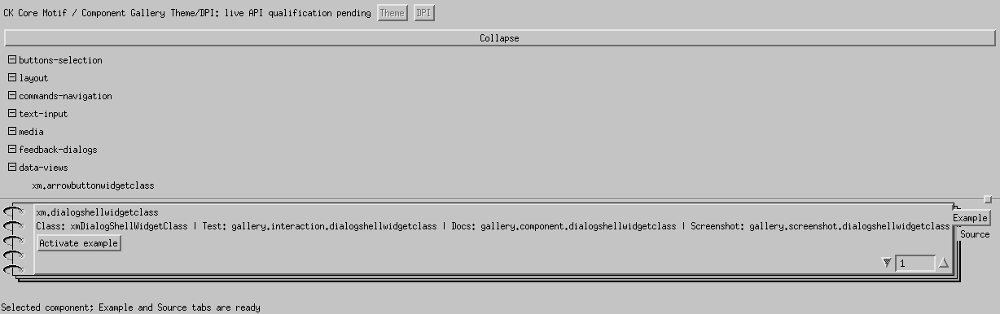

### `xm.fileselectionboxwidgetclass`

- Class: `xmFileSelectionBoxWidgetClass`
- Example: `gallery.source.fileselectionboxwidgetclass`
- Interaction: `gallery.interaction.fileselectionboxwidgetclass`
- Screenshot: `gallery.screenshot.fileselectionboxwidgetclass`
- Capability: constructible

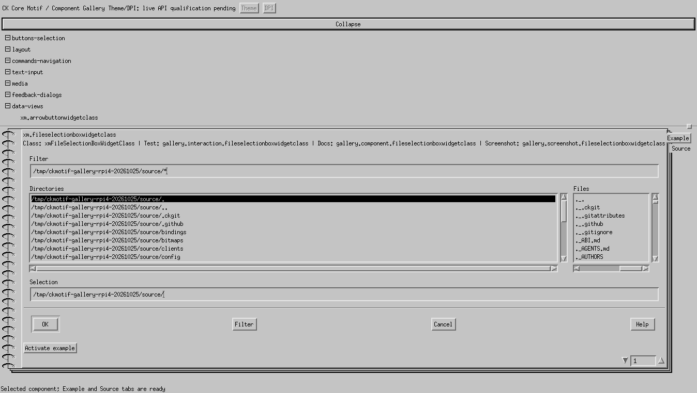

### `xm.grabshellwidgetclass`

- Class: `xmGrabShellWidgetClass`
- Example: `gallery.source.grabshellwidgetclass`
- Interaction: `gallery.interaction.grabshellwidgetclass`
- Screenshot: `gallery.screenshot.grabshellwidgetclass`
- Capability: constructible

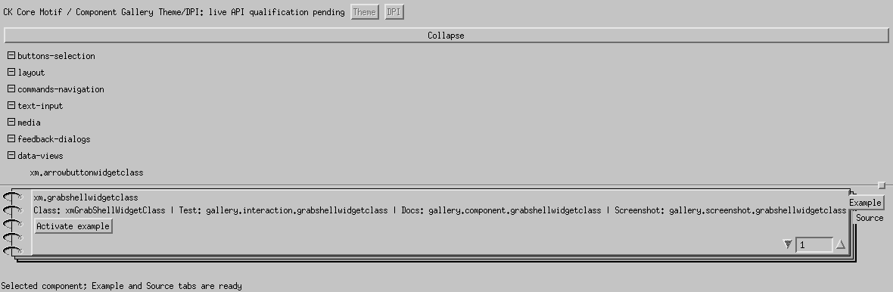

### `xm.menushellwidgetclass`

- Class: `xmMenuShellWidgetClass`
- Example: `gallery.source.menushellwidgetclass`
- Interaction: `gallery.interaction.menushellwidgetclass`
- Screenshot: `gallery.screenshot.menushellwidgetclass`
- Capability: constructible

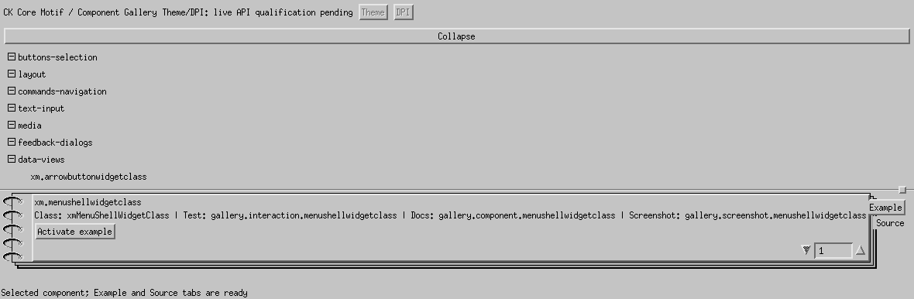

### `xm.messageboxwidgetclass`

- Class: `xmMessageBoxWidgetClass`
- Example: `gallery.source.messageboxwidgetclass`
- Interaction: `gallery.interaction.messageboxwidgetclass`
- Screenshot: `gallery.screenshot.messageboxwidgetclass`
- Capability: constructible

### `xm.flyoutwidgetclass`

- Class: `xmFlyoutWidgetClass`
- Example: `gallery.source.flyoutwidgetclass`
- Interaction: `gallery.interaction.flyoutwidgetclass`
- Screenshot: `gallery.screenshot.flyoutwidgetclass`
- Capability: constructible

### `xm.teachingtipwidgetclass`

- Class: `xmTeachingTipWidgetClass`
- Example: `gallery.source.teachingtipwidgetclass`
- Interaction: `gallery.interaction.teachingtipwidgetclass`
- Screenshot: `gallery.screenshot.teachingtipwidgetclass`
- Capability: constructible

### `xm.breadcrumbbarwidgetclass`

- Class: `xmBreadcrumbBarWidgetClass`
- Example: `gallery.source.breadcrumbbarwidgetclass`
- Interaction: `gallery.interaction.breadcrumbbarwidgetclass`
- Screenshot: `gallery.screenshot.breadcrumbbarwidgetclass`
- Capability: constructible

### `xm.linkwidgetclass`

- Class: `xmLinkWidgetClass`
- Example: `gallery.source.linkwidgetclass`
- Interaction: `gallery.interaction.linkwidgetclass`
- Screenshot: `gallery.screenshot.linkwidgetclass`
- Capability: constructible

### `xm.toastwidgetclass`

- Class: `xmToastWidgetClass`
- Example: `gallery.source.toastwidgetclass`
- Interaction: `gallery.interaction.toastwidgetclass`
- Screenshot: `gallery.screenshot.toastwidgetclass`
- Capability: constructible

### `xm.commandpalettewidgetclass`

- Class: `xmCommandPaletteWidgetClass`
- Example: `gallery.source.commandpalettewidgetclass`
- Interaction: `gallery.interaction.commandpalettewidgetclass`
- Screenshot: `gallery.screenshot.commandpalettewidgetclass`
- Capability: constructible

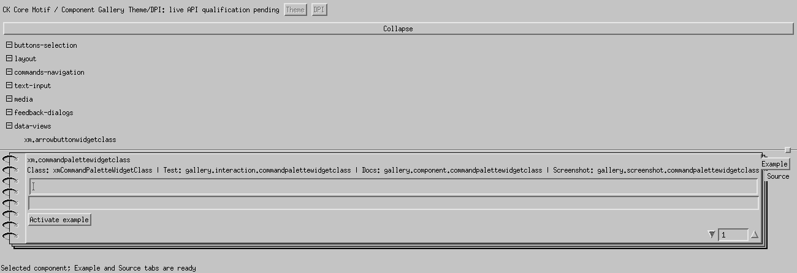

## text-input

### `xm.datafieldwidgetclass`

- Class: `xmDataFieldWidgetClass`
- Example: `gallery.source.datafieldwidgetclass`
- Interaction: `gallery.interaction.datafieldwidgetclass`
- Screenshot: `gallery.screenshot.datafieldwidgetclass`
- Capability: constructible

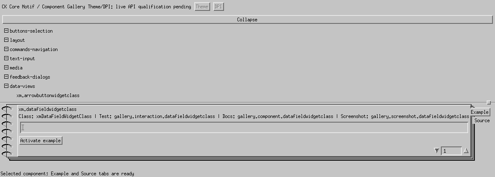

### `xm.labelwidgetclass`

- Class: `xmLabelWidgetClass`
- Example: `gallery.source.labelwidgetclass`
- Interaction: `gallery.interaction.labelwidgetclass`
- Screenshot: `gallery.screenshot.labelwidgetclass`
- Capability: constructible

### `xm.labelgadgetclass`

- Class: `xmLabelGadgetClass`
- Example: `gallery.source.labelgadgetclass`
- Interaction: `gallery.interaction.labelgadgetclass`
- Screenshot: `gallery.screenshot.labelgadgetclass`
- Capability: constructible

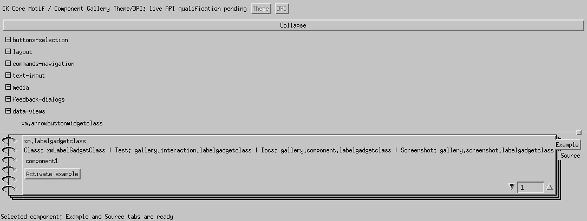

### `xm.iconlabelwidgetclass`

- Class: `xmIconLabelWidgetClass`
- Example: `gallery.source.iconlabelwidgetclass`
- Interaction: `gallery.interaction.iconlabelwidgetclass`
- Screenshot: `gallery.screenshot.iconlabelwidgetclass`
- Capability: constructible

### `xm.searchboxwidgetclass`

- Class: `xmSearchBoxWidgetClass`
- Example: `gallery.source.searchboxwidgetclass`
- Interaction: `gallery.interaction.searchboxwidgetclass`
- Screenshot: `gallery.screenshot.searchboxwidgetclass`
- Capability: constructible

### `xm.promptwidgetclass`

- Class: `xmPromptWidgetClass`
- Example: `gallery.source.promptwidgetclass`
- Interaction: `gallery.interaction.promptwidgetclass`
- Screenshot: `gallery.screenshot.promptwidgetclass`
- Capability: constructible

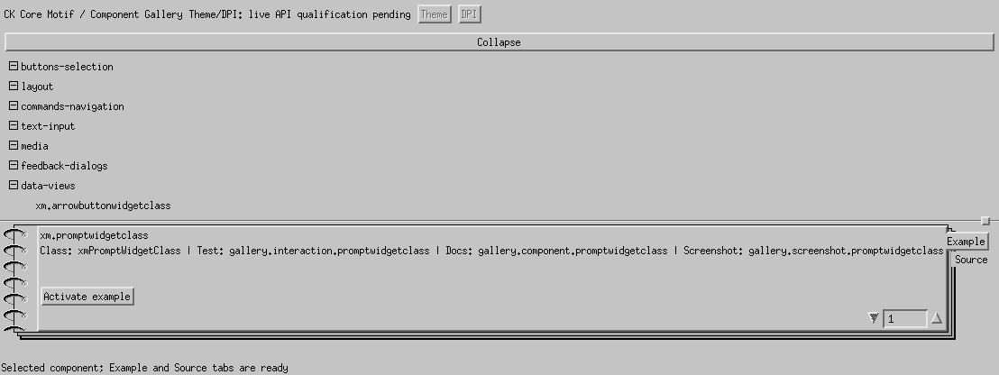

### `xm.autosuggestboxwidgetclass`

- Class: `xmAutoSuggestBoxWidgetClass`
- Example: `gallery.source.autosuggestboxwidgetclass`
- Interaction: `gallery.interaction.autosuggestboxwidgetclass`
- Screenshot: `gallery.screenshot.autosuggestboxwidgetclass`
- Capability: constructible

### `xm.textwidgetclass`

- Class: `xmTextWidgetClass`
- Example: `gallery.source.textwidgetclass`
- Interaction: `gallery.interaction.textwidgetclass`
- Screenshot: `gallery.screenshot.textwidgetclass`
- Capability: constructible

### `xm.textfieldwidgetclass`

- Class: `xmTextFieldWidgetClass`
- Example: `gallery.source.textfieldwidgetclass`
- Interaction: `gallery.interaction.textfieldwidgetclass`
- Screenshot: `gallery.screenshot.textfieldwidgetclass`
- Capability: constructible

## media

### `xm.drawingareawidgetclass`

- Class: `xmDrawingAreaWidgetClass`
- Example: `gallery.source.drawingareawidgetclass`
- Interaction: `gallery.interaction.drawingareawidgetclass`
- Screenshot: `gallery.screenshot.drawingareawidgetclass`
- Capability: constructible

### `xm.dropsitemanagerobjectclass`

- Class: `xmDropSiteManagerObjectClass`
- Example: `gallery.source.dropsitemanagerobjectclass`
- Interaction: `gallery.interaction.dropsitemanagerobjectclass`
- Screenshot: `gallery.screenshot.dropsitemanagerobjectclass`
- Capability: inventory-only

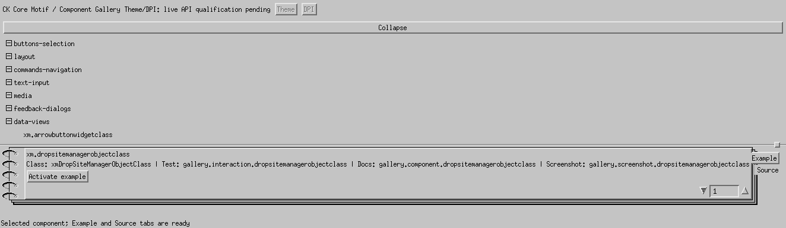

### `xm.droptransferobjectclass`

- Class: `xmDropTransferObjectClass`
- Example: `gallery.source.droptransferobjectclass`
- Interaction: `gallery.interaction.droptransferobjectclass`
- Screenshot: `gallery.screenshot.droptransferobjectclass`
- Capability: inventory-only

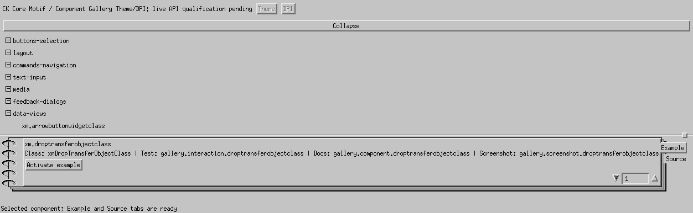

### `xm.icongadgetclass`

- Class: `xmIconGadgetClass`
- Example: `gallery.source.icongadgetclass`
- Interaction: `gallery.interaction.icongadgetclass`
- Screenshot: `gallery.screenshot.icongadgetclass`
- Capability: constructible

### `xm.iconheaderclass`

- Class: `xmIconHeaderClass`
- Example: `gallery.source.iconheaderclass`
- Interaction: `gallery.interaction.iconheaderclass`
- Screenshot: `gallery.screenshot.iconheaderclass`
- Capability: constructible

### `xm.drophighlightwidgetclass`

- Class: `xmDropHighlightWidgetClass`
- Example: `gallery.source.drophighlightwidgetclass`
- Interaction: `gallery.interaction.drophighlightwidgetclass`
- Screenshot: `gallery.screenshot.drophighlightwidgetclass`
- Capability: constructible

## feedback-dialogs

### `xm.infobarwidgetclass`

- Class: `xmInfoBarWidgetClass`
- Example: `gallery.source.infobarwidgetclass`
- Interaction: `gallery.interaction.infobarwidgetclass`
- Screenshot: `gallery.screenshot.infobarwidgetclass`
- Capability: constructible

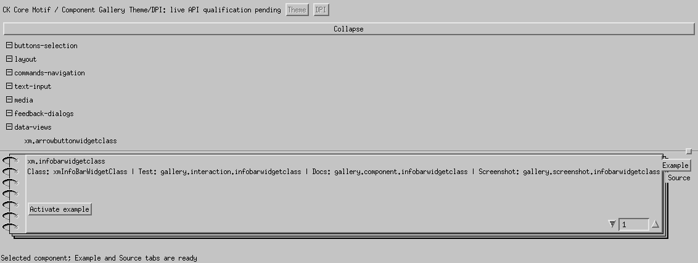

### `xm.chipwidgetclass`

- Class: `xmChipWidgetClass`
- Example: `gallery.source.chipwidgetclass`
- Interaction: `gallery.interaction.chipwidgetclass`
- Screenshot: `gallery.screenshot.chipwidgetclass`
- Capability: constructible

### `xm.badgewidgetclass`

- Class: `xmBadgeWidgetClass`
- Example: `gallery.source.badgewidgetclass`
- Interaction: `gallery.interaction.badgewidgetclass`
- Screenshot: `gallery.screenshot.badgewidgetclass`
- Capability: constructible

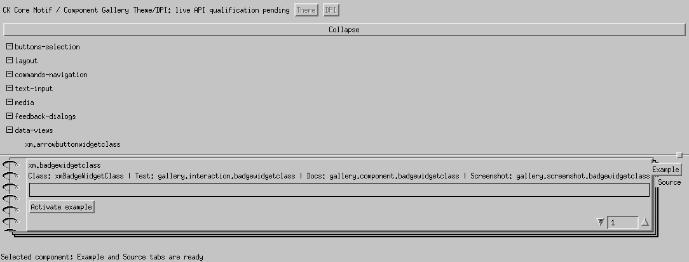

### `xm.avatarwidgetclass`

- Class: `xmAvatarWidgetClass`
- Example: `gallery.source.avatarwidgetclass`
- Interaction: `gallery.interaction.avatarwidgetclass`
- Screenshot: `gallery.screenshot.avatarwidgetclass`
- Capability: constructible

### `xm.emptystatewidgetclass`

- Class: `xmEmptyStateWidgetClass`
- Example: `gallery.source.emptystatewidgetclass`
- Interaction: `gallery.interaction.emptystatewidgetclass`
- Screenshot: `gallery.screenshot.emptystatewidgetclass`
- Capability: constructible

### `xm.skeletonwidgetclass`

- Class: `xmSkeletonWidgetClass`
- Example: `gallery.source.skeletonwidgetclass`
- Interaction: `gallery.interaction.skeletonwidgetclass`
- Screenshot: `gallery.screenshot.skeletonwidgetclass`
- Capability: constructible

### `xm.numberboxwidgetclass`

- Class: `xmNumberBoxWidgetClass`
- Example: `gallery.source.numberboxwidgetclass`
- Interaction: `gallery.interaction.numberboxwidgetclass`
- Screenshot: `gallery.screenshot.numberboxwidgetclass`
- Capability: constructible

### `xm.progressbarwidgetclass`

- Class: `xmProgressBarWidgetClass`
- Example: `gallery.source.progressbarwidgetclass`
- Interaction: `gallery.interaction.progressbarwidgetclass`
- Screenshot: `gallery.screenshot.progressbarwidgetclass`
- Capability: constructible

### `xm.progressringwidgetclass`

- Class: `xmProgressRingWidgetClass`
- Example: `gallery.source.progressringwidgetclass`
- Interaction: `gallery.interaction.progressringwidgetclass`
- Screenshot: `gallery.screenshot.progressringwidgetclass`
- Capability: constructible

## data-views

### `xm.calendarwidgetclass`

- Class: `xmCalendarWidgetClass`
- Example: `gallery.source.calendarwidgetclass`
- Interaction: `gallery.interaction.calendarwidgetclass`
- Screenshot: `gallery.screenshot.calendarwidgetclass`
- Capability: constructible

### `xm.datepickerwidgetclass`

- Class: `xmDatePickerWidgetClass`
- Example: `gallery.source.datepickerwidgetclass`
- Interaction: `gallery.interaction.datepickerwidgetclass`
- Screenshot: `gallery.screenshot.datepickerwidgetclass`
- Capability: constructible

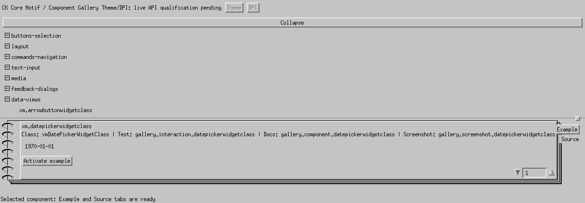

### `xm.timepickerwidgetclass`

- Class: `xmTimePickerWidgetClass`
- Example: `gallery.source.timepickerwidgetclass`
- Interaction: `gallery.interaction.timepickerwidgetclass`
- Screenshot: `gallery.screenshot.timepickerwidgetclass`
- Capability: constructible

### `xm.datagridwidgetclass`

- Class: `xmDataGridWidgetClass`
- Example: `gallery.source.datagridwidgetclass`
- Interaction: `gallery.interaction.datagridwidgetclass`
- Screenshot: `gallery.screenshot.datagridwidgetclass`
- Capability: constructible

