# CK Core Motif component catalogue

<!-- Generated from docs/modern-gallery-manifest.json; do not edit. -->
<!-- manifest-sha256: b12695e62dc786f345fa4eba11bc0e2b83f651c7abec7fddb390d961a8286da7 -->

This catalogue is generated from the gallery manifest. Each anchor is
the documentation target recorded by the corresponding manifest entry.
Use **Demo** to inspect the captured application and **Source** for its actual construction code.
Screenshots retain their recorded capture version; they are not a claim of completed visual redesign.

## layout

### `xm.buttonboxwidgetclass`

- Class: `xmButtonBoxWidgetClass`
- Example: `gallery.source.buttonboxwidgetclass`
- Interaction: `gallery.interaction.buttonboxwidgetclass`
- Screenshot: `gallery.screenshot.buttonboxwidgetclass`
- Capability: constructible

::: tabs
== Demo

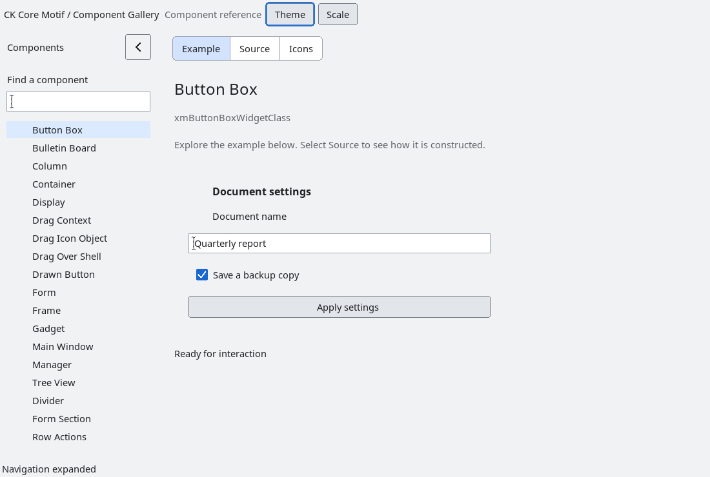

== Source

Actual gallery excerpt: class = xmButtonBoxWidgetClass.
The host supplies parent, name, callback and client_data.
Shared factory locals: Widget example; XmString label = NULL.
The shared factory frees label, attaches callbacks and sizes the preview.
Helpers and the complete factory are in gallery_examples.c.

<<< @/demos/programs/ckmotif-gallery/gallery_examples.c#L1006-L1047

[Complete demo source](../demos/programs/ckmotif-gallery/gallery_examples.c) · [Public header](../lib/Xm/ButtonBox.h)

:::

### `xm.bulletinboardwidgetclass`

- Class: `xmBulletinBoardWidgetClass`
- Example: `gallery.source.bulletinboardwidgetclass`
- Interaction: `gallery.interaction.bulletinboardwidgetclass`
- Screenshot: `gallery.screenshot.bulletinboardwidgetclass`
- Capability: constructible

::: tabs
== Demo

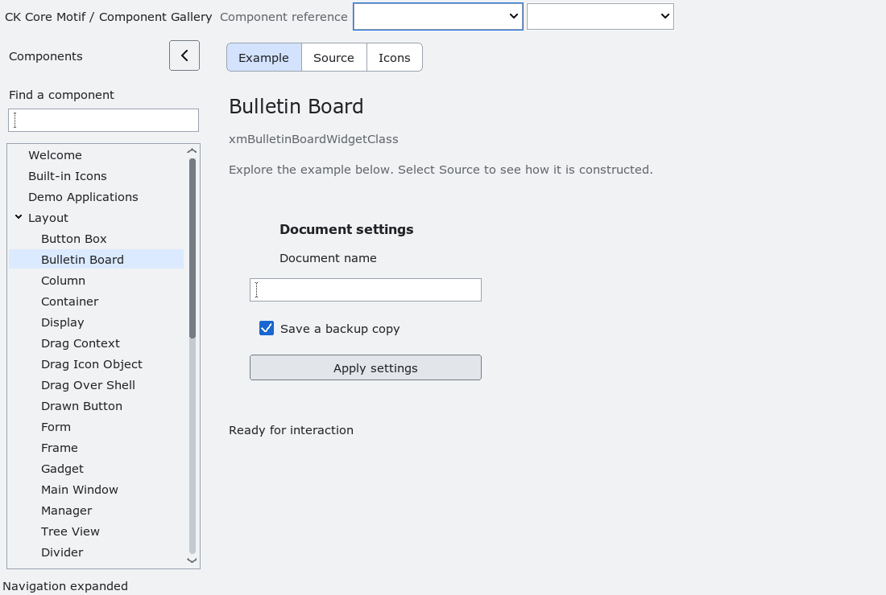

== Source

Actual gallery excerpt: class = xmBulletinBoardWidgetClass.
The host supplies parent, name, callback and client_data.
Shared factory locals: Widget example; XmString label = NULL.
The shared factory frees label, attaches callbacks and sizes the preview.
Helpers and the complete factory are in gallery_examples.c.

<<< @/demos/programs/ckmotif-gallery/gallery_examples.c#L1006-L1047

[Complete demo source](../demos/programs/ckmotif-gallery/gallery_examples.c) · [Public header](../lib/Xm/BulletinB.h)

:::

### `xm.columnwidgetclass`

- Class: `xmColumnWidgetClass`
- Example: `gallery.source.columnwidgetclass`
- Interaction: `gallery.interaction.columnwidgetclass`
- Screenshot: `gallery.screenshot.columnwidgetclass`
- Capability: constructible

::: tabs
== Demo

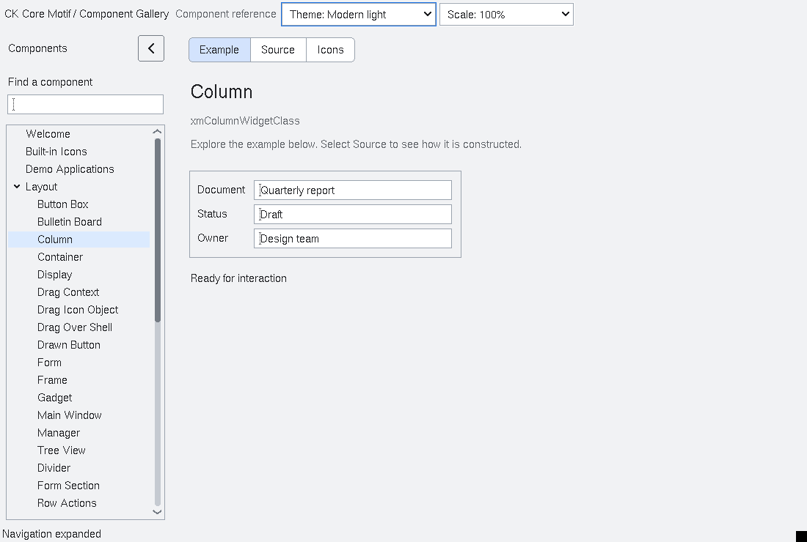

== Source

Actual gallery excerpt: class = xmColumnWidgetClass.
The host supplies parent, name, callback and client_data.
Shared factory locals: Widget example; XmString label = NULL.
The shared factory frees label, attaches callbacks and sizes the preview.
Helpers and the complete factory are in gallery_examples.c.

<<< @/demos/programs/ckmotif-gallery/gallery_examples.c#L968-L977

[Complete demo source](../demos/programs/ckmotif-gallery/gallery_examples.c) · [Public header](../lib/Xm/Column.h)

:::

### `xm.containerwidgetclass`

- Class: `xmContainerWidgetClass`
- Example: `gallery.source.containerwidgetclass`
- Interaction: `gallery.interaction.containerwidgetclass`
- Screenshot: `gallery.screenshot.containerwidgetclass`
- Capability: constructible

::: tabs
== Demo

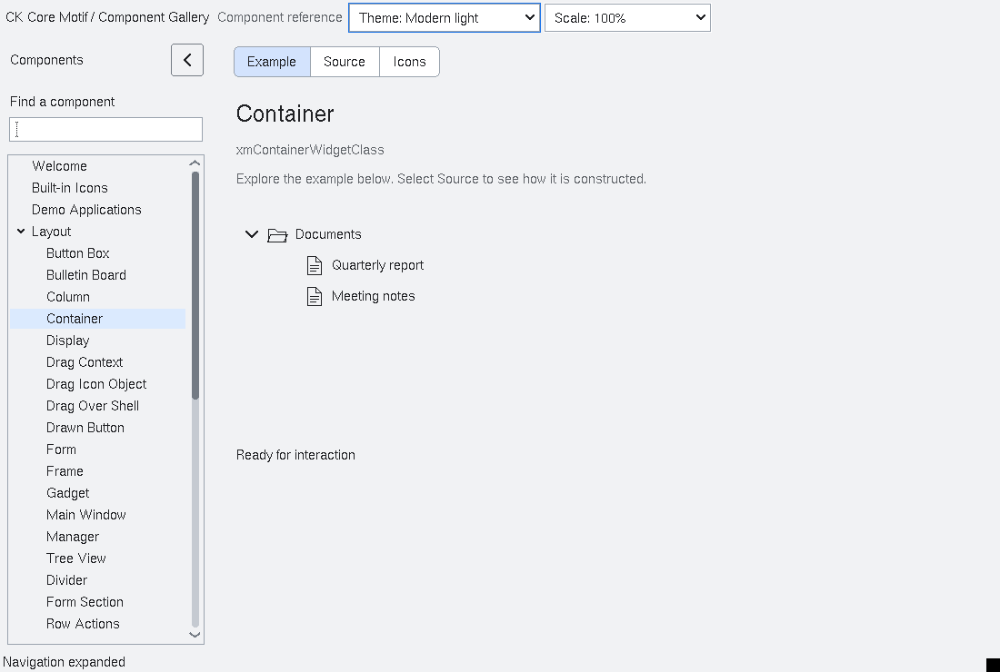

== Source

Actual gallery excerpt: class = xmContainerWidgetClass.
The host supplies parent, name, callback and client_data.
Shared factory locals: Widget example; XmString label = NULL.
The shared factory frees label, attaches callbacks and sizes the preview.
Helpers and the complete factory are in gallery_examples.c.

<<< @/demos/programs/ckmotif-gallery/gallery_examples.c#L981-L997

[Complete demo source](../demos/programs/ckmotif-gallery/gallery_examples.c) · [Public header](../lib/Xm/Container.h)

:::

### `xm.displayclass`

- Class: `xmDisplayClass`
- Example: `gallery.source.displayclass`
- Interaction: `gallery.interaction.displayclass`
- Screenshot: `gallery.screenshot.displayclass`
- Capability: inventory-only

::: tabs
== Demo

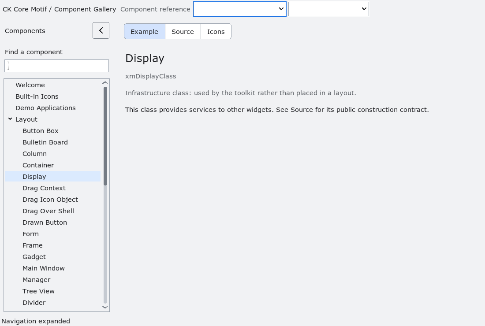

== Source

This is a service or abstract class, not a standalone control.
The Demo tab explains its role in the toolkit.

<<< @/lib/Xm/Display.h

[Complete demo source](../demos/programs/ckmotif-gallery/gallery_examples.c) · [Public header](../lib/Xm/Display.h)

:::

### `xm.dragcontextclass`

- Class: `xmDragContextClass`
- Example: `gallery.source.dragcontextclass`
- Interaction: `gallery.interaction.dragcontextclass`
- Screenshot: `gallery.screenshot.dragcontextclass`
- Capability: inventory-only

::: tabs
== Demo

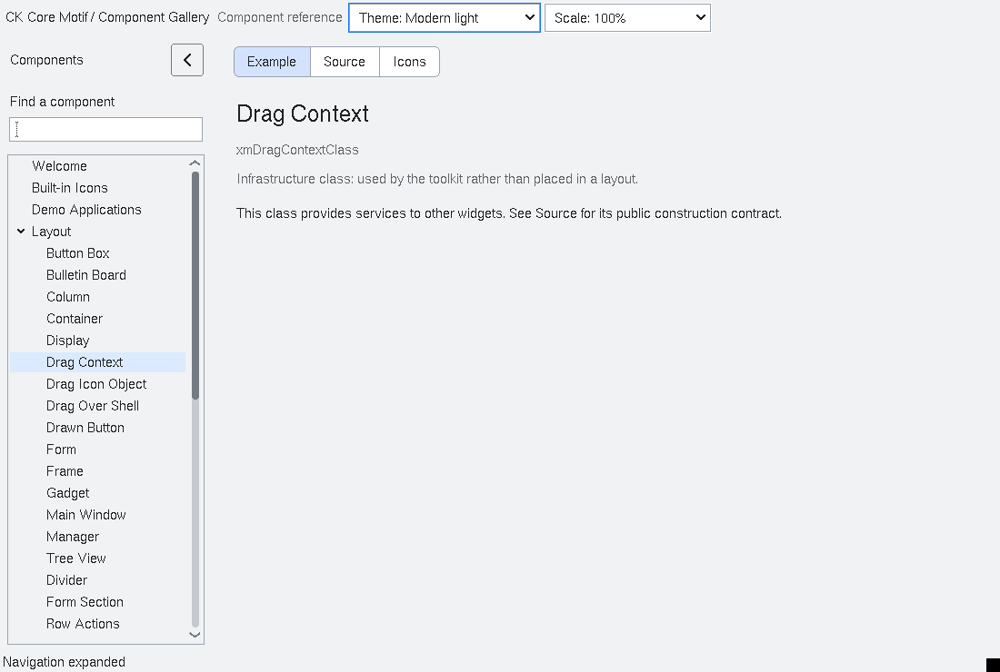

== Source

This is a service or abstract class, not a standalone control.
The Demo tab explains its role in the toolkit.

<<< @/lib/Xm/DragC.h

[Complete demo source](../demos/programs/ckmotif-gallery/gallery_examples.c) · [Public header](../lib/Xm/DragC.h)

:::

### `xm.dragiconobjectclass`

- Class: `xmDragIconObjectClass`
- Example: `gallery.source.dragiconobjectclass`
- Interaction: `gallery.interaction.dragiconobjectclass`
- Screenshot: `gallery.screenshot.dragiconobjectclass`
- Capability: inventory-only

::: tabs
== Demo

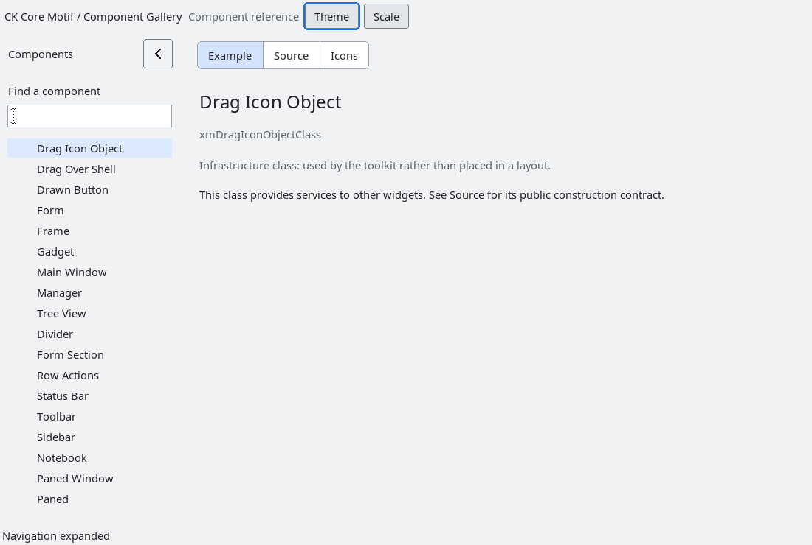

== Source

This is a service or abstract class, not a standalone control.
The Demo tab explains its role in the toolkit.

<<< @/lib/Xm/DragIcon.h

[Complete demo source](../demos/programs/ckmotif-gallery/gallery_examples.c) · [Public header](../lib/Xm/DragIcon.h)

:::

### `xm.dragovershellwidgetclass`

- Class: `xmDragOverShellWidgetClass`
- Example: `gallery.source.dragovershellwidgetclass`
- Interaction: `gallery.interaction.dragovershellwidgetclass`
- Screenshot: `gallery.screenshot.dragovershellwidgetclass`
- Capability: constructible

::: tabs
== Demo

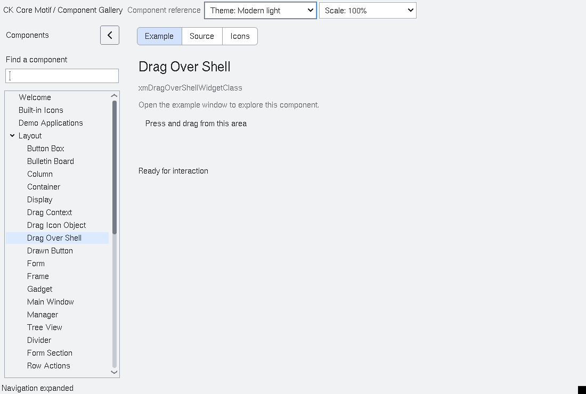

== Source

Actual gallery factory for xmDragOverShellWidgetClass.
The gallery host supplies the function arguments.
Helpers are defined in gallery_examples.c.

<<< @/demos/programs/ckmotif-gallery/gallery_examples.c#L1166-L1177

[Complete demo source](../demos/programs/ckmotif-gallery/gallery_examples.c) · [Public header](../lib/Xm/DragOverS.h)

:::

### `xm.drawnbuttonwidgetclass`

- Class: `xmDrawnButtonWidgetClass`
- Example: `gallery.source.drawnbuttonwidgetclass`
- Interaction: `gallery.interaction.drawnbuttonwidgetclass`
- Screenshot: `gallery.screenshot.drawnbuttonwidgetclass`
- Capability: constructible

::: tabs
== Demo

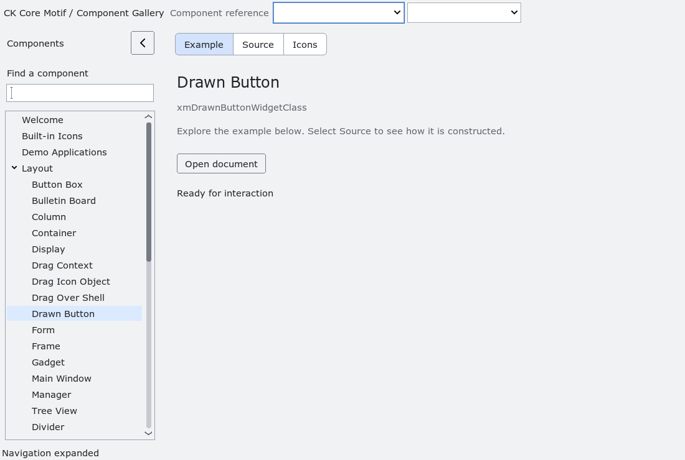

== Source

Actual gallery excerpt: class = xmDrawnButtonWidgetClass.
The host supplies parent, name, callback and client_data.
Shared factory locals: Widget example; XmString label = NULL.
The shared factory frees label, attaches callbacks and sizes the preview.
Helpers and the complete factory are in gallery_examples.c.

<<< @/demos/programs/ckmotif-gallery/gallery_examples.c#L787-L791

[Complete demo source](../demos/programs/ckmotif-gallery/gallery_examples.c) · [Public header](../lib/Xm/DrawnB.h)

:::

### `xm.formwidgetclass`

- Class: `xmFormWidgetClass`
- Example: `gallery.source.formwidgetclass`
- Interaction: `gallery.interaction.formwidgetclass`
- Screenshot: `gallery.screenshot.formwidgetclass`
- Capability: constructible

::: tabs
== Demo

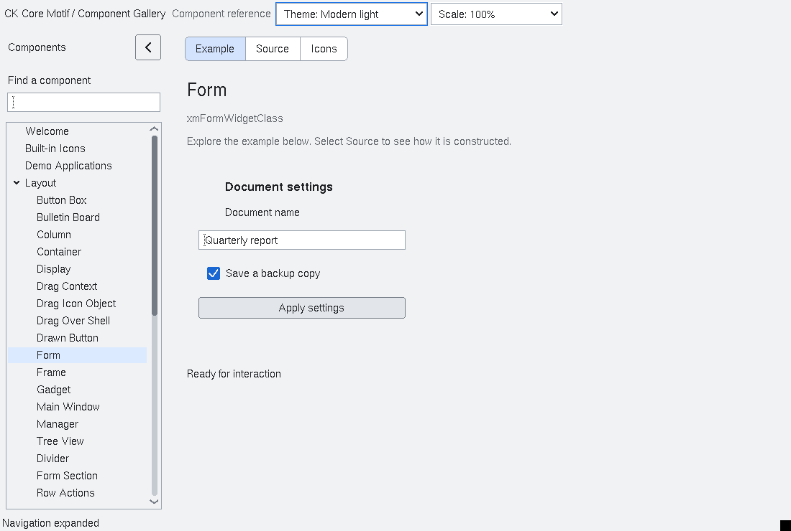

== Source

Actual gallery excerpt: class = xmFormWidgetClass.
The host supplies parent, name, callback and client_data.
Shared factory locals: Widget example; XmString label = NULL.
The shared factory frees label, attaches callbacks and sizes the preview.
Helpers and the complete factory are in gallery_examples.c.

<<< @/demos/programs/ckmotif-gallery/gallery_examples.c#L1006-L1047

[Complete demo source](../demos/programs/ckmotif-gallery/gallery_examples.c) · [Public header](../lib/Xm/Form.h)

:::

### `xm.framewidgetclass`

- Class: `xmFrameWidgetClass`
- Example: `gallery.source.framewidgetclass`
- Interaction: `gallery.interaction.framewidgetclass`
- Screenshot: `gallery.screenshot.framewidgetclass`
- Capability: constructible

::: tabs
== Demo

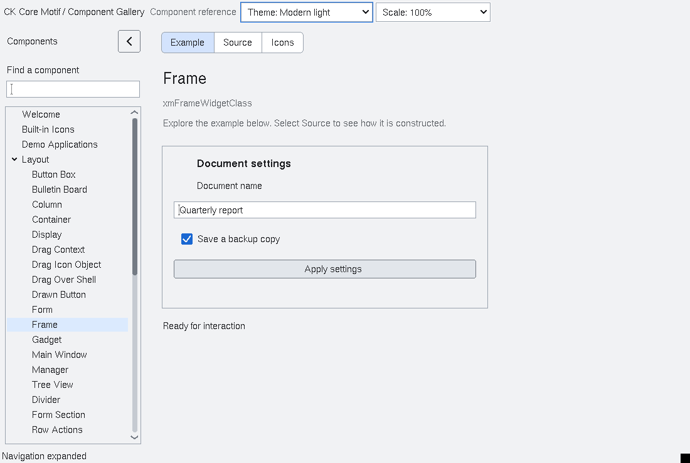

== Source

Actual gallery excerpt: class = xmFrameWidgetClass.
The host supplies parent, name, callback and client_data.
Shared factory locals: Widget example; XmString label = NULL.
The shared factory frees label, attaches callbacks and sizes the preview.
Helpers and the complete factory are in gallery_examples.c.

<<< @/demos/programs/ckmotif-gallery/gallery_examples.c#L1006-L1047

[Complete demo source](../demos/programs/ckmotif-gallery/gallery_examples.c) · [Public header](../lib/Xm/Frame.h)

:::

### `xm.gadgetclass`

- Class: `xmGadgetClass`
- Example: `gallery.source.gadgetclass`
- Interaction: `gallery.interaction.gadgetclass`
- Screenshot: `gallery.screenshot.gadgetclass`
- Capability: inventory-only

::: tabs
== Demo

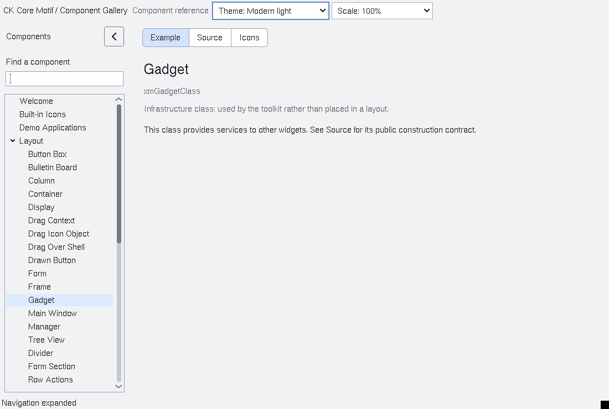

== Source

This is a service or abstract class, not a standalone control.
The Demo tab explains its role in the toolkit.

<<< @/lib/Xm/Gadget.h

[Complete demo source](../demos/programs/ckmotif-gallery/gallery_examples.c) · [Public header](../lib/Xm/Gadget.h)

:::

### `xm.mainwindowwidgetclass`

- Class: `xmMainWindowWidgetClass`
- Example: `gallery.source.mainwindowwidgetclass`
- Interaction: `gallery.interaction.mainwindowwidgetclass`
- Screenshot: `gallery.screenshot.mainwindowwidgetclass`
- Capability: constructible

::: tabs
== Demo

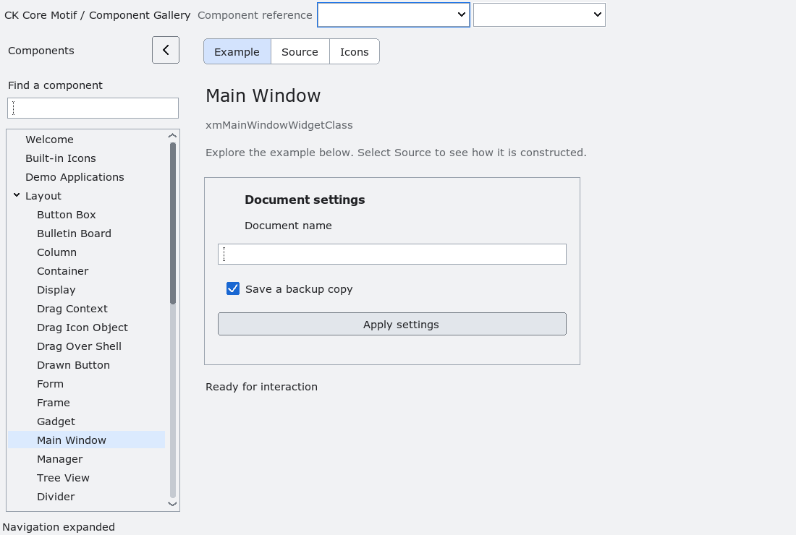

== Source

Actual gallery excerpt: class = xmMainWindowWidgetClass.
The host supplies parent, name, callback and client_data.
Shared factory locals: Widget example; XmString label = NULL.
The shared factory frees label, attaches callbacks and sizes the preview.
Helpers and the complete factory are in gallery_examples.c.

<<< @/demos/programs/ckmotif-gallery/gallery_examples.c#L1006-L1047

[Complete demo source](../demos/programs/ckmotif-gallery/gallery_examples.c) · [Public header](../lib/Xm/MainW.h)

:::

### `xm.managerwidgetclass`

- Class: `xmManagerWidgetClass`
- Example: `gallery.source.managerwidgetclass`
- Interaction: `gallery.interaction.managerwidgetclass`
- Screenshot: `gallery.screenshot.managerwidgetclass`
- Capability: inventory-only

::: tabs
== Demo

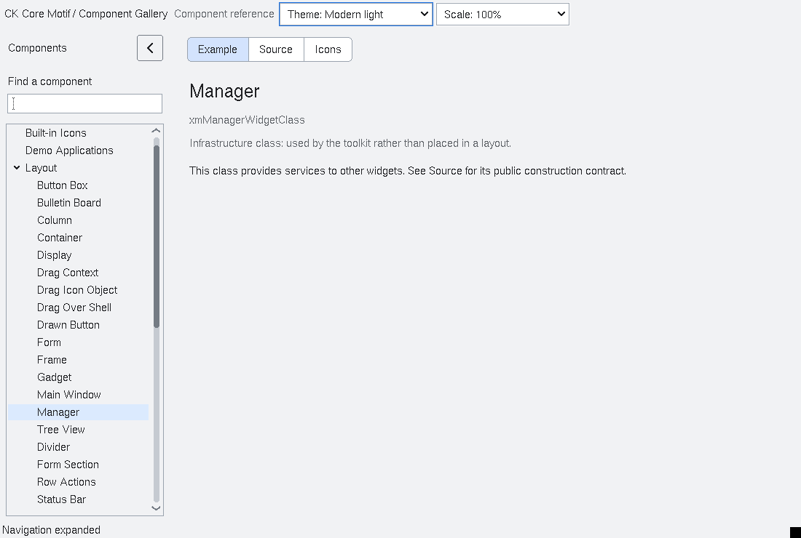

== Source

This is a service or abstract class, not a standalone control.
The Demo tab explains its role in the toolkit.

<<< @/lib/Xm/Manager.h

[Complete demo source](../demos/programs/ckmotif-gallery/gallery_examples.c) · [Public header](../lib/Xm/Manager.h)

:::

### `xm.treeviewwidgetclass`

- Class: `xmTreeViewWidgetClass`
- Example: `gallery.source.treeviewwidgetclass`
- Interaction: `gallery.interaction.treeviewwidgetclass`
- Screenshot: `gallery.screenshot.treeviewwidgetclass`
- Capability: constructible

::: tabs
== Demo

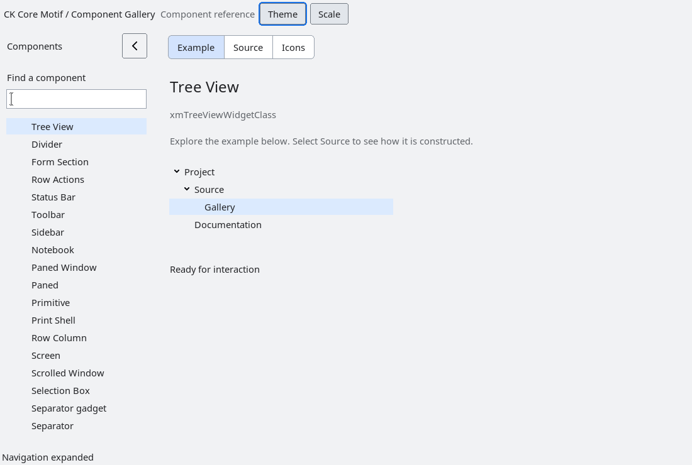

== Source

Actual gallery excerpt: class = xmTreeViewWidgetClass.
The host supplies parent, name, callback and client_data.
Shared factory locals: Widget example; XmString label = NULL.
The shared factory frees label, attaches callbacks and sizes the preview.
Helpers and the complete factory are in gallery_examples.c.

<<< @/demos/programs/ckmotif-gallery/gallery_examples.c#L659-L669

[Complete demo source](../demos/programs/ckmotif-gallery/gallery_examples.c) · [Public header](../lib/Xm/TreeView.h)

:::

### `xm.dividerwidgetclass`

- Class: `xmDividerWidgetClass`
- Example: `gallery.source.dividerwidgetclass`
- Interaction: `gallery.interaction.dividerwidgetclass`
- Screenshot: `gallery.screenshot.dividerwidgetclass`
- Capability: constructible

::: tabs
== Demo

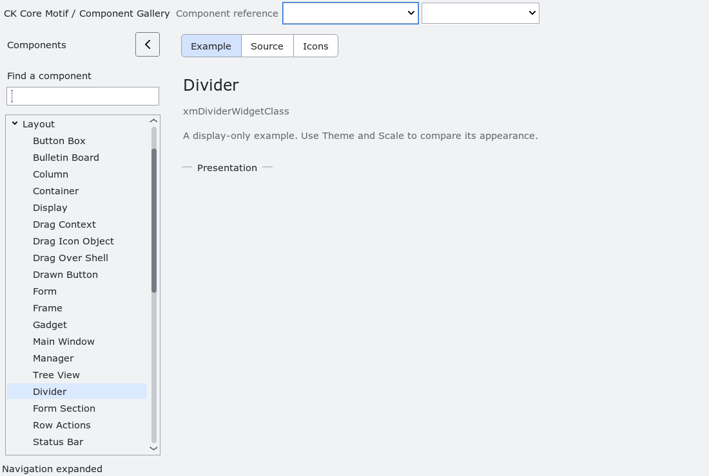

== Source

Actual gallery excerpt: class = xmDividerWidgetClass.
The host supplies parent, name, callback and client_data.
Shared factory locals: Widget example; XmString label = NULL.
The shared factory frees label, attaches callbacks and sizes the preview.
Helpers and the complete factory are in gallery_examples.c.

<<< @/demos/programs/ckmotif-gallery/gallery_examples.c#L371-L373

[Complete demo source](../demos/programs/ckmotif-gallery/gallery_examples.c) · [Public header](../lib/Xm/Divider.h)

:::

### `xm.formsectionwidgetclass`

- Class: `xmFormSectionWidgetClass`
- Example: `gallery.source.formsectionwidgetclass`
- Interaction: `gallery.interaction.formsectionwidgetclass`
- Screenshot: `gallery.screenshot.formsectionwidgetclass`
- Capability: constructible

::: tabs
== Demo

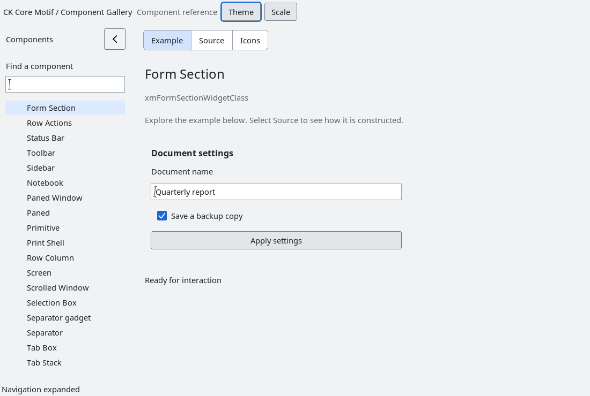

== Source

Actual gallery excerpt: class = xmFormSectionWidgetClass.
The host supplies parent, name, callback and client_data.
Shared factory locals: Widget example; XmString label = NULL.
The shared factory frees label, attaches callbacks and sizes the preview.
Helpers and the complete factory are in gallery_examples.c.

<<< @/demos/programs/ckmotif-gallery/gallery_examples.c#L1006-L1047

[Complete demo source](../demos/programs/ckmotif-gallery/gallery_examples.c) · [Public header](../lib/Xm/FormSection.h)

:::

### `xm.rowactionswidgetclass`

- Class: `xmRowActionsWidgetClass`
- Example: `gallery.source.rowactionswidgetclass`
- Interaction: `gallery.interaction.rowactionswidgetclass`
- Screenshot: `gallery.screenshot.rowactionswidgetclass`
- Capability: constructible

::: tabs
== Demo

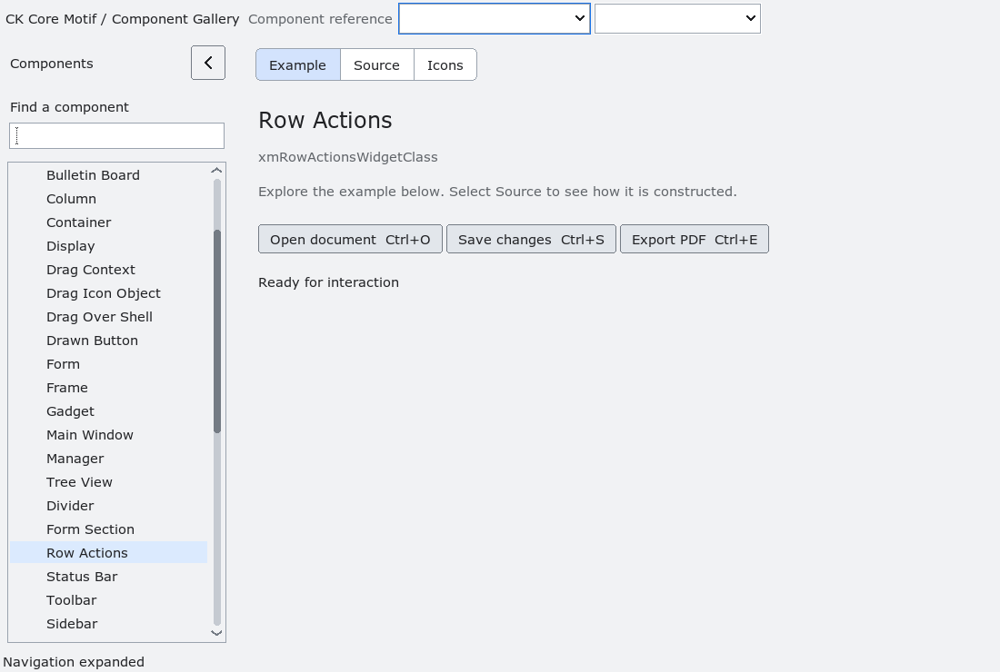

== Source

Actual gallery excerpt: class = xmRowActionsWidgetClass.
The host supplies parent, name, callback and client_data.
Shared factory locals: Widget example; XmString label = NULL.
The shared factory frees label, attaches callbacks and sizes the preview.
Helpers and the complete factory are in gallery_examples.c.

<<< @/demos/programs/ckmotif-gallery/gallery_examples.c#L839-L858

[Complete demo source](../demos/programs/ckmotif-gallery/gallery_examples.c) · [Public header](../lib/Xm/RowActions.h)

:::

### `xm.statusbarwidgetclass`

- Class: `xmStatusBarWidgetClass`
- Example: `gallery.source.statusbarwidgetclass`
- Interaction: `gallery.interaction.statusbarwidgetclass`
- Screenshot: `gallery.screenshot.statusbarwidgetclass`
- Capability: constructible

::: tabs
== Demo

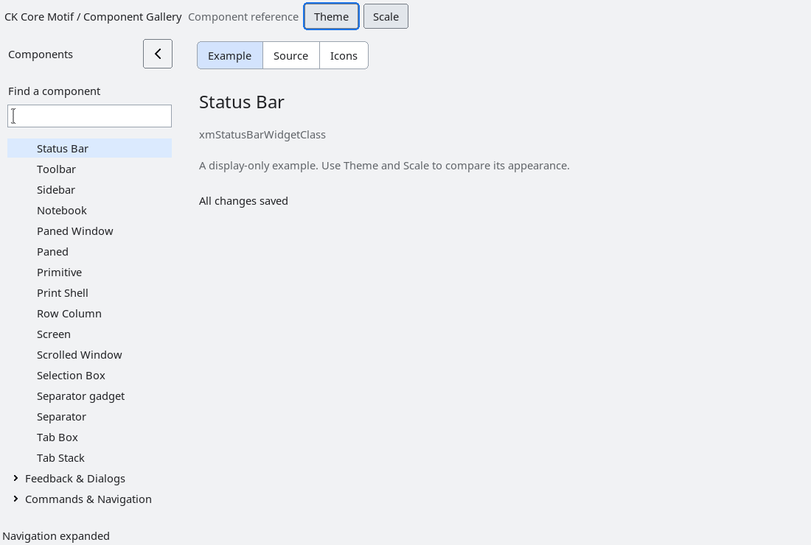

== Source

Actual gallery excerpt: class = xmStatusBarWidgetClass.
The host supplies parent, name, callback and client_data.
Shared factory locals: Widget example; XmString label = NULL.
The shared factory frees label, attaches callbacks and sizes the preview.
Helpers and the complete factory are in gallery_examples.c.

<<< @/demos/programs/ckmotif-gallery/gallery_examples.c#L809-L814

[Complete demo source](../demos/programs/ckmotif-gallery/gallery_examples.c) · [Public header](../lib/Xm/StatusBar.h)

:::

### `xm.toolbarwidgetclass`

- Class: `xmToolbarWidgetClass`
- Example: `gallery.source.toolbarwidgetclass`
- Interaction: `gallery.interaction.toolbarwidgetclass`
- Screenshot: `gallery.screenshot.toolbarwidgetclass`
- Capability: constructible

::: tabs
== Demo

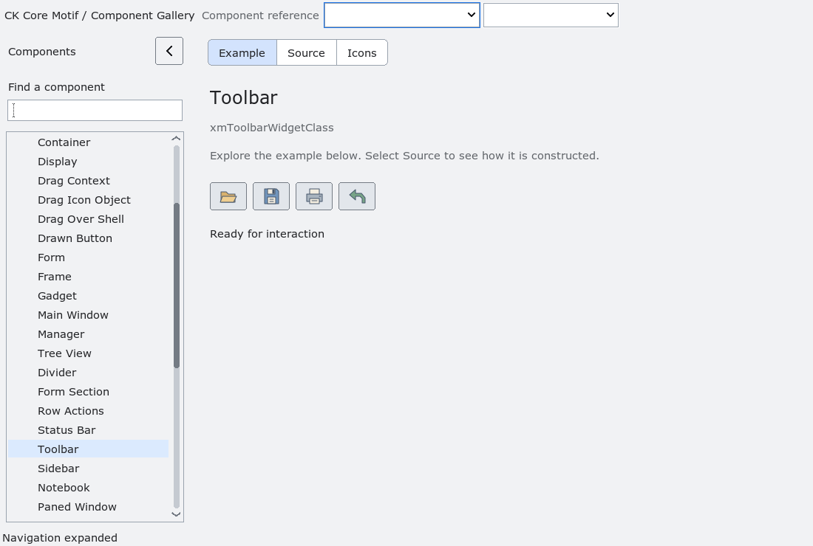

== Source

Actual gallery excerpt: class = xmToolbarWidgetClass.
The host supplies parent, name, callback and client_data.
Shared factory locals: Widget example; XmString label = NULL.
The shared factory frees label, attaches callbacks and sizes the preview.
Helpers and the complete factory are in gallery_examples.c.

<<< @/demos/programs/ckmotif-gallery/gallery_examples.c#L618-L655

[Complete demo source](../demos/programs/ckmotif-gallery/gallery_examples.c) · [Public header](../lib/Xm/Toolbar.h)

:::

### `xm.sidebarwidgetclass`

- Class: `xmSidebarWidgetClass`
- Example: `gallery.source.sidebarwidgetclass`
- Interaction: `gallery.interaction.sidebarwidgetclass`
- Screenshot: `gallery.screenshot.sidebarwidgetclass`
- Capability: constructible

::: tabs
== Demo

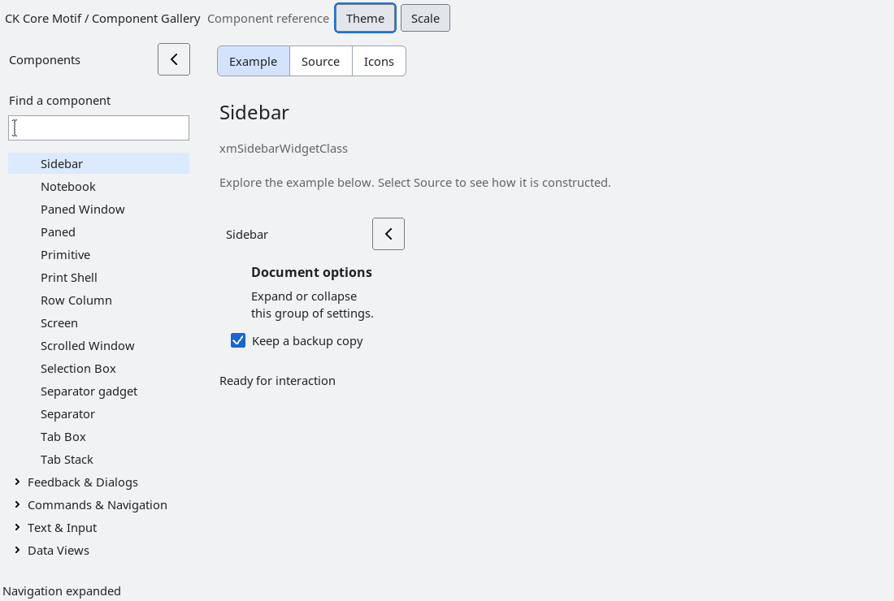

== Source

Actual gallery excerpt: class = xmSidebarWidgetClass.
The host supplies parent, name, callback and client_data.
Shared factory locals: Widget example; XmString label = NULL.
The shared factory frees label, attaches callbacks and sizes the preview.
Helpers and the complete factory are in gallery_examples.c.

<<< @/demos/programs/ckmotif-gallery/gallery_examples.c#L818-L835

[Complete demo source](../demos/programs/ckmotif-gallery/gallery_examples.c) · [Public header](../lib/Xm/Sidebar.h)

:::

### `xm.notebookwidgetclass`

- Class: `xmNotebookWidgetClass`
- Example: `gallery.source.notebookwidgetclass`
- Interaction: `gallery.interaction.notebookwidgetclass`
- Screenshot: `gallery.screenshot.notebookwidgetclass`
- Capability: constructible

::: tabs
== Demo

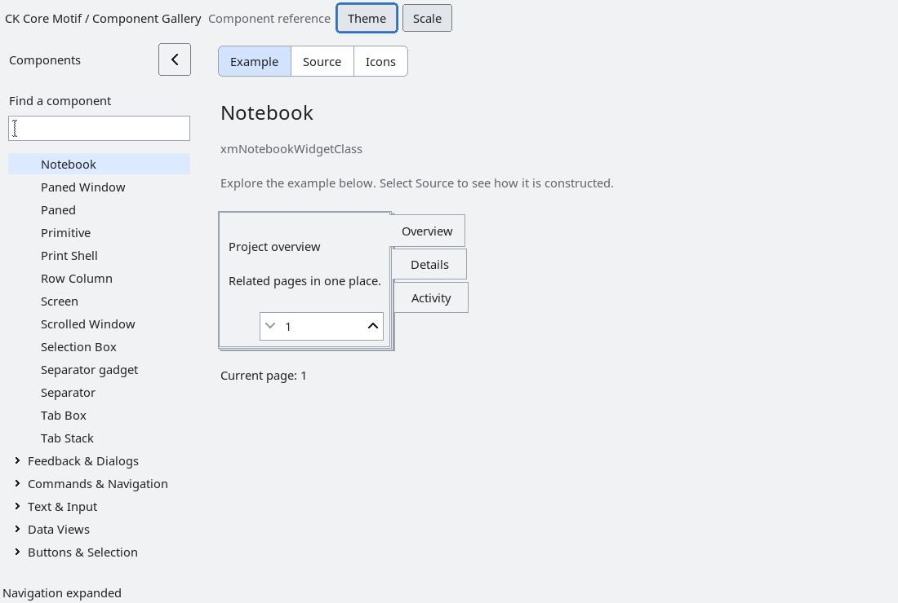

== Source

Actual gallery excerpt: class = xmNotebookWidgetClass.
The host supplies parent, name, callback and client_data.
Shared factory locals: Widget example; XmString label = NULL.
The shared factory frees label, attaches callbacks and sizes the preview.
Helpers and the complete factory are in gallery_examples.c.

<<< @/demos/programs/ckmotif-gallery/gallery_examples.c#L919-L937

[Complete demo source](../demos/programs/ckmotif-gallery/gallery_examples.c) · [Public header](../lib/Xm/Notebook.h)

:::

### `xm.panedwindowwidgetclass`

- Class: `xmPanedWindowWidgetClass`
- Example: `gallery.source.panedwindowwidgetclass`
- Interaction: `gallery.interaction.panedwindowwidgetclass`
- Screenshot: `gallery.screenshot.panedwindowwidgetclass`
- Capability: constructible

::: tabs
== Demo

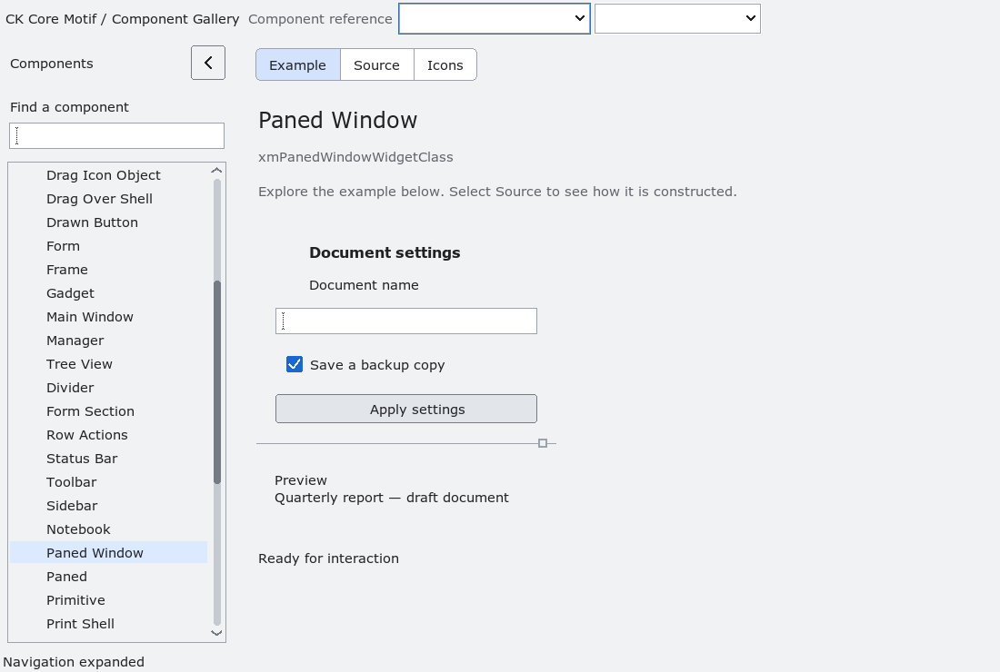

== Source

Actual gallery excerpt: class = xmPanedWindowWidgetClass.
The host supplies parent, name, callback and client_data.
Shared factory locals: Widget example; XmString label = NULL.
The shared factory frees label, attaches callbacks and sizes the preview.
Helpers and the complete factory are in gallery_examples.c.

<<< @/demos/programs/ckmotif-gallery/gallery_examples.c#L1006-L1047

[Complete demo source](../demos/programs/ckmotif-gallery/gallery_examples.c) · [Public header](../lib/Xm/PanedW.h)

:::

### `xm.panedwidgetclass`

- Class: `xmPanedWidgetClass`
- Example: `gallery.source.panedwidgetclass`
- Interaction: `gallery.interaction.panedwidgetclass`
- Screenshot: `gallery.screenshot.panedwidgetclass`
- Capability: constructible

::: tabs
== Demo

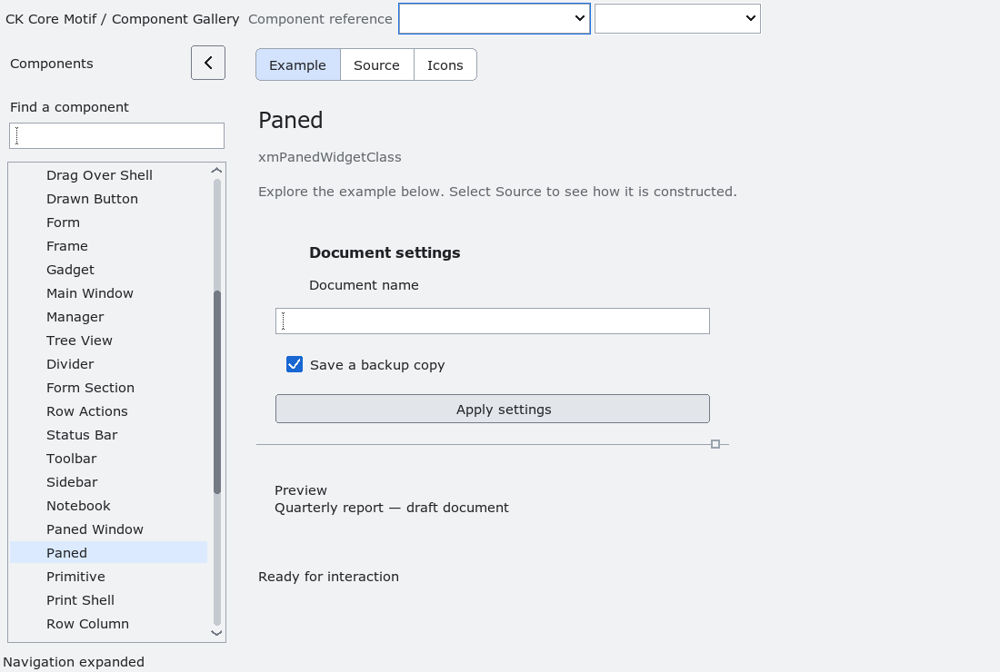

== Source

Actual gallery excerpt: class = xmPanedWidgetClass.
The host supplies parent, name, callback and client_data.
Shared factory locals: Widget example; XmString label = NULL.
The shared factory frees label, attaches callbacks and sizes the preview.
Helpers and the complete factory are in gallery_examples.c.

<<< @/demos/programs/ckmotif-gallery/gallery_examples.c#L1006-L1047

[Complete demo source](../demos/programs/ckmotif-gallery/gallery_examples.c) · [Public header](../lib/Xm/Paned.h)

:::

### `xm.primitivewidgetclass`

- Class: `xmPrimitiveWidgetClass`
- Example: `gallery.source.primitivewidgetclass`
- Interaction: `gallery.interaction.primitivewidgetclass`
- Screenshot: `gallery.screenshot.primitivewidgetclass`
- Capability: inventory-only

::: tabs
== Demo

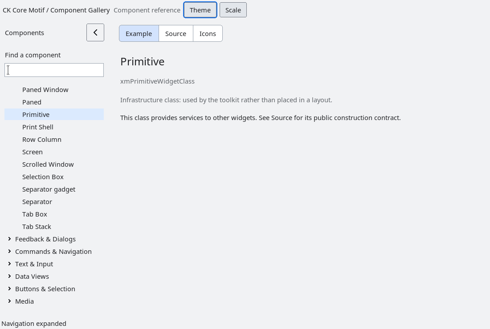

== Source

This is a service or abstract class, not a standalone control.
The Demo tab explains its role in the toolkit.

<<< @/lib/Xm/Primitive.h

[Complete demo source](../demos/programs/ckmotif-gallery/gallery_examples.c) · [Public header](../lib/Xm/Primitive.h)

:::

### `xm.printshellwidgetclass`

- Class: `xmPrintShellWidgetClass`
- Example: `gallery.source.printshellwidgetclass`
- Interaction: `gallery.interaction.printshellwidgetclass`
- Screenshot: `gallery.screenshot.printshellwidgetclass`
- Capability: constructible

::: tabs
== Demo

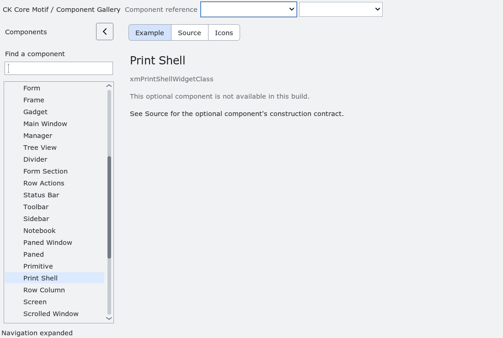

== Source

Actual gallery factory for xmPrintShellWidgetClass.
The gallery host supplies the function arguments.
Helpers are defined in gallery_examples.c.

<<< @/demos/programs/ckmotif-gallery/gallery_examples.c#L1200-L1258

[Complete demo source](../demos/programs/ckmotif-gallery/gallery_examples.c) · [Public header](../lib/Xm/Print.h)

:::

### `xm.rowcolumnwidgetclass`

- Class: `xmRowColumnWidgetClass`
- Example: `gallery.source.rowcolumnwidgetclass`
- Interaction: `gallery.interaction.rowcolumnwidgetclass`
- Screenshot: `gallery.screenshot.rowcolumnwidgetclass`
- Capability: constructible

::: tabs
== Demo

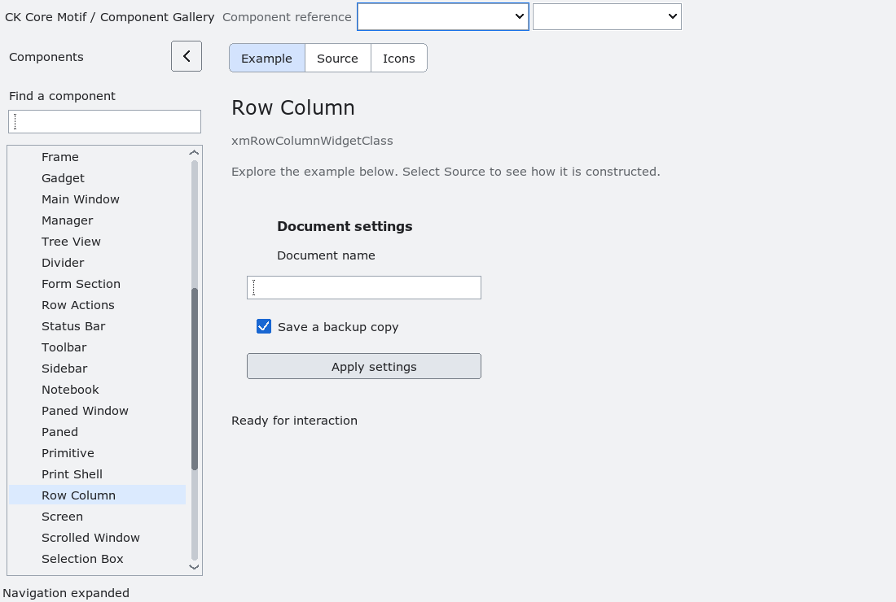

== Source

Actual gallery excerpt: class = xmRowColumnWidgetClass.
The host supplies parent, name, callback and client_data.
Shared factory locals: Widget example; XmString label = NULL.
The shared factory frees label, attaches callbacks and sizes the preview.
Helpers and the complete factory are in gallery_examples.c.

<<< @/demos/programs/ckmotif-gallery/gallery_examples.c#L1006-L1047

[Complete demo source](../demos/programs/ckmotif-gallery/gallery_examples.c) · [Public header](../lib/Xm/RowColumn.h)

:::

### `xm.screenclass`

- Class: `xmScreenClass`
- Example: `gallery.source.screenclass`
- Interaction: `gallery.interaction.screenclass`
- Screenshot: `gallery.screenshot.screenclass`
- Capability: inventory-only

::: tabs
== Demo

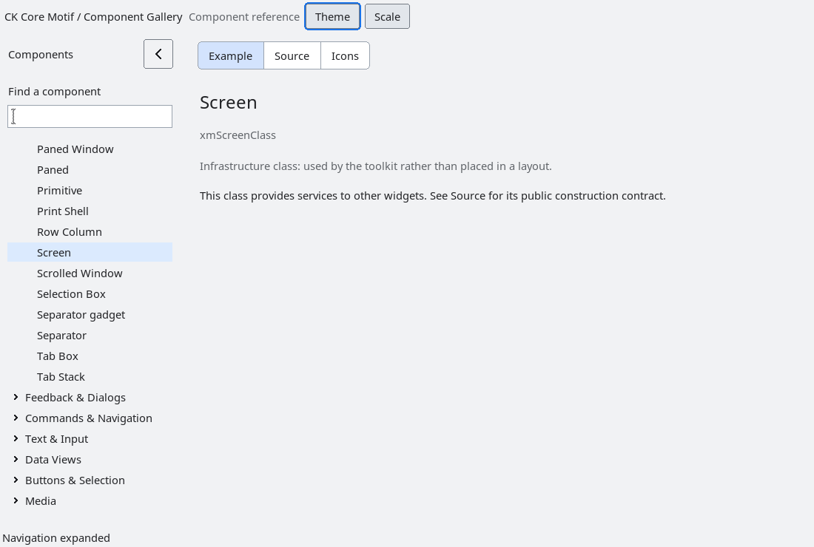

== Source

This is a service or abstract class, not a standalone control.
The Demo tab explains its role in the toolkit.

<<< @/lib/Xm/Screen.h

[Complete demo source](../demos/programs/ckmotif-gallery/gallery_examples.c) · [Public header](../lib/Xm/Screen.h)

:::

### `xm.scrolledwindowwidgetclass`

- Class: `xmScrolledWindowWidgetClass`
- Example: `gallery.source.scrolledwindowwidgetclass`
- Interaction: `gallery.interaction.scrolledwindowwidgetclass`
- Screenshot: `gallery.screenshot.scrolledwindowwidgetclass`
- Capability: constructible

::: tabs
== Demo

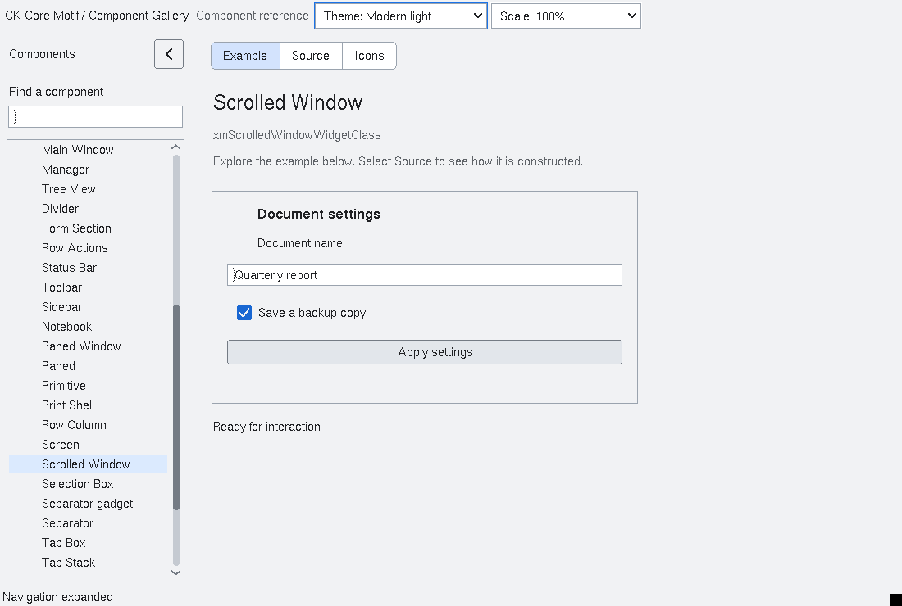

== Source

Actual gallery excerpt: class = xmScrolledWindowWidgetClass.
The host supplies parent, name, callback and client_data.
Shared factory locals: Widget example; XmString label = NULL.
The shared factory frees label, attaches callbacks and sizes the preview.
Helpers and the complete factory are in gallery_examples.c.

<<< @/demos/programs/ckmotif-gallery/gallery_examples.c#L1006-L1047

[Complete demo source](../demos/programs/ckmotif-gallery/gallery_examples.c) · [Public header](../lib/Xm/ScrolledW.h)

:::

### `xm.selectionboxwidgetclass`

- Class: `xmSelectionBoxWidgetClass`
- Example: `gallery.source.selectionboxwidgetclass`
- Interaction: `gallery.interaction.selectionboxwidgetclass`
- Screenshot: `gallery.screenshot.selectionboxwidgetclass`
- Capability: constructible

::: tabs
== Demo

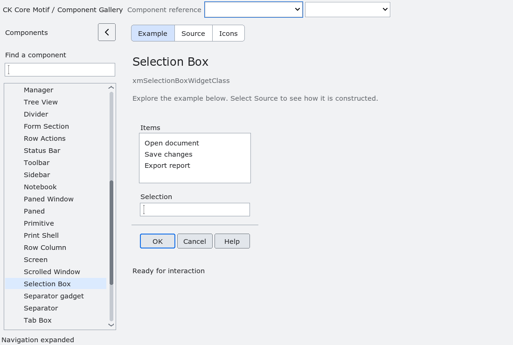

== Source

Actual gallery excerpt: class = xmSelectionBoxWidgetClass.
The host supplies parent, name, callback and client_data.
Shared factory locals: Widget example; XmString label = NULL.
The shared factory frees label, attaches callbacks and sizes the preview.
Helpers and the complete factory are in gallery_examples.c.

<<< @/demos/programs/ckmotif-gallery/gallery_examples.c#L899-L907

[Complete demo source](../demos/programs/ckmotif-gallery/gallery_examples.c) · [Public header](../lib/Xm/SelectioB.h)

:::

### `xm.separatorgadgetclass`

- Class: `xmSeparatorGadgetClass`
- Example: `gallery.source.separatorgadgetclass`
- Interaction: `gallery.interaction.separatorgadgetclass`
- Screenshot: `gallery.screenshot.separatorgadgetclass`
- Capability: constructible

::: tabs
== Demo

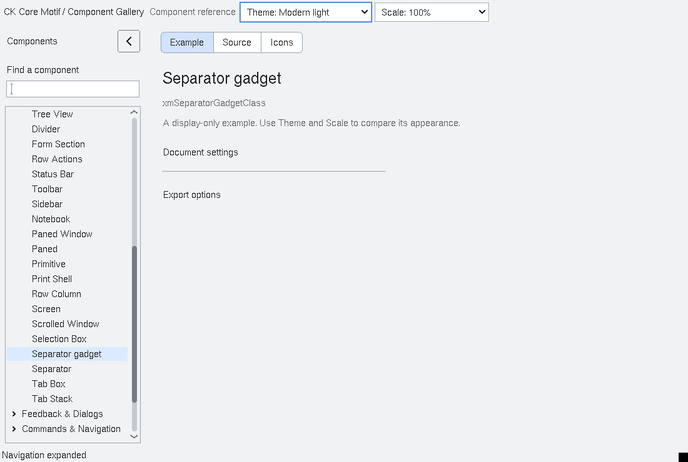

== Source

Actual gallery excerpt: class = xmSeparatorGadgetClass.
The host supplies parent, name, callback and client_data.
Shared factory locals: Widget example; XmString label = NULL.
The shared factory frees label, attaches callbacks and sizes the preview.
Helpers and the complete factory are in gallery_examples.c.

<<< @/demos/programs/ckmotif-gallery/gallery_examples.c#L911-L915

[Complete demo source](../demos/programs/ckmotif-gallery/gallery_examples.c) · [Public header](../lib/Xm/SeparatoG.h)

:::

### `xm.separatorwidgetclass`

- Class: `xmSeparatorWidgetClass`
- Example: `gallery.source.separatorwidgetclass`
- Interaction: `gallery.interaction.separatorwidgetclass`
- Screenshot: `gallery.screenshot.separatorwidgetclass`
- Capability: constructible

::: tabs
== Demo

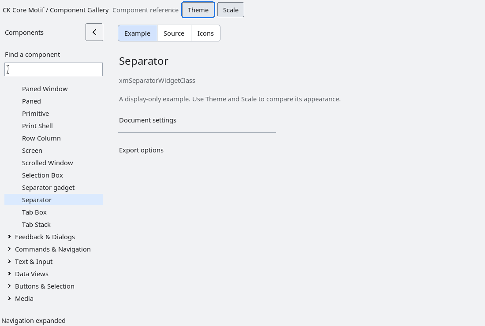

== Source

Actual gallery excerpt: class = xmSeparatorWidgetClass.
The host supplies parent, name, callback and client_data.
Shared factory locals: Widget example; XmString label = NULL.
The shared factory frees label, attaches callbacks and sizes the preview.
Helpers and the complete factory are in gallery_examples.c.

<<< @/demos/programs/ckmotif-gallery/gallery_examples.c#L911-L915

[Complete demo source](../demos/programs/ckmotif-gallery/gallery_examples.c) · [Public header](../lib/Xm/Separator.h)

:::

### `xm.tabboxwidgetclass`

- Class: `xmTabBoxWidgetClass`
- Example: `gallery.source.tabboxwidgetclass`
- Interaction: `gallery.interaction.tabboxwidgetclass`
- Screenshot: `gallery.screenshot.tabboxwidgetclass`
- Capability: constructible

::: tabs
== Demo

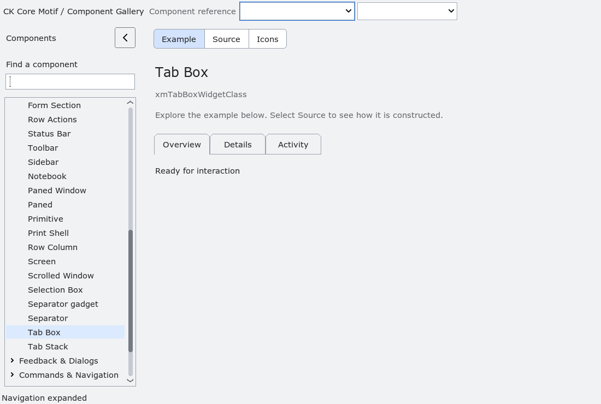

== Source

Actual gallery excerpt: class = xmTabBoxWidgetClass.
The host supplies parent, name, callback and client_data.
Shared factory locals: Widget example; XmString label = NULL.
The shared factory frees label, attaches callbacks and sizes the preview.
Helpers and the complete factory are in gallery_examples.c.

<<< @/demos/programs/ckmotif-gallery/gallery_examples.c#L739-L750

[Complete demo source](../demos/programs/ckmotif-gallery/gallery_examples.c) · [Public header](../lib/Xm/TabBox.h)

:::

### `xm.tabstackwidgetclass`

- Class: `xmTabStackWidgetClass`
- Example: `gallery.source.tabstackwidgetclass`
- Interaction: `gallery.interaction.tabstackwidgetclass`
- Screenshot: `gallery.screenshot.tabstackwidgetclass`
- Capability: constructible

::: tabs
== Demo

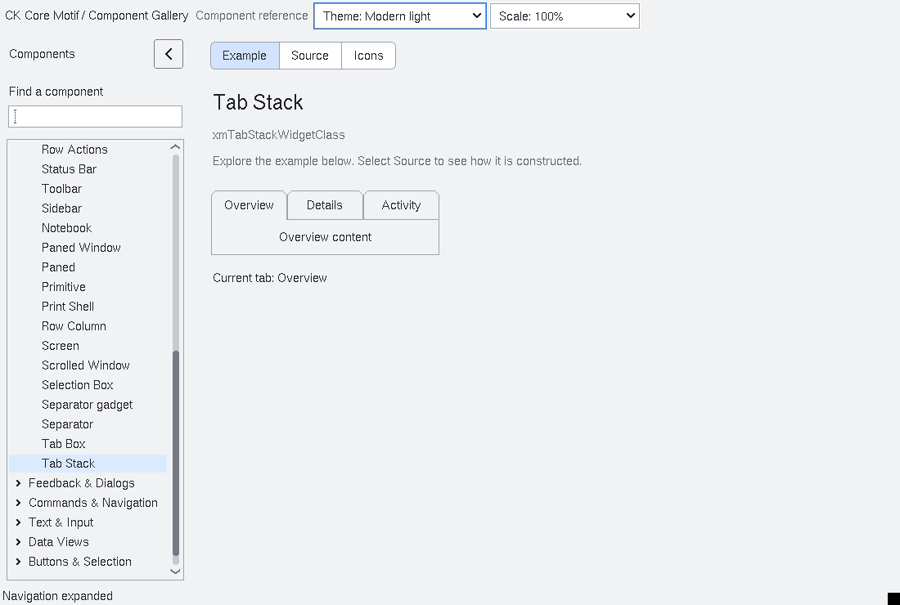

== Source

Actual gallery excerpt: class = xmTabStackWidgetClass.
The host supplies parent, name, callback and client_data.
Shared factory locals: Widget example; XmString label = NULL.
The shared factory frees label, attaches callbacks and sizes the preview.
Helpers and the complete factory are in gallery_examples.c.

<<< @/demos/programs/ckmotif-gallery/gallery_examples.c#L584-L614

[Complete demo source](../demos/programs/ckmotif-gallery/gallery_examples.c) · [Public header](../lib/Xm/TabStack.h)

:::

## feedback-dialogs

### `xm.colorselectorwidgetclass`

- Class: `xmColorSelectorWidgetClass`
- Example: `gallery.source.colorselectorwidgetclass`
- Interaction: `gallery.interaction.colorselectorwidgetclass`
- Screenshot: `gallery.screenshot.colorselectorwidgetclass`
- Capability: constructible

::: tabs
== Demo

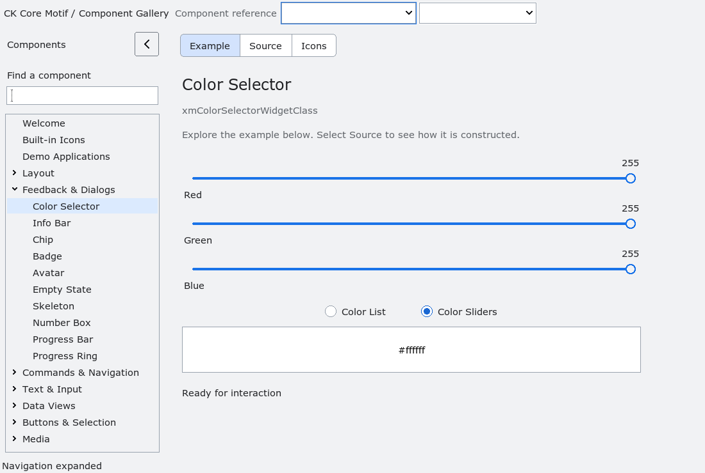

== Source

Actual gallery excerpt: class = xmColorSelectorWidgetClass.
The host supplies parent, name, callback and client_data.
Shared factory locals: Widget example; XmString label = NULL.
The shared factory frees label, attaches callbacks and sizes the preview.
Helpers and the complete factory are in gallery_examples.c.

<<< @/demos/programs/ckmotif-gallery/gallery_examples.c#L1066-L1069

[Complete demo source](../demos/programs/ckmotif-gallery/gallery_examples.c) · [Public header](../lib/Xm/ColorS.h)

:::

### `xm.infobarwidgetclass`

- Class: `xmInfoBarWidgetClass`
- Example: `gallery.source.infobarwidgetclass`
- Interaction: `gallery.interaction.infobarwidgetclass`
- Screenshot: `gallery.screenshot.infobarwidgetclass`
- Capability: constructible

::: tabs
== Demo

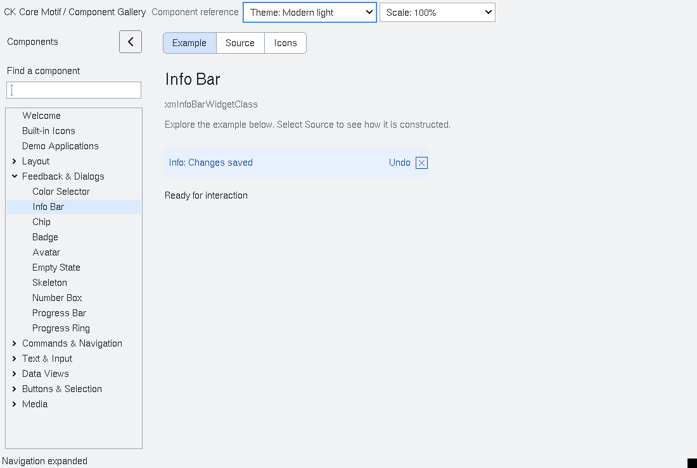

== Source

Actual gallery excerpt: class = xmInfoBarWidgetClass.
The host supplies parent, name, callback and client_data.
Shared factory locals: Widget example; XmString label = NULL.
The shared factory frees label, attaches callbacks and sizes the preview.
Helpers and the complete factory are in gallery_examples.c.

<<< @/demos/programs/ckmotif-gallery/gallery_examples.c#L552-L555

[Complete demo source](../demos/programs/ckmotif-gallery/gallery_examples.c) · [Public header](../lib/Xm/InfoBar.h)

:::

### `xm.chipwidgetclass`

- Class: `xmChipWidgetClass`
- Example: `gallery.source.chipwidgetclass`
- Interaction: `gallery.interaction.chipwidgetclass`
- Screenshot: `gallery.screenshot.chipwidgetclass`
- Capability: constructible

::: tabs
== Demo

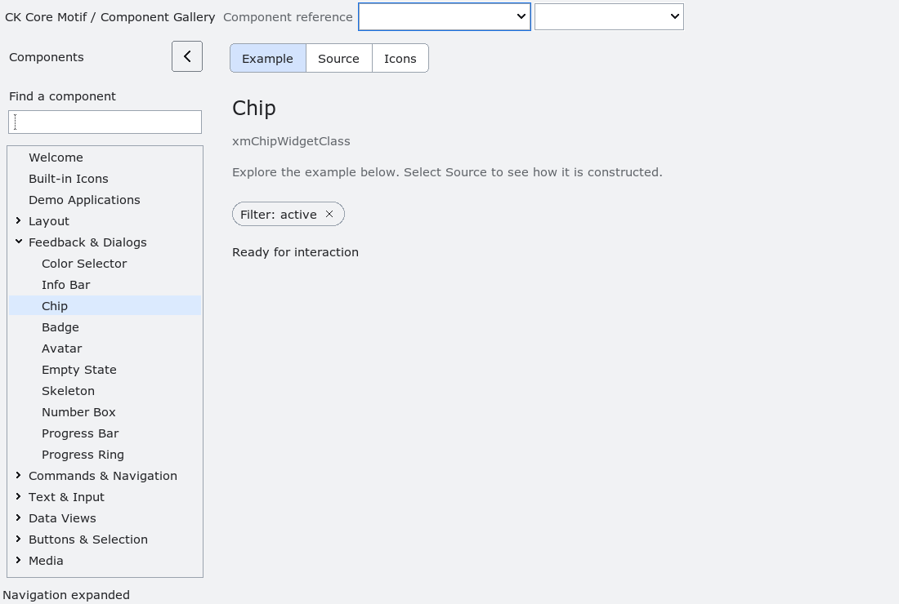

== Source

Actual gallery excerpt: class = xmChipWidgetClass.
The host supplies parent, name, callback and client_data.
Shared factory locals: Widget example; XmString label = NULL.
The shared factory frees label, attaches callbacks and sizes the preview.
Helpers and the complete factory are in gallery_examples.c.

<<< @/demos/programs/ckmotif-gallery/gallery_examples.c#L350-L353

[Complete demo source](../demos/programs/ckmotif-gallery/gallery_examples.c) · [Public header](../lib/Xm/Chip.h)

:::

### `xm.badgewidgetclass`

- Class: `xmBadgeWidgetClass`
- Example: `gallery.source.badgewidgetclass`
- Interaction: `gallery.interaction.badgewidgetclass`
- Screenshot: `gallery.screenshot.badgewidgetclass`
- Capability: constructible

::: tabs
== Demo

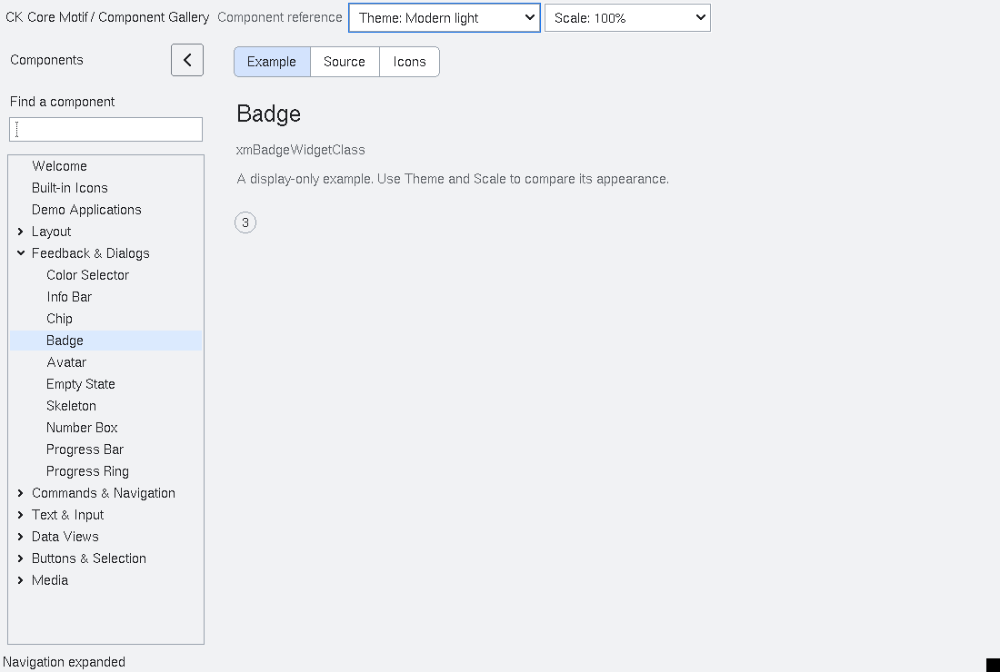

== Source

Actual gallery excerpt: class = xmBadgeWidgetClass.
The host supplies parent, name, callback and client_data.
Shared factory locals: Widget example; XmString label = NULL.
The shared factory frees label, attaches callbacks and sizes the preview.
Helpers and the complete factory are in gallery_examples.c.

<<< @/demos/programs/ckmotif-gallery/gallery_examples.c#L357-L360

[Complete demo source](../demos/programs/ckmotif-gallery/gallery_examples.c) · [Public header](../lib/Xm/Badge.h)

:::

### `xm.avatarwidgetclass`

- Class: `xmAvatarWidgetClass`
- Example: `gallery.source.avatarwidgetclass`
- Interaction: `gallery.interaction.avatarwidgetclass`
- Screenshot: `gallery.screenshot.avatarwidgetclass`
- Capability: constructible

::: tabs
== Demo

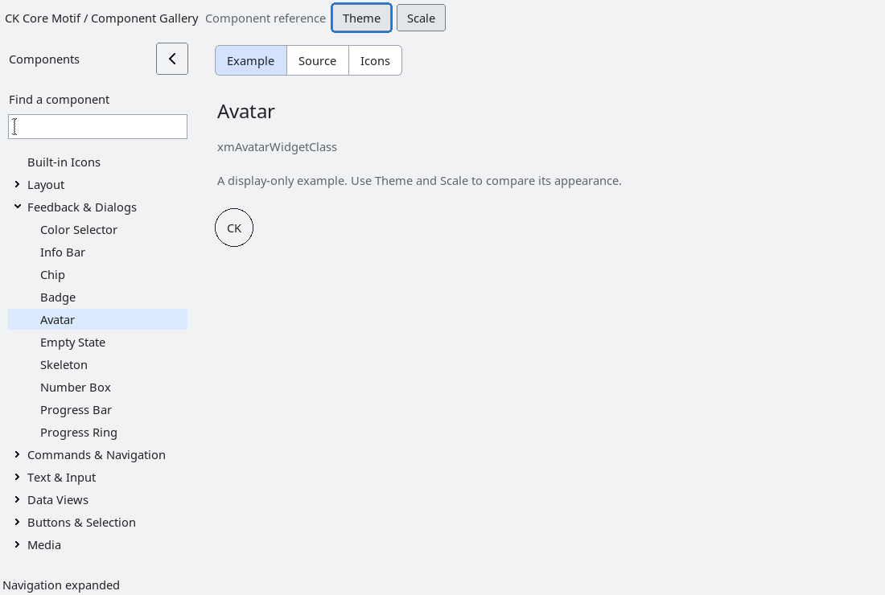

== Source

Actual gallery excerpt: class = xmAvatarWidgetClass.
The host supplies parent, name, callback and client_data.
Shared factory locals: Widget example; XmString label = NULL.
The shared factory frees label, attaches callbacks and sizes the preview.
Helpers and the complete factory are in gallery_examples.c.

<<< @/demos/programs/ckmotif-gallery/gallery_examples.c#L377-L379

[Complete demo source](../demos/programs/ckmotif-gallery/gallery_examples.c) · [Public header](../lib/Xm/Avatar.h)

:::

### `xm.emptystatewidgetclass`

- Class: `xmEmptyStateWidgetClass`
- Example: `gallery.source.emptystatewidgetclass`
- Interaction: `gallery.interaction.emptystatewidgetclass`
- Screenshot: `gallery.screenshot.emptystatewidgetclass`
- Capability: constructible

::: tabs
== Demo

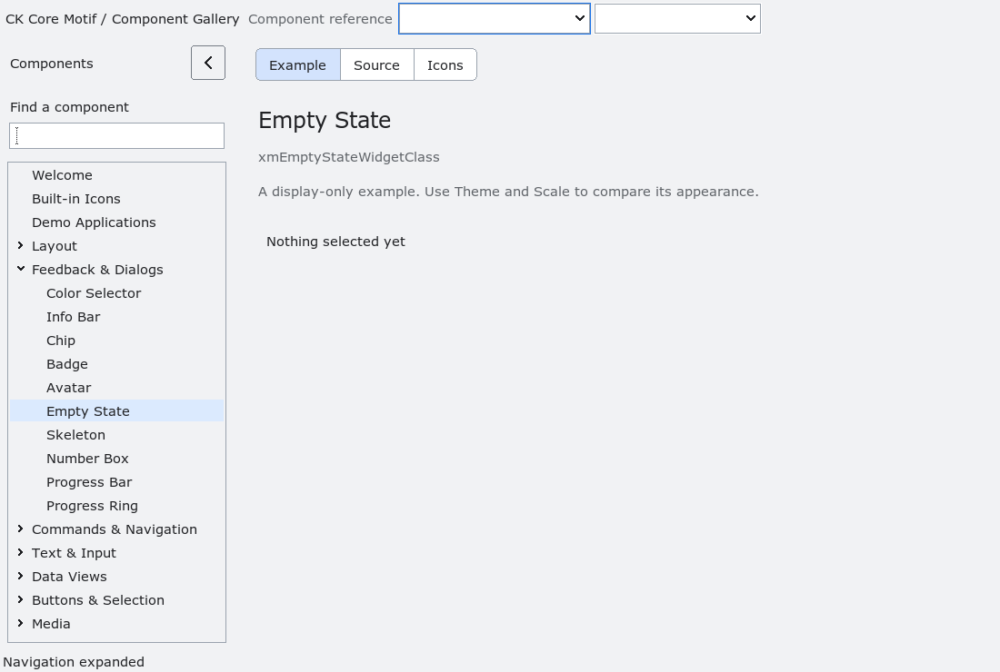

== Source

Actual gallery excerpt: class = xmEmptyStateWidgetClass.
The host supplies parent, name, callback and client_data.
Shared factory locals: Widget example; XmString label = NULL.
The shared factory frees label, attaches callbacks and sizes the preview.
Helpers and the complete factory are in gallery_examples.c.

<<< @/demos/programs/ckmotif-gallery/gallery_examples.c#L396-L398

[Complete demo source](../demos/programs/ckmotif-gallery/gallery_examples.c) · [Public header](../lib/Xm/EmptyState.h)

:::

### `xm.skeletonwidgetclass`

- Class: `xmSkeletonWidgetClass`
- Example: `gallery.source.skeletonwidgetclass`
- Interaction: `gallery.interaction.skeletonwidgetclass`
- Screenshot: `gallery.screenshot.skeletonwidgetclass`
- Capability: constructible

::: tabs
== Demo

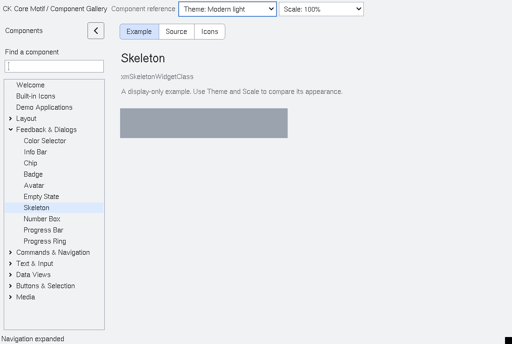

== Source

Actual gallery excerpt: class = xmSkeletonWidgetClass.
The host supplies parent, name, callback and client_data.
Shared factory locals: Widget example; XmString label = NULL.
The shared factory frees label, attaches callbacks and sizes the preview.
Helpers and the complete factory are in gallery_examples.c.

<<< @/demos/programs/ckmotif-gallery/gallery_examples.c#L1073-L1074

[Complete demo source](../demos/programs/ckmotif-gallery/gallery_examples.c) · [Public header](../lib/Xm/Skeleton.h)

:::

### `xm.numberboxwidgetclass`

- Class: `xmNumberBoxWidgetClass`
- Example: `gallery.source.numberboxwidgetclass`
- Interaction: `gallery.interaction.numberboxwidgetclass`
- Screenshot: `gallery.screenshot.numberboxwidgetclass`
- Capability: constructible

::: tabs
== Demo

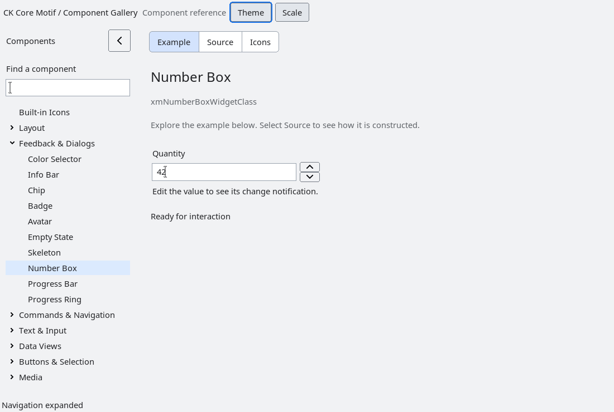

== Source

Actual gallery excerpt: class = xmNumberBoxWidgetClass.
The host supplies parent, name, callback and client_data.
Shared factory locals: Widget example; XmString label = NULL.
The shared factory frees label, attaches callbacks and sizes the preview.
Helpers and the complete factory are in gallery_examples.c.

<<< @/demos/programs/ckmotif-gallery/gallery_examples.c#L335-L342

<<< @/demos/programs/ckmotif-gallery/gallery_examples.c#L494-L496

<<< @/demos/programs/ckmotif-gallery/gallery_examples.c#L1108-L1111

[Complete demo source](../demos/programs/ckmotif-gallery/gallery_examples.c) · [Public header](../lib/Xm/NumberBox.h)

:::

### `xm.progressbarwidgetclass`

- Class: `xmProgressBarWidgetClass`
- Example: `gallery.source.progressbarwidgetclass`
- Interaction: `gallery.interaction.progressbarwidgetclass`
- Screenshot: `gallery.screenshot.progressbarwidgetclass`
- Capability: constructible

::: tabs
== Demo

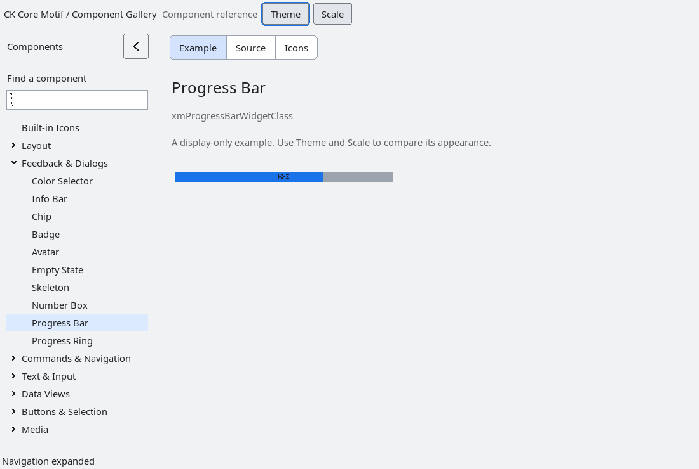

== Source

Actual gallery excerpt: class = xmProgressBarWidgetClass.
The host supplies parent, name, callback and client_data.
Shared factory locals: Widget example; XmString label = NULL.
The shared factory frees label, attaches callbacks and sizes the preview.
Helpers and the complete factory are in gallery_examples.c.

<<< @/demos/programs/ckmotif-gallery/gallery_examples.c#L505-L508

[Complete demo source](../demos/programs/ckmotif-gallery/gallery_examples.c) · [Public header](../lib/Xm/ProgressBar.h)

:::

### `xm.progressringwidgetclass`

- Class: `xmProgressRingWidgetClass`
- Example: `gallery.source.progressringwidgetclass`
- Interaction: `gallery.interaction.progressringwidgetclass`
- Screenshot: `gallery.screenshot.progressringwidgetclass`
- Capability: constructible

::: tabs
== Demo

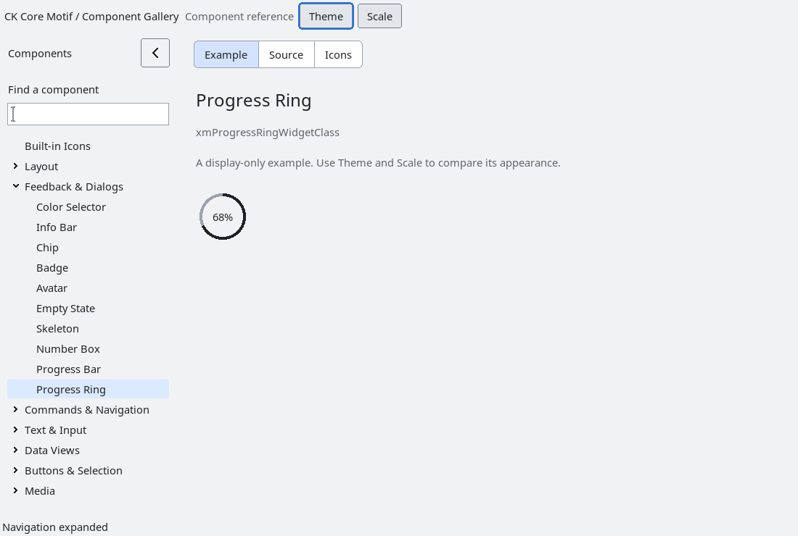

== Source

Actual gallery excerpt: class = xmProgressRingWidgetClass.
The host supplies parent, name, callback and client_data.
Shared factory locals: Widget example; XmString label = NULL.
The shared factory frees label, attaches callbacks and sizes the preview.
Helpers and the complete factory are in gallery_examples.c.

<<< @/demos/programs/ckmotif-gallery/gallery_examples.c#L512-L514

[Complete demo source](../demos/programs/ckmotif-gallery/gallery_examples.c) · [Public header](../lib/Xm/ProgressRing.h)

:::

## commands-navigation

### `xm.combinationbox2widgetclass`

- Class: `xmCombinationBox2WidgetClass`
- Example: `gallery.source.combinationbox2widgetclass`
- Interaction: `gallery.interaction.combinationbox2widgetclass`
- Screenshot: `gallery.screenshot.combinationbox2widgetclass`
- Capability: constructible

::: tabs
== Demo

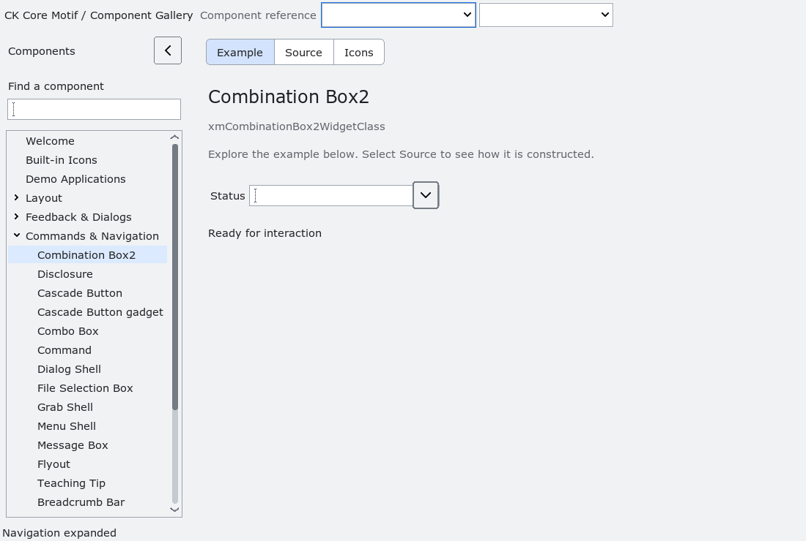

== Source

Actual gallery excerpt: class = xmCombinationBox2WidgetClass.
The host supplies parent, name, callback and client_data.
Shared factory locals: Widget example; XmString label = NULL.
The shared factory frees label, attaches callbacks and sizes the preview.
Helpers and the complete factory are in gallery_examples.c.

<<< @/demos/programs/ckmotif-gallery/gallery_examples.c#L725-L735

[Complete demo source](../demos/programs/ckmotif-gallery/gallery_examples.c) · [Public header](../lib/Xm/ComboBox2.h)

:::

### `xm.disclosurewidgetclass`

- Class: `xmDisclosureWidgetClass`
- Example: `gallery.source.disclosurewidgetclass`
- Interaction: `gallery.interaction.disclosurewidgetclass`
- Screenshot: `gallery.screenshot.disclosurewidgetclass`
- Capability: constructible

::: tabs
== Demo

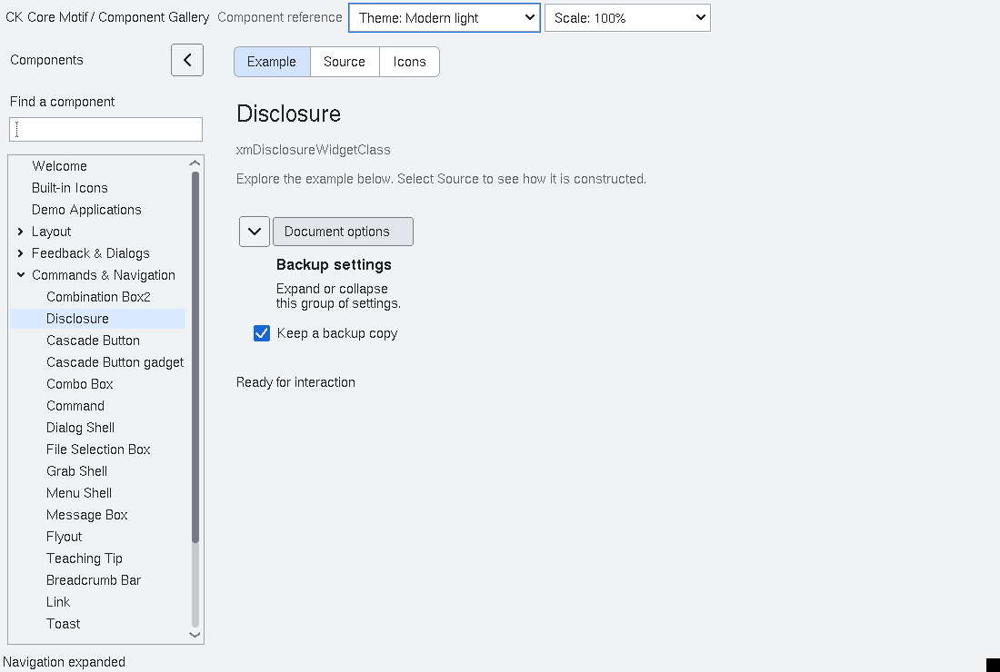

== Source

Actual gallery excerpt: class = xmDisclosureWidgetClass.
The host supplies parent, name, callback and client_data.
Shared factory locals: Widget example; XmString label = NULL.
The shared factory frees label, attaches callbacks and sizes the preview.
Helpers and the complete factory are in gallery_examples.c.

<<< @/demos/programs/ckmotif-gallery/gallery_examples.c#L818-L835

[Complete demo source](../demos/programs/ckmotif-gallery/gallery_examples.c) · [Public header](../lib/Xm/Disclosure.h)

:::

### `xm.cascadebuttonwidgetclass`

- Class: `xmCascadeButtonWidgetClass`
- Example: `gallery.source.cascadebuttonwidgetclass`
- Interaction: `gallery.interaction.cascadebuttonwidgetclass`
- Screenshot: `gallery.screenshot.cascadebuttonwidgetclass`
- Capability: constructible

::: tabs
== Demo

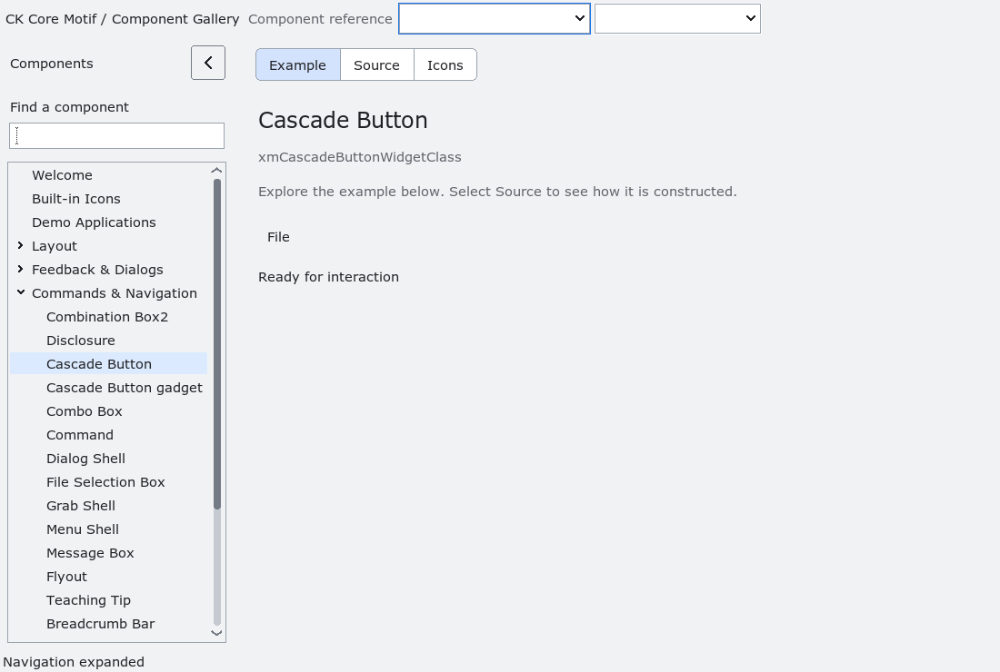

== Source

Actual gallery excerpt: class = xmCascadeButtonWidgetClass.
The host supplies parent, name, callback and client_data.
Shared factory locals: Widget example; XmString label = NULL.
The shared factory frees label, attaches callbacks and sizes the preview.
Helpers and the complete factory are in gallery_examples.c.

<<< @/demos/programs/ckmotif-gallery/gallery_examples.c#L420-L439

[Complete demo source](../demos/programs/ckmotif-gallery/gallery_examples.c) · [Public header](../lib/Xm/CascadeB.h)

:::

### `xm.cascadebuttongadgetclass`

- Class: `xmCascadeButtonGadgetClass`
- Example: `gallery.source.cascadebuttongadgetclass`
- Interaction: `gallery.interaction.cascadebuttongadgetclass`
- Screenshot: `gallery.screenshot.cascadebuttongadgetclass`
- Capability: constructible

::: tabs
== Demo

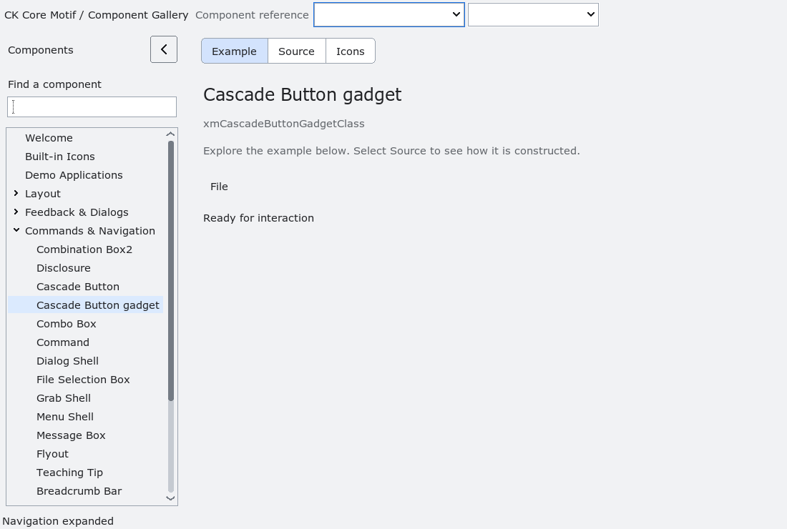

== Source

Actual gallery excerpt: class = xmCascadeButtonGadgetClass.
The host supplies parent, name, callback and client_data.
Shared factory locals: Widget example; XmString label = NULL.
The shared factory frees label, attaches callbacks and sizes the preview.
Helpers and the complete factory are in gallery_examples.c.

<<< @/demos/programs/ckmotif-gallery/gallery_examples.c#L420-L439

[Complete demo source](../demos/programs/ckmotif-gallery/gallery_examples.c) · [Public header](../lib/Xm/CascadeBG.h)

:::

### `xm.comboboxwidgetclass`

- Class: `xmComboBoxWidgetClass`
- Example: `gallery.source.comboboxwidgetclass`
- Interaction: `gallery.interaction.comboboxwidgetclass`
- Screenshot: `gallery.screenshot.comboboxwidgetclass`
- Capability: constructible

::: tabs
== Demo

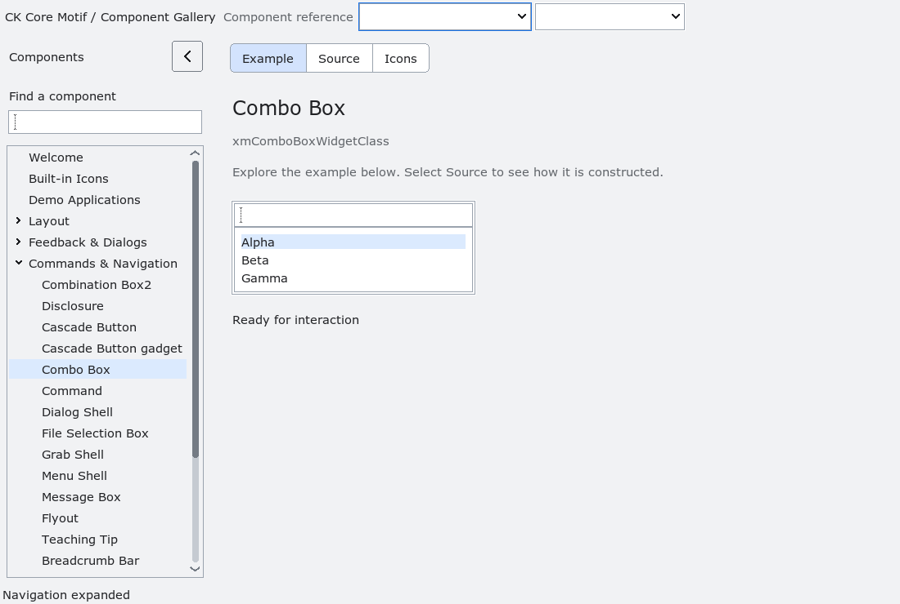

== Source

Actual gallery excerpt: class = xmComboBoxWidgetClass.
The host supplies parent, name, callback and client_data.
Shared factory locals: Widget example; XmString label = NULL.
The shared factory frees label, attaches callbacks and sizes the preview.
Helpers and the complete factory are in gallery_examples.c.

<<< @/demos/programs/ckmotif-gallery/gallery_examples.c#L476-L483

[Complete demo source](../demos/programs/ckmotif-gallery/gallery_examples.c) · [Public header](../lib/Xm/ComboBox.h)

:::

### `xm.commandwidgetclass`

- Class: `xmCommandWidgetClass`
- Example: `gallery.source.commandwidgetclass`
- Interaction: `gallery.interaction.commandwidgetclass`
- Screenshot: `gallery.screenshot.commandwidgetclass`
- Capability: constructible

::: tabs
== Demo

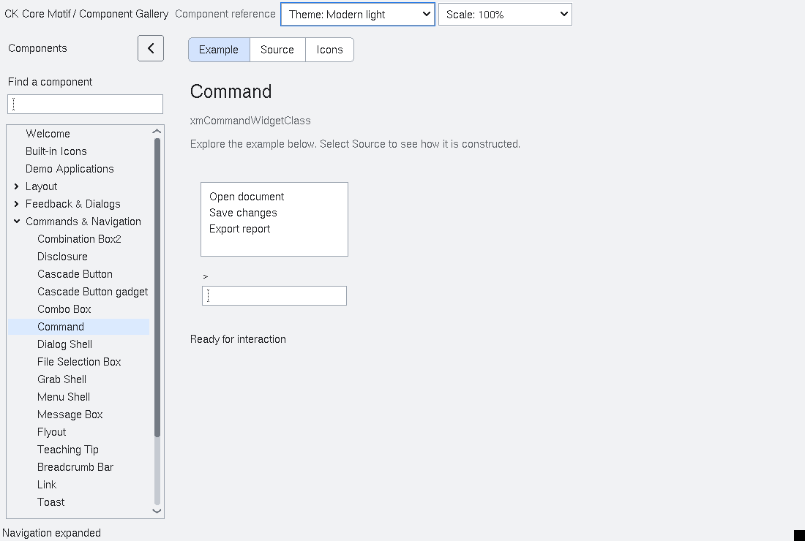

== Source

Actual gallery excerpt: class = xmCommandWidgetClass.
The host supplies parent, name, callback and client_data.
Shared factory locals: Widget example; XmString label = NULL.
The shared factory frees label, attaches callbacks and sizes the preview.
Helpers and the complete factory are in gallery_examples.c.

<<< @/demos/programs/ckmotif-gallery/gallery_examples.c#L899-L907

[Complete demo source](../demos/programs/ckmotif-gallery/gallery_examples.c) · [Public header](../lib/Xm/Command.h)

:::

### `xm.dialogshellwidgetclass`

- Class: `xmDialogShellWidgetClass`
- Example: `gallery.source.dialogshellwidgetclass`
- Interaction: `gallery.interaction.dialogshellwidgetclass`
- Screenshot: `gallery.screenshot.dialogshellwidgetclass`
- Capability: constructible

::: tabs
== Demo

== Source

Actual gallery factory for xmDialogShellWidgetClass.
The gallery host supplies the function arguments.
Helpers are defined in gallery_examples.c.

<<< @/demos/programs/ckmotif-gallery/gallery_examples.c#L1200-L1258

[Complete demo source](../demos/programs/ckmotif-gallery/gallery_examples.c) · [Public header](../lib/Xm/DialogS.h)

:::

### `xm.fileselectionboxwidgetclass`

- Class: `xmFileSelectionBoxWidgetClass`
- Example: `gallery.source.fileselectionboxwidgetclass`
- Interaction: `gallery.interaction.fileselectionboxwidgetclass`
- Screenshot: `gallery.screenshot.fileselectionboxwidgetclass`
- Capability: constructible

::: tabs
== Demo

== Source

Actual gallery excerpt: class = xmFileSelectionBoxWidgetClass.
The host supplies parent, name, callback and client_data.
Shared factory locals: Widget example; XmString label = NULL.
The shared factory frees label, attaches callbacks and sizes the preview.
Helpers and the complete factory are in gallery_examples.c.

<<< @/demos/programs/ckmotif-gallery/gallery_examples.c#L941-L945

[Complete demo source](../demos/programs/ckmotif-gallery/gallery_examples.c) · [Public header](../lib/Xm/FileSB.h)

:::

### `xm.grabshellwidgetclass`

- Class: `xmGrabShellWidgetClass`
- Example: `gallery.source.grabshellwidgetclass`
- Interaction: `gallery.interaction.grabshellwidgetclass`
- Screenshot: `gallery.screenshot.grabshellwidgetclass`
- Capability: constructible

::: tabs
== Demo

== Source

Actual gallery factory for xmGrabShellWidgetClass.
The gallery host supplies the function arguments.
Helpers are defined in gallery_examples.c.

<<< @/demos/programs/ckmotif-gallery/gallery_examples.c#L1200-L1258

[Complete demo source](../demos/programs/ckmotif-gallery/gallery_examples.c) · [Public header](../lib/Xm/GrabShell.h)

:::

### `xm.menushellwidgetclass`

- Class: `xmMenuShellWidgetClass`
- Example: `gallery.source.menushellwidgetclass`
- Interaction: `gallery.interaction.menushellwidgetclass`
- Screenshot: `gallery.screenshot.menushellwidgetclass`
- Capability: constructible

::: tabs
== Demo

== Source

Actual gallery factory for xmMenuShellWidgetClass.
The gallery host supplies the function arguments.
Helpers are defined in gallery_examples.c.

<<< @/demos/programs/ckmotif-gallery/gallery_examples.c#L1200-L1258

[Complete demo source](../demos/programs/ckmotif-gallery/gallery_examples.c) · [Public header](../lib/Xm/MenuShell.h)

:::

### `xm.messageboxwidgetclass`

- Class: `xmMessageBoxWidgetClass`
- Example: `gallery.source.messageboxwidgetclass`
- Interaction: `gallery.interaction.messageboxwidgetclass`
- Screenshot: `gallery.screenshot.messageboxwidgetclass`
- Capability: constructible

::: tabs
== Demo

== Source

Actual gallery excerpt: class = xmMessageBoxWidgetClass.
The host supplies parent, name, callback and client_data.
Shared factory locals: Widget example; XmString label = NULL.
The shared factory frees label, attaches callbacks and sizes the preview.
Helpers and the complete factory are in gallery_examples.c.

<<< @/demos/programs/ckmotif-gallery/gallery_examples.c#L893-L895

[Complete demo source](../demos/programs/ckmotif-gallery/gallery_examples.c) · [Public header](../lib/Xm/MessageB.h)

:::

### `xm.flyoutwidgetclass`

- Class: `xmFlyoutWidgetClass`
- Example: `gallery.source.flyoutwidgetclass`
- Interaction: `gallery.interaction.flyoutwidgetclass`
- Screenshot: `gallery.screenshot.flyoutwidgetclass`
- Capability: constructible

::: tabs
== Demo

== Source

Actual gallery excerpt: class = xmFlyoutWidgetClass.
The host supplies parent, name, callback and client_data.
Shared factory locals: Widget example; XmString label = NULL.
The shared factory frees label, attaches callbacks and sizes the preview.
Helpers and the complete factory are in gallery_examples.c.

<<< @/demos/programs/ckmotif-gallery/gallery_examples.c#L862-L881

[Complete demo source](../demos/programs/ckmotif-gallery/gallery_examples.c) · [Public header](../lib/Xm/Flyout.h)

:::

### `xm.teachingtipwidgetclass`

- Class: `xmTeachingTipWidgetClass`
- Example: `gallery.source.teachingtipwidgetclass`
- Interaction: `gallery.interaction.teachingtipwidgetclass`
- Screenshot: `gallery.screenshot.teachingtipwidgetclass`
- Capability: constructible

::: tabs
== Demo

== Source

Actual gallery excerpt: class = xmTeachingTipWidgetClass.
The host supplies parent, name, callback and client_data.
Shared factory locals: Widget example; XmString label = NULL.
The shared factory frees label, attaches callbacks and sizes the preview.
Helpers and the complete factory are in gallery_examples.c.

<<< @/demos/programs/ckmotif-gallery/gallery_examples.c#L862-L881

[Complete demo source](../demos/programs/ckmotif-gallery/gallery_examples.c) · [Public header](../lib/Xm/TeachingTip.h)

:::

### `xm.breadcrumbbarwidgetclass`

- Class: `xmBreadcrumbBarWidgetClass`
- Example: `gallery.source.breadcrumbbarwidgetclass`
- Interaction: `gallery.interaction.breadcrumbbarwidgetclass`
- Screenshot: `gallery.screenshot.breadcrumbbarwidgetclass`
- Capability: constructible

::: tabs
== Demo

== Source

Actual gallery excerpt: class = xmBreadcrumbBarWidgetClass.
The host supplies parent, name, callback and client_data.
Shared factory locals: Widget example; XmString label = NULL.
The shared factory frees label, attaches callbacks and sizes the preview.
Helpers and the complete factory are in gallery_examples.c.

<<< @/demos/programs/ckmotif-gallery/gallery_examples.c#L534-L542

[Complete demo source](../demos/programs/ckmotif-gallery/gallery_examples.c) · [Public header](../lib/Xm/BreadcrumbBar.h)

:::

### `xm.linkwidgetclass`

- Class: `xmLinkWidgetClass`
- Example: `gallery.source.linkwidgetclass`
- Interaction: `gallery.interaction.linkwidgetclass`
- Screenshot: `gallery.screenshot.linkwidgetclass`
- Capability: constructible

::: tabs
== Demo

== Source

Actual gallery excerpt: class = xmLinkWidgetClass.
The host supplies parent, name, callback and client_data.
Shared factory locals: Widget example; XmString label = NULL.
The shared factory frees label, attaches callbacks and sizes the preview.
Helpers and the complete factory are in gallery_examples.c.

<<< @/demos/programs/ckmotif-gallery/gallery_examples.c#L383-L386

[Complete demo source](../demos/programs/ckmotif-gallery/gallery_examples.c) · [Public header](../lib/Xm/Link.h)

:::

### `xm.toastwidgetclass`

- Class: `xmToastWidgetClass`
- Example: `gallery.source.toastwidgetclass`
- Interaction: `gallery.interaction.toastwidgetclass`
- Screenshot: `gallery.screenshot.toastwidgetclass`
- Capability: constructible

::: tabs
== Demo

== Source

Actual gallery excerpt: class = xmToastWidgetClass.
The host supplies parent, name, callback and client_data.
Shared factory locals: Widget example; XmString label = NULL.
The shared factory frees label, attaches callbacks and sizes the preview.
Helpers and the complete factory are in gallery_examples.c.

<<< @/demos/programs/ckmotif-gallery/gallery_examples.c#L559-L563

[Complete demo source](../demos/programs/ckmotif-gallery/gallery_examples.c) · [Public header](../lib/Xm/Toast.h)

:::

### `xm.commandpalettewidgetclass`

- Class: `xmCommandPaletteWidgetClass`
- Example: `gallery.source.commandpalettewidgetclass`
- Interaction: `gallery.interaction.commandpalettewidgetclass`
- Screenshot: `gallery.screenshot.commandpalettewidgetclass`
- Capability: constructible

::: tabs
== Demo

== Source

Actual gallery excerpt: class = xmCommandPaletteWidgetClass.
The host supplies parent, name, callback and client_data.
Shared factory locals: Widget example; XmString label = NULL.
The shared factory frees label, attaches callbacks and sizes the preview.
Helpers and the complete factory are in gallery_examples.c.

<<< @/demos/programs/ckmotif-gallery/gallery_examples.c#L839-L858

[Complete demo source](../demos/programs/ckmotif-gallery/gallery_examples.c) · [Public header](../lib/Xm/CommandPalette.h)

:::

## text-input

### `xm.fontselectorwidgetclass`

- Class: `xmFontSelectorWidgetClass`
- Example: `gallery.source.fontselectorwidgetclass`
- Interaction: `gallery.interaction.fontselectorwidgetclass`
- Screenshot: `gallery.screenshot.fontselectorwidgetclass`
- Capability: constructible

::: tabs
== Demo

== Source

Actual gallery excerpt: class = xmFontSelectorWidgetClass.
The host supplies parent, name, callback and client_data.
Shared factory locals: Widget example; XmString label = NULL.
The shared factory frees label, attaches callbacks and sizes the preview.
Helpers and the complete factory are in gallery_examples.c.

<<< @/demos/programs/ckmotif-gallery/gallery_examples.c#L1066-L1069

[Complete demo source](../demos/programs/ckmotif-gallery/gallery_examples.c) · [Public header](../lib/Xm/FontS.h)

:::

### `xm.datafieldwidgetclass`

- Class: `xmDataFieldWidgetClass`
- Example: `gallery.source.datafieldwidgetclass`
- Interaction: `gallery.interaction.datafieldwidgetclass`
- Screenshot: `gallery.screenshot.datafieldwidgetclass`
- Capability: constructible

::: tabs
== Demo

== Source

Actual gallery excerpt: class = xmDataFieldWidgetClass.
The host supplies parent, name, callback and client_data.
Shared factory locals: Widget example; XmString label = NULL.
The shared factory frees label, attaches callbacks and sizes the preview.
Helpers and the complete factory are in gallery_examples.c.

<<< @/demos/programs/ckmotif-gallery/gallery_examples.c#L335-L342

<<< @/demos/programs/ckmotif-gallery/gallery_examples.c#L459-L461

<<< @/demos/programs/ckmotif-gallery/gallery_examples.c#L1108-L1111

[Complete demo source](../demos/programs/ckmotif-gallery/gallery_examples.c) · [Public header](../lib/Xm/DataF.h)

:::

### `xm.labelwidgetclass`

- Class: `xmLabelWidgetClass`
- Example: `gallery.source.labelwidgetclass`
- Interaction: `gallery.interaction.labelwidgetclass`
- Screenshot: `gallery.screenshot.labelwidgetclass`
- Capability: constructible

::: tabs
== Demo

== Source

Actual gallery excerpt: class = xmLabelWidgetClass.
The host supplies parent, name, callback and client_data.
Shared factory locals: Widget example; XmString label = NULL.
The shared factory frees label, attaches callbacks and sizes the preview.
Helpers and the complete factory are in gallery_examples.c.

<<< @/demos/programs/ckmotif-gallery/gallery_examples.c#L446-L448

[Complete demo source](../demos/programs/ckmotif-gallery/gallery_examples.c) · [Public header](../lib/Xm/Label.h)

:::

### `xm.labelgadgetclass`

- Class: `xmLabelGadgetClass`
- Example: `gallery.source.labelgadgetclass`
- Interaction: `gallery.interaction.labelgadgetclass`
- Screenshot: `gallery.screenshot.labelgadgetclass`
- Capability: constructible

::: tabs
== Demo

== Source

Actual gallery excerpt: class = xmLabelGadgetClass.
The host supplies parent, name, callback and client_data.
Shared factory locals: Widget example; XmString label = NULL.
The shared factory frees label, attaches callbacks and sizes the preview.
Helpers and the complete factory are in gallery_examples.c.

<<< @/demos/programs/ckmotif-gallery/gallery_examples.c#L446-L448

[Complete demo source](../demos/programs/ckmotif-gallery/gallery_examples.c) · [Public header](../lib/Xm/LabelG.h)

:::

### `xm.iconlabelwidgetclass`

- Class: `xmIconLabelWidgetClass`
- Example: `gallery.source.iconlabelwidgetclass`
- Interaction: `gallery.interaction.iconlabelwidgetclass`
- Screenshot: `gallery.screenshot.iconlabelwidgetclass`
- Capability: constructible

::: tabs
== Demo

== Source

Actual gallery excerpt: class = xmIconLabelWidgetClass.
The host supplies parent, name, callback and client_data.
Shared factory locals: Widget example; XmString label = NULL.
The shared factory frees label, attaches callbacks and sizes the preview.
Helpers and the complete factory are in gallery_examples.c.

<<< @/demos/programs/ckmotif-gallery/gallery_examples.c#L364-L367

[Complete demo source](../demos/programs/ckmotif-gallery/gallery_examples.c) · [Public header](../lib/Xm/IconLabel.h)

:::

### `xm.searchboxwidgetclass`

- Class: `xmSearchBoxWidgetClass`
- Example: `gallery.source.searchboxwidgetclass`
- Interaction: `gallery.interaction.searchboxwidgetclass`
- Screenshot: `gallery.screenshot.searchboxwidgetclass`
- Capability: constructible

::: tabs
== Demo

== Source

Actual gallery excerpt: class = xmSearchBoxWidgetClass.
The host supplies parent, name, callback and client_data.
Shared factory locals: Widget example; XmString label = NULL.
The shared factory frees label, attaches callbacks and sizes the preview.
Helpers and the complete factory are in gallery_examples.c.

<<< @/demos/programs/ckmotif-gallery/gallery_examples.c#L949-L952

[Complete demo source](../demos/programs/ckmotif-gallery/gallery_examples.c) · [Public header](../lib/Xm/SearchBox.h)

:::

### `xm.promptwidgetclass`

- Class: `xmPromptWidgetClass`
- Example: `gallery.source.promptwidgetclass`
- Interaction: `gallery.interaction.promptwidgetclass`
- Screenshot: `gallery.screenshot.promptwidgetclass`
- Capability: constructible

::: tabs
== Demo

== Source

Actual gallery excerpt: class = xmPromptWidgetClass.
The host supplies parent, name, callback and client_data.
Shared factory locals: Widget example; XmString label = NULL.
The shared factory frees label, attaches callbacks and sizes the preview.
Helpers and the complete factory are in gallery_examples.c.

<<< @/demos/programs/ckmotif-gallery/gallery_examples.c#L390-L392

[Complete demo source](../demos/programs/ckmotif-gallery/gallery_examples.c) · [Public header](../lib/Xm/Prompt.h)

:::

### `xm.autosuggestboxwidgetclass`

- Class: `xmAutoSuggestBoxWidgetClass`
- Example: `gallery.source.autosuggestboxwidgetclass`
- Interaction: `gallery.interaction.autosuggestboxwidgetclass`
- Screenshot: `gallery.screenshot.autosuggestboxwidgetclass`
- Capability: constructible

::: tabs
== Demo

== Source

Actual gallery excerpt: class = xmAutoSuggestBoxWidgetClass.
The host supplies parent, name, callback and client_data.
Shared factory locals: Widget example; XmString label = NULL.
The shared factory frees label, attaches callbacks and sizes the preview.
Helpers and the complete factory are in gallery_examples.c.

<<< @/demos/programs/ckmotif-gallery/gallery_examples.c#L295-L323

<<< @/demos/programs/ckmotif-gallery/gallery_examples.c#L546-L548

[Complete demo source](../demos/programs/ckmotif-gallery/gallery_examples.c) · [Public header](../lib/Xm/AutoSuggestBox.h)

:::

### `xm.textwidgetclass`

- Class: `xmTextWidgetClass`
- Example: `gallery.source.textwidgetclass`
- Interaction: `gallery.interaction.textwidgetclass`
- Screenshot: `gallery.screenshot.textwidgetclass`
- Capability: constructible

::: tabs
== Demo

== Source

Actual gallery excerpt: class = xmTextWidgetClass.
The host supplies parent, name, callback and client_data.
Shared factory locals: Widget example; XmString label = NULL.
The shared factory frees label, attaches callbacks and sizes the preview.
Helpers and the complete factory are in gallery_examples.c.

<<< @/demos/programs/ckmotif-gallery/gallery_examples.c#L335-L342

<<< @/demos/programs/ckmotif-gallery/gallery_examples.c#L459-L461

<<< @/demos/programs/ckmotif-gallery/gallery_examples.c#L1108-L1111

[Complete demo source](../demos/programs/ckmotif-gallery/gallery_examples.c) · [Public header](../lib/Xm/Text.h)

:::

### `xm.textfieldwidgetclass`

- Class: `xmTextFieldWidgetClass`
- Example: `gallery.source.textfieldwidgetclass`
- Interaction: `gallery.interaction.textfieldwidgetclass`
- Screenshot: `gallery.screenshot.textfieldwidgetclass`
- Capability: constructible

::: tabs
== Demo

== Source

Actual gallery excerpt: class = xmTextFieldWidgetClass.
The host supplies parent, name, callback and client_data.
Shared factory locals: Widget example; XmString label = NULL.
The shared factory frees label, attaches callbacks and sizes the preview.
Helpers and the complete factory are in gallery_examples.c.

<<< @/demos/programs/ckmotif-gallery/gallery_examples.c#L335-L342

<<< @/demos/programs/ckmotif-gallery/gallery_examples.c#L459-L461

<<< @/demos/programs/ckmotif-gallery/gallery_examples.c#L1108-L1111

[Complete demo source](../demos/programs/ckmotif-gallery/gallery_examples.c) · [Public header](../lib/Xm/TextF.h)

:::

## data-views

### `xm.hierarchywidgetclass`

- Class: `xmHierarchyWidgetClass`
- Example: `gallery.source.hierarchywidgetclass`
- Interaction: `gallery.interaction.hierarchywidgetclass`
- Screenshot: `gallery.screenshot.hierarchywidgetclass`
- Capability: inventory-only

::: tabs
== Demo

== Source

This is a service or abstract class, not a standalone control.
The Demo tab explains its role in the toolkit.

<<< @/lib/Xm/Hierarchy.h

[Complete demo source](../demos/programs/ckmotif-gallery/gallery_examples.c) · [Public header](../lib/Xm/Hierarchy.h)

:::

### `xm.ext18listwidgetclass`

- Class: `xmExt18ListWidgetClass`
- Example: `gallery.source.ext18listwidgetclass`
- Interaction: `gallery.interaction.ext18listwidgetclass`
- Screenshot: `gallery.screenshot.ext18listwidgetclass`
- Capability: constructible

::: tabs
== Demo

== Source

Actual gallery excerpt: class = xmExt18ListWidgetClass.
The host supplies parent, name, callback and client_data.
Shared factory locals: Widget example; XmString label = NULL.
The shared factory frees label, attaches callbacks and sizes the preview.
Helpers and the complete factory are in gallery_examples.c.

<<< @/demos/programs/ckmotif-gallery/gallery_examples.c#L703-L721

[Complete demo source](../demos/programs/ckmotif-gallery/gallery_examples.c) · [Public header](../lib/Xm/Ext18List.h)

:::

### `xm.multilistwidgetclass`

- Class: `xmMultiListWidgetClass`
- Example: `gallery.source.multilistwidgetclass`
- Interaction: `gallery.interaction.multilistwidgetclass`
- Screenshot: `gallery.screenshot.multilistwidgetclass`
- Capability: constructible

::: tabs
== Demo

== Source

Actual gallery excerpt: class = xmMultiListWidgetClass.
The host supplies parent, name, callback and client_data.
Shared factory locals: Widget example; XmString label = NULL.
The shared factory frees label, attaches callbacks and sizes the preview.
Helpers and the complete factory are in gallery_examples.c.

<<< @/demos/programs/ckmotif-gallery/gallery_examples.c#L703-L721

[Complete demo source](../demos/programs/ckmotif-gallery/gallery_examples.c) · [Public header](../lib/Xm/MultiList.h)

:::

### `xm.iconboxwidgetclass`

- Class: `xmIconBoxWidgetClass`
- Example: `gallery.source.iconboxwidgetclass`
- Interaction: `gallery.interaction.iconboxwidgetclass`
- Screenshot: `gallery.screenshot.iconboxwidgetclass`
- Capability: constructible

::: tabs
== Demo

== Source

Actual gallery excerpt: class = xmIconBoxWidgetClass.
The host supplies parent, name, callback and client_data.
Shared factory locals: Widget example; XmString label = NULL.
The shared factory frees label, attaches callbacks and sizes the preview.
Helpers and the complete factory are in gallery_examples.c.

<<< @/demos/programs/ckmotif-gallery/gallery_examples.c#L772-L782

[Complete demo source](../demos/programs/ckmotif-gallery/gallery_examples.c) · [Public header](../lib/Xm/IconBox.h)

:::

### `xm.outlinewidgetclass`

- Class: `xmOutlineWidgetClass`
- Example: `gallery.source.outlinewidgetclass`
- Interaction: `gallery.interaction.outlinewidgetclass`
- Screenshot: `gallery.screenshot.outlinewidgetclass`
- Capability: constructible

::: tabs
== Demo

== Source

Actual gallery excerpt: class = xmOutlineWidgetClass.
The host supplies parent, name, callback and client_data.
Shared factory locals: Widget example; XmString label = NULL.
The shared factory frees label, attaches callbacks and sizes the preview.
Helpers and the complete factory are in gallery_examples.c.

<<< @/demos/programs/ckmotif-gallery/gallery_examples.c#L754-L768

[Complete demo source](../demos/programs/ckmotif-gallery/gallery_examples.c) · [Public header](../lib/Xm/Outline.h)

:::

### `xm.treewidgetclass`

- Class: `xmTreeWidgetClass`
- Example: `gallery.source.treewidgetclass`
- Interaction: `gallery.interaction.treewidgetclass`
- Screenshot: `gallery.screenshot.treewidgetclass`
- Capability: constructible

::: tabs
== Demo

== Source

Actual gallery excerpt: class = xmTreeWidgetClass.
The host supplies parent, name, callback and client_data.
Shared factory locals: Widget example; XmString label = NULL.
The shared factory frees label, attaches callbacks and sizes the preview.
Helpers and the complete factory are in gallery_examples.c.

<<< @/demos/programs/ckmotif-gallery/gallery_examples.c#L754-L768

[Complete demo source](../demos/programs/ckmotif-gallery/gallery_examples.c) · [Public header](../lib/Xm/Tree.h)

:::

### `xm.calendarwidgetclass`

- Class: `xmCalendarWidgetClass`
- Example: `gallery.source.calendarwidgetclass`
- Interaction: `gallery.interaction.calendarwidgetclass`
- Screenshot: `gallery.screenshot.calendarwidgetclass`
- Capability: constructible

::: tabs
== Demo

== Source

Actual gallery excerpt: class = xmCalendarWidgetClass.
The host supplies parent, name, callback and client_data.
Shared factory locals: Widget example; XmString label = NULL.
The shared factory frees label, attaches callbacks and sizes the preview.
Helpers and the complete factory are in gallery_examples.c.

<<< @/demos/programs/ckmotif-gallery/gallery_examples.c#L696-L699

[Complete demo source](../demos/programs/ckmotif-gallery/gallery_examples.c) · [Public header](../lib/Xm/Calendar.h)

:::

### `xm.datepickerwidgetclass`

- Class: `xmDatePickerWidgetClass`
- Example: `gallery.source.datepickerwidgetclass`
- Interaction: `gallery.interaction.datepickerwidgetclass`
- Screenshot: `gallery.screenshot.datepickerwidgetclass`
- Capability: constructible

::: tabs
== Demo

== Source

Actual gallery excerpt: class = xmDatePickerWidgetClass.
The host supplies parent, name, callback and client_data.
Shared factory locals: Widget example; XmString label = NULL.
The shared factory frees label, attaches callbacks and sizes the preview.
Helpers and the complete factory are in gallery_examples.c.

<<< @/demos/programs/ckmotif-gallery/gallery_examples.c#L795-L798

[Complete demo source](../demos/programs/ckmotif-gallery/gallery_examples.c) · [Public header](../lib/Xm/DatePicker.h)

:::

### `xm.timepickerwidgetclass`

- Class: `xmTimePickerWidgetClass`
- Example: `gallery.source.timepickerwidgetclass`
- Interaction: `gallery.interaction.timepickerwidgetclass`
- Screenshot: `gallery.screenshot.timepickerwidgetclass`
- Capability: constructible

::: tabs
== Demo

== Source

Actual gallery excerpt: class = xmTimePickerWidgetClass.
The host supplies parent, name, callback and client_data.
Shared factory locals: Widget example; XmString label = NULL.
The shared factory frees label, attaches callbacks and sizes the preview.
Helpers and the complete factory are in gallery_examples.c.

<<< @/demos/programs/ckmotif-gallery/gallery_examples.c#L802-L805

[Complete demo source](../demos/programs/ckmotif-gallery/gallery_examples.c) · [Public header](../lib/Xm/TimePicker.h)

:::

### `xm.datagridwidgetclass`

- Class: `xmDataGridWidgetClass`
- Example: `gallery.source.datagridwidgetclass`
- Interaction: `gallery.interaction.datagridwidgetclass`
- Screenshot: `gallery.screenshot.datagridwidgetclass`
- Capability: constructible

::: tabs
== Demo

== Source

Actual gallery excerpt: class = xmDataGridWidgetClass.
The host supplies parent, name, callback and client_data.
Shared factory locals: Widget example; XmString label = NULL.
The shared factory frees label, attaches callbacks and sizes the preview.
Helpers and the complete factory are in gallery_examples.c.

<<< @/demos/programs/ckmotif-gallery/gallery_examples.c#L673-L692

[Complete demo source](../demos/programs/ckmotif-gallery/gallery_examples.c) · [Public header](../lib/Xm/DataGrid.h)

:::

## buttons-selection

### `xm.arrowbuttonwidgetclass`

- Class: `xmArrowButtonWidgetClass`
- Example: `gallery.source.arrowbuttonwidgetclass`
- Interaction: `gallery.interaction.arrowbuttonwidgetclass`
- Screenshot: `gallery.screenshot.arrowbuttonwidgetclass`
- Capability: constructible

::: tabs
== Demo

== Source

Actual gallery excerpt: class = xmArrowButtonWidgetClass.
The host supplies parent, name, callback and client_data.
Shared factory locals: Widget example; XmString label = NULL.
The shared factory frees label, attaches callbacks and sizes the preview.
Helpers and the complete factory are in gallery_examples.c.

<<< @/demos/programs/ckmotif-gallery/gallery_examples.c#L453-L454

[Complete demo source](../demos/programs/ckmotif-gallery/gallery_examples.c) · [Public header](../lib/Xm/ArrowB.h)

:::

### `xm.arrowbuttongadgetclass`

- Class: `xmArrowButtonGadgetClass`
- Example: `gallery.source.arrowbuttongadgetclass`
- Interaction: `gallery.interaction.arrowbuttongadgetclass`
- Screenshot: `gallery.screenshot.arrowbuttongadgetclass`
- Capability: constructible

::: tabs
== Demo

== Source

Actual gallery excerpt: class = xmArrowButtonGadgetClass.
The host supplies parent, name, callback and client_data.
Shared factory locals: Widget example; XmString label = NULL.
The shared factory frees label, attaches callbacks and sizes the preview.
Helpers and the complete factory are in gallery_examples.c.

<<< @/demos/programs/ckmotif-gallery/gallery_examples.c#L453-L454

[Complete demo source](../demos/programs/ckmotif-gallery/gallery_examples.c) · [Public header](../lib/Xm/ArrowBG.h)

:::

### `xm.iconbuttonwidgetclass`

- Class: `xmIconButtonWidgetClass`
- Example: `gallery.source.iconbuttonwidgetclass`
- Interaction: `gallery.interaction.iconbuttonwidgetclass`
- Screenshot: `gallery.screenshot.iconbuttonwidgetclass`
- Capability: constructible

::: tabs
== Demo

== Source

Actual gallery excerpt: class = xmIconButtonWidgetClass.
The host supplies parent, name, callback and client_data.
Shared factory locals: Widget example; XmString label = NULL.
The shared factory frees label, attaches callbacks and sizes the preview.
Helpers and the complete factory are in gallery_examples.c.

<<< @/demos/programs/ckmotif-gallery/gallery_examples.c#L787-L791

[Complete demo source](../demos/programs/ckmotif-gallery/gallery_examples.c) · [Public header](../lib/Xm/IconButton.h)

:::

### `xm.listwidgetclass`

- Class: `xmListWidgetClass`
- Example: `gallery.source.listwidgetclass`
- Interaction: `gallery.interaction.listwidgetclass`
- Screenshot: `gallery.screenshot.listwidgetclass`
- Capability: constructible

::: tabs
== Demo

== Source

Actual gallery excerpt: class = xmListWidgetClass.
The host supplies parent, name, callback and client_data.
Shared factory locals: Widget example; XmString label = NULL.
The shared factory frees label, attaches callbacks and sizes the preview.
Helpers and the complete factory are in gallery_examples.c.

<<< @/demos/programs/ckmotif-gallery/gallery_examples.c#L465-L472

[Complete demo source](../demos/programs/ckmotif-gallery/gallery_examples.c) · [Public header](../lib/Xm/List.h)

:::

### `xm.colorpickerwidgetclass`

- Class: `xmColorPickerWidgetClass`
- Example: `gallery.source.colorpickerwidgetclass`
- Interaction: `gallery.interaction.colorpickerwidgetclass`
- Screenshot: `gallery.screenshot.colorpickerwidgetclass`
- Capability: constructible

::: tabs
== Demo

== Source

Actual gallery excerpt: class = xmColorPickerWidgetClass.
The host supplies parent, name, callback and client_data.
Shared factory locals: Widget example; XmString label = NULL.
The shared factory frees label, attaches callbacks and sizes the preview.
Helpers and the complete factory are in gallery_examples.c.

<<< @/demos/programs/ckmotif-gallery/gallery_examples.c#L529-L530

[Complete demo source](../demos/programs/ckmotif-gallery/gallery_examples.c) · [Public header](../lib/Xm/ColorPicker.h)

:::

### `xm.segmentedcontrolwidgetclass`

- Class: `xmSegmentedControlWidgetClass`
- Example: `gallery.source.segmentedcontrolwidgetclass`
- Interaction: `gallery.interaction.segmentedcontrolwidgetclass`
- Screenshot: `gallery.screenshot.segmentedcontrolwidgetclass`
- Capability: constructible

::: tabs
== Demo

== Source

Actual gallery factory for xmSegmentedControlWidgetClass.
The gallery host supplies the function arguments.
Helpers are defined in gallery_examples.c.

<<< @/demos/programs/ckmotif-gallery/gallery_examples.c#L1122-L1151

[Complete demo source](../demos/programs/ckmotif-gallery/gallery_examples.c) · [Public header](../lib/Xm/SegmentedControl.h)

:::

### `xm.ratingcontrolwidgetclass`

- Class: `xmRatingControlWidgetClass`
- Example: `gallery.source.ratingcontrolwidgetclass`
- Interaction: `gallery.interaction.ratingcontrolwidgetclass`
- Screenshot: `gallery.screenshot.ratingcontrolwidgetclass`
- Capability: constructible

::: tabs
== Demo

== Source

Actual gallery excerpt: class = xmRatingControlWidgetClass.
The host supplies parent, name, callback and client_data.
Shared factory locals: Widget example; XmString label = NULL.
The shared factory frees label, attaches callbacks and sizes the preview.
Helpers and the complete factory are in gallery_examples.c.

<<< @/demos/programs/ckmotif-gallery/gallery_examples.c#L500-L501

[Complete demo source](../demos/programs/ckmotif-gallery/gallery_examples.c) · [Public header](../lib/Xm/RatingControl.h)

:::

### `xm.pushbuttonwidgetclass`

- Class: `xmPushButtonWidgetClass`
- Example: `gallery.source.pushbuttonwidgetclass`
- Interaction: `gallery.interaction.pushbuttonwidgetclass`
- Screenshot: `gallery.screenshot.pushbuttonwidgetclass`
- Capability: constructible

::: tabs
== Demo

== Source

Actual gallery excerpt: class = xmPushButtonWidgetClass.
The host supplies parent, name, callback and client_data.
Shared factory locals: Widget example; XmString label = NULL.
The shared factory frees label, attaches callbacks and sizes the preview.
Helpers and the complete factory are in gallery_examples.c.

<<< @/demos/programs/ckmotif-gallery/gallery_examples.c#L446-L448

<<< @/demos/programs/ckmotif-gallery/gallery_examples.c#L1079-L1105

[Complete demo source](../demos/programs/ckmotif-gallery/gallery_examples.c) · [Public header](../lib/Xm/PushB.h)

:::

### `xm.pushbuttongadgetclass`

- Class: `xmPushButtonGadgetClass`
- Example: `gallery.source.pushbuttongadgetclass`
- Interaction: `gallery.interaction.pushbuttongadgetclass`
- Screenshot: `gallery.screenshot.pushbuttongadgetclass`
- Capability: constructible

::: tabs
== Demo

== Source

Actual gallery excerpt: class = xmPushButtonGadgetClass.
The host supplies parent, name, callback and client_data.
Shared factory locals: Widget example; XmString label = NULL.
The shared factory frees label, attaches callbacks and sizes the preview.
Helpers and the complete factory are in gallery_examples.c.

<<< @/demos/programs/ckmotif-gallery/gallery_examples.c#L446-L448

<<< @/demos/programs/ckmotif-gallery/gallery_examples.c#L1079-L1105

[Complete demo source](../demos/programs/ckmotif-gallery/gallery_examples.c) · [Public header](../lib/Xm/PushBG.h)

:::

### `xm.simplespinboxwidgetclass`

- Class: `xmSimpleSpinBoxWidgetClass`
- Example: `gallery.source.simplespinboxwidgetclass`
- Interaction: `gallery.interaction.simplespinboxwidgetclass`
- Screenshot: `gallery.screenshot.simplespinboxwidgetclass`
- Capability: constructible

::: tabs
== Demo

== Source

Actual gallery excerpt: class = xmSimpleSpinBoxWidgetClass.
The host supplies parent, name, callback and client_data.
Shared factory locals: Widget example; XmString label = NULL.
The shared factory frees label, attaches callbacks and sizes the preview.
Helpers and the complete factory are in gallery_examples.c.

<<< @/demos/programs/ckmotif-gallery/gallery_examples.c#L956-L964

[Complete demo source](../demos/programs/ckmotif-gallery/gallery_examples.c) · [Public header](../lib/Xm/SSpinB.h)

:::

### `xm.scalewidgetclass`

- Class: `xmScaleWidgetClass`
- Example: `gallery.source.scalewidgetclass`
- Interaction: `gallery.interaction.scalewidgetclass`
- Screenshot: `gallery.screenshot.scalewidgetclass`
- Capability: constructible

::: tabs
== Demo

== Source

Actual gallery excerpt: class = xmScaleWidgetClass.
The host supplies parent, name, callback and client_data.
Shared factory locals: Widget example; XmString label = NULL.
The shared factory frees label, attaches callbacks and sizes the preview.
Helpers and the complete factory are in gallery_examples.c.

<<< @/demos/programs/ckmotif-gallery/gallery_examples.c#L487-L490

[Complete demo source](../demos/programs/ckmotif-gallery/gallery_examples.c) · [Public header](../lib/Xm/Scale.h)

:::

### `xm.spinnerwidgetclass`

- Class: `xmSpinnerWidgetClass`
- Example: `gallery.source.spinnerwidgetclass`
- Interaction: `gallery.interaction.spinnerwidgetclass`
- Screenshot: `gallery.screenshot.spinnerwidgetclass`
- Capability: constructible

::: tabs
== Demo

== Source

Actual gallery excerpt: class = xmSpinnerWidgetClass.
The host supplies parent, name, callback and client_data.
Shared factory locals: Widget example; XmString label = NULL.
The shared factory frees label, attaches callbacks and sizes the preview.
Helpers and the complete factory are in gallery_examples.c.

<<< @/demos/programs/ckmotif-gallery/gallery_examples.c#L518-L519

[Complete demo source](../demos/programs/ckmotif-gallery/gallery_examples.c) · [Public header](../lib/Xm/Spinner.h)

:::

### `xm.stepperwidgetclass`

- Class: `xmStepperWidgetClass`
- Example: `gallery.source.stepperwidgetclass`
- Interaction: `gallery.interaction.stepperwidgetclass`
- Screenshot: `gallery.screenshot.stepperwidgetclass`
- Capability: constructible

::: tabs
== Demo

== Source

Actual gallery excerpt: class = xmStepperWidgetClass.
The host supplies parent, name, callback and client_data.
Shared factory locals: Widget example; XmString label = NULL.
The shared factory frees label, attaches callbacks and sizes the preview.
Helpers and the complete factory are in gallery_examples.c.

<<< @/demos/programs/ckmotif-gallery/gallery_examples.c#L523-L525

[Complete demo source](../demos/programs/ckmotif-gallery/gallery_examples.c) · [Public header](../lib/Xm/Stepper.h)

:::

### `xm.scrollbarwidgetclass`

- Class: `xmScrollBarWidgetClass`
- Example: `gallery.source.scrollbarwidgetclass`
- Interaction: `gallery.interaction.scrollbarwidgetclass`
- Screenshot: `gallery.screenshot.scrollbarwidgetclass`
- Capability: constructible

::: tabs
== Demo

== Source

Actual gallery excerpt: class = xmScrollBarWidgetClass.
The host supplies parent, name, callback and client_data.
Shared factory locals: Widget example; XmString label = NULL.
The shared factory frees label, attaches callbacks and sizes the preview.
Helpers and the complete factory are in gallery_examples.c.

<<< @/demos/programs/ckmotif-gallery/gallery_examples.c#L487-L490

[Complete demo source](../demos/programs/ckmotif-gallery/gallery_examples.c) · [Public header](../lib/Xm/ScrollBar.h)

:::

### `xm.spinboxwidgetclass`

- Class: `xmSpinBoxWidgetClass`
- Example: `gallery.source.spinboxwidgetclass`
- Interaction: `gallery.interaction.spinboxwidgetclass`
- Screenshot: `gallery.screenshot.spinboxwidgetclass`
- Capability: constructible

::: tabs
== Demo

== Source

Actual gallery excerpt: class = xmSpinBoxWidgetClass.
The host supplies parent, name, callback and client_data.
Shared factory locals: Widget example; XmString label = NULL.
The shared factory frees label, attaches callbacks and sizes the preview.
Helpers and the complete factory are in gallery_examples.c.

<<< @/demos/programs/ckmotif-gallery/gallery_examples.c#L956-L964

[Complete demo source](../demos/programs/ckmotif-gallery/gallery_examples.c) · [Public header](../lib/Xm/SpinB.h)

:::

### `xm.togglebuttonwidgetclass`

- Class: `xmToggleButtonWidgetClass`
- Example: `gallery.source.togglebuttonwidgetclass`
- Interaction: `gallery.interaction.togglebuttonwidgetclass`
- Screenshot: `gallery.screenshot.togglebuttonwidgetclass`
- Capability: constructible

::: tabs
== Demo

== Source

Actual gallery excerpt: class = xmToggleButtonWidgetClass.
The host supplies parent, name, callback and client_data.
Shared factory locals: Widget example; XmString label = NULL.
The shared factory frees label, attaches callbacks and sizes the preview.
Helpers and the complete factory are in gallery_examples.c.

<<< @/demos/programs/ckmotif-gallery/gallery_examples.c#L412-L416

<<< @/demos/programs/ckmotif-gallery/gallery_examples.c#L1079-L1105

[Complete demo source](../demos/programs/ckmotif-gallery/gallery_examples.c) · [Public header](../lib/Xm/ToggleB.h)

:::

### `xm.toggleswitchwidgetclass`

- Class: `xmToggleSwitchWidgetClass`
- Example: `gallery.source.toggleswitchwidgetclass`
- Interaction: `gallery.interaction.toggleswitchwidgetclass`
- Screenshot: `gallery.screenshot.toggleswitchwidgetclass`
- Capability: constructible

::: tabs
== Demo

== Source

Actual gallery excerpt: class = xmToggleSwitchWidgetClass.
The host supplies parent, name, callback and client_data.
Shared factory locals: Widget example; XmString label = NULL.
The shared factory frees label, attaches callbacks and sizes the preview.
Helpers and the complete factory are in gallery_examples.c.

<<< @/demos/programs/ckmotif-gallery/gallery_examples.c#L402-L407

[Complete demo source](../demos/programs/ckmotif-gallery/gallery_examples.c) · [Public header](../lib/Xm/ToggleSwitch.h)

:::

### `xm.togglebuttongadgetclass`

- Class: `xmToggleButtonGadgetClass`
- Example: `gallery.source.togglebuttongadgetclass`
- Interaction: `gallery.interaction.togglebuttongadgetclass`
- Screenshot: `gallery.screenshot.togglebuttongadgetclass`
- Capability: constructible

::: tabs
== Demo

== Source

Actual gallery excerpt: class = xmToggleButtonGadgetClass.
The host supplies parent, name, callback and client_data.
Shared factory locals: Widget example; XmString label = NULL.
The shared factory frees label, attaches callbacks and sizes the preview.
Helpers and the complete factory are in gallery_examples.c.

<<< @/demos/programs/ckmotif-gallery/gallery_examples.c#L412-L416

<<< @/demos/programs/ckmotif-gallery/gallery_examples.c#L1079-L1105

[Complete demo source](../demos/programs/ckmotif-gallery/gallery_examples.c) · [Public header](../lib/Xm/ToggleBG.h)

:::

## media

### `xm.drawingareawidgetclass`

- Class: `xmDrawingAreaWidgetClass`
- Example: `gallery.source.drawingareawidgetclass`
- Interaction: `gallery.interaction.drawingareawidgetclass`
- Screenshot: `gallery.screenshot.drawingareawidgetclass`
- Capability: constructible

::: tabs
== Demo

== Source

Actual gallery excerpt: class = xmDrawingAreaWidgetClass.
The host supplies parent, name, callback and client_data.
Shared factory locals: Widget example; XmString label = NULL.
The shared factory frees label, attaches callbacks and sizes the preview.
Helpers and the complete factory are in gallery_examples.c.

<<< @/demos/programs/ckmotif-gallery/gallery_examples.c#L1051-L1062

[Complete demo source](../demos/programs/ckmotif-gallery/gallery_examples.c) · [Public header](../lib/Xm/DrawingA.h)

:::

### `xm.dropsitemanagerobjectclass`

- Class: `xmDropSiteManagerObjectClass`
- Example: `gallery.source.dropsitemanagerobjectclass`
- Interaction: `gallery.interaction.dropsitemanagerobjectclass`
- Screenshot: `gallery.screenshot.dropsitemanagerobjectclass`
- Capability: inventory-only

::: tabs
== Demo

== Source

This is a service or abstract class, not a standalone control.
The Demo tab explains its role in the toolkit.

<<< @/lib/Xm/DropSMgr.h

[Complete demo source](../demos/programs/ckmotif-gallery/gallery_examples.c) · [Public header](../lib/Xm/DropSMgr.h)

:::

### `xm.droptransferobjectclass`

- Class: `xmDropTransferObjectClass`
- Example: `gallery.source.droptransferobjectclass`
- Interaction: `gallery.interaction.droptransferobjectclass`
- Screenshot: `gallery.screenshot.droptransferobjectclass`
- Capability: inventory-only

::: tabs
== Demo

== Source

This is a service or abstract class, not a standalone control.
The Demo tab explains its role in the toolkit.

<<< @/lib/Xm/DropTrans.h

[Complete demo source](../demos/programs/ckmotif-gallery/gallery_examples.c) · [Public header](../lib/Xm/DropTrans.h)

:::

### `xm.icongadgetclass`

- Class: `xmIconGadgetClass`
- Example: `gallery.source.icongadgetclass`
- Interaction: `gallery.interaction.icongadgetclass`
- Screenshot: `gallery.screenshot.icongadgetclass`
- Capability: constructible

::: tabs
== Demo

== Source

Actual gallery excerpt: class = xmIconGadgetClass.
The host supplies parent, name, callback and client_data.
Shared factory locals: Widget example; XmString label = NULL.
The shared factory frees label, attaches callbacks and sizes the preview.
Helpers and the complete factory are in gallery_examples.c.

<<< @/demos/programs/ckmotif-gallery/gallery_examples.c#L787-L791

[Complete demo source](../demos/programs/ckmotif-gallery/gallery_examples.c) · [Public header](../lib/Xm/IconG.h)

:::

### `xm.iconheaderclass`

- Class: `xmIconHeaderClass`
- Example: `gallery.source.iconheaderclass`
- Interaction: `gallery.interaction.iconheaderclass`
- Screenshot: `gallery.screenshot.iconheaderclass`
- Capability: constructible

::: tabs
== Demo

== Source

Actual gallery excerpt: class = xmIconHeaderClass.
The host supplies parent, name, callback and client_data.
Shared factory locals: Widget example; XmString label = NULL.
The shared factory frees label, attaches callbacks and sizes the preview.
Helpers and the complete factory are in gallery_examples.c.

<<< @/demos/programs/ckmotif-gallery/gallery_examples.c#L787-L791

[Complete demo source](../demos/programs/ckmotif-gallery/gallery_examples.c) · [Public header](../lib/Xm/IconH.h)

:::

### `xm.drophighlightwidgetclass`

- Class: `xmDropHighlightWidgetClass`
- Example: `gallery.source.drophighlightwidgetclass`
- Interaction: `gallery.interaction.drophighlightwidgetclass`
- Screenshot: `gallery.screenshot.drophighlightwidgetclass`
- Capability: constructible

::: tabs
== Demo

== Source

Actual gallery excerpt: class = xmDropHighlightWidgetClass.
The host supplies parent, name, callback and client_data.
Shared factory locals: Widget example; XmString label = NULL.
The shared factory frees label, attaches callbacks and sizes the preview.
Helpers and the complete factory are in gallery_examples.c.

<<< @/demos/programs/ckmotif-gallery/gallery_examples.c#L885-L889

[Complete demo source](../demos/programs/ckmotif-gallery/gallery_examples.c) · [Public header](../lib/Xm/DropHighlight.h)

:::
