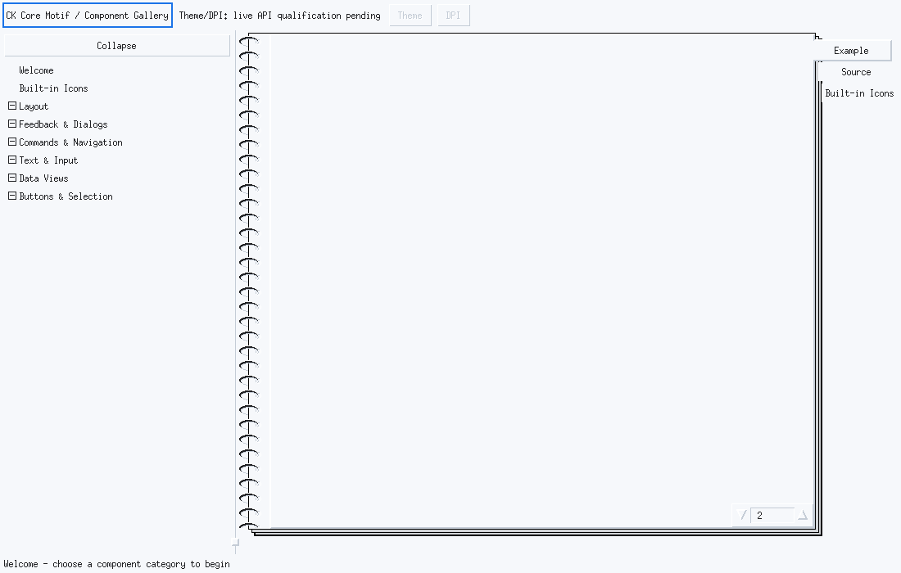
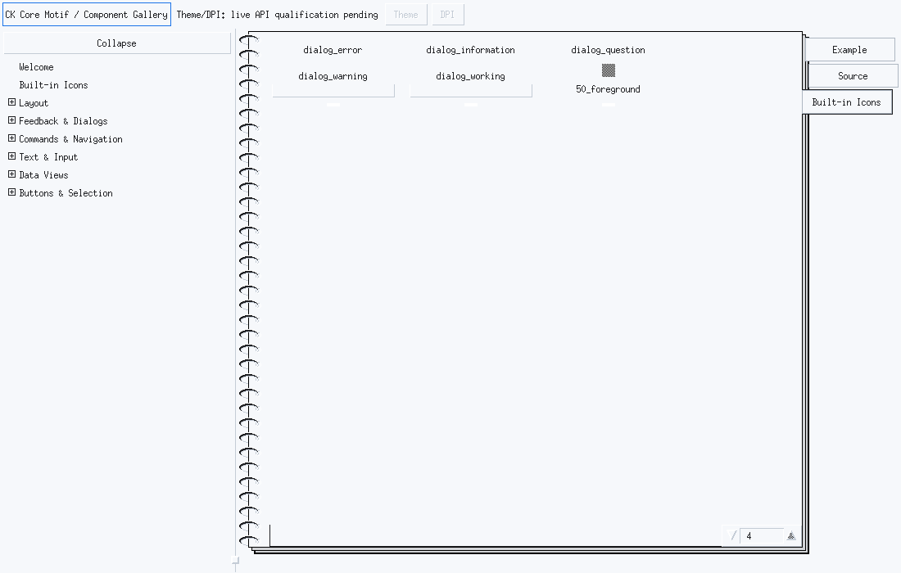
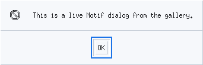
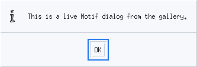
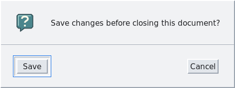
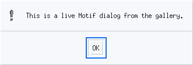
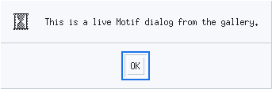
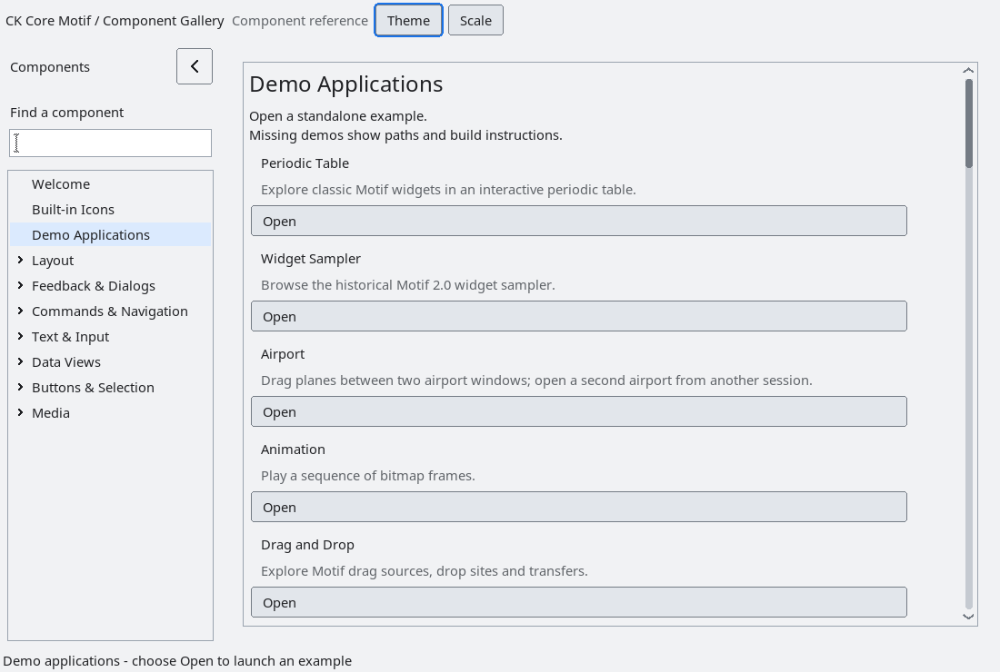
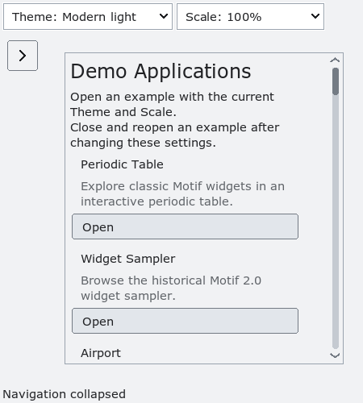

# CK Core Motif component gallery

`ckmotif-gallery` is the maintained native reference application for the
component inventory in [`modern-gallery-manifest.json`](modern-gallery-manifest.json).
The complete manifest-backed component catalogue (105 public classes, including
legacy public widgets) is in
[`modern-gallery-components.md`](modern-gallery-components.md).
The JSON manifest is the source of truth for navigation categories, example
owners, source-fragment IDs, interaction tests, documentation anchors, and
screenshot scenarios; the gallery build rejects incomplete records before it
generates its registry.

The gallery separates application navigation from the selected component's
**Example** and **Source** views. A searchable, resizable sidebar preserves
category disclosure and selection. Component pages use native labels and an
Xft render table, with 24-pixel inner margins, descriptive titles, API names,
and feedback beneath the live example. The view strip exposes **Example**,
**Source**, and **Built-in Icons**; every tab has a one-pixel gray outline when
inactive so the available views remain legible against the page. Source uses a
monospace rendition.

The preview preserves the control's natural proportions. Wide or tall controls
scroll within the preview instead of stretching small badges or clipping a
font selector. The preview tracks subsequent native size changes, including
expanded disclosure content. The classic decorated Notebook remains a populated component
example, rather than framing every page in the application.

The default appearance is `modern-light`. Explicit `--appearance` and `--scale`
options remain available for qualification. Live Theme/DPI controls are only
shown in builds that enable `CKMOTIF_GALLERY_ENABLE_LIVE_TRANSACTIONS`; the
ordinary gallery does not present disabled engineering controls in its header.

The native examples include populated data views, command discovery, meaningful
notifications, date/time values, labeled editing controls, enabled/disabled
buttons, checked/unchecked toggles, and real settings forms inside layout
managers. Popup examples have named triggers. Nonvisual inventory entries
explain their infrastructure role instead of presenting an empty interactive
example. Ordinary controls are operated directly; there is no generic
“Activate example” button.

`XmHierarchy` is classified as a base class: it manages hierarchy nodes but
does not lay them out. Its `XmOutline` and `XmTree` subclasses have populated
live examples. Optional classes absent from a build explain that state instead
of showing an empty preview marked ready.

Source pages are generated from annotated code in
`demos/programs/ckmotif-gallery/gallery_examples.c`, the same construction path
used by the application. The build's `gallery_provenance.json` records the
manifest and example-source hashes. `make check` checks the generated registry,
source fragments and catalogue links. Display-backed integration additionally
exercises component selection, filtering, page switching, callbacks, traversal
and focus restoration.

## Welcome and built-in icons

**Welcome** introduces navigation and keyboard use. **Built-in Icons** shows
the five dialog symbols with readable names. SVG-enabled builds use the
embedded vector artwork described in [SVG images](svg-images.md); other builds
show the original Motif bitmaps.





The SVG resource names are `dialog_error`, `dialog_information`,
`dialog_question`, `dialog_warning`, and `dialog_working`. Standard message-box
constructors select them automatically when SVG is enabled, after application
image overrides and before the built-in bitmap fallback.

## Dialog screenshots and constructors

These client-window screenshots are captured from the current SVG-enabled
gallery binary in a display-backed Linux session. Each uses the same public construction pattern; replace the
constructor name and dialog identifier as shown:

| Dialog | Constructor | Current screenshot |
| --- | --- | --- |
| Error | `XmCreateErrorDialog(parent, "errorDialog", args, count)` |  |
| Information | `XmCreateInformationDialog(parent, "informationDialog", args, count)` |  |
| Question | `XmCreateQuestionDialog(parent, "questionDialog", args, count)` |  |
| Warning | `XmCreateWarningDialog(parent, "warningDialog", args, count)` |  |
| Working | `XmCreateWorkingDialog(parent, "workingDialog", args, count)` |  |

For example:

```c
Arg args[2];
Cardinal count = 0;
XmString message = XmStringCreateLocalized("The operation needs attention.");
XtSetArg(args[count], XmNmessageString, message); ++count;
Widget dialog = XmCreateWarningDialog(parent, "warningDialog", args, count);
XmStringFree(message);
XtManageChild(dialog);
```

When available, the accessibility bridge attaches to the realized shell and
its tree role is checked by native integration. Optional capabilities such as
PrintShell retain inventory entries and explain when unavailable.

The source contract check is:

```sh
python3 tests/automated/check-gallery-source.py
```

The display-backed native interaction check is:

```sh
python3 tests/automated/run-gallery-integration.py
```

It reports a deliberate skip when no display-backed gallery binary is
available. It does not turn the pending live appearance/DPI work into a false
pass.

Screenshot scenarios can be exercised with a verified binary using:

```sh
python3 tests/automated/run-gallery-screenshots.py \
  --binary /absolute/path/to/ckmotif-gallery \
  --out /Volumes/S8T/tmp/ckmotif-gallery-screenshots
```

The runner selects each manifest component through `--component`, waits for its
process-ID and idle-readiness properties, verifies the window is viewable,
then captures that window with `xwd`. Capture readiness drains post-map expose
and configuration events as well as the initial application queue.
It skips when required runtime tools are absent and fails if a process exits or
never becomes ready. A successful capture is evidence of identity and readiness;
visual review remains required.
Pass `--appearance classic|modern-light|high-contrast|modern-dark` and
`--scale SCALE` to qualify an explicit profile and simulated display scale;
these options use the public toolkit transactions and are recorded in the
capture receipt.

The generated component catalogue links each manifest entry to its captured
PNG under `docs/gallery-screenshots/`. Capture receipts record the binary,
appearance profile, scale and image hashes; XWD files are temporary capture
intermediates.

The [layout and artwork validation record](gallery-ui-validation.md) summarizes
the native acceptance checks and screenshot provenance.


Example guidance follows the constructed demo. Passive labels, indicators and
presentation controls offer Theme/Scale comparison without an unused callback
status row. Interactive examples keep their feedback, and popup examples explain
how to open their window. Compact layouts preserve the distinction. Source
remains available for every class, including unavailable optional components
and infrastructure classes.

## Appearance selectors and preview replacement

The header provides read-only Theme and Scale combo boxes. Choose Classic,
Modern light or Modern dark directly, and Automatic, 100%, 150%, 200% or 300%
scale. A custom command-line scale is retained as an additional selectable item.
Changing either selection preserves the current example and page.

Preview replacement constructs its unmanaged native root before exchanging it
with the previous root using XtChangeManagedSet. The old example is destroyed
through the public example teardown after the replacement is ready. This avoids
an empty managed preview followed by repeated parent layout during construction.
See [buffered painting](buffered-painting.md) for the toolkit rendering contract
and its DBE/pixmap fallback.

At compact widths the header omits its decorative title and reflows the
selectors as needed; the native window title still identifies the gallery.
Selectors retain keyboard focus through theme/scale changes and responsive
navigation transitions. Popup menu examples are created unposted beneath their
invoker and posted with XmMenuPosition followed by XtManageChild, rather than
posting while the example is still being constructed.


## Standalone demo applications

Choose **Demo Applications** in the navigation, or start with
`ckmotif-gallery --component gallery.demos`. Each entry explains the example and
provides an **Open** button. The catalogue covers all 34 installed standalone demo targets, including the widget samplers,
application examples, drag-and-drop demonstrations, individual widget demos,
custom widget examples and Wsm.

The launcher checks the configured build directory and then the installed
`PREFIX/share/Xm/<demo>/<executable>` location, preserving case. It runs the
resolved executable directly, with its asset directory as the working directory
and the gallery's display and environment. One instance of each example can be
opened by a gallery at a time. Child exits are reaped and reported; closing the
gallery leaves independently opened examples running.

A missing or non-executable application produces a notice with the exact build
and install paths. Build and install the examples with `./configure
--enable-demos`, `make -j6` and `make install`. Examples are enabled by default;
`--disable-demos` retains the gallery while omitting the other demo applications.
The gallery remains usable with a partial installation.





The [native acceptance record](mwm-workspace-validation.json) includes the
captured binary and library identities and image hashes.

Additional build-only teaching examples live under `demos/doc/programGuide`,
and `demos/unsupported` contains `aicon`, `dainput`, `dogs`, another `hellomotif`,
`motifshell`, `uilsymdump`, `xmfonts`, `xmforc`, `xmform` and `xmapdef`.
These `noinst_PROGRAMS` targets are built with demos enabled and are kept in the
source/build tree; the installed application catalogue covers `bin_PROGRAMS`.

Panner can show the miniature desktop with this fork. Moving the desktop
requires the older virtual-screen extension, which this MWM does not advertise.
Its root-property context lookup uses pointer-sized storage and rejects display
indices outside its configured capacity.

Wsm requires MWM's standalone workspace protocol; see
[MWM workspace management](mwm-workspace-manager.md).


UID-based applications receive an asset search path containing their executable
folder and locale UID subdirectories, with an inherited `UIDPATH` taking
precedence. The international Hello example installs its language UID files,
including a portable `C` fallback, so its Open action works after installation.

Installed demo assets can be qualified independently of the build-tree copies:

```sh
python3 tests/automated/run-gallery-installed-demos.py \
  --build-root /absolute/idle/build --prefix /absolute/install \
  --out /absolute/fresh/evidence
```

Use an idle, task-owned build. This Linux/Xvfb test temporarily renames its
demo directory, restores it on exit, launches all 33 non-workspace demos through
the installed gallery, and checks its missing-app notice. Wsm has a separate
native protocol and workspace UI acceptance suite.

Gallery startup centers through a client-window configuration request and
preserves explicit geometry positions. It measures the outer frame through the
window hierarchy without moving the manager's base or frame windows. Native
captures verify that the client remains inside its decorated frame.

The core toolkit, WML, UIL, MWM and gallery support current C23 compilers.
Historical standalone demos still contain traditional C definitions; build
those consumers in the compiler's normal C mode or GNU C17. A global
`CC='clang -std=c23'` is not the legacy-demo qualification profile. These
consumers link to the same shared toolkit C ABI.
