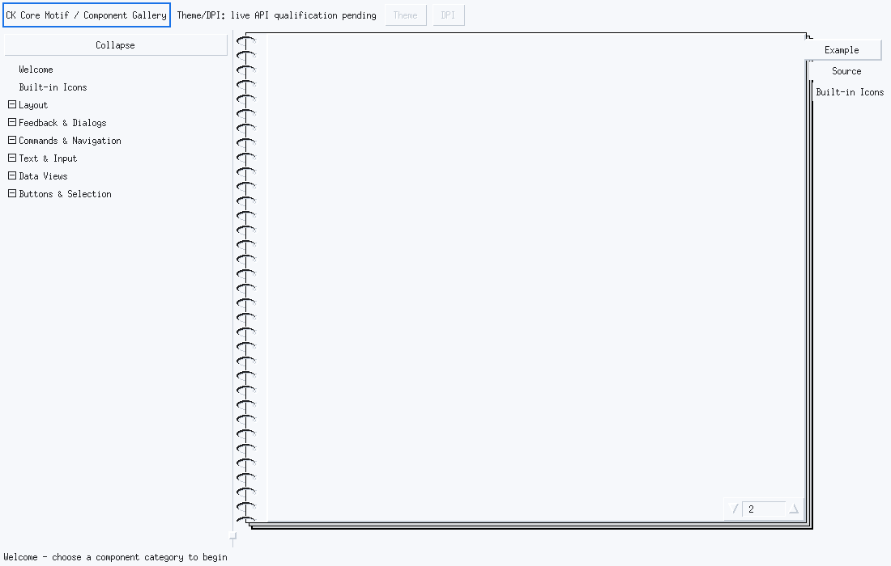
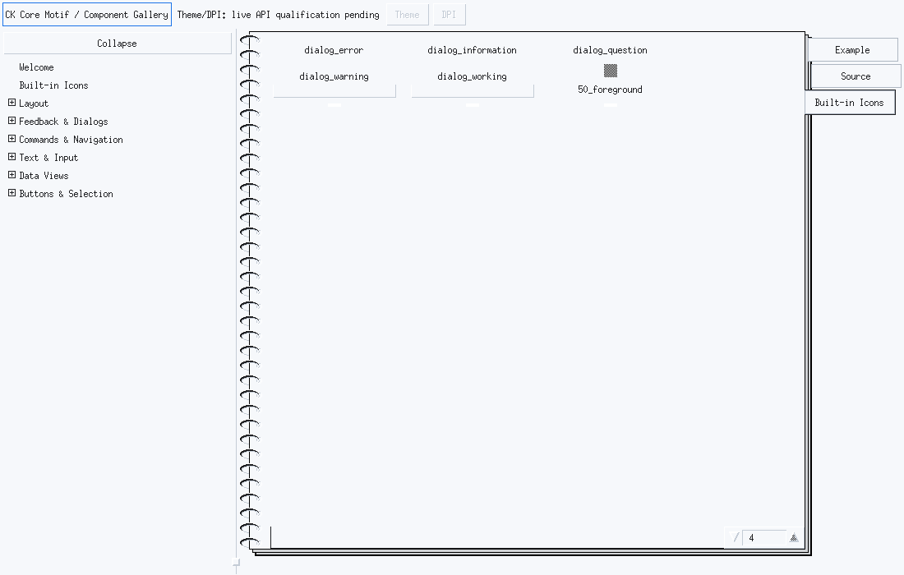
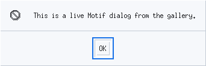
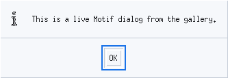
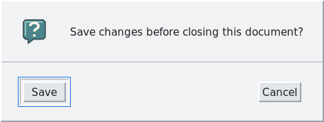
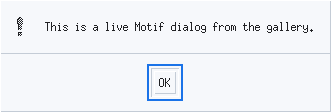
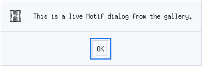

# CK Core Motif component gallery

`ckmotif-gallery` is the maintained native reference application for the
component inventory in [`modern-gallery-manifest.json`](modern-gallery-manifest.json).
The complete manifest-backed component catalogue (105 public classes, including
legacy public widgets) is in
[`modern-gallery-components.md`](modern-gallery-components.md).
The JSON manifest is the source of truth for navigation categories, example
owners, source-fragment IDs, interaction tests, documentation anchors, and
screenshot scenarios; the gallery build rejects incomplete records before it
generates its registry.

The shell is deliberately assembled from public toolkit interfaces:

- `XmSidebar` owns the collapsible navigation content;
- `XmTreeView` presents manifest categories and component entries;
- `XmNotebook` provides the **Welcome**, **Example**, and **Source** pages; and
- `XmStatusBar` reports selection, callback, and capability state.

The sidebar is the left pane of a horizontal split: categories and component
entries stay visible on the left while the selected live control occupies the
right pane.

Categories start collapsed and use conventional disclosure indicators: `+`
means the category is closed and `−` means it is open.  A component launched
with `--component` automatically opens its category so the selected child is
visible in the left navigation.

When launched with `--component xm.infobarwidgetclass` (or any other
constructible manifest ID), the gallery creates the Example page only after
the notebook's Example, Source, and Built-in Icons tabs are registered.  This
ensures the requested live control is displayed immediately rather than
leaving the notebook on Welcome.  Manager examples are populated with their
real child controls; for example, TabStack shows selectable Overview, Details,
and Activity pages.
The Toolbar entry likewise uses real `XmToolbarAction` records for Open, Save,
Print, and Undo, with their keyboard shortcuts visible through the native
overflow-aware toolbar.  Its visible actions also use native 16x16 pixmaps;
the additive `XmToolbarSetActionIcons` API keeps those pixmaps borrowed so
existing action-model callers remain source and ABI compatible.
Layout-manager entries are populated with colored Header, Content, and Footer
panels so their geometry is visible and inspectable rather than an empty frame.
TreeView, DataGrid, and Calendar entries are also backed by small real models
and dates through their public APIs, so data-view pages show actual rows,
selection, hierarchy, and calendar state.

Startup opens the first sidebar item as a dedicated welcome screen with
“Hello world!” in English, German, Japanese, and Chinese.  The CJK lines are
drawn through the toolkit's Xft-backed path using installed fallback fonts, so
the gallery exercises real Unicode glyph rendering rather than displaying
encoded byte sequences or metadata.

The native integration mode exercises sidebar collapse/restore, manifest
selection across every available constructible entry, notebook page
switching, generated-source lookup, callback delivery, status-bar updates,
keyboard traversal, and focus restoration. Shell-class entries use public
Xt popup-shell construction; ordinary widget and gadget entries use their
manifest-bound public class pointer and invoke the first available semantic
public callback (with a help callback fallback).

## Welcome and built-in icons

The first item in the left sidebar is **Welcome**; it is a real first page,
not a component tab. The next item, **Built-in Icons**, renders the standard
Motif dialog bitmaps in a grid and prints each resource name below its image.





The dialog bitmap names are also the names accepted by `XmGetPixmap`:

```c
Pixmap question = XmGetPixmap(XtScreen(parent), "dialog_question",
                              BlackPixelOfScreen(XtScreen(parent)),
                              WhitePixelOfScreen(XtScreen(parent)));
Widget dialog = XmCreateQuestionDialog(parent, "question", args, count);
```

The corresponding constructors for the other standard dialog types are
`XmCreateErrorDialog`, `XmCreateInformationDialog`, `XmCreateWarningDialog`,
and `XmCreateWorkingDialog`. Their dialog-type bitmaps are shown together on
the Built-in Icons page so applications can compare the actual Motif assets.

## Dialog screenshots and constructors

These screenshots are captured from the current gallery binary under the
source-built MWM. Each uses the same public construction pattern; replace the
constructor name and dialog identifier as shown:

| Dialog | Constructor | Current screenshot |
| --- | --- | --- |
| Error | `XmCreateErrorDialog(parent, "errorDialog", args, count)` |  |
| Information | `XmCreateInformationDialog(parent, "informationDialog", args, count)` |  |
| Question | `XmCreateQuestionDialog(parent, "questionDialog", args, count)` |  |
| Warning | `XmCreateWarningDialog(parent, "warningDialog", args, count)` |  |
| Working | `XmCreateWorkingDialog(parent, "workingDialog", args, count)` |  |

For example:

```c
Arg args[2];
Cardinal count = 0;
XmString message = XmStringCreateLocalized("The operation needs attention.");
XtSetArg(args[count], XmNmessageString, message); ++count;
Widget dialog = XmCreateWarningDialog(parent, "warningDialog", args, count);
XmStringFree(message);
XtManageChild(dialog);
```

When the public accessibility bridge is available, the gallery attaches it to
the realized shell and verifies the navigation tree's semantic role during
the native integration run. The optional AT-SPI transport remains optional;
normal gallery operation does not depend on it.

Source pages are generated from annotated code in
`demos/programs/ckmotif-gallery/gallery_examples.c`. They are not copied UI
strings. The excerpt includes the public construction path, semantic callback
selection (activate/value-change/help fallback), and public `XtDestroyWidget`
teardown used by the live example. The component class pointer, source ID,
interaction ID, documentation anchor, and screenshot ID remain linked to the
same manifest record.

Compound controls are populated with real public models before they are shown.
For example, the segmented-control entry renders three selectable segments —
`Overview`, `Details`, and `Activity` — and selects `Overview`; it is not a
metadata-only placeholder. The same construction block powers the live
component pane and its Source tab.

The same rule applies to the other data-driven controls: lists and combo boxes
receive sample rows, text controls receive editable text, and numeric,
progress, rating, color, breadcrumb, suggestion, notification, and status
controls are initialized through their public setters/resources. Every
constructible manifest entry therefore renders a control or a live child
surface in the Example tab; entries that are intentionally non-constructible
remain explicitly marked as such.

The toggle-switch entry uses a symmetric, scanline-rendered rounded track and
knob rather than X11 arc pairs (which can produce one-pixel asymmetry). Its
Motif presentation is a compact outlined pill with an explicit `Off` label;
the selected state uses the profile highlight color. The gallery shell also
accounts for the source-built MWM frame when centering its initial 1100x700
window, so the decorated window has equal virtual-screen margins.

Each gallery build also emits `gallery_provenance.json`, including the manifest
and annotated-source hashes plus one record for every component. `make check`
rejects stale hashes, missing IDs, duplicate records, or drift in any of the
source/test/docs/screenshot references.

The toolkit now exposes public `XmApplyAppearanceProfile` and display-scale
transaction APIs. The gallery wires its Theme and DPI callbacks to those APIs
behind `CKMOTIF_GALLERY_ENABLE_LIVE_TRANSACTIONS`, but the default build keeps
the controls disabled while the WP-05 qualification matrix is incomplete. In
the default build the status output says that qualification is pending; the
gallery never simulates a transition or claims that it works early.

`PrintShell` is emitted behind `PRINTING_SUPPORTED`; a print-disabled build
keeps the inventory and navigation entry but reports the capability as
unavailable instead of referring to a missing class symbol.

The source contract check is:

```sh
python3 tests/automated/check-gallery-source.py
```

The display-backed native interaction check is:

```sh
python3 tests/automated/run-gallery-integration.py
```

It reports a deliberate skip when no display-backed gallery binary is
available. It does not turn the pending live appearance/DPI work into a false
pass.

Screenshot scenarios can be exercised with a verified binary using:

```sh
python3 tests/automated/run-gallery-screenshots.py \
  --binary /absolute/path/to/ckmotif-gallery \
  --out /Volumes/S8T/tmp/ckmotif-gallery-screenshots
```

The runner selects each manifest component through `--component`, captures the
named gallery window with `xwd`, and skips when the required runtime is absent.
Pass `--appearance classic|modern-light|high-contrast|modern-dark` and
`--scale SCALE` to qualify an explicit profile and simulated display scale;
these options use the public toolkit transactions and are recorded in the
capture receipt.

The generated component catalogue links each manifest entry to its captured
PNG under `docs/gallery-screenshots/`. The XWD captures are retained beside
the PNGs as native evidence when the gallery is qualified on a display-backed
host.
