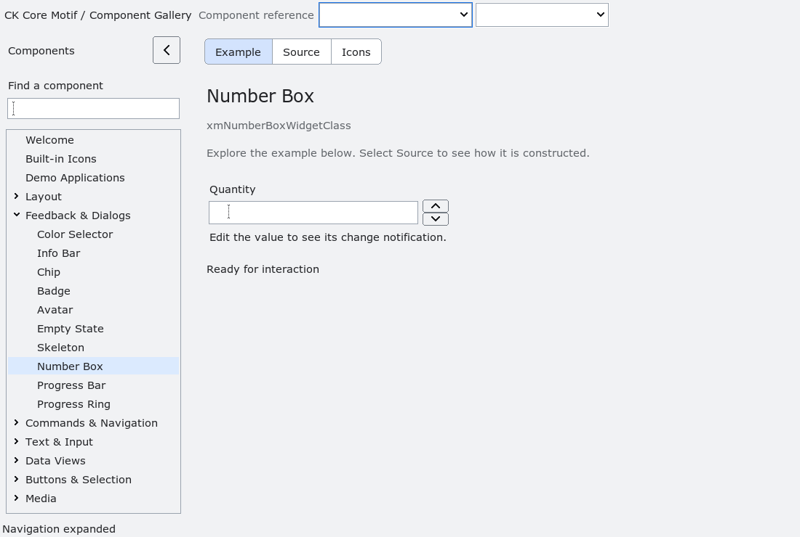

# NumberBox

`XmNumberBox` is an additive bounded integer entry and spin control. Its
numeric contract is deliberately explicit: values are signed integers,
`XmNnumberMinimum`/`XmNnumberMaximum` define an inclusive range,
`XmNnumberStep` and `XmNnumberPageStep` define keyboard and pointer increments,
and `XmNnumberWrap` controls boundary wrapping. Existing `XmTextField` and
`XmSpinBox` resources and records are unchanged.

The visible text is a tentative edit in a native `XmTextField`. Caret movement,
selection, clipboard operations and text rendering use the existing text-field
implementation. Return commits, Escape restores the committed value, and
Up/Down and PageUp/PageDown step the numeric value. A complete edit is committed only when it parses and is
inside the configured range. Invalid text remains visible, sets
`XmNumberBoxIsInvalid`, and invokes `XmNnumberInvalidCallback`; it is never
silently converted to another value. Programmatic setters normalize and
format the committed value.

`XmNnumberValueChangedCallback` receives normalized range, value and step
information. Explicit setters and stepping accept a `notify` flag. The
control composes a text field and two native arrow buttons. Focus traversal
enters the editor. `XmNumberBoxGetTextField` returns the borrowed editor for
standard text-field operations; the NumberBox owns its lifetime. An invalid
commit leaves the tentative text visible and displays the permitted range.
The manager's private layout replaces the former Primitive record in the
pending ABI-9 development cohort. Rebuild private-record consumers.

Natural size follows native editor/font metrics and range width. Explicit width
and height remain independent; zero returns an axis to automatic sizing.
The spin column moves to the left in RTL. Modern spacing defaults to 4 logical
pixels in comfortable density and 2 in compact density. The gallery supplies
no size override. Standard editor activation commits just like Return.

An explicit `XmNforeground` on NumberBox is inherited by its editor, arrows and
validation message. A child's own resource-file or explicit foreground takes
precedence, including a setter whose value equals the current inherited colour.
Without an explicit parent colour, each child follows the selected appearance
palette. The text field retains its own background surface. These ownership
rules apply at creation and during live profile, density and scale changes.

Value and invalid-input notifications stop when a callback destroys the
control. Callback registration changes take effect on the next dispatch.
Callbacks on the borrowed editor may destroy the NumberBox during SetValue,
SetRange or Step; formatting then stops without accessing the destroyed owner.

The accessibility provider exposes a spin-button role, committed numeric value,
inclusive bounds and configured increment. Named increment/decrement and page
step actions use the native callback path; numeric writes replace tentative text
and clear validation. See [Native accessibility](accessibility.md#numeric-values-and-native-scroll-bars).
The installed Xvfb fixture covers range normalization, stepping,
wrapping, programmatic clamping, focus, explicit sizing and accessibility.

<!-- gallery-demo-tabs: begin -->
## Component demo

Captured gallery example and its corresponding source excerpt.

::: tabs
== Demo

== Source

Actual gallery excerpt: class = xmNumberBoxWidgetClass.
The host supplies parent, name, callback and client_data.
Shared factory locals: Widget example; XmString label = NULL.
The shared factory frees label, attaches callbacks and sizes the preview.
Helpers and the complete factory are in gallery_examples.c.

<<< @/demos/programs/ckmotif-gallery/gallery_examples.c#L335-L342

<<< @/demos/programs/ckmotif-gallery/gallery_examples.c#L494-L496

<<< @/demos/programs/ckmotif-gallery/gallery_examples.c#L1108-L1111

[Complete demo source](../demos/programs/ckmotif-gallery/gallery_examples.c) · [Public header](../lib/Xm/NumberBox.h)

:::
<!-- gallery-demo-tabs: end -->
