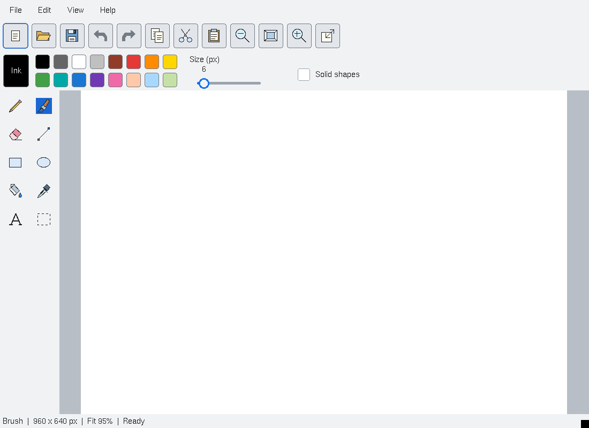
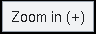

# Paint drawing demo

The `draw` executable is a raster drawing application with a compact action bar,
color palette and left-hand tool panel. The default 960 × 640 document fits the
available canvas viewport. Resizing the window does not resize or distort the
picture. Explicit zoom enables horizontal or vertical scrolling only when the
scaled picture exceeds the viewport; **Fit** removes the need to scroll.



## Tool layout and icons

The left-hand tools use a compact two-column grid, while the action bar uses
square icon buttons. All 22 tool/action buttons expose hover tooltips; action
tips include keyboard shortcuts. The palette uses two rows of square swatches,
with separate current-ink, size and solid-shape controls.

Original classic-style icon geometry is in `paint-icons.c`. It rasterizes at the
widget's display scale without external assets or an SVG dependency. Each button
owns its normal, active and disabled pixmaps and frees them on destruction.
Both the icon viewport and its visible artwork are centered, with equal margins;
the toolbar explicitly requests centered entry alignment. Native tests measure
pixel bounds, padding and image alignment, and verify actual hover popup text
under classic and 150% modern styling. Tooltips show the full text and a subtle outline in the
first frame; a brief timed reveal expands the padding only; see [tooltip popup geometry](tooltip-child-allocation.md).

A tooltip captured from the running application:



## Drawing and editing

- **Pencil**, **Brush**, **Eraser**, **Line**, **Rectangle** and **Ellipse** draw
  directly into the document. Shape drags preview until release. Pencil uses one
  pixel; Size controls the other tools. Solid shapes fills rectangles/ellipses.
- **Fill** changes a connected region; **Eyedropper** picks an existing color.
  The palette provides sixteen colors; **Ink…** accepts a custom `#RRGGBB` value.
  The right button draws white, including for shapes and fill.
- **Text** places an X11 bitmap-font label at the clicked location.
- **Select** marks a rectangle. **Copy** and **Cut** retain its pixels in an
  application-local clipboard; **Paste** places them at the next canvas click.
- **Undo/Redo** retain sixteen edits. A new edit after undo discards the redo
  branch. **Canvas size** crops or extends the raster without scaling its
  content, and is also undoable. Dimensions are bounded to 1–4096 pixels.
- **Escape** cancels a drawing gesture or a pending paste. **Delete** clears the
  selection or, if there is none, the canvas; clearing can be undone.

Keyboard commands are Ctrl+N/O/S, Ctrl+Shift+S, Ctrl+Z/Y, Ctrl+C/X/V, `+`/`-` for
zoom and `0` for fit. The in-application Help menu describes the same workflow.

## Files and resource ownership

Every build reads/writes uncompressed 24-bit BMP. With the existing configured
libpng dependency, PNG is supported too. The save extension selects the format;
unsupported extensions produce an error. PNG alpha is composited onto white.
Failed or truncated input leaves the current document untouched. Saving writes
and closes a sibling temporary file before renaming it over the destination.
New/Open/Quit ask before discarding changes; Save As asks before replacing a file.
Canceling an Open dialog after a discard prompt retains the old dirty document.

The RGB document, history and selection clipboard are independent of X11 pixmaps
and widget geometry. Expose events reconstruct the visible raster; zoom changes
only the view transform. The app requires a TrueColor X11 display. It does not
import the former demo's resource-encoded polylines or embedded button objects.
No toolkit ABI is changed by this demo replacement. Gallery launches retain the
normal appearance/density/scale resources.

## Validation

From the repository root, with an installed toolkit and XQuartz/Xvfb:

```sh
python3 tests/automated/run-paint.py \
  --prefix /path/to/install --out "$TMPDIR/paint-check"
```

Use a fresh, host-policy-compliant output directory. The runner records source
and library fingerprints, exact compiler commands, output path, build/test times
and exit statuses. Address/undefined-behavior sanitizers cover the raster model
and application fixture. Native XTest input exercises strokes, shape previews,
tool selection, selection/paste, erasing, zoomed coordinates, scrolling and fit.
It also verifies document preservation across window resizing, canvas resizing,
bitmap text and undo. Model checks cover flood fill, clipped paste, bounded
history, branch edits, PNG/BMP round trips and malformed-input preservation.
