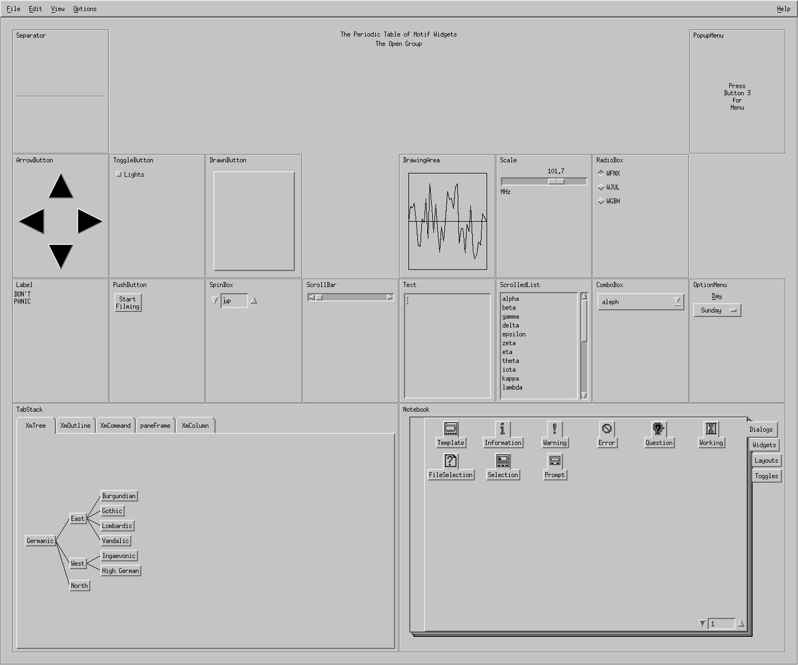
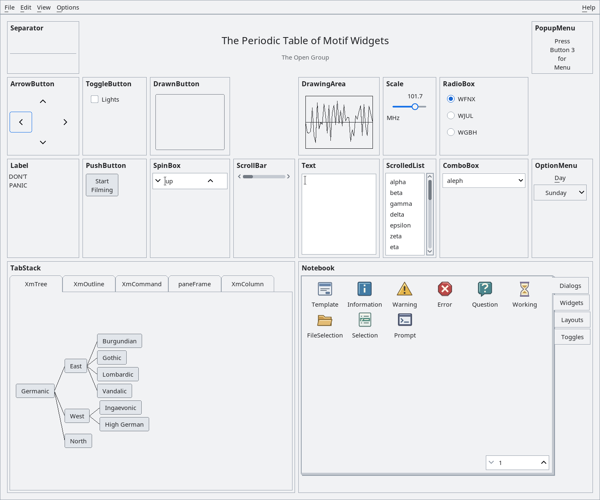
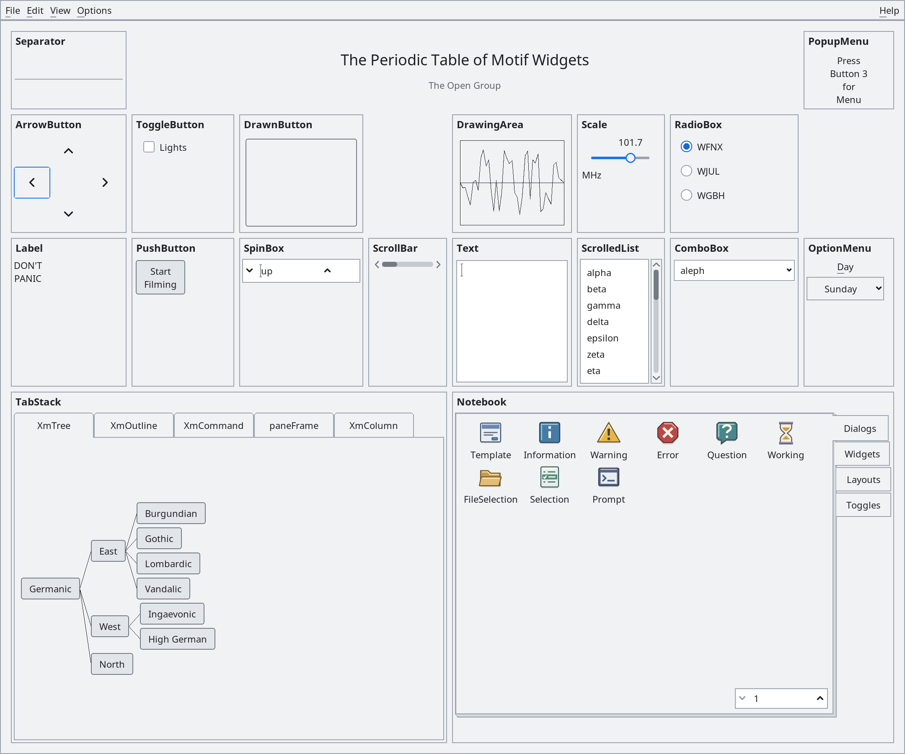
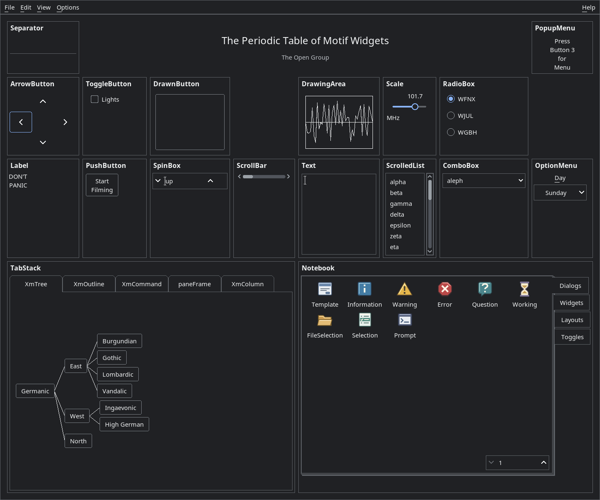
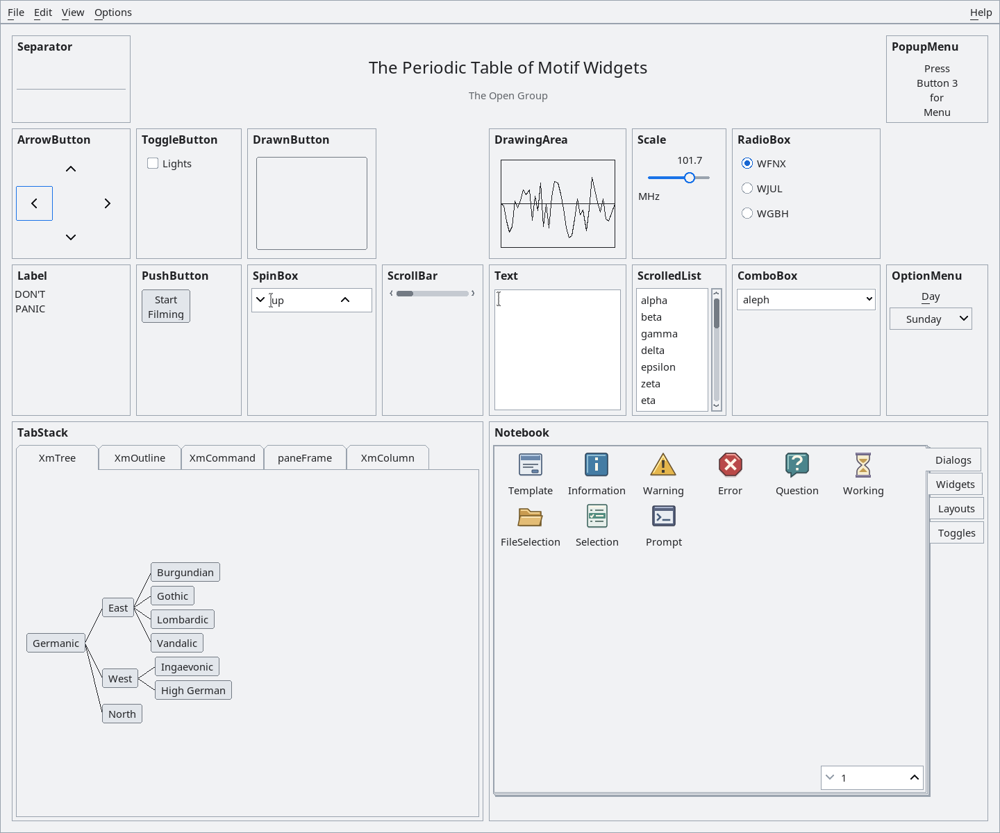
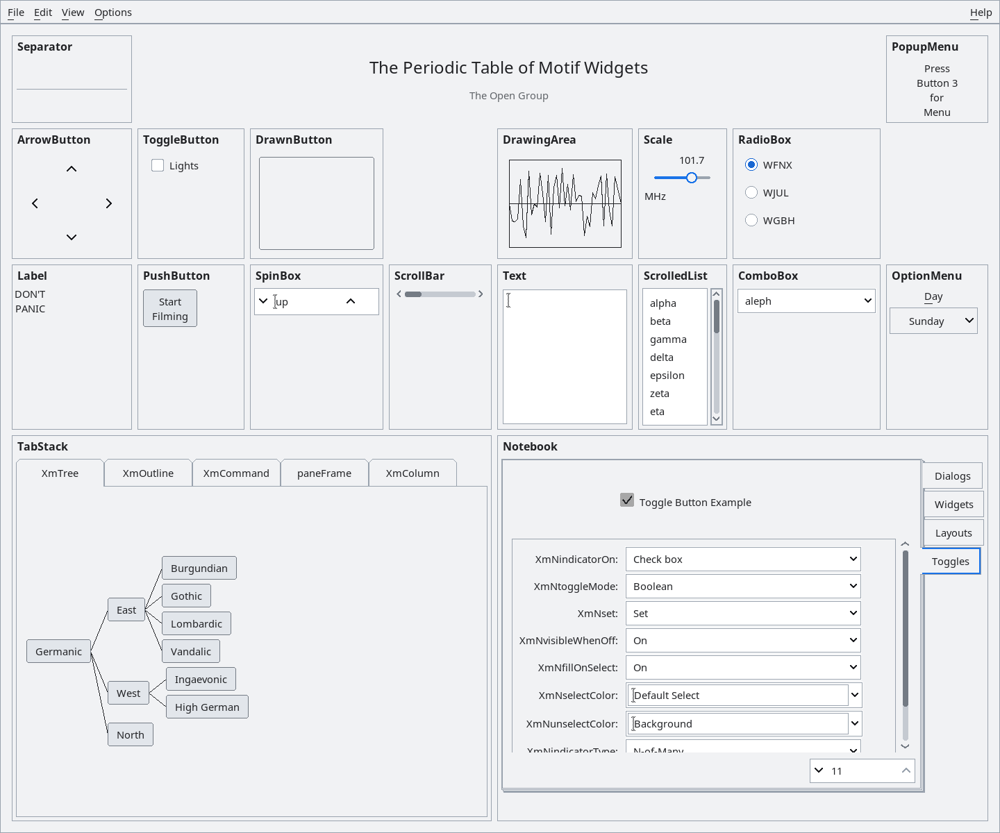
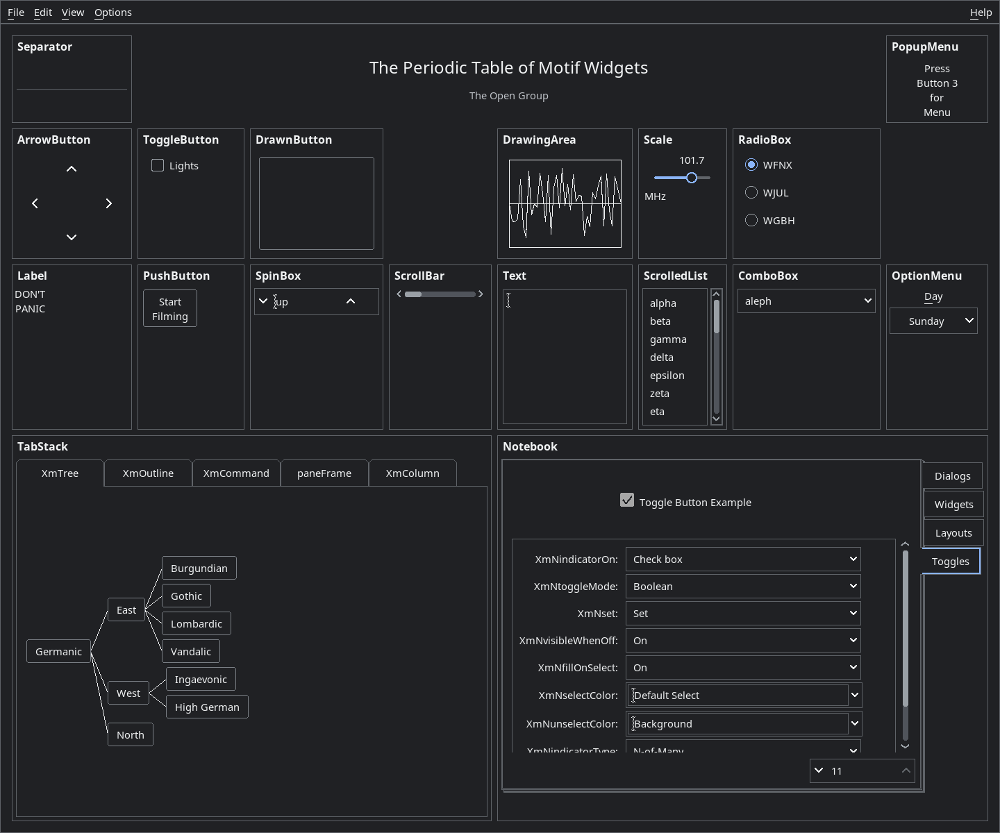
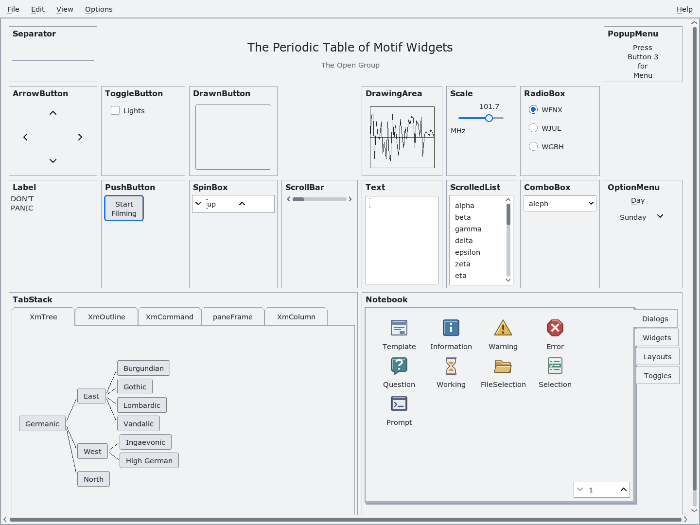
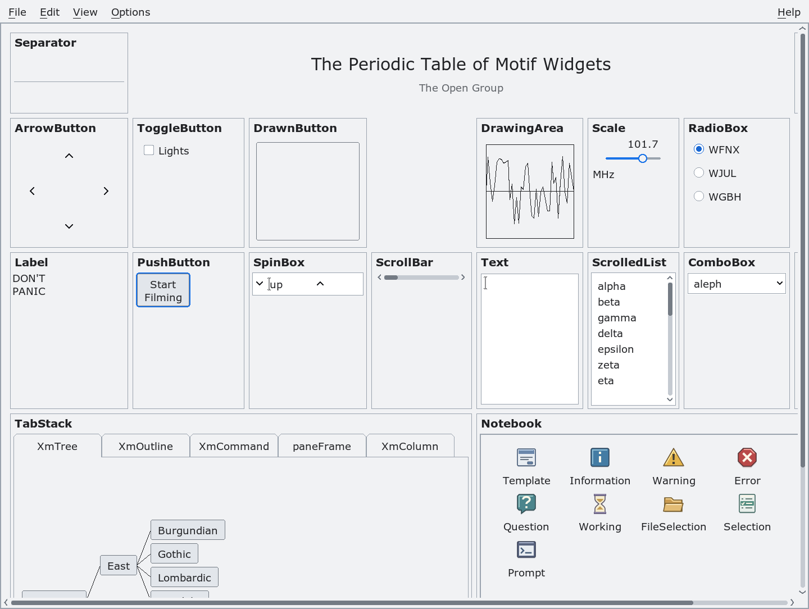

# Periodic Table as a toolkit appearance reference

The [menu action guide](periodic-menu-actions.md) covers working document,
clipboard, search, wrapping, direction, calendar, help and local message actions.

`demos/programs/periodic` now starts with toolkit modern-light defaults. Use
`--appearance modern-dark`, `--appearance high-contrast`, `--appearance classic`
or `--density compact` to compare the same UIL hierarchy. Its modern resource
class is `XmdPeriodicModern`; it supplies no fallback font, color, border or
control-size overrides. The UIL retains ownership of content and arrangement.

`--historical-resources` instead selects classic appearance, the original
fallback resources and application class `XmdPeriodic`. It can load the supplied
`XmdPeriodic.ad` file from an app-defaults directory. Combining this mode with a
non-classic appearance is an error. Historical resources should not be merged
into a global wildcard database when comparing toolkit defaults.

Appearance and density are selected after opening the display and before creating
the session shell: shell initialization itself can create internal Motif objects.
All fetched controls, menus and dialogs then observe the selected settings.
A profile or density already selected through Xt resources is adopted unless
an explicit Periodic option selects it. This permits gallery-launched dark,
classic and compact instances while retaining modern-light as the standalone
default. Standard Xt options and explicit resources remain authoritative. Missing UID
files and failed hierarchy construction are reported with a failing exit status.
The realized shell publishes `_NET_WM_PID` for actual-process visual verification.
The overview fills the MainWindow work area. Variable-layout MainWindow instances
do not require an internal clip child; the nested automatic ScrolledWindow owns
the overview clip. Native acceptance checks the work-area width at startup.

## Appearance comparison

These are captures of the same native Periodic application and UIL hierarchy,
not redrawn mockups. Each uses a 1440 × 1200 logical-pixel window: 1440 × 1200
at 1× and 2160 × 1800 at 1.5×. This keeps the complete table and notebook footer
in view while scaling the actual toolkit fonts, controls and native window. The modern-light and modern-dark views are refreshed from the qualified
integration build. Capture fingerprints are recorded per variant.

::: tabs
== Classic

Classic toolkit defaults at 96 DPI (1×), without historical app-default styling.

== Modern

Modern light at 96 DPI (1×), comfortable density.

== Modern scaled

Modern light at 144 DPI (1.5×), with the same logical viewport.
Open the image at full resolution to inspect native pixel geometry.

== Modern dark

Modern dark at 96 DPI (1×), comfortable density.

== Compact

Modern light at 96 DPI (1×), compact density.

:::

The [capture manifest](periodic-screenshots/manifest.json) records profile,
scale, density, logical and physical viewports, and executable/library/UID/image fingerprints. Captures
verify the realized window's PID and loaded library. Recreate the comparison
with `scripts/capture-periodic-docs.py` using a verified build record.

The PopupMenu demonstration uses its existing section frame without an extra
hard-coded X window border around the instruction label. Historical-resource
mode retains that original inner border through its own resource defaults.

## Toolkit defects exposed by this reference

Static labels and label gadgets consistently opt out of keyboard traversal in
modern light and dark. A title is not an actionable control; interactive
subclasses retain their normal traversal and applications may opt labels in.

Ordinary and option RowColumns do not accept nonzero shadows. Profile resolution
now preserves their class baseline instead of repeatedly asking SetValues to
reject a theme shadow. Popup, pulldown and menu-bar shadows remain styled.

Classic Periodic startup exposed a List geometry loop with no progress for
zero-height rows and zero spacing. A Dimension-sized accumulator could also
wrap at large available heights. Query and resize now share measured row-height
resolution and a widened quotient. Rows occupy at least one pixel, including
empty lists without an available default font; at least one row is reported for
an undersized viewport. No iteration proportional to the viewport is required.

The actual light/dark windows exposed missing labels even when startup/resource
checks passed. A tag-cache input guard rejected `XmSTRING_TAG_STRLEN` (`-1`),
which is a valid sentinel, so a fresh cache returned null font tags. The guard
now distinguishes that sentinel from invalid negative lengths. Native coverage
starts with an empty tag cache, checks sentinel/bounded tag equivalence, and
requires positive measured extents for a real default-font label. UIL resources
must be regenerated with the corrected library; both UIL input files are now
explicit build dependencies.

## Notebook property editor

The Toggles page uses the native `XmColumn` form layout. Each selector owns its
entry label, so label widths and control widths are measured separately rather
than forced into two equally wide columns. The form follows the scrolled
viewport width while retaining vertical scrolling for the remaining settings.
This keeps selector arrows reachable without horizontal scrolling at the
reference viewport, including high contrast and scaled rendering. Colors,
fonts, borders and row measurements remain toolkit-owned.

::: tabs
== Modern light

== Modern dark

:::

## Native validation

Run `tests/automated/run-periodic-appearance.py --build /absolute/build --out
/absolute/fresh-output` on Linux after building Xm, Mrm, UIL and Periodic. The
fixture compiles the actual demo startup and substitutes only its event loop to
inspect the realized hierarchy. It checks light, dark, high contrast, compact,
classic, historical resources and explicit color overrides, including menu and
dialog resources. A historical app-defaults file is installed for the test to
verify class isolation. Zero, one and maximum row heights are queried with a
maximum viewport; startup errors are tested separately. Receipts record source
and loaded library hashes. Xvfb readiness is obtained through its display pipe.

This startup/resource acceptance does not establish visual-overhaul completion.
Default typography, semantic roles, control geometry, redesigned controls and the
full actual-window state/DPI matrix remain in `modern-visual-overhaul.md`.

## Overview layout in development

Modern modes use a scrollable periodic table. Column and row tracks are
measured from the demonstrated controls and frame headings after realization;
wide notebook/tab examples span their existing columns. Window resizing can
expand the tracks but cannot shrink them below their measured content sizes.
Small windows expose scrollbars instead of squeezing text or hiding radio
options inside cells. Classic and historical-resource modes retain their
original layout.

Drawing surfaces and the arrow arrangement have deliberate sample areas,
because those canvases have no intrinsic content dimensions. The multiline
text sample presents ten columns/four rows, and the combo sample ten columns;
these are application content budgets, not theme font/color overrides. The
layout uses the toolkit spacing API and preserves the original periodic
relationships. Keyboard traversal scrolls obscured controls into view, with
initial focus at the first interactive example in table order.

Native acceptance includes all startup/profile modes, 1.5x scaling, narrow/wide
resize round trips, bounded event processing, frame-heading widths and complete
radio-option bounds. The layout exposed an as-needed scrollbar fit oscillation;
see [Stable scrollbar fit](scrolled-window-fit.md) for the independent toolkit
fix. Control styling and complete dialog/page visual qualification remain in
progress; these development screenshots are not the final design acceptance.

## Natural sample controls

The PushButton and ToggleButton samples attach their leading and top edges to
their containing forms. Their opposite edges remain free, so their preferred
sizes come from the toolkit rather than percentages of the table cell. The
native Periodic regression compares their allocations to `XtQueryGeometry`
after repeated window resizing in each non-classic appearance variant.

## Dialog example artwork

Modern modes request the toolkit's nine embedded dialog SVGs instead of the
separate UIL bitmap pictures. The cache flattens each image onto its icon
background and chooses the display scale; the demo releases its cache references
when the icons are destroyed. Template, file selection, selection and prompt
have their own artwork alongside the five standard message symbols. Classic
and historical modes retain the original pictures, as do builds without SVG.
The Periodic startup regression checks the assigned icon cache identities in
modern modes and the retained bitmaps in classic/historical modes.

This artwork change is under native qualification.

The DrawingArea overview sample uses the section frame directly. Its plot
boundary remains part of the drawing demonstration; an additional inset frame
with an explicit two-pixel bevel has been removed. This structural simplification
applies to classic and modern variants without overriding toolkit style defaults.

Overview controls use consistent top alignment within their section work areas.
The SpinBox, ComboBox and horizontal ScrollBar no longer use a 50-percent bottom
attachment, and the Scale no longer uses a 15-percent top offset. The Label keeps
its natural size instead of filling the cell. Fonts, control rendering and
appearance defaults remain owned by the toolkit.

The [message dialog review](messagebox-symbol-palette.md) shows the actual
Information dialog in light/dark tabs and explains the shared symbol-palette fix.

## Push-button feedback

The overview **Start Filming** sample changes to **Stop Filming** when activated
and returns to **Start Filming** on the next activation. This demonstrates a
reversible command; it does not access a camera or create a recording. Modern
profiles show the arm color while held and restore the normal face on release.
The persistent label change also makes short clicks observable.

The native Periodic fixture requires XTest (`libXtst`) and exercises the actual
UIL button with mouse press/release and the focused Space key. It checks pressed
and released pixels, both label transitions, profile overrides and teardown.

Unspecified modern window dimensions default to a usable scaled viewport, clamped
to the screen. Explicit width/height resources and `-geometry` remain authoritative.

## Font size menu

**Options → Font → Small / Medium / Large** changes this application's existing
fonts to 85%, 100% or 125% of their original size. Controls, menu panes, cached
gadgets and pre-created dialogs participate. Medium restores the original font
tables exactly, so repeated choices do not accumulate scaling.

This is a text-size preference: the selected appearance profile, display scale,
density and current control values remain unchanged. Xft renditions retain their
font families, weights and text tags. Legacy bitmap fonts use scalable outline
substitutes in Xft builds, normalized to their original line height. Builds
without Xft use available scalable X11 fonts.

The modern overview recomputes its track budgets from the original measurements
and chosen font factor. Enlarged examples can scroll; returning to Medium also
restores the original minimum track sizes. The native fixture checks actual
control/menu/text/dialog font metrics, repeated Small/Large/Medium choices, Xft
family and weight, unchanged theme/scale, enlarged bounds and teardown.

The shell permits normal resize negotiation so menu labels can request their new
width and height. After the batch, Periodic calls `XmContainerRelayout` for its
spatial icon pages. That API recomputes automatic cell dimensions from current
item geometry while preserving explicit cell dimensions. This keeps enlarged
icon labels separate.

