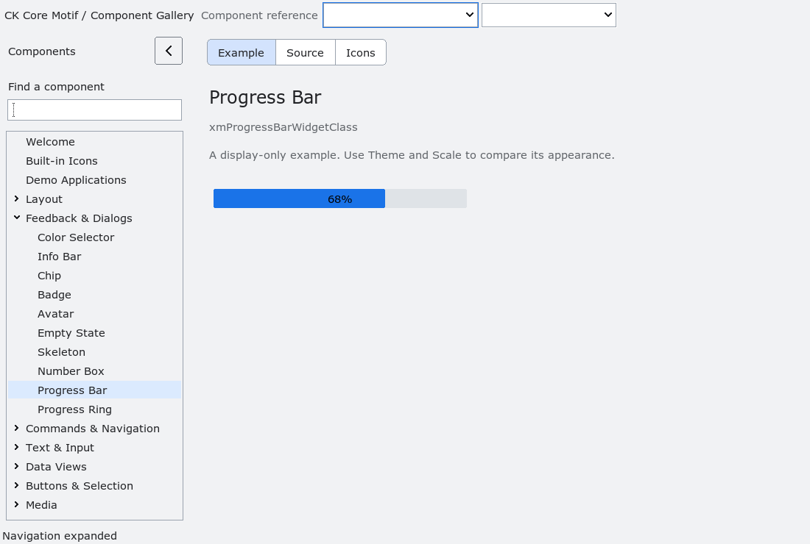

# ProgressBar

`XmProgressBar` is an additive, resource-driven progress control. It keeps the
existing Xt/Motif object model intact while providing a small, typed state
contract for determinate and indeterminate feedback.

<!-- gallery-demo-tabs: begin -->
## Component demo

Captured gallery example and its corresponding source excerpt.

::: tabs
== Demo

== Source

Actual gallery excerpt: class = xmProgressBarWidgetClass.
The host supplies parent, name, callback and client_data.
Shared factory locals: Widget example; XmString label = NULL.
The shared factory frees label, attaches callbacks and sizes the preview.
Helpers and the complete factory are in gallery_examples.c.

<<< @/demos/programs/ckmotif-gallery/gallery_examples.c#L505-L508

[Complete demo source](../demos/programs/ckmotif-gallery/gallery_examples.c) · [Public header](../lib/Xm/ProgressBar.h)

:::
<!-- gallery-demo-tabs: end -->

## State contract

The `XmNprogressMinimum`, `XmNprogressMaximum`, and `XmNprogressValue`
resources are integer values. A maximum below the minimum is normalized to the
minimum, and values outside the resulting range are clamped. The same rules
apply to `XmProgressBarSetRange` and `XmProgressBarSetValue`.

`XmNprogressIndeterminate` selects a busy presentation. It does not create a
worker thread or a global event loop; applications that need animation should
use a separate bounded activity control. `XmNprogressTextVisible` controls the
percentage text, while `XmNprogressLabelString` supplies the descriptive
label.

The `XmNprogressValueChangedCallback` callback receives an
`XmProgressBarCallbackStruct` containing the normalized minimum, maximum,
value, and indeterminate state. The explicit setters accept a `notify` flag,
so applications can batch updates without generating intermediate callbacks.

## Accessibility

The accessibility provider exposes the control as a progress-bar role with a
numeric minimum, maximum, current value, and increment of one. Indeterminate
controls expose the busy state. The label is taken from
`XmNprogressLabelString`; progress controls do not expose actions.

## Geometry and appearance

Explicit `XmNwidth` and `XmNheight` values are honored. When omitted, the
control derives a compact size from the label and its spacing resource. Drawing
uses the current primitive foreground, bottom-shadow, background, render table,
focus state, sensitivity, and layout direction, so theme and high-contrast
profiles remain owned by the application.

## Verification

`tests/automated/run-progress-bar.py` builds and runs
`tests/automated/check-progress-bar.c` under Xvfb. The fixture covers explicit
dimensions, range normalization and clamping, notifications, indeterminate
state, focus/sensitivity, accessibility values and busy state, callback
re-entry, and widget teardown.

## Modern rendering

`XmNrenderTable` selects the copied render table used for the label and percentage.
Empty labels reserve no label space. Font changes recompute dimensions that still
match the prior preferred size, preserving custom allocations. Modern profiles
measure the preferred height, round the track, and choose readable
default percentage colors over both filled and unfilled portions.
[Disjoint clip handling](xmstring-clip-regions.md) keeps the two text passes
independent. Fixed application heights
remain authoritative; allow preferred geometry when changing fonts or scale.
