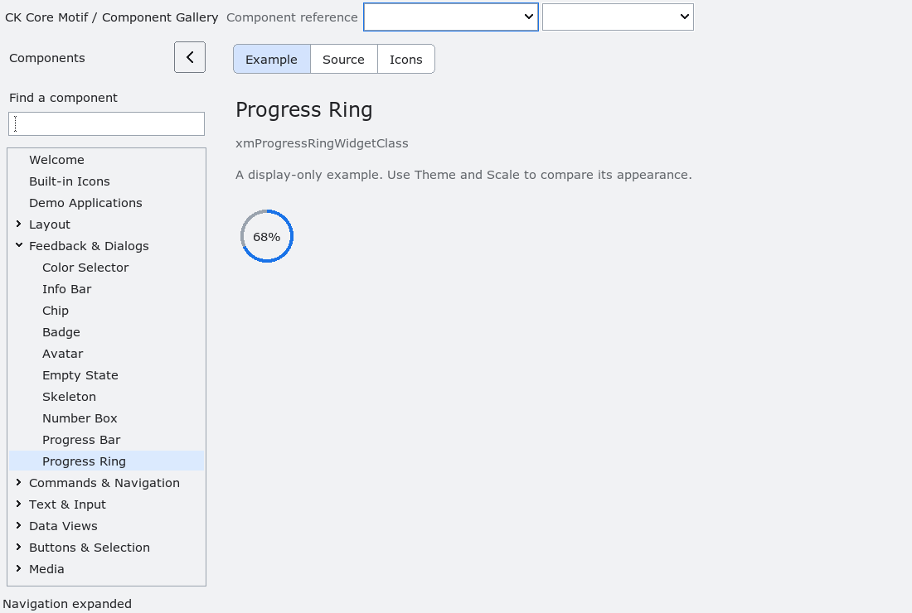

# ProgressRing

`XmProgressRing` is an additive compact progress presentation. It uses the
same bounded integer range/value contract, `XmNprogress*` resources and
`XmProgressBarCallbackStruct` as `XmProgressBar`, so an application can switch
presentations without translating progress state.

Determinate values draw a clockwise filled arc from the top of a circular
track. Indeterminate state draws a static partial arc and sets the accessible
busy state; it deliberately does not create a timer or process-wide animation
loop. `XmNprogressTextVisible` controls the centered percentage/busy marker,
while `XmNprogressLabelString` places an optional label beside the ring.

The ring derives its default diameter and stroke width from the existing DPI
default contract, while explicit width and height resources remain authoritative.
It exposes the standard progress accessibility role, range and current value,
and retains keyboard focus behavior from `XmPrimitive`.

The installed regression is `tests/automated/run-progress-ring.py`. Existing
`XmProgressBar` and `XmSpinner` APIs and resources are unchanged.

<!-- gallery-demo-tabs: begin -->
## Component demo

Captured gallery example and its corresponding source excerpt.

::: tabs
== Demo

== Source

Actual gallery excerpt: class = xmProgressRingWidgetClass.
The host supplies parent, name, callback and client_data.
Shared factory locals: Widget example; XmString label = NULL.
The shared factory frees label, attaches callbacks and sizes the preview.
Helpers and the complete factory are in gallery_examples.c.

<<< @/demos/programs/ckmotif-gallery/gallery_examples.c#L512-L514

[Complete demo source](../demos/programs/ckmotif-gallery/gallery_examples.c) · [Public header](../lib/Xm/ProgressRing.h)

:::
<!-- gallery-demo-tabs: end -->

### Circular rasterization (development)

The indicator uses a shared pixel-center annulus/sector renderer. Stroke width
is measured inward from the complete painted diameter, so its pixels remain
inside the allocated bounds. Full rings are symmetric across both axes at odd
and even sizes; partial fills use the same ring mask. Small allocations reduce
decorative padding instead of producing negative origins. Unlabelled indicators
are centered. The primitive focus indicator is painted independently.

Both Xft/SVG and core-font/non-SVG builds pass the 1,945-case native raster
and actual-widget matrix, plus the existing behavior fixtures. Verified gallery
windows were inspected in light, dark and 1.5x scale.

### Typography and natural geometry (development)

`XmNfontList` and `XmNrenderTable` alias the same owned render table. Inherited
fonts follow appearance and DPI changes; explicit fonts remain application
owned choices. Replacement copies the table before releasing the previous one,
and retains the previous table if copying fails.

Natural dimensions include font metrics, indicator size and padding. Explicit
width and height choices are preserved independently. Live changes negotiate
size with the parent. ProgressRing's natural diameter accommodates its percentage
text. Gallery examples use these defaults without fixed dimensions.

Both configurations pass 88 native font/geometry cases, including startup/live
parity, scaling, resource aliases, explicit overrides and injected copy failure.
Fresh verified gallery windows confirm the percentage follows modern typography
and scales at 1.5x. The broader visual overhaul remains in progress.
