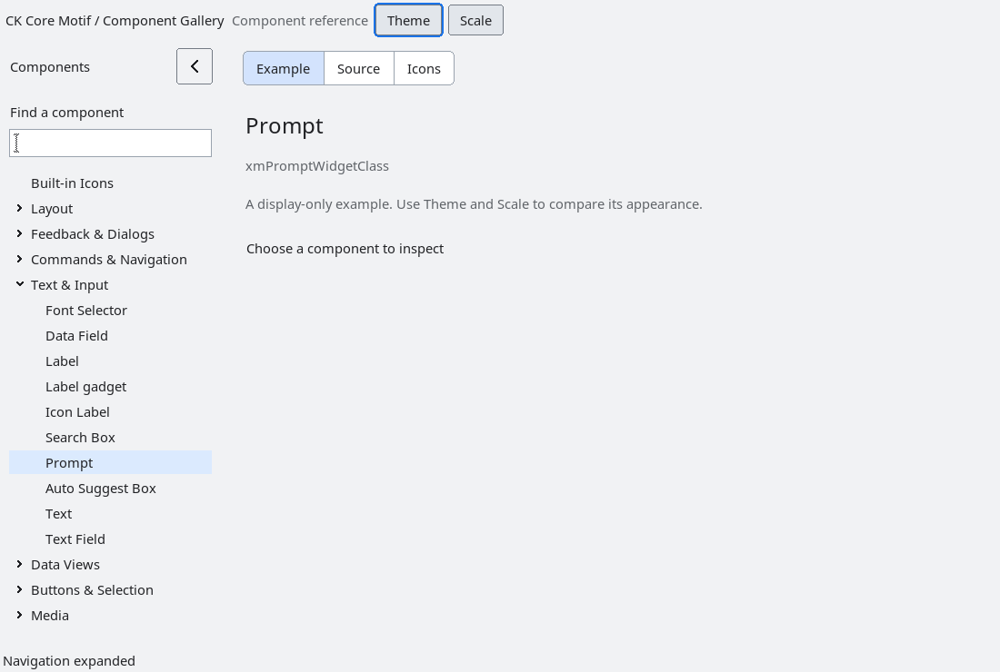

# Prompt text

`XmPrompt` is a standalone, non-interactive presentation for placeholder or
instructional text.  Its copied `XmNpromptText` is never inserted into a text
field, submitted, or treated as user input.  `XmPromptSetVisible` controls the
presentation explicitly; hiding it does not mutate any sibling or host
widget.  Applications place it next to a text field or compose it in their
own layout, so the toolkit never creates an overlay or silently changes host
geometry.

The control is not focusable and has no activation callbacks.  Accessibility
exposes visible prompt text as a label and exposes no name when hidden.  The
installed fixture verifies visibility transitions, sibling value preservation,
accessibility and teardown.

## Content geometry

Prompt measures its compound string with the current render table. Width and
height are independently automatic unless the application assigns a nonzero
size; assigning zero restores natural sizing. Explicit sizes remain authoritative
in geometry queries. The gallery uses these library defaults without a sizing
repair.

Text aligns to the beginning of the allocated content area: the left edge for
left-to-right layouts and the right edge for right-to-left layouts. Drawing is
clipped to that area's padding on every side, including when a parent allocates
less room than the measured text. Multiline content retains its measured height.

Run `tests/automated/check-prompt-geometry.py --build /absolute/build --out
/absolute/fresh-output` to check native geometry and rendered pixel bounds in
light/dark themes at 100%, 150% and 200%, in both layout directions. This replaces
the old source-text check for fixed 24-pixel height. The public visibility and
accessibility contract remains covered by `run-prompt.py`.

<!-- gallery-demo-tabs: begin -->
## Component demo

Captured gallery example and its corresponding source excerpt.

::: tabs
== Demo

== Source

Actual gallery excerpt: class = xmPromptWidgetClass.
The host supplies parent, name, callback and client_data.
Shared factory locals: Widget example; XmString label = NULL.
The shared factory frees label, attaches callbacks and sizes the preview.
Helpers and the complete factory are in gallery_examples.c.

<<< @/demos/programs/ckmotif-gallery/gallery_examples.c#L374-L376

[Complete demo source](../demos/programs/ckmotif-gallery/gallery_examples.c) · [Public header](../lib/Xm/Prompt.h)

:::
<!-- gallery-demo-tabs: end -->

## Natural dimensions

Unspecified dimensions follow the measured compound label and active render
table, including multiline text and live font/scale changes. Padding scales
with DPI. An explicit width or height remains application-owned, even when set
to its current value; setting that dimension to zero restores automatic sizing.
Parent geometry negotiation still determines the accepted allocation.
