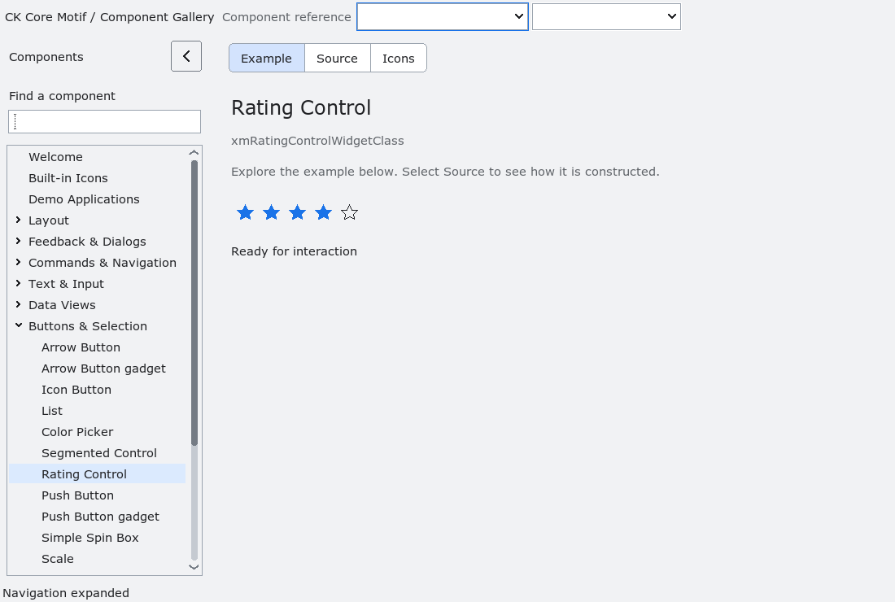

# RatingControl

`XmRatingControl` is an additive integer rating from zero through
`XmNratingCount`. It draws outlined and filled stars, so selection does not rely on color alone. Arrow keys and pointer selection choose a value;
`XmNratingAllowClear` permits selecting the current value again to clear it,
and `XmNratingReadonly` disables interaction while retaining visible focus and
value semantics. `XmNratingValueChangedCallback` reports the count and
committed value. Existing toggle-button groups are not involved.

Natural width follows the rating count, display scale and modern density. Height
follows the scaled control metrics. Explicit width and height independently own
their axes; setting an axis to zero restores natural sizing. Live appearance and
scale changes renegotiate natural dimensions. Classic retains its normal density.
Star drawing stays inside the content allocation and bounds its work by available
pixels, including extreme rating counts.

`run-rating-layout.py --build BUILD --out FRESH_DIR` checks 30 live profile,
density and scale transitions, count changes, explicit axis ownership and tiny
allocations with extreme counts. The gallery uses the library's natural size.
`run-rating-interaction.py` covers hover preview, press/release, cancellation,
read-only and disabled input, RTL keyboard navigation, focus rendering and
destructive callbacks. SetValue only notifies when its normalized value changes.

<!-- gallery-demo-tabs: begin -->
## Component demo

Captured gallery example and its corresponding source excerpt.

::: tabs
== Demo

== Source

Actual gallery excerpt: class = xmRatingControlWidgetClass.
The host supplies parent, name, callback and client_data.
Shared factory locals: Widget example; XmString label = NULL.
The shared factory frees label, attaches callbacks and sizes the preview.
Helpers and the complete factory are in gallery_examples.c.

<<< @/demos/programs/ckmotif-gallery/gallery_examples.c#L500-L501

[Complete demo source](../demos/programs/ckmotif-gallery/gallery_examples.c) · [Public header](../lib/Xm/RatingControl.h)

:::
<!-- gallery-demo-tabs: end -->
