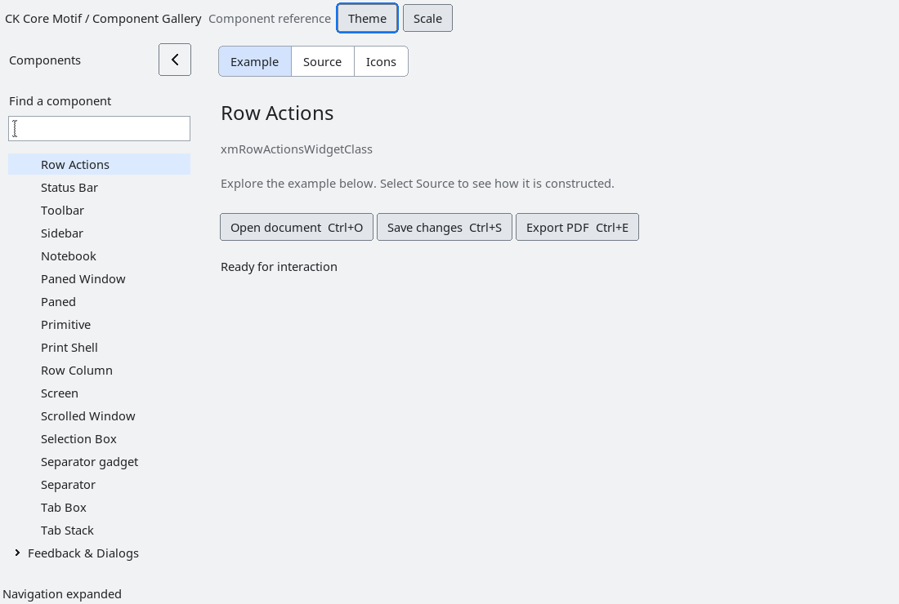

# RowActions

`XmRowActions` is an opt-in action strip that an application may place beside
or over a compatible row.  It owns copied action IDs, labels and shortcuts,
and dispatches the selected ID through `XmNrowActionsInvokeCallback`.
`user_data` is borrowed and returned unchanged.

The strip starts hidden.  `XmRowActionsReveal` and the Space/Return keyboard
equivalent reveal or hide it; `XmRowActionsInvoke` dispatches only while it is
revealed.  The application owns row identity, pointer/swipe admission,
placement and dismissal policy.  The widget never changes `XmList` selection,
scrolling, transfer ownership or drop callbacks, so it can be used as a
sibling or explicitly managed overlay by a new list surface.

`XmRowActionsSetItems` constructs all action buttons unmanaged and manages them
only after the internal item table is complete.  This is intentional: Xt may
synchronously request geometry while a child is managed, and a partially
populated action table must never expose a missing button to that path.

Natural width calculation saturates at the X11 `Dimension` limit, so a large
number of actions cannot wrap the accumulator on 32-bit builds and collapse
the action strip to an incorrect width.

Accessibility exposes a revealed strip as a panel with one action per visible
action button.  The installed fixture covers copied model ownership,
reveal/hide, explicit dispatch, accessibility and preservation of a sibling
`XmList` selection.

<!-- gallery-demo-tabs: begin -->
## Component demo

Captured gallery example and its corresponding source excerpt.

::: tabs
== Demo

== Source

Actual gallery excerpt: class = xmRowActionsWidgetClass.
The host supplies parent, name, callback and client_data.
Shared factory locals: Widget example; XmString label = NULL.
The shared factory frees label, attaches callbacks and sizes the preview.
Helpers and the complete factory are in gallery_examples.c.

<<< @/demos/programs/ckmotif-gallery/gallery_examples.c#L806-L825

[Complete demo source](../demos/programs/ckmotif-gallery/gallery_examples.c) · [Public header](../lib/Xm/RowActions.h)

:::
<!-- gallery-demo-tabs: end -->
