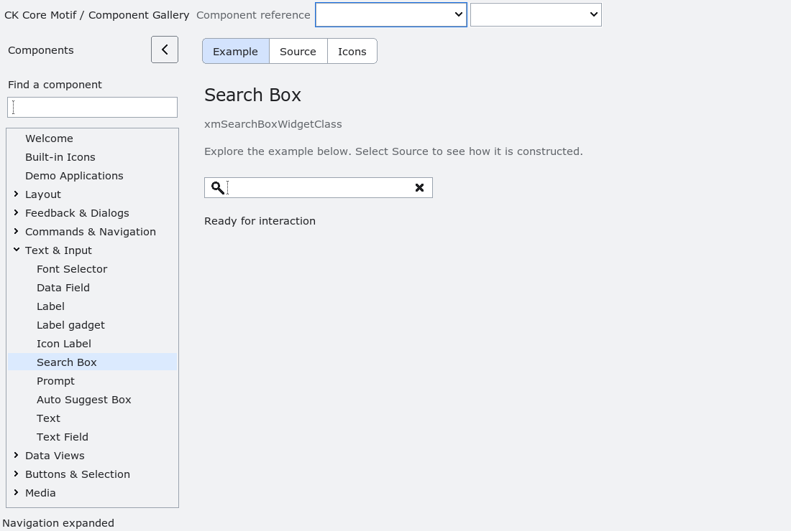

# SearchBox

`XmSearchBox` is an additive subclass of `XmTextField`.  It preserves the
ordinary text-field editing, selection, validation and IME paths while adding
three application callbacks: `XmNsearchQueryChangedCallback` for edits,
`XmNsearchCommittedCallback` for an explicit search submission, and
`XmNsearchClearedCallback` for the clear affordance.  The callback record
contains a borrowed query snapshot valid only for the callback duration.

`XmNsearchPlaceholder` is presentation-only: it is never inserted into the
text-field value or submitted.  Escape, the optional trailing clear button,
and `XmSearchBoxClear` clear the real value.  `XmSearchBoxCommit` only emits a
callback; the toolkit performs no blocking search or network work.  All
callbacks run on the owning Xt thread and applications own asynchronous work
and lifetime. Callback lists and query text are snapshotted for a dispatch;
registration changes apply to the next dispatch. Destruction stops the current
notification and suppresses subsequent notifications from the clear operation.
Inherited TextField verification may reject a clear, in which case no cleared
notification is emitted. Placeholder compound-string renditions are preserved,
and the widget owns its copied placeholder through destruction.

The library reserves a leading magnifier lane and an optional trailing clear
lane, measured from the field font and mirrored in RTL layouts. Text clipping,
caret scrolling, pointer selection, natural size and the display rectangle use
these same boundaries. The ordinary margin resources remain application-owned;
icon space is additional. Modern profiles supply the same field colors, padding
and border defaults as TextField. The gallery uses these defaults directly.

The empty field draws its placeholder without changing its value. Clear uses
primary-button press/release activation inside the visible trailing affordance;
other mouse buttons and releases outside cancel rather than clearing. Tiny
allocations suppress icons that cannot fit inside the frame. Read-only fields
hide the clear glyph and ignore pointer/Escape clear requests while preserving
the reserved lane, so changing editability does not shift the text. Becoming
read-only cancels an armed clear gesture even if editing is immediately restored.
The explicit `XmSearchBoxClear` API remains a programmatic operation, like
`XmTextFieldSetString`; applications may use it to replace read-only content.

`run-searchbox-layout.py` covers 36 theme/scale/RTL/clear-mode combinations,
placeholder pixels, natural dimensions, long-text caret visibility, live
clear-mode changes, mouse activation/cancellation and tiny allocations. The
shared TextField decoration hooks extend its private class record in epoch 9;
subclasses must rebuild with the matching headers.

Accessibility exposes a text role with the current query length and a named
`commit` action at index 0. A named `clear` action at index 1 is available when
the field is editable, nonempty and configured to show the clear button. Clear
action dispatch rechecks those conditions and obeys sensitivity and modal input
admission, including ancestor sensitivity.  The installed fixture covers placeholder separation,
query/clear/commit ordering, direct API operation, sensitivity and teardown.

<!-- gallery-demo-tabs: begin -->
## Component demo

Captured gallery example and its corresponding source excerpt.

::: tabs
== Demo

== Source

Actual gallery excerpt: class = xmSearchBoxWidgetClass.
The host supplies parent, name, callback and client_data.
Shared factory locals: Widget example; XmString label = NULL.
The shared factory frees label, attaches callbacks and sizes the preview.
Helpers and the complete factory are in gallery_examples.c.

<<< @/demos/programs/ckmotif-gallery/gallery_examples.c#L949-L952

[Complete demo source](../demos/programs/ckmotif-gallery/gallery_examples.c) · [Public header](../lib/Xm/SearchBox.h)

:::
<!-- gallery-demo-tabs: end -->
