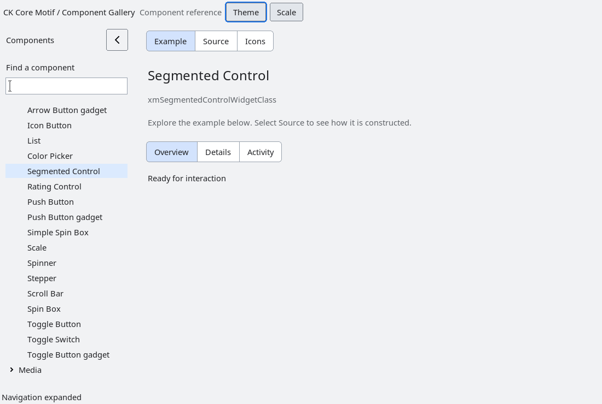

# SegmentedControl

`XmSegmentedControl` is an opt-in mutually-exclusive picker.  It is a
composite whose segments are ordinary public `XmToggleButton` children; the
control only coordinates their selection and applies the shared segment
treatment.  Existing toggle buttons and radio groups are unchanged.

Applications replace the item model with `XmSegmentedControlSetItems`.  The
control copies each item ID and label, so callers may release their input
after the call.  Replacement is transactional: if the model copy cannot be
allocated, the existing children and selection remain unchanged.
`XmSegmentedControlGetItemId` returns a borrowed ID that is
valid until the next item replacement or widget destruction.  `Pixmap` is
optional (`XmUNSPECIFIED_PIXMAP` means label-only); icons are rendered with
the normal Motif label/pixmap rules.

Selection is a single item index or `-1` for no selection.  Disabled items are
not selectable.  `XmNSegmentedAllowClear` controls whether activating the
selected item clears it. Programmatic selection is an assignment: setting the
same index again keeps it selected regardless of `XmNSegmentedAllowClear`.
Repeated assignment and clearing an already-empty selection emit no callback.
The setter returns whether the request was accepted, even if a notification
callback subsequently changes the selection/model or destroys the control.
When clearing is disabled, activating the selected segment again retains its
native toggle state and selected fill, without emitting a selection change.
`XmNSegmentedSelectionCallback` reports the new index and a callback-lifetime ID snapshot after
the child toggle states have been synchronized.  Callback code may destroy
the control or replace its items; later callbacks still see the original ID
snapshot, and notification stops if destruction starts. Keyboard navigation
focuses only a surviving current selection after callbacks return. Home/End
scan inward from their endpoint when endpoint items are disabled.

The control is a single horizontal row.  `XmNSegmentedRtl` reverses visual
order and Left/Right keyboard movement.  `XmNSegmentedSpacing` sets the gap
between segments.  When the preferred widths do not fit, the bounded
`XmSEGMENTED_OVERFLOW_CLIP` policy gives each segment a deterministic share
of the available width; labels clip according to the child ToggleButton
renderer.  Wrapping, scrolling, and implicit item menus are intentionally
outside this contract.

Omitting `XmNwidth` or `XmNheight` gives the toolkit ownership of that
dimension. It requests the natural size after replacing items and when child
labels or fonts change, subject to the parent's geometry policy. Explicit
nonzero dimensions remain application-owned. Setting either dimension to zero
restores natural sizing for that dimension independently. The gallery example
uses this contract without fixed width or height.

Preferred geometry is measured from each child's natural label size, independently
of its last allocation. Shrinking and expanding the control therefore restores
usable segment widths. Explicit gaps contribute to the preferred width and are
removed when the row cannot fit. If there are fewer available pixels than
segments, zero-share children remain managed but are unmapped until space
returns; no zero-sized X window is requested. Child positions and preferred
widths are bounded by the signed X coordinate range.

Geometry queries do not move, resize, or map children. Native verification is
available through `tests/automated/run-segmented-geometry.py --prefix PREFIX
--out NEW_DIRECTORY`: it exercises all four appearance profiles, both reading
directions, shrink/expand cycles, label growth, spacing, query-only requests,
and tiny allocations. This sizing regression does not establish completion
of the modern visual redesign.

Modern light/dark profiles render adjoining segments with one rounded outer
outline and a single divider at each boundary. Selection uses a tonal fill;
keyboard focus is inset within its segment. Disabling the control preserves
the selected surface so its current value stays visible. Explicit gaps produce separate
outlines when they fit. The renderer paints the surface before drawing label
content, preserving it underneath anti-aliased text. Classic and high-contrast
continue to use the native ToggleButton presentation. Pixmap-and-text items
retain the same connected surface during selection and pointer feedback;
the existing ToggleButton machinery still selects the state pixmap.

All children remain ordinary ToggleButtons for focus, sensitivity, and
accessibility.  The parent reports a list role with the selected index, while
each child retains its native button semantics.  Keyboard operation includes
Left/Right (direction-aware), Up/Down, Home, and End; disabled segments are
skipped.

<!-- gallery-demo-tabs: begin -->
## Component demo

Captured gallery example and its corresponding source excerpt.

::: tabs
== Demo

== Source

Actual gallery factory for xmSegmentedControlWidgetClass.
The gallery host supplies the function arguments.
Helpers are defined in gallery_examples.c.

<<< @/demos/programs/ckmotif-gallery/gallery_examples.c#L1085-L1114

[Complete demo source](../demos/programs/ckmotif-gallery/gallery_examples.c) · [Public header](../lib/Xm/SegmentedControl.h)

:::
<!-- gallery-demo-tabs: end -->

`run-segmented-selection.py` checks assignment, clear policy, callback ID
snapshots, model replacement, disabled endpoints and callback destruction
through both public API and native keyboard paths.
