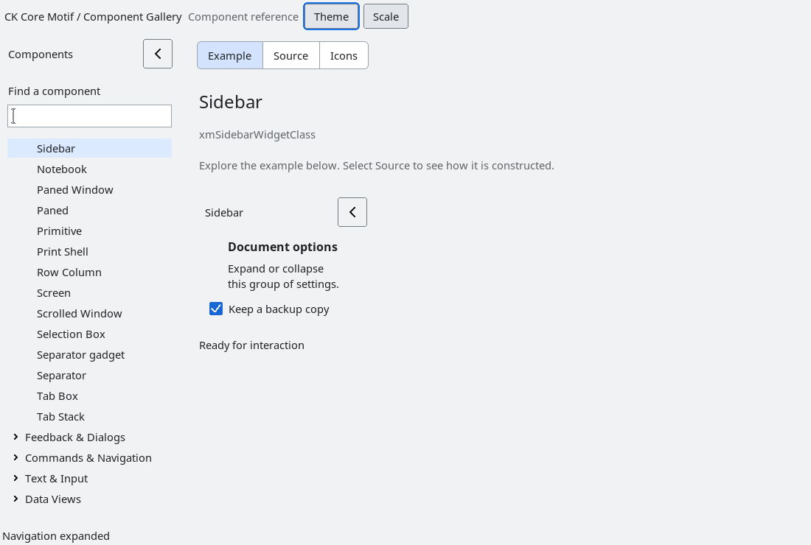

# Sidebar

`XmSidebar` is an opt-in bounded client-area composite.  Applications create
their content below `XmSidebarGetContent`; the sidebar owns that content host
and its toggle presentation, while the application owns the content widgets,
navigation model and selection policy.

The expanded and collapsed widths are controlled by
`XmNsidebarExpandedWidth` and `XmNsidebarCollapsedWidth`.  `XmSidebarToggle`
and the toggle button provide the same state transition, and `Ctrl+M` is the
keyboard equivalent when focus is anywhere in the sidebar subtree.  If focus
is inside the content host when it collapses, the sidebar moves focus to its
toggle and restores the prior content focus when expanded again.
Collapse changes the preferred width while preserving the height allocated by
the parent. It does not shrink the window vertically to the hidden content.
Keyboard routing includes descendants created after realization; nested
sidebars handle their own shortcut without toggling their ancestors. Caps Lock
does not disable the shortcut, and ordinary text input remains unaffected.
The toggle receives focus after its final collapsed geometry is installed, so
the parent's resize cannot move keyboard focus to an unrelated workspace control.

The composite exposes a named accessible panel with one toggle action.  It does
not create an adaptive navigation stack, infer application routes, or alter
window-manager decorations.

## Header and geometry

The header owns a title (`XmNlabelString`, default “Sidebar”) and a square
ArrowButton. The collapsed header shows only the toggle. Its accessible name
changes between “Collapse sidebar” and “Expand sidebar”; pointer, keyboard
activation and the accessibility action use the same toggle callback.
Title and toggle layout follow text direction, font metrics, density and scale.
Preferred collapsed width includes the toggle and its padding; parent allocations
can constrain it further without letting children draw outside the sidebar.
The parent must accept the sidebar's width request and redistribute the freed
space. A Form with the workspace attached to the sidebar's trailing edge
provides this behavior, as demonstrated by the gallery. PanedWindow's
`XmNallowResize` permits a request but does not guarantee redistribution within
the existing window; its pane and parent geometry policies still apply.

Setting `XmNsidebarExpanded` updates the header/content/focus state without
emitting the user toggle callback. The public toggle/set-expanded methods emit
one callback per change. Saved content focus is cleared if its widget is
destroyed while the sidebar is collapsed.

`tests/automated/run-sidebar-header.py` covers four profiles, two densities,
1x/1.5x/2x, both directions, accessible names/actions, callback counts, focus
restoration and destruction, and tiny allocations.
It also dispatches key events through a text-field descendant and the toggle,
checks nested ownership and normal text input, and verifies that collapse and
reopening retain the allocated height.

<!-- gallery-demo-tabs: begin -->
## Component demo

Captured gallery example and its corresponding source excerpt.

::: tabs
== Demo

== Source

Actual gallery excerpt: class = xmSidebarWidgetClass.
The host supplies parent, name, callback and client_data.
Shared factory locals: Widget example; XmString label = NULL.
The shared factory frees label, attaches callbacks and sizes the preview.
Helpers and the complete factory are in gallery_examples.c.

<<< @/demos/programs/ckmotif-gallery/gallery_examples.c#L785-L802

[Complete demo source](../demos/programs/ckmotif-gallery/gallery_examples.c) · [Public header](../lib/Xm/Sidebar.h)

:::
<!-- gallery-demo-tabs: end -->

## Focus during programmatic layout changes

Collapsing a Sidebar moves focus to its toggle only when focus was inside that
sidebar. Focus on an unrelated control is preserved. Expanding restores saved
content focus only while focus remains in the sidebar; moving elsewhere while
collapsed cancels that restoration. This also applies when responsive layout
changes expand or collapse the sidebar through the public API.
