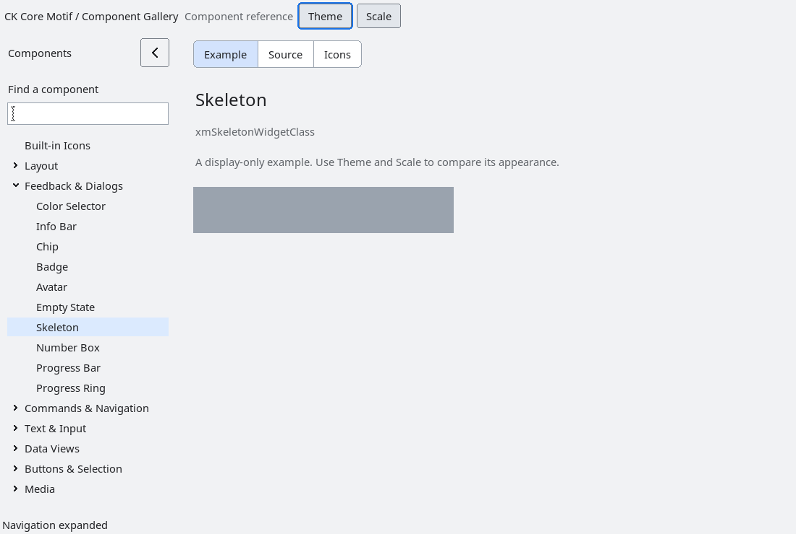

# Skeleton loading presentation

`XmSkeleton` is a bounded placeholder for content that is loading.  It owns
no data, timer queue or application state.  Animation is opt-in presentation
only, is disabled by `XmNskeletonReducedMotion`, and has a per-instance
interval; `XmSkeletonStop` always provides a static fallback.  Applications
choose the placeholder geometry and replace it with their real view.

The label is a copied `XmString` used for accessibility; it is not drawn into
the placeholder.  The widget does not introduce a generalized animation
framework or require animation for a usable loading state.  The installed
fixture covers start/stop, reduced-motion behavior, accessibility naming,
timer teardown and destruction.

<!-- gallery-demo-tabs: begin -->
## Component demo

Captured gallery example and its corresponding source excerpt.

::: tabs
== Demo

== Source

Actual gallery excerpt: class = xmSkeletonWidgetClass.
The host supplies parent, name, callback and client_data.
Shared factory locals: Widget example; XmString label = NULL.
The shared factory frees label, attaches callbacks and sizes the preview.
Helpers and the complete factory are in gallery_examples.c.

<<< @/demos/programs/ckmotif-gallery/gallery_examples.c#L1036-L1037

[Complete demo source](../demos/programs/ckmotif-gallery/gallery_examples.c) · [Public header](../lib/Xm/Skeleton.h)

:::
<!-- gallery-demo-tabs: end -->
