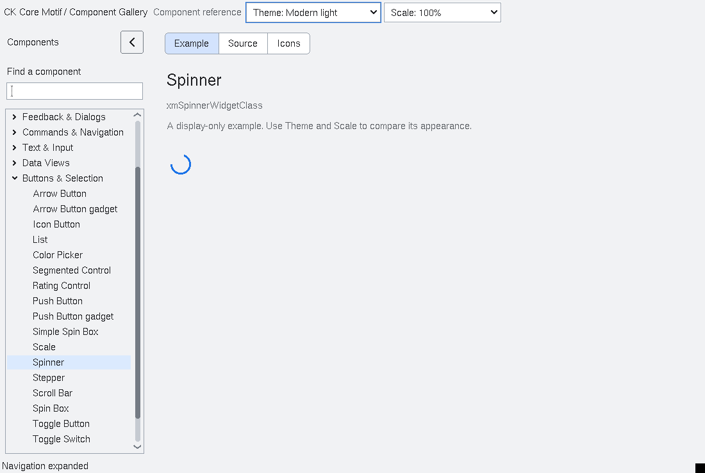

# Spinner

`XmSpinner` is a small indeterminate activity indicator for applications that
need feedback while work is in progress. It is additive and resource-driven;
existing Motif classes and callback contracts are unchanged.

When a Spinner has a label, its ring and label follow the layout direction:
the ring is at the logical start edge and the label follows it in both LTR and
RTL layouts.

`XmNspinnerActive` controls whether the indicator is running and
`XmNspinnerInterval` selects the update period. Intervals are bounded to
10–1000 milliseconds. The control schedules one Xt timeout at a time only
while it is realized, managed, mapped, and sensitive. The timeout is cancelled
before unmap, deactivation, or destruction, and no worker thread or global
event loop is created. `XmNspinnerLabelString` provides an optional
description.

`XmNspinnerStateChangedCallback` receives an `XmSpinnerCallbackStruct` with
the normalized active state and current phase. `XmSpinnerGetPhase` is intended
for diagnostics and deterministic tests; applications normally only need the
active state.

The accessibility provider exposes a progress-bar role with the busy state and
the spinner label. It intentionally has no numeric value or actions.

`tests/automated/run-spinner.py` builds and runs the Xvfb fixture. The fixture
covers explicit dimensions, timer advancement, active-state callbacks,
deactivation/unmanagement cancellation, accessibility semantics, and teardown.

<!-- gallery-demo-tabs: begin -->
## Component demo

Captured gallery example and its corresponding source excerpt.

::: tabs
== Demo

== Source

Actual gallery excerpt: class = xmSpinnerWidgetClass.
The host supplies parent, name, callback and client_data.
Shared factory locals: Widget example; XmString label = NULL.
The shared factory frees label, attaches callbacks and sizes the preview.
Helpers and the complete factory are in gallery_examples.c.

<<< @/demos/programs/ckmotif-gallery/gallery_examples.c#L518-L519

[Complete demo source](../demos/programs/ckmotif-gallery/gallery_examples.c) · [Public header](../lib/Xm/Spinner.h)

:::
<!-- gallery-demo-tabs: end -->

### Circular rasterization (development)

The indicator uses a shared pixel-center annulus/sector renderer. Stroke width
is measured inward from the complete painted diameter, so its pixels remain
inside the allocated bounds. Full rings are symmetric across both axes at odd
and even sizes; partial fills use the same ring mask. Small allocations reduce
decorative padding instead of producing negative origins. Unlabelled indicators
are centered. The primitive focus indicator is painted independently.

Both Xft/SVG and core-font/non-SVG builds pass the 1,945-case native raster
and actual-widget matrix, plus the existing behavior fixtures. Verified gallery
windows were inspected in light, dark and 1.5x scale.

### Typography and natural geometry (development)

`XmNfontList` and `XmNrenderTable` alias the same owned render table. Inherited
fonts follow appearance and DPI changes; explicit fonts remain application
owned choices. Replacement copies the table before releasing the previous one,
and retains the previous table if copying fails.

Natural dimensions include font metrics, indicator size and padding. Explicit
width and height choices are preserved independently. Live changes negotiate
size with the parent. ProgressRing's natural diameter accommodates its percentage
text. Gallery examples use these defaults without fixed dimensions.

Both configurations pass 88 native font/geometry cases, including startup/live
parity, scaling, resource aliases, explicit overrides and injected copy failure.
Fresh verified gallery windows confirm the percentage follows modern typography
and scales at 1.5x. The broader visual overhaul remains in progress.
