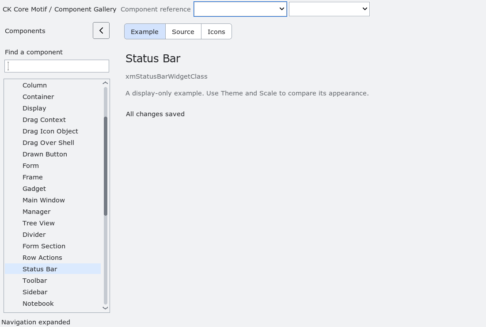

# StatusBar

`XmStatusBar` is an opt-in client-area status presentation.  It copies item
IDs and labels and creates ordinary label children; the application retains
ownership of the status model and `user_data`.  Progress items are rendered
as a bounded `value/maximum` suffix when the item kind is
`XmSTATUS_BAR_ITEM_PROGRESS`.

Items have an explicit priority.  When the bar is narrower than the natural
width, higher-priority items remain visible first and lower-priority items are
unmapped.  `XmStatusBarGetOverflowCount` reports how many were hidden so the
application can expose its own menu or other policy.  The toolkit does not
invent navigation, queueing or an overflow command model.

The bar owns only its presentation children and tears them down with the
owner.  Geometry, status semantics, updates, and overflow interaction remain
application-owned.  Accessibility exposes the composite as a named panel
without pretending that status items are actionable controls.

<!-- gallery-demo-tabs: begin -->
## Component demo

Captured gallery example and its corresponding source excerpt.

::: tabs
== Demo

== Source

Actual gallery excerpt: class = xmStatusBarWidgetClass.
The host supplies parent, name, callback and client_data.
Shared factory locals: Widget example; XmString label = NULL.
The shared factory frees label, attaches callbacks and sizes the preview.
Helpers and the complete factory are in gallery_examples.c.

<<< @/demos/programs/ckmotif-gallery/gallery_examples.c#L809-L814

[Complete demo source](../demos/programs/ckmotif-gallery/gallery_examples.c) · [Public header](../lib/Xm/StatusBar.h)

:::
<!-- gallery-demo-tabs: end -->
