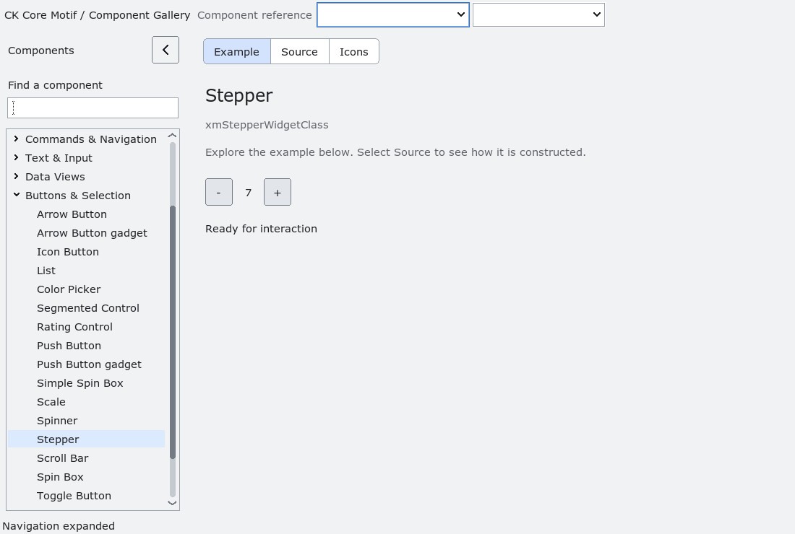

# Stepper

`XmStepper` presents a noneditable numeric value between native decrement and
increment PushButtons. The buttons activate on release inside their own bounds;
clicking the value does not change it. Dragging outside cancels the click, and
losing effective sensitivity cancels a pending gesture. Up/Right increment and
Down/Left decrement while either button has keyboard focus; in right-to-left
layouts Left/Right follow the mirrored button order. Space and Return retain
the native button activation behavior.

The signed-integer contract uses inclusive bounds, a positive step, clamping and
optional wrapping. Without wrapping, the unavailable endpoint button is disabled;
a single-value range disables both buttons. Value callbacks run in registration
order and stop if a callback destroys the Stepper.

The control measures its native child fonts and reserves room for the complete
range, so changes to the value do not shift the buttons. Theme, density, scale,
font and range changes update automatic dimensions. An explicit width or height
owns only that axis; setting it to zero restores natural sizing. `XmNspacing`
controls the gaps around the value. In right-to-left layouts the button order is
mirrored. Constrained allocations stay within the assigned bounds.

Stepper derives from `XmManager`; its native children are named `decrement`,
`value` and `increment`. Application overrides of child fonts and foregrounds
remain independent of inherited defaults. The gallery uses these defaults without
custom geometry or painting. Rebuild private-record consumers for ABI epoch 9.

The accessibility provider exposes a spin-button role, committed numeric value,
bounds and configured step. Named increment/decrement actions use the native
callback path; NumberBox also supports page stepping. See
[Native accessibility](accessibility.md#numeric-values-and-native-scroll-bars).
`tests/automated/run-stepper.py` verifies the numeric/accessibility contract;
`run-stepper-native.py` checks natural geometry, RTL, live appearance changes,
pointer and keyboard interaction, disabled states and callback destruction.

<!-- gallery-demo-tabs: begin -->
## Component demo

Captured gallery example and its corresponding source excerpt.

::: tabs
== Demo

== Source

Actual gallery excerpt: class = xmStepperWidgetClass.
The host supplies parent, name, callback and client_data.
Shared factory locals: Widget example; XmString label = NULL.
The shared factory frees label, attaches callbacks and sizes the preview.
Helpers and the complete factory are in gallery_examples.c.

<<< @/demos/programs/ckmotif-gallery/gallery_examples.c#L523-L525

[Complete demo source](../demos/programs/ckmotif-gallery/gallery_examples.c) · [Public header](../lib/Xm/Stepper.h)

:::
<!-- gallery-demo-tabs: end -->
