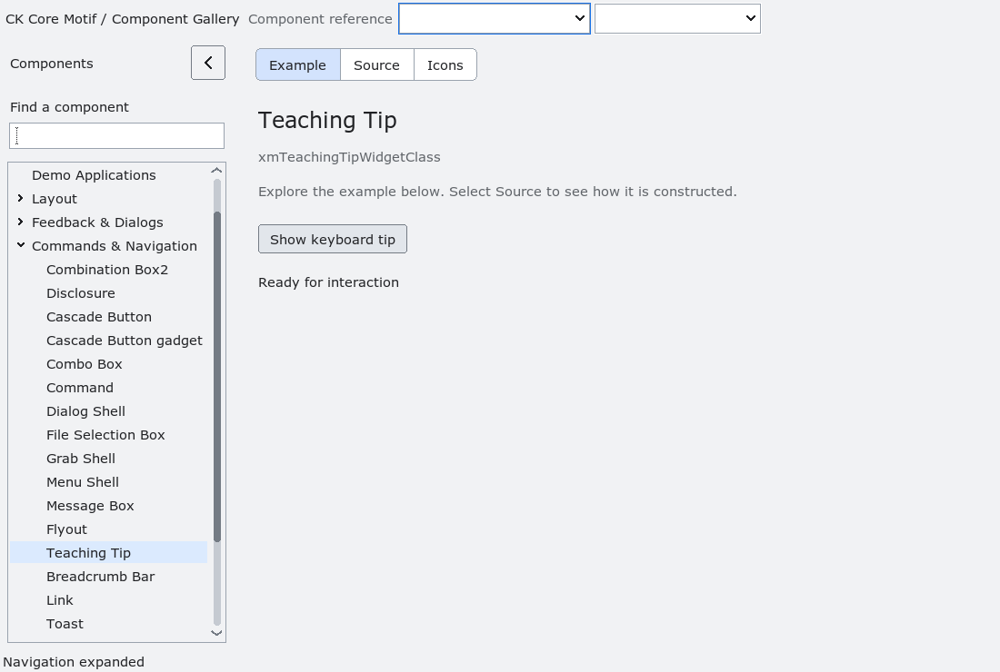

# Teaching tip

`XmTeachingTip` is an opt-in, non-modal anchored presentation layered over the
same Xt shell rules as `XmFlyout`. Create it as an unmanaged child of its owner
with `XmCreateTeachingTip`, provide copied `XmNteachingTipTitle` and
`XmNteachingTipText` values, and call `XmTeachingTipShow` or
`XmTeachingTipHide` explicitly.

`XmNteachingTipDelay` delays the show in milliseconds. A pending delay is
cancelled by hide, a second show, owner unmap or owner destruction. Showing
creates a transient override-redirect shell below the owner, clamps it to the
active screen and uses `XtGrabNone`; it never moves focus or changes menu and
dialog admission. Escape/Return, pointer activation, explicit hide and owner
unmap dismiss the tip and invoke `XmNteachingTipDismissCallback` (owner
destruction does not call application callbacks after the owner is gone).

Title and body strings are copied by the widget. The widget owns its popup
labels and timer; applications own the owner and decide when a tip is useful.
The accessibility bridge exposes a panel named from the title, then body, or
the deterministic `Teaching tip` fallback. There is no global tooltip queue,
pointer tracker or external URL/action dispatch.

`tests/automated/run-teaching-tip.py` validates delay cancellation, show/hide,
screen-edge placement, accessibility and owner teardown under Xvfb.

<!-- gallery-demo-tabs: begin -->
## Component demo

Captured gallery example and its corresponding source excerpt.

::: tabs
== Demo

== Source

Actual gallery excerpt: class = xmTeachingTipWidgetClass.
The host supplies parent, name, callback and client_data.
Shared factory locals: Widget example; XmString label = NULL.
The shared factory frees label, attaches callbacks and sizes the preview.
Helpers and the complete factory are in gallery_examples.c.

<<< @/demos/programs/ckmotif-gallery/gallery_examples.c#L862-L881

[Complete demo source](../demos/programs/ckmotif-gallery/gallery_examples.c) · [Public header](../lib/Xm/TeachingTip.h)

:::
<!-- gallery-demo-tabs: end -->
