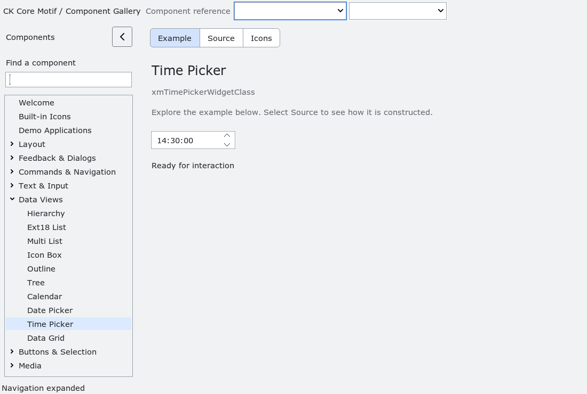

# XmTimePicker

`XmTimePicker` edits a wall-clock value (`hour`, `minute`, `second`) in the
closed ranges 0–23, 0–59, and 0–59.  The value is not a timestamp: it has no
date, locale time zone, daylight-saving rule, or implicit conversion to an
instant.  Applications that attach a date and zone must resolve gaps and
overlaps explicitly before committing an instant.

The default range is 00:00:00 through 23:59:59.  `XmTimePickerSetRange`
accepts only valid, ordered bounds and rejects a range that excludes the
current value.  Invalid updates have no partial effect.

The default presentation is 24-hour `HH:MM:SS`; `XmNtimePickerFormat24Hour`
may request a deterministic 12-hour `AM`/`PM` presentation.  Left/Right moves
between hour, minute, and second fields in visual order, including reversed
left/right traversal for right-to-left layouts.  Up/Down changes the focused
field by one unit, clamped at the documented range. Non-text arrow key events
are recognized without requiring a character. Return activates the value.
Callbacks are delivered after the value has been committed and may destroy
the widget.
Keyboard and pointer editing is inactive while the TimePicker or an ancestor is
insensitive; explicit value APIs remain available.

A live `XmNlayoutDirection` update repaints the realized control, including
the direction-sensitive time text and selected-field feedback.

<!-- gallery-demo-tabs: begin -->
## Component demo

Captured gallery example and its corresponding source excerpt.

::: tabs
== Demo

== Source

Actual gallery excerpt: class = xmTimePickerWidgetClass.
The host supplies parent, name, callback and client_data.
Shared factory locals: Widget example; XmString label = NULL.
The shared factory frees label, attaches callbacks and sizes the preview.
Helpers and the complete factory are in gallery_examples.c.

<<< @/demos/programs/ckmotif-gallery/gallery_examples.c#L802-L805

[Complete demo source](../demos/programs/ckmotif-gallery/gallery_examples.c) · [Public header](../lib/Xm/TimePicker.h)

:::
<!-- gallery-demo-tabs: end -->
