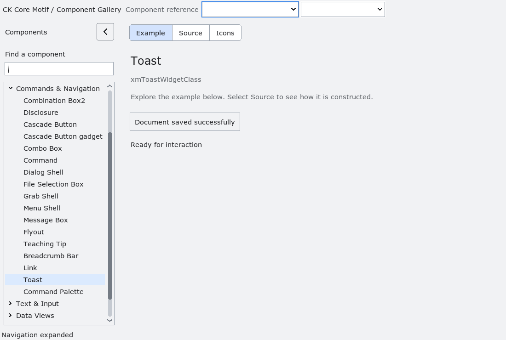

# Toast notifications

`XmToast` is a per-instance, non-modal notification composite.  It owns a
message label and an optional action button; the application owns placement,
severity policy and the callback that performs an action.  The toolkit does
not create a process-global queue, move shells to screen edges, or alter
dialogs, menus or navigation.

`XmToastShow` replaces the instance's current presentation and starts its
configured timeout.  `XmToastPause` cancels or restarts the full timeout,
`XmToastDismiss` is idempotent, and `XmToastInvokeAction` dispatches without
launching a command.  A timeout of zero leaves the toast visible until
explicit dismissal.  Message and action labels are copied `XmString`
resources; callbacks run on the owning Xt application context.

Accessibility exposes a shown toast as a panel named from its message and
reports an action only when an action label is present.  The installed fixture
covers show/dismiss, pause, action dispatch, timeout teardown, accessibility
and destruction.

<!-- gallery-demo-tabs: begin -->
## Component demo

Captured gallery example and its corresponding source excerpt.

::: tabs
== Demo

== Source

Actual gallery excerpt: class = xmToastWidgetClass.
The host supplies parent, name, callback and client_data.
Shared factory locals: Widget example; XmString label = NULL.
The shared factory frees label, attaches callbacks and sizes the preview.
Helpers and the complete factory are in gallery_examples.c.

<<< @/demos/programs/ckmotif-gallery/gallery_examples.c#L559-L563

[Complete demo source](../demos/programs/ckmotif-gallery/gallery_examples.c) · [Public header](../lib/Xm/Toast.h)

:::
<!-- gallery-demo-tabs: end -->
