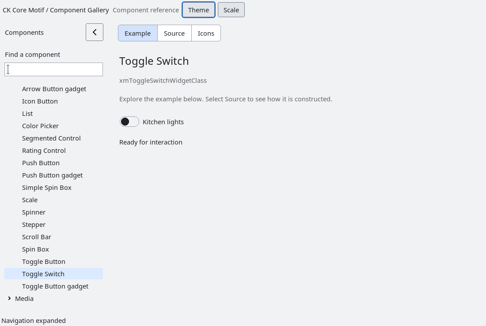

# ToggleSwitch

`XmToggleSwitch` is an additive binary control for applications that want a
compact on/off affordance without changing `XmToggleButton` behavior. Include
`<Xm/ToggleSwitch.h>` and create it with `XmCreateToggleSwitch` or one of its
variadic constructors.

The library measures the label and scales its track and knob with the display
scale. `XmNfontList` and `XmNrenderTable` supply the label font. Width and height
are independently automatic unless explicitly set; setting either axis to zero
restores its natural size. RTL places the track at the leading edge and mirrors
its state positions. Modern profiles use the shared symmetric rounded renderer,
with separate hover, pressed, disabled and keyboard-focus states.

The widget uses the normal Xt resource model:

- `XmNset` is the Boolean state.
- `XmNlabelString` supplies the label.
- `XmNvalueChangedCallback` receives an `XmToggleSwitchCallbackStruct` whose
  `set` member is the new state. The callback may destroy the widget; callers
  must not use the widget after returning from the callback.
- `XmToggleSwitchGetState` and `XmToggleSwitchSetState` provide typed state
  access. `notify=False` changes state without invoking callbacks.

Space and Return toggle the state when the widget is sensitive. A primary-button
press arms the control; release inside activates it. Release outside or disabling
the control cancels that press. Focus traversal is inherited from `XmPrimitive`; the focus ring is
drawn separately from the state indicator, so the control remains
understandable without relying on color alone.

When an `XmAccessibility` bridge is attached, the control exposes the
AT-SPI check-box role, its label as the accessible name, the checked state, a
single `activate` action, and value-change notifications. Queries and actions
remain on the owning Xt application thread.

`run-toggle-switch-pixels.py` compares actual window pixels at 100–200% scale
in 25% steps, including opposite margins and RTL mirroring. Track and knob
dimensions share pixel parity to keep their centers aligned at fractional scales.

`run-toggle-switch-failures.py` injects failed label copies, empty-label
allocation, render-table copies and GC allocation. It verifies retained ownership
and safe expose/destruction paths.

`run-toggle-switch-live.py` compares existing and freshly created switches
through classic/light/dark, both densities and repeated scale changes. Explicit
fonts and dimensions remain unchanged. A scale observer negotiates new natural
dimensions even when classic core fonts do not change.

`run-toggle-switch-colormap.py` checks a full application-owned indexed palette
whose screen black/white entries contain other colors. The on-state thumb uses
the highest-contrast existing foreground, background or shadow color, measured
against the track in that colormap; drawing does not allocate color cells.

The installed consumer fixture
`tests/automated/run-toggle-switch.py` covers construction, labels, state
notification, no-notify updates, keyboard focus, disabled rendering state,
accessibility query/action, resize metrics, and destruction from a value
callback under Xvfb.

<!-- gallery-demo-tabs: begin -->
## Component demo

Captured gallery example and its corresponding source excerpt.

::: tabs
== Demo

== Source

Actual gallery excerpt: class = xmToggleSwitchWidgetClass.
The host supplies parent, name, callback and client_data.
Shared factory locals: Widget example; XmString label = NULL.
The shared factory frees label, attaches callbacks and sizes the preview.
Helpers and the complete factory are in gallery_examples.c.

<<< @/demos/programs/ckmotif-gallery/gallery_examples.c#L386-L391

[Complete demo source](../demos/programs/ckmotif-gallery/gallery_examples.c) · [Public header](../lib/Xm/ToggleSwitch.h)

:::
<!-- gallery-demo-tabs: end -->
