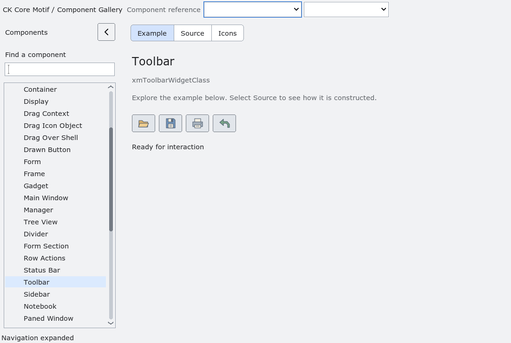

# Toolbar

`XmToolbar` is an opt-in client-area action strip.  The application supplies
stable action IDs, labels, optional shortcut text, priority and an explicit
`overflowable` flag.  The toolbar copies the IDs and `XmString` values; it
does not own the application's action model or `user_data`.

When space is constrained, non-overflowable actions remain in the strip and
overflowable actions are selected by descending priority.  Remaining actions
are placed in an ordinary Motif pulldown menu behind the `More` cascade
(`XmNtoolbarOverflowLabel`), and `XmToolbarGetOverflowCount` reports how many
are there.  The toolkit preserves action IDs and dispatches both the strip and
menu entries through `XmNtoolbarActivateCallback`; shortcut text is retained
and shown with the action label, but applications remain responsible for
global accelerator policy.

`XmNtoolbarOverflowLabel` is optional. Passing `NULL` at creation or through
`XtSetValues` creates an intentionally blank overflow cascade label; both
paths have the same safe behavior.

The toolbar owns only its push-button and menu-entry presentation children.
It does not create a navigation model, launch commands, or change existing
menus and toolbar widgets.  Accessibility exposes a named toolbar panel and
reports one action when an overflow menu is available.

## Per-action icons and button surfaces

`XmToolbarGetActionButton(toolbar, index, overflow)` returns the normal action
button when `overflow` is `False`, or its overflow-menu entry when `True`.
Invalid inputs return `NULL`. The returned widget is borrowed: the toolbar owns
it and destroys it when `XmToolbarSetActions` replaces the action model.

Applications can use that button's public resources to configure icons,
accessible names and tooltips without relying on presentation-child names or
ordering. Query its `XmNbackground`, `XmNforeground` and `XmNarmColor` when
rasterizing images. The toolbar background can differ from the button face.
Set both `XmNlabelPixmap` and `XmNarmPixmap` to images composited against their
respective surfaces. Set `XmNlabelInsensitivePixmap` against the normal surface
with `XmNinsensitiveForeground` (or the documented bottom-shadow fallback).
The application retains image ownership and must keep these pixmaps alive.
`XmToolbarSetActionIcons` remains the convenience API for borrowed pixmaps that
already suit all of their destination surfaces.

The gallery binds each normal and overflow button independently, retaining and
refreshing its normal, armed and disabled image-cache references as the button's
colors or display scale change. Transparent SVG pixels and monochrome fallback
backgrounds are therefore composited against the actual destination color.
This avoids rectangular patches in light/dark themes and while a button is
pressed or disabled.

The [Mac qualification record](validation/toolbar-icon-surfaces-macos-20261101.json)
records the reproduced old-factory failure and passing corrected rendering.
The native regression uses the real gallery factory, samples the rendered icon
corners during normal, pressed and disabled states, and checks overflow image
resources across four profiles and two scales. It runs on an isolated Xvfb
server, without sending input to the user's desktop:

```sh
python3 tests/automated/run-toolbar-icon-surfaces.py \
  --build /absolute/path/to/build --results /absolute/path/to/fresh/results
```

<!-- gallery-demo-tabs: begin -->
## Component demo

Captured gallery example and its corresponding source excerpt.

::: tabs
== Demo



== Source

Actual gallery excerpt: class = xmToolbarWidgetClass.
The host supplies parent, name, callback and client_data.
Shared factory locals: Widget example; XmString label = NULL.
The shared factory frees label, attaches callbacks and sizes the preview.
Helpers and the complete factory are in gallery_examples.c.

<<< @/demos/programs/ckmotif-gallery/gallery_examples.c#L618-L655

[Complete demo source](../demos/programs/ckmotif-gallery/gallery_examples.c) · [Public header](../lib/Xm/Toolbar.h)

:::
<!-- gallery-demo-tabs: end -->
