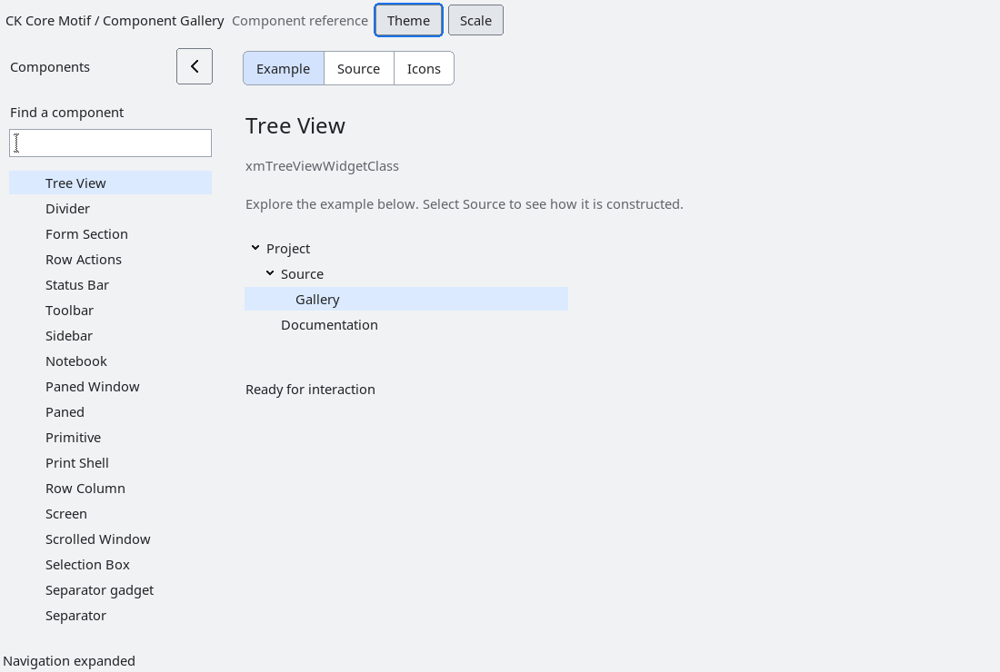

# TreeView contract and decision record

`XmTreeView` is an additive model/view widget.  It does not subclass or
inspect `XmTree`, `XmOutline`, `XmContainer`, or any application child widget.
The application supplies a flat array of nodes through
`XmTreeViewSetNodes`; each node has an opaque stable `id`, an optional
`parent_id`, a copied UTF-8 label, and explicit `has_children`/`expanded`
state.  IDs and any application payload they identify remain application
owned.  Labels are copied so a model can retire its input array after the
setter returns.

Input nodes need not be in display order: children may precede their parent,
and roots may be grouped separately from descendants. The widget presents a
depth-first forest, with each expanded parent's descendants immediately beneath
it. Root and sibling order follow their relative order in the input array.
Hit testing, Up/Down navigation and selection scrolling use this same order.
Collapsing a parent hides its complete subtree without moving unrelated roots.
`tests/automated/run-tree-view-order.py` checks pointer and keyboard selection,
collapse/reopen, child-before-parent input, all profiles and both text directions.

The model is synchronous and belongs to the Xt application thread.  A setter
must run on that thread; the widget never performs I/O or invokes a provider
from drawing, geometry negotiation, or an event filter.  Replacing the model
preserves selection only when the selected ID is still present.  A node count
above 4096 is rejected without changing the current model.  Duplicate IDs,
cycles, missing parents, and child references whose parent does not advertise
`has_children` are rejected without changing the current model; the widget
never silently reparents malformed data.

Preferred width is measured from every node's label and indentation, including
collapsed descendants, so expanding a branch does not change the preferred
width. `XmNtreeViewRowHeight` defaults to zero, meaning automatic height based
on the active render table, the tallest label, and shared vertical padding.
Explicit nonzero row heights remain fixed; setting zero restores automatic
measurement. Font/profile changes update automatically measured rows.

Reducing `XmNtreeViewVisibleRows` keeps the selected item in view. Selecting
an already-selected item also restores its visibility without repeating the
selection callback. The row-count resource requests a preferred height. Drawing, scrolling and
selection visibility use the actual allocated height and measured row height.
Hosts must not feed allocated height back into the preferred row count: parent
layout controls the viewport, and TreeView adapts without another size request.

The viewport is deliberately bounded. `XmNtreeViewVisibleRows` specifies the
preferred capacity, while `XmNtreeViewTopRow` sets its starting row; wheel events and
`XmTreeViewSetTopRow` move through the flattened visible rows.  This is a
bounded drawing policy, not a general virtualization engine.  Lazy child
retrieval, incremental model callbacks and remote data loading are deferred
until a separately specified model contract exists.

Left/right keys expand, collapse, or move to a parent/first child according to
the logical direction; Up/Down move through visible rows; Return toggles a
branch.  Pointer selection and disclosure toggling use the same callbacks.
`XmNtreeViewSelectionCallback` and `XmNtreeViewExpansionCallback` report
opaque IDs and callback data that is valid only for the callback duration.
Callbacks may destroy the widget; callers must not use it after returning.

`XmNtreeViewRtl` mirrors indentation and directional keyboard behavior without
reordering the model.  Accessibility exposes the control as a tree with a
selection/value summary.  Per-node semantic children are intentionally not
invented without native child ownership; a later accessibility extension must
define stable child IDs first.

<!-- gallery-demo-tabs: begin -->
## Component demo

Captured gallery example and its corresponding source excerpt.

::: tabs
== Demo

== Source

Actual gallery excerpt: class = xmTreeViewWidgetClass.
The host supplies parent, name, callback and client_data.
Shared factory locals: Widget example; XmString label = NULL.
The shared factory frees label, attaches callbacks and sizes the preview.
Helpers and the complete factory are in gallery_examples.c.

<<< @/demos/programs/ckmotif-gallery/gallery_examples.c#L626-L636

[Complete demo source](../demos/programs/ckmotif-gallery/gallery_examples.c) · [Public header](../lib/Xm/TreeView.h)

:::
<!-- gallery-demo-tabs: end -->

## WP-25 decision

The bounded flat-model contract is accepted for the first additive TreeView
implementation.  It provides deterministic geometry, mutation and lifecycle
behavior while leaving the existing hierarchy widgets untouched.  General
virtualization and asynchronous/lazy providers remain out of scope.

## Modern disclosure controls

Modern light and dark profiles use centered chevrons with scale-aware size,
leading inset and label gap. The preferred width, painted icon and mouse target
share those metrics. Closed chevrons point toward the children (left in RTL);
expanded chevrons point down. A first click on the disclosure slot expands or
collapses the branch without changing selection. Clicking its label selects it.
Classic and high-contrast profiles retain the boxed plus/minus presentation.
Explicit small row heights bound the glyph; a row too small for a recognizable
indicator suppresses the glyph rather than painting into the adjacent row.

`tests/automated/run-tree-view-disclosure.py` checks light/dark profiles, both
text directions and 1x/1.5x/2x/3x scales with native pixel checks, immediate
activation, callback counts, unchanged selection and tiny-row clipping.

## Selection and focus

Modern selected rows use the toolkit-owned `XmNselectColor` surface, keeping text
and disclosure colors readable without a thin rectangular selection outline.
Applications can explicitly set the pixel; live profile changes preserve that
ownership. Classic/high-contrast profiles retain their outline presentation.
Text drawing uses the selected surface as its background and restores the
normal drawing context afterward.

Keyboard focus uses `highlightColor` independently of selection. TreeView
installs the Primitive focus/traversal translations: logical focus must produce
its visible focus indicator. Tree arrow and Return handling consumes those
key events so inherited traversal or parent activation cannot also run; Tab
remains available to the normal traversal system. The native color regression
checks the focus pixels, retention of focus during tree navigation and removal
of the focus indicator when focus moves to another control.

## Activation and selection

`XmNactivateCallback` receives `XmTreeViewCallbackStruct` with reason
`XmCR_ACTIVATE`. Enter (including keypad Enter) activates the selected leaf.
A primary-button press followed by release on the same selected leaf also
activates it, including a leaf that was already selected. Group nodes retain
their expansion behavior.

Selection callbacks continue to report changes in selection. Arrow-key movement
and programmatic selection do not activate a page. Applications can therefore
let users navigate before committing an action or closing a navigation panel.
An unmatched release, release outside the widget or on another row, intervening
key input, disabling the widget, or replacing its nodes cancels a pending press.
Activation callbacks may destroy the widget.

The native activation regression covers all four appearance profiles, three
scales and both layout directions, including callback data and cancellation.

### Accessibility selection action

The native accessibility object exposes action 0, named `activate`, when the
selected row is visible in the expanded model and the widget is sensitive.
It uses the same selection action as Enter: a leaf emits `XmNactivateCallback`,
and a group toggles expansion. An accessibility activation supplies a null
`event` and preserves the usual callback ID, parent ID and index. Activation
does not emit a selection change merely because the selected row was invoked
again. Off-screen rows in an expanded branch remain actionable; descendants
hidden by a collapsed branch do not.

Requests with no selection, a hidden selected descendant, an insensitive
widget, a stale accessible ID, or an invalid action index are rejected. Native
modal admission still applies. Expansion callbacks also notify the
accessibility bridge. Activation callbacks may destroy the tree or the bridge;
no widget state is accessed after their dispatch.

`tests/automated/run-tree-view-accessibility.py --prefix PREFIX --out OUTPUT`
checks 24 profile/scale/direction scenarios, including repeated activation,
expansion, availability, callback data and both destruction cases. The gallery's
`--integration-responsive` path checks semantic activation of the currently
selected navigation leaf and its return to the example page.

Modern disclosure chevrons use mirrored pixel-center sampling, with equal
45-degree arms and rounded stroke ends. Their existing disclosure slot remains
the hit target; glyph geometry is centered independently within that slot.
Collapsed chevrons point left in RTL, and expanded chevrons point down.
Classic plus/minus indicators retain their existing rendering.

An unspecified (zero) height follows `treeViewVisibleRows` multiplied by the
measured row height, including font and scale updates. A nonzero explicit height
keeps application ownership; setting height back to zero restores automatic
sizing. Parent geometry negotiation still controls the accepted allocation.
